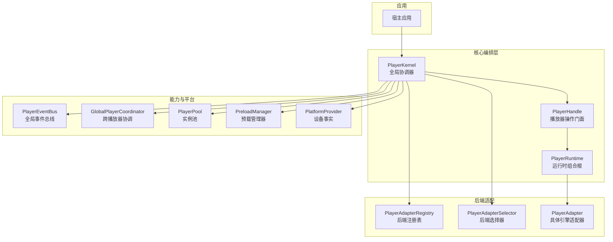
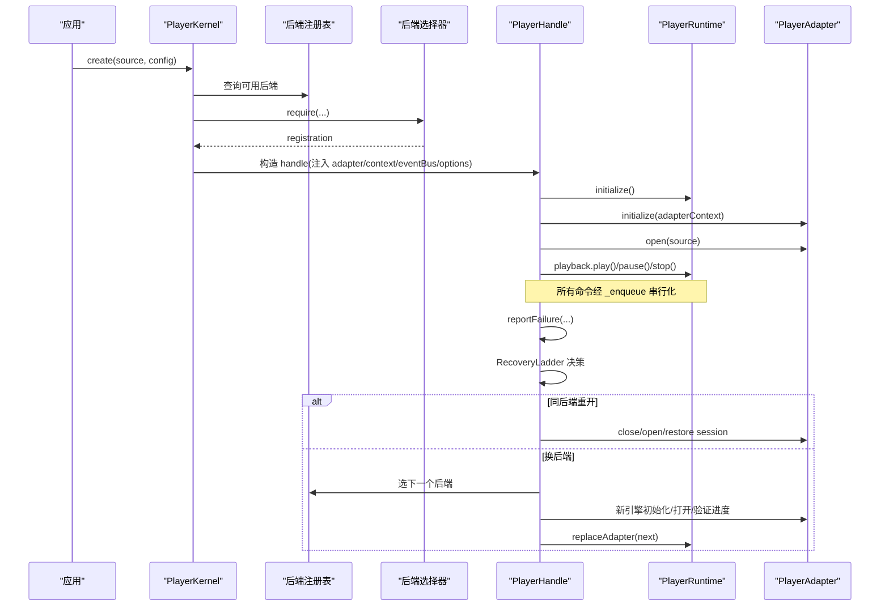
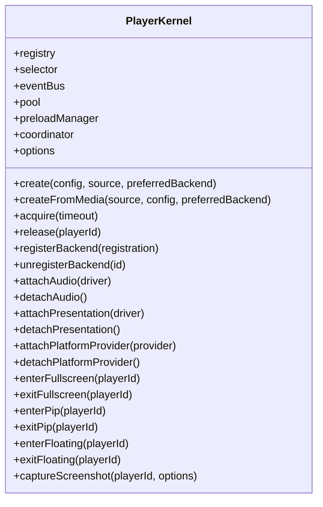
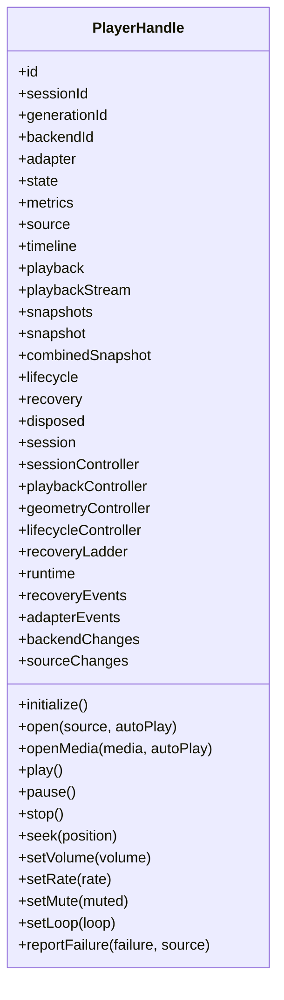
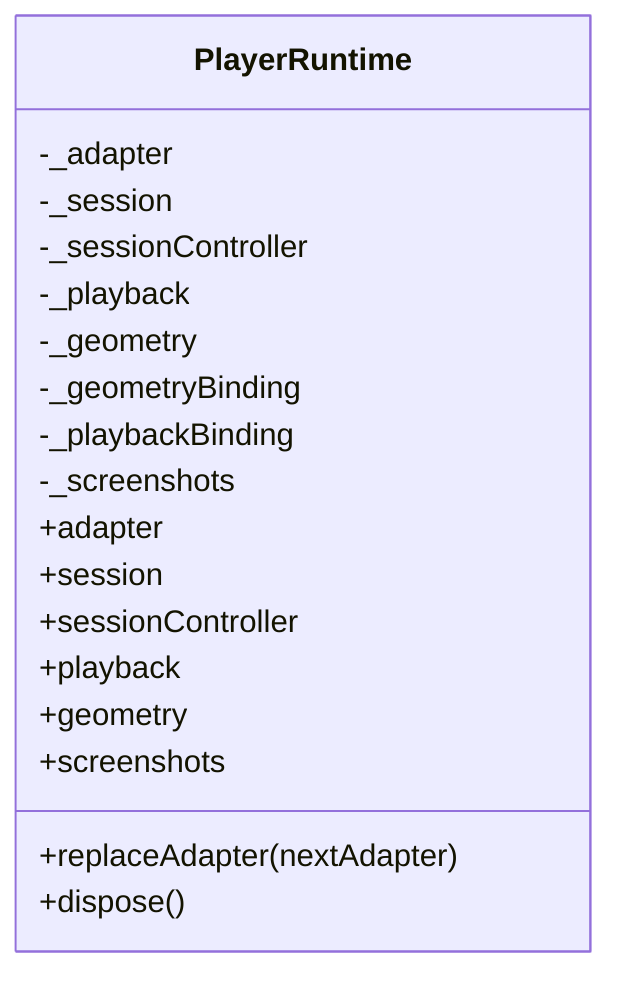
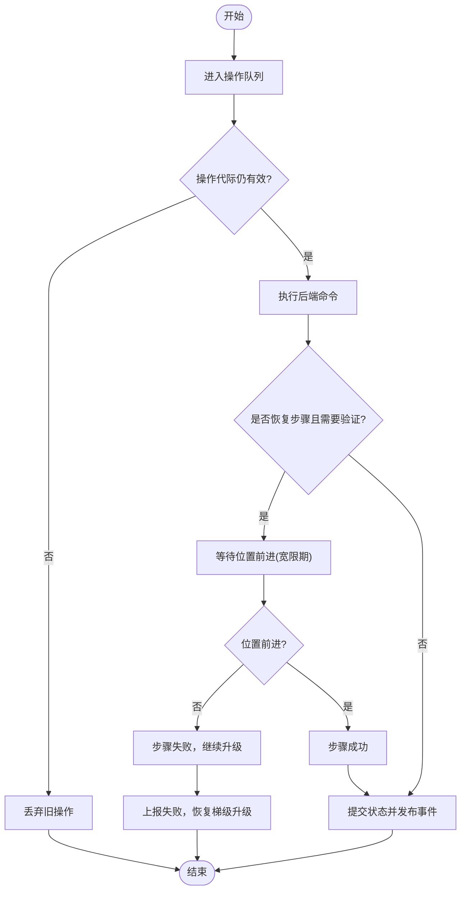
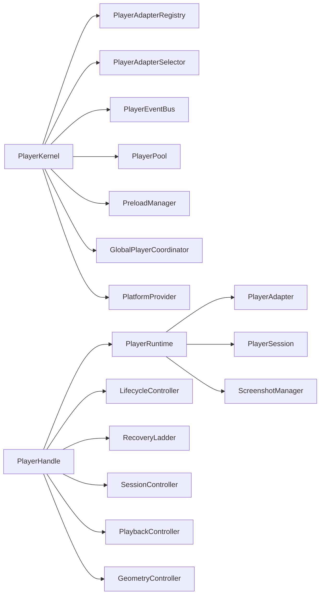

# 核心编排层

<cite>
**本文引用的文件**   
- [README.md](file://README.md)
- [packages/media_core/README.md](file://packages/media_core/README.md)
- [packages/media_core/media_core_architecture_guide.md](file://packages/media_core/media_core_architecture_guide.md)
- [doc/en/architecture.md](file://doc/en/architecture.md)
- [packages/media_core/lib/kernel/player_kernel.dart](file://packages/media_core/lib/kernel/player_kernel.dart)
- [packages/media_core/lib/kernel/player_handle.dart](file://packages/media_core/lib/kernel/player_handle.dart)
- [packages/media_core/lib/kernel/player_handle_operations.dart](file://packages/media_core/lib/kernel/player_handle_operations.dart)
- [packages/media_core/lib/kernel/player_handle_playback.dart](file://packages/media_core/lib/kernel/player_handle_playback.dart)
- [packages/media_core/lib/kernel/player_handle_recovery.dart](file://packages/media_core/lib/kernel/player_handle_recovery.dart)
- [packages/media_core/lib/runtime/player_runtime.dart](file://packages/media_core/lib/runtime/player_runtime.dart)
</cite>

## 目录
1. [引言](#引言)
2. [项目结构](#项目结构)
3. [核心组件](#核心组件)
4. [架构总览](#架构总览)
5. [详细组件分析](#详细组件分析)
6. [依赖关系分析](#依赖关系分析)
7. [性能与内存管理](#性能与内存管理)
8. [故障排查指南](#故障排查指南)
9. [结论](#结论)
10. [附录：使用示例与最佳实践](#附录使用示例与最佳实践)

## 引言
本文件聚焦 Media Core 的“核心编排层”，目标是帮助初学者理解 PlayerKernel、PlayerHandle、PlayerRuntime 的职责边界与协作方式，同时为高级开发者提供实现细节、扩展点与自定义指南。核心编排层不关心具体解码引擎如何实现，而是把“选择后端、会话与代际、命令串行化、恢复决策、池化、事件归一化”这些每个播放器都会重复造轮子的难点抽象成模块，并通过清晰的组合根和门面暴露简洁 API。

## 项目结构
仓库采用“核心包 + 能力包 + 后端适配包”的分层组织：
- 核心包 `media_core` 提供编排内核、门面、运行时、恢复、调度、事件等纯 Dart/Flutter 逻辑。
- 能力包（如 UI、系统媒体面、直播、下载、录制）通过接口挂载到内核，核心不反向依赖它们。
- 后端适配包（media_kit、ijk、better_player、fvp）实现 `PlayerAdapter` 契约，由内核按协议/格式/能力打分选择。

图表来源
- [packages/media_core/lib/kernel/player_kernel.dart:50-101](file://packages/media_core/lib/kernel/player_kernel.dart#L50-L101)
- [packages/media_core/lib/kernel/player_handle.dart:111-147](file://packages/media_core/lib/kernel/player_handle.dart#L111-L147)
- [packages/media_core/lib/runtime/player_runtime.dart:16-37](file://packages/media_core/lib/runtime/player_runtime.dart#L16-L37)

章节来源
- [README.md:55-81](file://README.md#L55-L81)
- [packages/media_core/README.md:69-87](file://packages/media_core/README.md#L69-L87)

## 核心组件
- PlayerKernel：全局协调器，负责后端注册、源解析、后端选择、创建/释放播放器、全局事件、池化、预载、能力驱动挂载。
- PlayerHandle：单个播放器的门面，封装 open/play/pause/stop/seek/volume/rate/mute 等操作，串联生命周期、回放状态机、会话控制器、几何控制器、截图、恢复梯级。
- PlayerRuntime：运行时组合根，持有当前 adapter、session、playback、geometry，桥接 adapter 事件到状态控制器，并在恢复时替换 adapter。

职责边界要点：
- Kernel 不拥有单播放器状态，也不执行恢复；它提供上下文与资源。
- Handle 不选择或创建 adapter，只转发命令并执行恢复步骤。
- Runtime 不决定何时恢复或切换后端，只做运行时装配与事件桥接。

章节来源
- [packages/media_core/lib/kernel/player_kernel.dart:50-101](file://packages/media_core/lib/kernel/player_kernel.dart#L50-L101)
- [packages/media_core/lib/kernel/player_handle.dart:111-147](file://packages/media_core/lib/kernel/player_handle.dart#L111-L147)
- [packages/media_core/lib/runtime/player_runtime.dart:16-37](file://packages/media_core/lib/runtime/player_runtime.dart#L16-L37)

## 架构总览
核心编排层的关键流程如下：
- 应用调用 `kernel.create(...)` 或 `kernel.createFromMedia(...)`。
- Kernel 通过 SourceService 解析源，通过 Selector 从 Registry 选出最佳后端。
- Kernel 构造 PlayerHandle，注入 adapter、session、eventBus、options 等。
- Handle 内部组合 PlayerRuntime，绑定 playback/geometry/session 控制器。
- 所有公开操作进入 Handle 的操作队列串行执行，并由 GenerationId 守卫过期异步结果。
- 错误上报统一走 Handle 的 RecoveryLadder，唯一决策点决定同后端重开、换线路、换后端或放弃。

图表来源
- [packages/media_core/lib/kernel/player_kernel.dart:304-400](file://packages/media_core/lib/kernel/player_kernel.dart#L304-L400)
- [packages/media_core/lib/kernel/player_handle_playback.dart:96-280](file://packages/media_core/lib/kernel/player_handle_playback.dart#L96-L280)
- [packages/media_core/lib/kernel/player_handle_recovery.dart:323-441](file://packages/media_core/lib/kernel/player_handle_recovery.dart#L323-L441)
- [packages/media_core/lib/runtime/player_runtime.dart:127-173](file://packages/media_core/lib/runtime/player_runtime.dart#L127-L173)

## 详细组件分析

### PlayerKernel：全局协调器
- 职责
  - 注册/注销后端，记录优先级与能力。
  - 解析 MediaSource/PlayerSource，规划 DirectPlan/CompositePlan/UnsupportedPlan。
  - 选择最佳后端，构造 PlayerHandle，完成 initialize/open。
  - 维护全局事件总线、实例池、预载管理器、跨播放器协调器。
  - 挂载音频/呈现/平台能力驱动，处理应用前后台生命周期。
- 关键行为
  - `create`：解析源 → 选择后端 → 构造 handle → 初始化 → 可选自动播放。
  - `createFromMedia`：先规划复合源，再委托 create。
  - `acquire/release`：软复用与完全释放。
  - `attachAudio/attachPresentation/attachPlatformProvider`：能力驱动挂载。
  - `didChangeAppLifecycleState`：后台暂停、前台激活。

图表来源
- [packages/media_core/lib/kernel/player_kernel.dart:115-257](file://packages/media_core/lib/kernel/player_kernel.dart#L115-L257)
- [packages/media_core/lib/kernel/player_kernel.dart:268-440](file://packages/media_core/lib/kernel/player_kernel.dart#L268-L440)
- [packages/media_core/lib/kernel/player_kernel.dart:552-686](file://packages/media_core/lib/kernel/player_kernel.dart#L552-L686)
- [packages/media_core/lib/kernel/player_kernel.dart:873-907](file://packages/media_core/lib/kernel/player_kernel.dart#L873-L907)

章节来源
- [packages/media_core/lib/kernel/player_kernel.dart:50-101](file://packages/media_core/lib/kernel/player_kernel.dart#L50-L101)
- [packages/media_core/lib/kernel/player_kernel.dart:304-440](file://packages/media_core/lib/kernel/player_kernel.dart#L304-L440)
- [packages/media_core/lib/kernel/player_kernel.dart:873-907](file://packages/media_core/lib/kernel/player_kernel.dart#L873-L907)

### PlayerHandle：播放器操作门面
- 职责
  - 对外暴露 open/play/pause/stop/seek/volume/rate/mute/setLoop 等简洁 API。
  - 将命令序列化进队列，用 OperationGeneration 保护旧操作不被提交。
  - 维护 muted/volume/rate/audioOnly/loop 等偏好，跨后端恢复后重新应用。
  - 作为 RecoveryTarget 执行恢复步骤，发布 recoveryEvents/backendChanges/sourceChanges。
  - 聚合 session/playback/geometry/lifecycle/recovery 快照，暴露 combinedSnapshot。
- 关键设计
  - 门面不拥有 runtime 的内部控制器，但可访问其 snapshot/stream。
  - 恢复边界：只有 Handle 能启动恢复；其他模块通过 reportFailure 上报。
  - 操作记录：onOperation 流可观测每一步开始/完成/失败。

图表来源
- [packages/media_core/lib/kernel/player_handle.dart:162-227](file://packages/media_core/lib/kernel/player_handle.dart#L162-L227)
- [packages/media_core/lib/kernel/player_handle.dart:399-519](file://packages/media_core/lib/kernel/player_handle.dart#L399-L519)
- [packages/media_core/lib/kernel/player_handle.dart:521-553](file://packages/media_core/lib/kernel/player_handle.dart#L521-L553)

章节来源
- [packages/media_core/lib/kernel/player_handle.dart:111-147](file://packages/media_core/lib/kernel/player_handle.dart#L111-L147)
- [packages/media_core/lib/kernel/player_handle.dart:162-227](file://packages/media_core/lib/kernel/player_handle.dart#L162-L227)
- [packages/media_core/lib/kernel/player_handle.dart:399-519](file://packages/media_core/lib/kernel/player_handle.dart#L399-L519)

### PlayerRuntime：运行时组合根
- 职责
  - 持有当前 adapter、session、playback、geometry。
  - 建立 geometryBinding/playbackBinding，将 adapter 事件映射到控制器。
  - 在恢复期间替换 adapter，重建绑定，清空旧几何状态。
  - 持有 ScreenshotManager，桥接引擎抓帧与渲染面抓取。
- 关键行为
  - `replaceAdapter(nextAdapter)`：解绑旧 adapter → 替换 → 重建绑定。
  - `dispose()`：按顺序解绑、停止、释放截图、控制器、adapter。

图表来源
- [packages/media_core/lib/runtime/player_runtime.dart:38-102](file://packages/media_core/lib/runtime/player_runtime.dart#L38-L102)
- [packages/media_core/lib/runtime/player_runtime.dart:127-173](file://packages/media_core/lib/runtime/player_runtime.dart#L127-L173)
- [packages/media_core/lib/runtime/player_runtime.dart:175-202](file://packages/media_core/lib/runtime/player_runtime.dart#L175-L202)

章节来源
- [packages/media_core/lib/runtime/player_runtime.dart:16-37](file://packages/media_core/lib/runtime/player_runtime.dart#L16-L37)
- [packages/media_core/lib/runtime/player_runtime.dart:127-173](file://packages/media_core/lib/runtime/player_runtime.dart#L127-L173)

### 操作序列与恢复时序
- 命令串行化：所有公开操作通过 `_enqueue` 排队，避免并发破坏状态。
- 代际守卫：每次 destructive 生命周期转换递增 `_operationGeneration`，旧操作检查失败即丢弃。
- 恢复验证：恢复步骤成功后需证明“位置确实在前进”，否则视为失败继续升级。

图表来源
- [packages/media_core/lib/kernel/player_handle_operations.dart:200-225](file://packages/media_core/lib/kernel/player_handle_operations.dart#L200-L225)
- [packages/media_core/lib/kernel/player_handle_operations.dart:132-182](file://packages/media_core/lib/kernel/player_handle_operations.dart#L132-L182)
- [packages/media_core/lib/kernel/player_handle_recovery.dart:138-194](file://packages/media_core/lib/kernel/player_handle_recovery.dart#L138-L194)

章节来源
- [packages/media_core/lib/kernel/player_handle_operations.dart:1-258](file://packages/media_core/lib/kernel/player_handle_operations.dart#L1-L258)
- [packages/media_core/lib/kernel/player_handle_recovery.dart:138-194](file://packages/media_core/lib/kernel/player_handle_recovery.dart#L138-L194)

## 依赖关系分析
- 耦合与内聚
  - Kernel 高内聚于“全局资源与协调”，低耦合于具体引擎。
  - Handle 高内聚于“单播放器门面与恢复执行”，通过 Runtime 降低对 adapter 的直接依赖。
  - Runtime 高内聚于“运行时装配与事件桥接”，不介入策略决策。
- 直接/间接依赖
  - Kernel 依赖 Registry/Selector/EventBus/Pool/Preload/Coordinator/PlatformProvider。
  - Handle 依赖 Runtime/LifecycleController/RecoveryLadder/SessionController/PlaybackController/GeometryController。
  - Runtime 依赖 Adapter/Session/Playback/Geometry/ScreenshotManager。
- 外部集成点
  - 能力包通过 KernelAudioDriver/KernelPresentationDriver/PlatformProvider 挂载。
  - 后端适配包实现 PlayerAdapter 契约。

图表来源
- [packages/media_core/lib/kernel/player_kernel.dart:115-257](file://packages/media_core/lib/kernel/player_kernel.dart#L115-L257)
- [packages/media_core/lib/kernel/player_handle.dart:162-227](file://packages/media_core/lib/kernel/player_handle.dart#L162-L227)
- [packages/media_core/lib/runtime/player_runtime.dart:38-102](file://packages/media_core/lib/runtime/player_runtime.dart#L38-L102)

章节来源
- [packages/media_core/lib/kernel/player_kernel.dart:115-257](file://packages/media_core/lib/kernel/player_kernel.dart#L115-L257)
- [packages/media_core/lib/kernel/player_handle.dart:162-227](file://packages/media_core/lib/kernel/player_handle.dart#L162-L227)
- [packages/media_core/lib/runtime/player_runtime.dart:38-102](file://packages/media_core/lib/runtime/player_runtime.dart#L38-L102)

## 性能与内存管理
- 性能特性
  - 命令串行化避免原生调用乱序，减少竞态与无效重建。
  - 池化（PlayerPool）+ 软复用（recycle/acquire）减少解码器重建成本。
  - 预载（PreloadManager）按优先级预热下一项，提升滑动/列表体验。
  - 恢复验证确保“真正播放”才认为修复成功，避免假成功导致后续卡顿。
- 内存管理
  - Kernel 按打开的 handle 数量上报内存估算值，配合 MemoryAccount 进行压力评估。
  - Runtime.dispose 按顺序解绑、释放截图、控制器与 adapter，防止泄漏。
  - Handle.dispose 清理订阅、控制器、截图通道与操作记录，避免长期引用。
- 优化建议
  - 合理设置 `KernelOptions.maxRecoveryAttempts/maxFallbackAttempts` 与退避延迟。
  - 在 feed/list/multiview 场景启用池化，避免频繁创建销毁。
  - 使用 `player.recoveryEvents` 观察恢复过程，结合日志定位瓶颈。

章节来源
- [packages/media_core/lib/kernel/player_kernel.dart:845-859](file://packages/media_core/lib/kernel/player_kernel.dart#L845-L859)
- [packages/media_core/lib/runtime/player_runtime.dart:175-202](file://packages/media_core/lib/runtime/player_runtime.dart#L175-L202)
- [packages/media_core/lib/kernel/player_handle.dart:689-747](file://packages/media_core/lib/kernel/player_handle.dart#L689-L747)

## 故障排查指南
- 常见问题
  - 无后端注册：`PlayerKernel.create` 会抛 `StateError`，需先 `registerBackend`。
  - 恢复耗尽：`recoveryEvents` 出现 exhausted，检查候选源与后端能力。
  - 恢复假成功：确认 `_verifyPlayback` 是否检测到位置前进。
  - 事件风暴：多个恢复循环并行会导致 adapter 频繁创建/销毁，应关闭多余恢复路径。
- 诊断手段
  - 监听 `handle.onOperation` 查看操作顺序与失败原因。
  - 监听 `handle.recoveryEvents` 观察恢复步骤与终态。
  - 使用 `handle.combinedSnapshot` 获取一次性快照，便于调试 UI 与状态不一致。
  - 开启分级日志，按分类提高级别，缩小问题范围。

章节来源
- [packages/media_core/lib/kernel/player_handle_recovery.dart:76-117](file://packages/media_core/lib/kernel/player_handle_recovery.dart#L76-L117)
- [packages/media_core/lib/kernel/player_handle_recovery.dart:541-634](file://packages/media_core/lib/kernel/player_handle_recovery.dart#L541-L634)
- [packages/media_core/lib/kernel/player_handle_operations.dart:1-54](file://packages/media_core/lib/kernel/player_handle_operations.dart#L1-L54)

## 结论
核心编排层通过 PlayerKernel 的全局协调、PlayerHandle 的门面封装、PlayerRuntime 的组合装配，将复杂的播放器状态、恢复与资源管理收敛到清晰边界内。消费者只需关注 handle 的简洁 API 与事件流，无需关心底层引擎差异；高级用户可通过能力驱动、后端注册、恢复策略与池化配置定制行为。该设计以“一个决策点、序列化即正确性、能力靠声明”为原则，兼顾稳定性与可扩展性。

## 附录：使用示例与最佳实践
- 快速接入
  - 初始化引擎与系统媒体面。
  - 创建 kernel 并注册后端。
  - 调用 `kernel.create` 传入 source 与 config。
  - 使用 `MediaCorePlayerView(handle: handle)` 显示视频与控制条。
- 代码示例路径
  - 快速接入示例入口：[README.md:14-43](file://README.md#L14-L43)
  - 包内用法示例：[packages/media_core/README.md:14-44](file://packages/media_core/README.md#L14-L44)
- 最佳实践
  - 始终注册至少一个后端，避免静默退化。
  - 使用 `planFor` 或 `createFromMedia` 提前判断是否支持复合源。
  - 在列表/信息流场景启用池化与预载，减少抖动。
  - 通过 `recoveryEvents` 与 `onOperation` 做可观测性与埋点。
  - 谨慎调整恢复预算与退避策略，避免过度重试影响用户体验。

章节来源
- [README.md:14-43](file://README.md#L14-L43)
- [packages/media_core/README.md:14-44](file://packages/media_core/README.md#L14-L44)