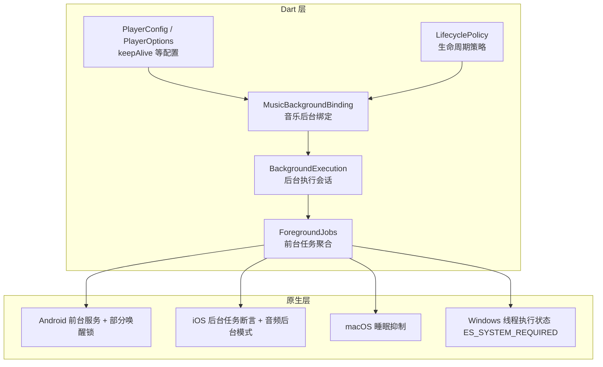
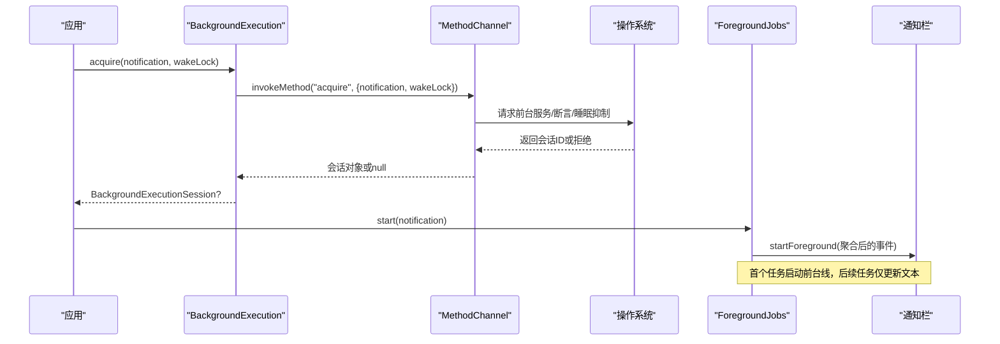
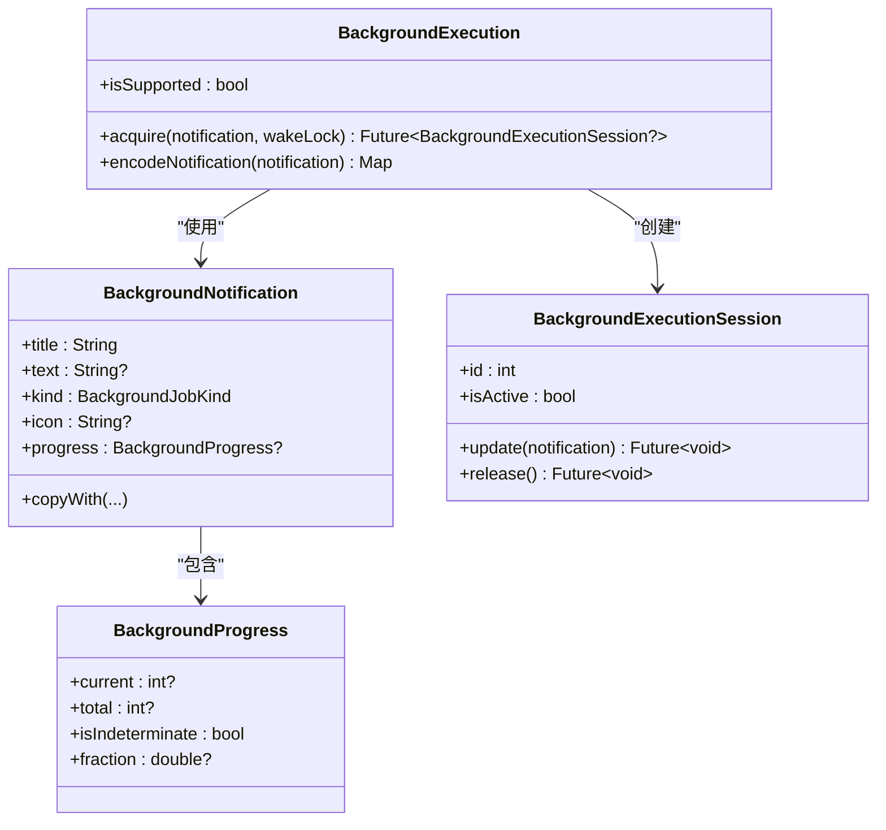
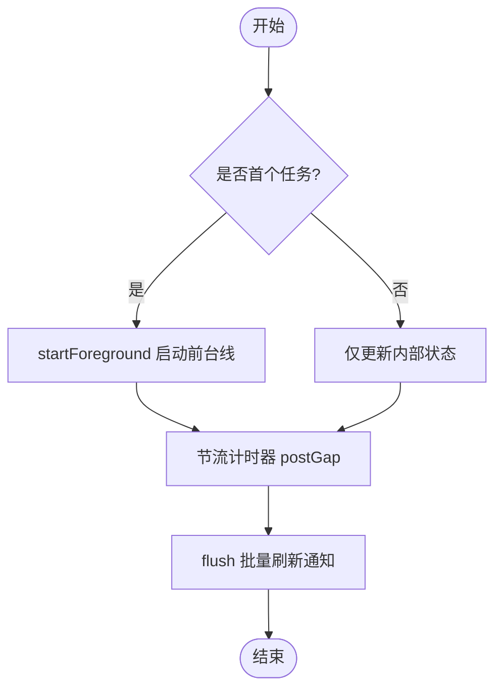
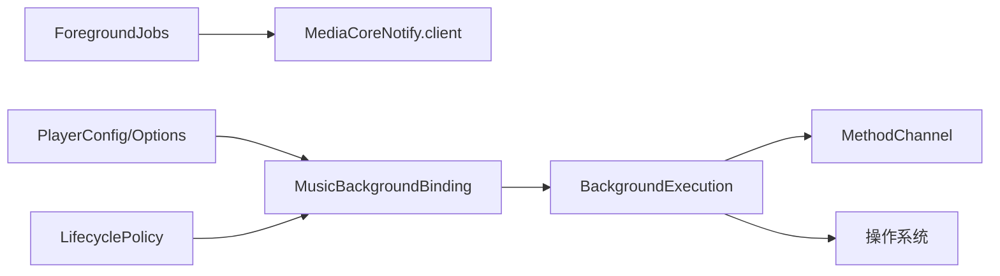

# 后台保活机制

<cite>
**本文引用的文件**   
- [background_execution.dart](file://packages/media_core_native/lib/src/background_execution.dart)
- [foreground_jobs.dart](file://packages/media_core_notify/lib/src/foreground_jobs.dart)
- [background_execution_demo.dart](file://example/lib/demos/console/background_execution_demo.dart)
- [music_background_binding.dart](file://packages/media_core_audio/lib/src/background/music_background_binding.dart)
- [player_config.dart](file://packages/media_core/lib/core/player_config.dart)
- [player_options.dart](file://packages/media_core/lib/core/player_options.dart)
- [lifecycle_policy.dart](file://packages/media_core/lib/policy/lifecycle_policy.dart)
- [background_execution.cc](file://packages/media_core_native/windows/background_execution.cc)
</cite>

## 目录
1. [简介](#简介)
2. [项目结构](#项目结构)
3. [核心组件](#核心组件)
4. [架构总览](#架构总览)
5. [详细组件分析](#详细组件分析)
6. [依赖关系分析](#依赖关系分析)
7. [性能与功耗考量](#性能与功耗考量)
8. [故障排查指南](#故障排查指南)
9. [结论](#结论)
10. [附录](#附录)

## 简介
本文面向 Media Core 在应用进入后台时的资源管理与生命周期控制，系统性说明后台保活机制的设计与实现。内容覆盖：
- 前台服务与后台任务：Android 前台服务、iOS 后台音频任务、桌面平台进程保活策略
- 唤醒锁管理：CPU 唤醒锁、屏幕唤醒锁、网络唤醒锁的使用与边界
- 防休眠策略：系统休眠抑制、电池优化适配、低电量模式处理
- 权限与清单：后台播放权限、通知权限、平台特定配置
- 健壮性：内存泄漏防护、资源清理、异常恢复
- 场景化策略选择与性能调优建议
- 常见问题排查与调试方法

## 项目结构
围绕后台保活能力，代码主要分布在以下模块：
- media_core_native：跨平台通道与原生能力封装（Android/iOS/macOS/Windows）
- media_core_notify：前台任务聚合与通知展示
- media_core_audio：音乐播放的后台绑定与音频会话
- media_core：播放器配置、选项与生命周期策略
- example：后台执行演示用例

图表来源
- [background_execution.dart:186-283](file://packages/media_core_native/lib/src/background_execution.dart#L186-L283)
- [foreground_jobs.dart:70-141](file://packages/media_core_notify/lib/src/foreground_jobs.dart#L70-L141)
- [music_background_binding.dart:42-42](file://packages/media_core_audio/lib/src/background/music_background_binding.dart#L42-L42)
- [player_config.dart:33-33](file://packages/media_core/lib/core/player_config.dart#L33-L33)
- [player_options.dart:27-27](file://packages/media_core/lib/core/player_options.dart#L27-L27)
- [lifecycle_policy.dart:31-31](file://packages/media_core/lib/policy/lifecycle_policy.dart#L31-L31)

章节来源
- [background_execution.dart:131-185](file://packages/media_core_native/lib/src/background_execution.dart#L131-L185)
- [foreground_jobs.dart:1-13](file://packages/media_core_notify/lib/src/foreground_jobs.dart#L1-L13)

## 核心组件
- BackgroundExecution：跨平台后台执行入口，负责申请会话、通知描述、唤醒锁开关、与原生通道交互
- BackgroundNotification / BackgroundProgress：通知内容与进度模型
- BackgroundExecutionSession：会话句柄，支持更新通知与释放资源
- ForegroundJobs：多任务聚合的前台通知线，统一节流与状态管理
- MusicBackgroundBinding：音乐播放的后台绑定，协调媒体会话与后台保活
- PlayerConfig / PlayerOptions / LifecyclePolicy：播放器侧 keepAlive 与生命周期策略配置

章节来源
- [background_execution.dart:44-129](file://packages/media_core_native/lib/src/background_execution.dart#L44-L129)
- [background_execution.dart:186-283](file://packages/media_core_native/lib/src/background_execution.dart#L186-L283)
- [background_execution.dart:285-373](file://packages/media_core_native/lib/src/background_execution.dart#L285-L373)
- [foreground_jobs.dart:25-67](file://packages/media_core_notify/lib/src/foreground_jobs.dart#L25-L67)
- [foreground_jobs.dart:70-141](file://packages/media_core_notify/lib/src/foreground_jobs.dart#L70-L141)
- [music_background_binding.dart:42-42](file://packages/media_core_audio/lib/src/background/music_background_binding.dart#L42-L42)
- [player_config.dart:33-33](file://packages/media_core/lib/core/player_config.dart#L33-L33)
- [player_options.dart:27-27](file://packages/media_core/lib/core/player_options.dart#L27-L27)
- [lifecycle_policy.dart:31-31](file://packages/media_core/lib/policy/lifecycle_policy.dart#L31-L31)

## 架构总览
后台保活的整体流程如下：
- Dart 层通过 BackgroundExecution.acquire 申请后台会话，传入通知描述与是否启用唤醒锁
- 原生层根据平台能力启动前台服务或设置系统级保活（Android/iOS/macOS/Windows）
- ForegroundJobs 聚合多个后台任务，统一维护前台通知线并节流刷新
- 业务侧（如音乐播放）通过 MusicBackgroundBinding 将媒体会话与后台保活关联
- 播放器配置中的 keepAlive 与生命周期策略影响保活行为

图表来源
- [background_execution.dart:227-257](file://packages/media_core_native/lib/src/background_execution.dart#L227-L257)
- [foreground_jobs.dart:102-126](file://packages/media_core_notify/lib/src/foreground_jobs.dart#L102-L126)

## 详细组件分析

### BackgroundExecution 与 BackgroundExecutionSession
- 作用
  - 提供统一的后台执行入口，屏蔽 Android/iOS/macOS/Windows 差异
  - 支持可选 CPU 唤醒锁，避免屏幕关闭后进程被冻结
  - 对通知进行编码并通过 MethodChannel 下发到原生层
- 关键行为
  - isSupported：判断平台是否支持后台执行
  - acquire：申请会话，失败时返回 null 但不中断任务
  - encodeNotification：将通知与进度序列化为平台可读的结构
  - Session.update/release：幂等更新通知与释放资源，保证异常路径不泄露
- 平台语义
  - Android：前台服务 + 部分唤醒锁 + 通知（Android 13+ 需要通知权限）
  - iOS：后台任务断言（过渡窗口），长期任务需声明 audio 后台模式
  - macOS：阻止系统空闲休眠
  - Windows：SetThreadExecutionState(ES_SYSTEM_REQUIRED)，显示可关闭但系统保持唤醒
  - Linux：当前未实现，返回 null

图表来源
- [background_execution.dart:44-129](file://packages/media_core_native/lib/src/background_execution.dart#L44-L129)
- [background_execution.dart:186-283](file://packages/media_core_native/lib/src/background_execution.dart#L186-L283)
- [background_execution.dart:285-373](file://packages/media_core_native/lib/src/background_execution.dart#L285-L373)

章节来源
- [background_execution.dart:131-185](file://packages/media_core_native/lib/src/background_execution.dart#L131-L185)
- [background_execution.dart:227-283](file://packages/media_core_native/lib/src/background_execution.dart#L227-L283)
- [background_execution.dart:285-373](file://packages/media_core_native/lib/src/background_execution.dart#L285-L373)

### ForegroundJobs 前台任务聚合
- 作用
  - 将多个后台任务合并为一条前台通知线，避免重复通知与服务
  - 首次任务启动前台服务，后续任务仅更新文本；最后一个任务结束则停止前台服务
  - 节流刷新，避免高频字节更新导致通知抖动
- 关键行为
  - start：注册任务，首个任务触发 startForeground
  - stopAll：清理所有任务并停止前台服务
  - update/release：幂等操作，防止重复释放或复活已结束的任务
  - _repaint/_flush：节流与批量刷新通知

图表来源
- [foreground_jobs.dart:102-141](file://packages/media_core_notify/lib/src/foreground_jobs.dart#L102-L141)
- [foreground_jobs.dart:190-237](file://packages/media_core_notify/lib/src/foreground_jobs.dart#L190-L237)

章节来源
- [foreground_jobs.dart:1-13](file://packages/media_core_notify/lib/src/foreground_jobs.dart#L1-L13)
- [foreground_jobs.dart:25-67](file://packages/media_core_notify/lib/src/foreground_jobs.dart#L25-L67)
- [foreground_jobs.dart:70-141](file://packages/media_core_notify/lib/src/foreground_jobs.dart#L70-L141)
- [foreground_jobs.dart:190-237](file://packages/media_core_notify/lib/src/foreground_jobs.dart#L190-L237)

### MusicBackgroundBinding 音乐后台绑定
- 作用
  - 将音乐播放与后台保活绑定，确保进入后台后仍可继续播放
  - 与媒体会话、通知、后台执行会话协同工作
- 关键点
  - 作为外部调用方持有后台会话的生命周期
  - 与播放器配置 keepAlive 及生命周期策略配合

章节来源
- [music_background_binding.dart:42-42](file://packages/media_core_audio/lib/src/background/music_background_binding.dart#L42-L42)

### 播放器配置与生命周期策略
- keepAlive 字段
  - PlayerConfig 与 PlayerOptions 均提供 keepAlive，默认开启，用于控制后台保活行为
- LifecyclePolicy
  - keepAliveInBackground 控制后台是否保持活跃，影响播放器在后台的行为

章节来源
- [player_config.dart:33-33](file://packages/media_core/lib/core/player_config.dart#L33-L33)
- [player_options.dart:27-27](file://packages/media_core/lib/core/player_options.dart#L27-L27)
- [lifecycle_policy.dart:31-31](file://packages/media_core/lib/policy/lifecycle_policy.dart#L31-L31)

### 示例与用法
- background_execution_demo.dart
  - 演示如何申请后台会话、更新通知、处理平台拒绝与权限问题
  - 强调 Android 前台服务与部分唤醒锁、iOS 过渡窗口限制、Linux 未实现等

章节来源
- [background_execution_demo.dart:6-6](file://example/lib/demos/console/background_execution_demo.dart#L6-L6)
- [background_execution_demo.dart:34-34](file://example/lib/demos/console/background_execution_demo.dart#L34-L34)
- [background_execution_demo.dart:53-55](file://example/lib/demos/console/background_execution_demo.dart#L53-L55)
- [background_execution_demo.dart:112-112](file://example/lib/demos/console/background_execution_demo.dart#L112-L112)

## 依赖关系分析
- Dart 层依赖
  - BackgroundExecution 依赖 MethodChannel 与平台能力探测
  - ForegroundJobs 依赖 MediaCoreNotify.client 以启动/更新前台通知
  - MusicBackgroundBinding 依赖 BackgroundExecution 与媒体会话
  - PlayerConfig/PlayerOptions/LifecyclePolicy 提供 keepAlive 相关配置
- 原生层依赖
  - Android：前台服务、通知渠道、部分唤醒锁
  - iOS：后台任务断言、音频后台模式
  - macOS：睡眠抑制
  - Windows：线程执行状态 ES_SYSTEM_REQUIRED

图表来源
- [background_execution.dart:186-283](file://packages/media_core_native/lib/src/background_execution.dart#L186-L283)
- [foreground_jobs.dart:102-141](file://packages/media_core_notify/lib/src/foreground_jobs.dart#L102-L141)
- [music_background_binding.dart:42-42](file://packages/media_core_audio/lib/src/background/music_background_binding.dart#L42-L42)
- [player_config.dart:33-33](file://packages/media_core/lib/core/player_config.dart#L33-L33)
- [player_options.dart:27-27](file://packages/media_core/lib/core/player_options.dart#L27-L27)
- [lifecycle_policy.dart:31-31](file://packages/media_core/lib/policy/lifecycle_policy.dart#L31-L31)

章节来源
- [background_execution.dart:186-283](file://packages/media_core_native/lib/src/background_execution.dart#L186-L283)
- [foreground_jobs.dart:102-141](file://packages/media_core_notify/lib/src/foreground_jobs.dart#L102-L141)

## 性能与功耗考量
- 唤醒锁策略
  - 仅在必要时启用 wakeLock=true，避免不必要的 CPU 唤醒
  - Android 前台服务与部分唤醒锁组合，屏幕关闭时仍保持计算
- 通知刷新节流
  - ForegroundJobs.postGap 限制通知重绘频率，避免频繁 UI 动画
- 平台差异
  - iOS 后台断言仅提供过渡时间，长期任务需音频后台模式
  - Windows 使用 ES_SYSTEM_REQUIRED，显示可关闭但系统保持唤醒
- 资源清理
  - Session.release 与 ForegroundJobs.stopAll 确保异常路径下不残留前台服务或通知

章节来源
- [background_execution.dart:213-226](file://packages/media_core_native/lib/src/background_execution.dart#L213-L226)
- [foreground_jobs.dart:71-73](file://packages/media_core_notify/lib/src/foreground_jobs.dart#L71-L73)
- [foreground_jobs.dart:128-141](file://packages/media_core_notify/lib/src/foreground_jobs.dart#L128-L141)

## 故障排查指南
- 通知权限问题（Android 13+）
  - 现象：前台服务启动成功但无通知
  - 原因：POST_NOTIFICATIONS 权限被拒绝
  - 处理：插件会在有 Activity 时主动申请；拒绝不影响保活，仅隐藏通知
- 平台不支持或原生缺失
  - 现象：acquire 返回 null
  - 原因：平台未实现或 MissingPluginException
  - 处理：任务继续运行，但可能因系统策略被冻结；检查平台支持与插件注册
- iOS 后台限制
  - 现象：录制/下载在后台很快被挂起
  - 原因：仅靠断言无法获得长时间运行；需声明 audio 后台模式并保持音频会话活动
- 通知未更新或重复
  - 现象：通知长时间不刷新或重复出现
  - 原因：未调用 update 或 release 非幂等调用
  - 处理：使用 Session.update 与 Session.release；确认 ForegroundJobs 节流逻辑正常
- 资源未释放
  - 现象：退出后仍有前台服务或通知
  - 原因：未在 finally 中释放会话
  - 处理：确保 try/finally 包裹 acquire/release；使用 ForegroundJobs.stopAll 做全局清理

章节来源
- [background_execution.dart:161-178](file://packages/media_core_native/lib/src/background_execution.dart#L161-L178)
- [background_execution.dart:246-257](file://packages/media_core_native/lib/src/background_execution.dart#L246-L257)
- [background_execution.dart:351-368](file://packages/media_core_native/lib/src/background_execution.dart#L351-L368)
- [foreground_jobs.dart:128-141](file://packages/media_core_notify/lib/src/foreground_jobs.dart#L128-L141)

## 结论
Media Core 的后台保活机制通过 Dart 层的统一抽象与原生平台的差异化实现，提供了跨平台的后台任务保护与前台通知聚合。其设计强调：
- 明确的会话生命周期与幂等操作，避免资源泄露
- 按需启用唤醒锁，平衡保活与功耗
- 平台能力的诚实暴露与降级策略
- 通知聚合与节流，提升用户体验
在实际工程中，应结合播放器 keepAlive 与生命周期策略，按场景选择合适的保活方案，并在异常路径中严格释放资源。

## 附录
- 平台能力对照
  - Android：前台服务 + 部分唤醒锁 + 通知（Android 13+ 通知权限）
  - iOS：后台任务断言（过渡窗口）+ 音频后台模式（长期任务）
  - macOS：睡眠抑制
  - Windows：ES_SYSTEM_REQUIRED（系统保持唤醒，显示可关闭）
  - Linux：暂未实现

章节来源
- [background_execution.dart:138-145](file://packages/media_core_native/lib/src/background_execution.dart#L138-L145)
- [background_execution.cc:1-1](file://packages/media_core_native/windows/background_execution.cc#L1-L1)