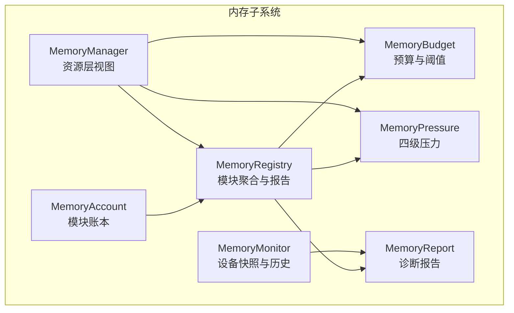
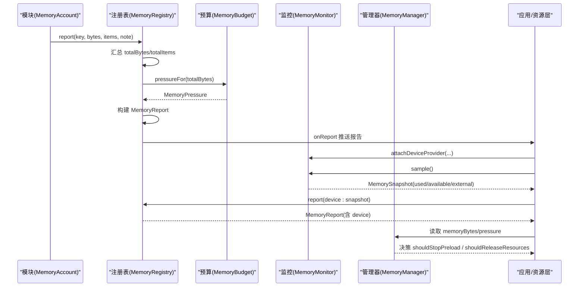
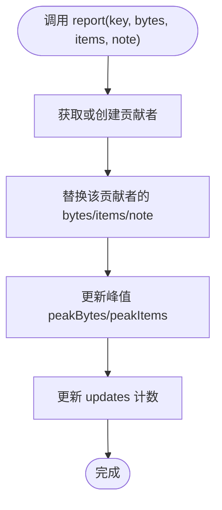
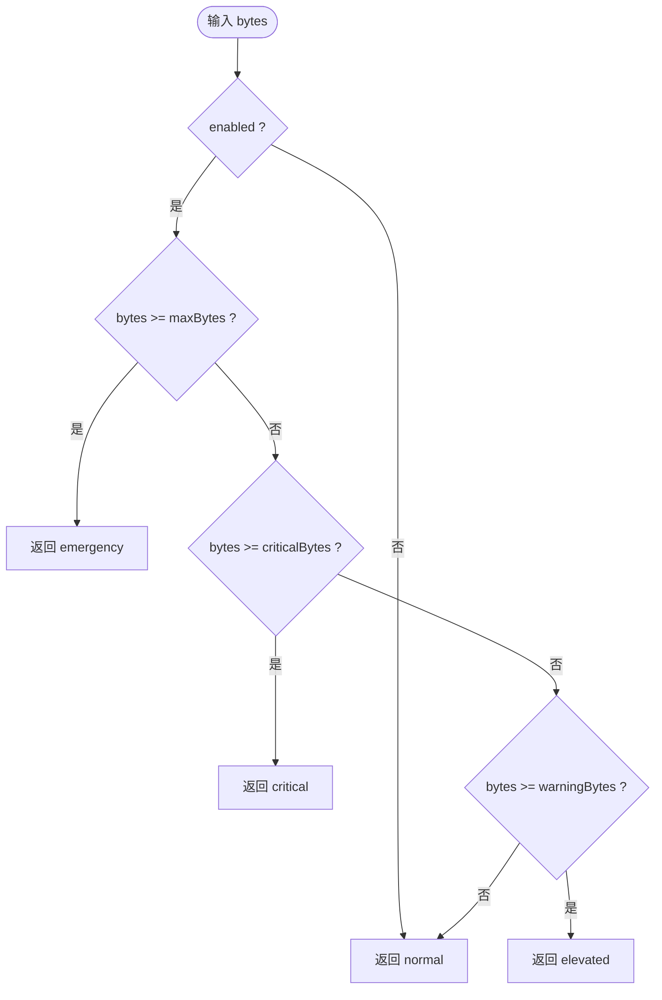
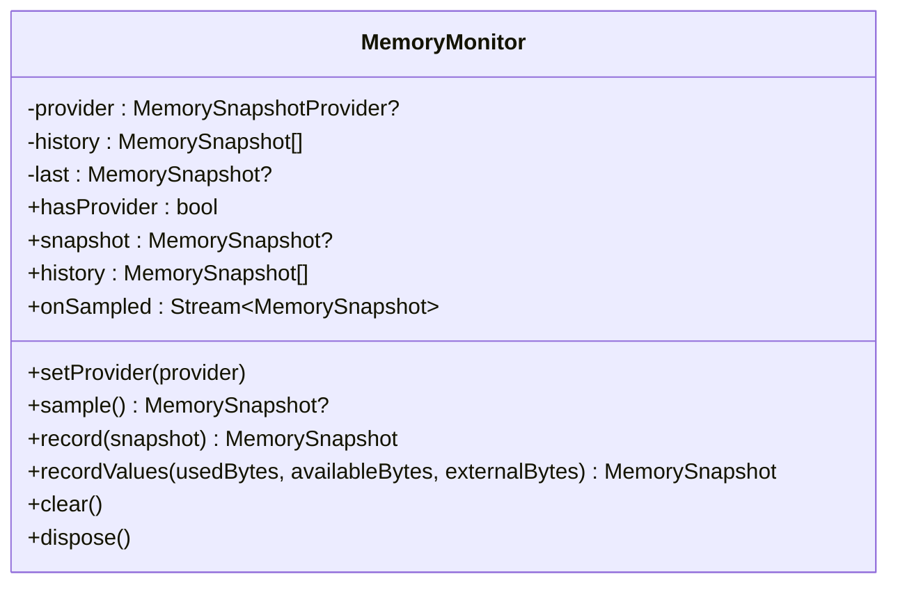
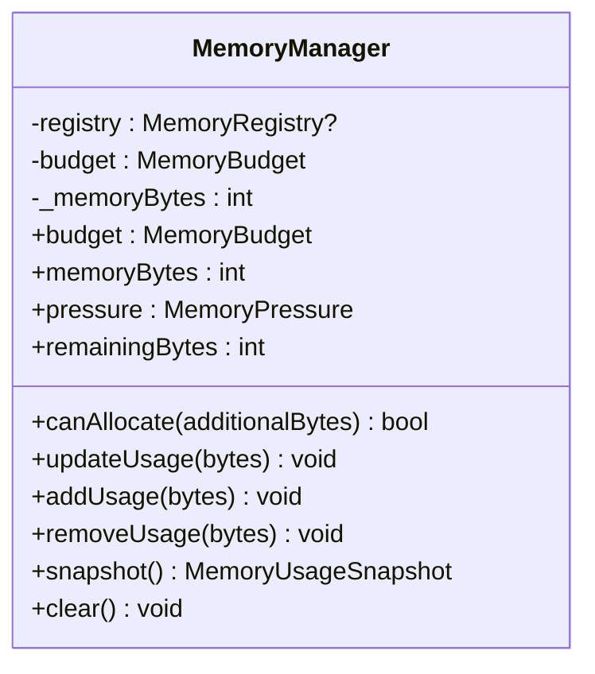
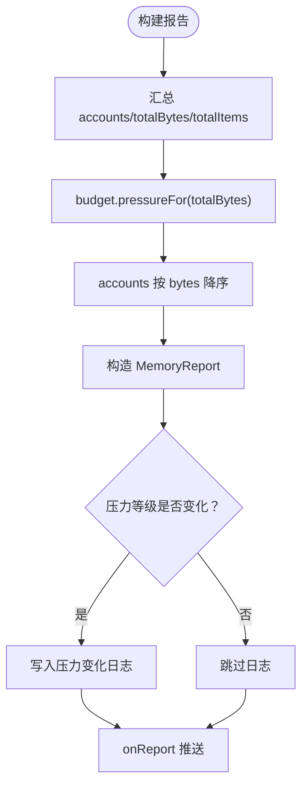
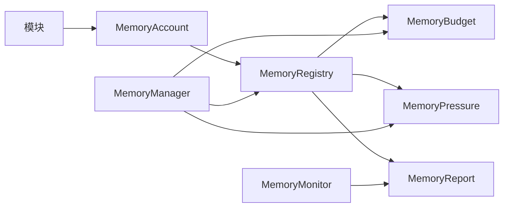

# 内存监控与压力感知

<cite>
**本文引用的文件**   
- [packages/media_core_memory/lib/media_core_memory.dart](file://packages/media_core_memory/lib/media_core_memory.dart)
- [packages/media_core_memory/README.md](file://packages/media_core_memory/README.md)
- [packages/media_core_memory/lib/src/memory_manager.dart](file://packages/media_core_memory/lib/src/memory_manager.dart)
- [packages/media_core_memory/lib/src/memory_monitor.dart](file://packages/media_core_memory/lib/src/memory_monitor.dart)
- [packages/media_core_memory/lib/src/memory_budget.dart](file://packages/media_core_memory/lib/src/memory_budget.dart)
- [packages/media_core_memory/lib/src/memory_pressure.dart](file://packages/media_core_memory/lib/src/memory_pressure.dart)
- [packages/media_core_memory/lib/src/memory_registry.dart](file://packages/media_core_memory/lib/src/memory_registry.dart)
- [packages/media_core_memory/lib/src/memory_account.dart](file://packages/media_core_memory/lib/src/memory_account.dart)
- [packages/media_core_memory/lib/src/memory_report.dart](file://packages/media_core_memory/lib/src/memory_report.dart)
- [example/lib/pages/memory_demo_page.dart](file://example/lib/pages/memory_demo_page.dart)
- [example/lib/demos/console/memory_demo.dart](file://example/lib/demos/console/memory_demo.dart)
</cite>

## 目录
1. [引言](#引言)
2. [项目结构](#项目结构)
3. [核心组件](#核心组件)
4. [架构总览](#架构总览)
5. [详细组件分析](#详细组件分析)
6. [依赖关系分析](#依赖关系分析)
7. [性能与采集策略](#性能与采集策略)
8. [平台内存 API 适配说明](#平台内存-api-适配说明)
9. [内存优化最佳实践](#内存优化最佳实践)
10. [问题排查指南](#问题排查指南)
11. [结论](#结论)

## 引言
本文件面向 Media Core 的内存监控与压力感知子系统，系统性说明其“申报值 + 实测值”的双视角设计：模块侧通过账本上报自身占用（堆、原生缓冲、缓存等），设备侧通过宿主提供的平台 Provider 采样进程级内存快照。预算与阈值将字节总量映射为四级压力等级，驱动预载停止、资源释放和分配拒绝等策略；同时提供报告、趋势历史与日志事件，帮助定位“谁在占内存”以及“为什么触发压力”。

## 项目结构
media_core_memory 包以职责清晰的小类组织：
- 对外入口：导出账户、预算、估算、Hub、管理器、模块、监控、压力、注册表、报告、快照等类型。
- 记账层：MemoryAccount 按模块维度记录 bytes/items、峰值、贡献者明细，支持 per-module 上限。
- 聚合层：MemoryRegistry 汇总所有模块账户，计算 totalBytes/totalItems，生成 MemoryReport 并输出压力变化日志。
- 预算与压力：MemoryBudget 定义 maxBytes 与 warning/critical 阈值，MemoryPressure 表示 normal/elevated/critical/emergency 四级状态。
- 设备监控：MemoryMonitor 持有可选的 MemorySnapshotProvider，维护最新快照与有界历史，并通过 Stream 推送采样。
- 资源层视图：MemoryManager 向资源协调层暴露单一 memoryBytes 与 pressure，可选择由 Registry 或本地累加器提供数据源。

图表来源
- [packages/media_core_memory/lib/src/memory_account.dart:51-289](file://packages/media_core_memory/lib/src/memory_account.dart#L51-L289)
- [packages/media_core_memory/lib/src/memory_registry.dart:30-155](file://packages/media_core_memory/lib/src/memory_registry.dart#L30-L155)
- [packages/media_core_memory/lib/src/memory_budget.dart:35-141](file://packages/media_core_memory/lib/src/memory_budget.dart#L35-L141)
- [packages/media_core_memory/lib/src/memory_pressure.dart:8-60](file://packages/media_core_memory/lib/src/memory_pressure.dart#L8-L60)
- [packages/media_core_memory/lib/src/memory_monitor.dart:22-143](file://packages/media_core_memory/lib/src/memory_monitor.dart#L22-L143)
- [packages/media_core_memory/lib/src/memory_manager.dart:25-117](file://packages/media_core_memory/lib/src/memory_manager.dart#L25-L117)
- [packages/media_core_memory/lib/src/memory_report.dart:12-151](file://packages/media_core_memory/lib/src/memory_report.dart#L12-L151)

章节来源
- [packages/media_core_memory/lib/media_core_memory.dart:1-41](file://packages/media_core_memory/lib/media_core_memory.dart#L1-L41)
- [packages/media_core_memory/README.md:1-101](file://packages/media_core_memory/README.md#L1-L101)

## 核心组件
- MemoryAccount：按模块维度记录 bytes/items、峰值、贡献者数量与备注；支持 add/remove/set/report/withdraw 等幂等更新；可设置 limitBytes 实现模块级限额。
- MemoryRegistry：为每个模块提供 MemoryAccount，汇总 totalBytes/totalItems，基于 MemoryBudget 计算压力，构建 MemoryReport 并输出压力变化日志。
- MemoryBudget：定义 enabled/maxBytes/warningThreshold/criticalThreshold，提供 pressureFor、remainingBytes、usageRatio、canAllocate 等方法。
- MemoryPressure：normal/elevated/critical/emergency 四级枚举，提供 hasPressure、shouldStopPreload、shouldReleaseResources、shouldRefuseAllocation 等策略判断。
- MemoryMonitor：封装 MemorySnapshotProvider，维护 latest snapshot、bounded history 与 onSampled 流；sample() 对 provider 异常做容错。
- MemoryManager：资源层单一视图，memoryBytes 可来自 registry.totalBytes 或本地累加；pressure 由 budget.pressureFor(memoryBytes) 得出；提供 canAllocate/snapshot/clear。
- MemoryReport：包含 at/accounts/totalBytes/totalItems/pressure/budget/device，支持 describe()/toMap()/forModule()/shareOf() 等诊断能力。

章节来源
- [packages/media_core_memory/lib/src/memory_account.dart:51-357](file://packages/media_core_memory/lib/src/memory_account.dart#L51-L357)
- [packages/media_core_memory/lib/src/memory_registry.dart:30-261](file://packages/media_core_memory/lib/src/memory_registry.dart#L30-L261)
- [packages/media_core_memory/lib/src/memory_budget.dart:35-141](file://packages/media_core_memory/lib/src/memory_budget.dart#L35-L141)
- [packages/media_core_memory/lib/src/memory_pressure.dart:8-60](file://packages/media_core_memory/lib/src/memory_pressure.dart#L8-L60)
- [packages/media_core_memory/lib/src/memory_monitor.dart:22-143](file://packages/media_core_memory/lib/src/memory_monitor.dart#L22-L143)
- [packages/media_core_memory/lib/src/memory_manager.dart:25-136](file://packages/media_core_memory/lib/src/memory_manager.dart#L25-L136)
- [packages/media_core_memory/lib/src/memory_report.dart:12-151](file://packages/media_core_memory/lib/src/memory_report.dart#L12-L151)

## 架构总览
下图展示从模块记账到压力决策、再到诊断报告的完整链路。

图表来源
- [packages/media_core_memory/lib/src/memory_registry.dart:120-155](file://packages/media_core_memory/lib/src/memory_registry.dart#L120-L155)
- [packages/media_core_memory/lib/src/memory_budget.dart:74-88](file://packages/media_core_memory/lib/src/memory_budget.dart#L74-L88)
- [packages/media_core_memory/lib/src/memory_monitor.dart:67-80](file://packages/media_core_memory/lib/src/memory_monitor.dart#L67-L80)
- [packages/media_core_memory/lib/src/memory_manager.dart:54-70](file://packages/media_core_memory/lib/src/memory_manager.dart#L54-L70)

## 详细组件分析

### 模块记账与多贡献者模型
- 一个模块可能有多个实例（如视频墙单元格、弹幕队列），因此使用 contributor key 区分不同实例，避免覆盖；report(key,...) 是替换语义，具备幂等性。
- 单实例模块可使用 add/remove/set 简化操作；remove 会 clamp 到 0，防止负数污染其他模块。
- 支持 per-module limitBytes，模块可在局部先于全局压力进行裁剪。

图表来源
- [packages/media_core_memory/lib/src/memory_account.dart:135-150](file://packages/media_core_memory/lib/src/memory_account.dart#L135-L150)
- [packages/media_core_memory/lib/src/memory_account.dart:276-285](file://packages/media_core_memory/lib/src/memory_account.dart#L276-L285)

章节来源
- [packages/media_core_memory/lib/src/memory_account.dart:51-289](file://packages/media_core_memory/lib/src/memory_account.dart#L51-L289)

### 预算与压力算法
- 预算默认 512 MiB，warning=70%，critical=85%；超过 maxBytes 进入 emergency。
- 压力等级决定行为：elevated 停止增长（预载/热播放器）；critical 开始释放；emergency 立即释放并拒绝新分配。
- MemoryBudget.canAllocate 用于在分配前快速拒绝超预算请求。

图表来源
- [packages/media_core_memory/lib/src/memory_budget.dart:74-88](file://packages/media_core_memory/lib/src/memory_budget.dart#L74-L88)
- [packages/media_core_memory/lib/src/memory_pressure.dart:32-42](file://packages/media_core_memory/lib/src/memory_pressure.dart#L32-L42)

章节来源
- [packages/media_core_memory/lib/src/memory_budget.dart:35-141](file://packages/media_core_memory/lib/src/memory_budget.dart#L35-L141)
- [packages/media_core_memory/lib/src/memory_pressure.dart:8-60](file://packages/media_core_memory/lib/src/memory_pressure.dart#L8-L60)

### 设备快照与泄漏趋势
- MemoryMonitor 不自行调度采样，而是由宿主按需调用 sample() 或 recordValues(...)。
- 内部维护 bounded history（默认容量 60），便于观察趋势而非瞬时值；onSampled 流可用于 UI 或指标收集。
- sample() 对 provider 抛异常做吞异常处理，保证诊断路径不影响播放。

图表来源
- [packages/media_core_memory/lib/src/memory_monitor.dart:22-143](file://packages/media_core_memory/lib/src/memory_monitor.dart#L22-L143)

章节来源
- [packages/media_core_memory/lib/src/memory_monitor.dart:22-143](file://packages/media_core_memory/lib/src/memory_monitor.dart#L22-L143)

### 资源层视图与桥接
- MemoryManager 对外只暴露 memoryBytes/pressure/remainingBytes/canAllocate/snapshot/clear。
- 当存在 MemoryRegistry 时，manager 直接采用 registry.totalBytes 作为权威值，避免两层不一致。
- 资源层可将 MemoryPressure 折算进 ResourcePressure，与带宽/温度/解码器压力合并取最大值。

图表来源
- [packages/media_core_memory/lib/src/memory_manager.dart:25-117](file://packages/media_core_memory/lib/src/memory_manager.dart#L25-L117)

章节来源
- [packages/media_core_memory/lib/src/memory_manager.dart:25-117](file://packages/media_core_memory/lib/src/memory_manager.dart#L25-L117)

### 报告与诊断
- MemoryReport 按模块排序（从大到小），包含 totalBytes/totalItems/pressure/budget/device。
- describe() 输出人类可读摘要，toMap() 便于序列化上报。
- Registry 在压力等级变化时写日志：升级用 warning/error，回落用 info；debug 级别下打印各模块分布。

图表来源
- [packages/media_core_memory/lib/src/memory_registry.dart:120-155](file://packages/media_core_memory/lib/src/memory_registry.dart#L120-L155)
- [packages/media_core_memory/lib/src/memory_registry.dart:195-239](file://packages/media_core_memory/lib/src/memory_registry.dart#L195-L239)
- [packages/media_core_memory/lib/src/memory_report.dart:87-125](file://packages/media_core_memory/lib/src/memory_report.dart#L87-L125)

章节来源
- [packages/media_core_memory/lib/src/memory_report.dart:12-151](file://packages/media_core_memory/lib/src/memory_report.dart#L12-L151)
- [packages/media_core_memory/lib/src/memory_registry.dart:195-239](file://packages/media_core_memory/lib/src/memory_registry.dart#L195-L239)

## 依赖关系分析
- 单向依赖方向：模块 → MemoryAccount → MemoryRegistry → MemoryBudget/MemoryPressure → MemoryReport；设备侧 MemoryMonitor 独立注入。
- MemoryManager 可选择消费 Registry 或本地计数器，避免耦合具体实现。
- 示例页面演示了 attachDeviceProvider、sampleDevice、budget 调整与压力标签读取。

图表来源
- [packages/media_core_memory/lib/src/memory_account.dart:51-289](file://packages/media_core_memory/lib/src/memory_account.dart#L51-L289)
- [packages/media_core_memory/lib/src/memory_registry.dart:30-155](file://packages/media_core_memory/lib/src/memory_registry.dart#L30-L155)
- [packages/media_core_memory/lib/src/memory_manager.dart:25-117](file://packages/media_core_memory/lib/src/memory_manager.dart#L25-L117)
- [packages/media_core_memory/lib/src/memory_monitor.dart:22-143](file://packages/media_core_memory/lib/src/memory_monitor.dart#L22-L143)

章节来源
- [packages/media_core_memory/lib/media_core_memory.dart:30-40](file://packages/media_core_memory/lib/media_core_memory.dart#L30-L40)
- [example/lib/pages/memory_demo_page.dart:117-167](file://example/lib/pages/memory_demo_page.dart#L117-L167)

## 性能与采集策略
- 采集频率：MemoryMonitor 不主动调度，由宿主决定何时调用 sample()/recordValues()；建议结合 UI 刷新或后台任务周期采样，避免高频 IO。
- 存储策略：historyCapacity 默认 60，超出则丢弃最旧项；onSampled 广播流适合轻量订阅者，避免重计算。
- 性能影响：
  - 记账层仅整数加减与 Map 存取，开销极低；峰值与更新计数仅在必要时更新。
  - 报告构建时对 accounts 排序，但通常模块数量有限；describe()/toMap() 属于诊断路径，不应在热点路径频繁调用。
  - provider 异常被吞掉，确保诊断路径不影响播放。

章节来源
- [packages/media_core_memory/lib/src/memory_monitor.dart:22-143](file://packages/media_core_memory/lib/src/memory_monitor.dart#L22-L143)
- [packages/media_core_memory/lib/src/memory_account.dart:276-285](file://packages/media_core_memory/lib/src/memory_account.dart#L276-L285)
- [packages/media_core_memory/lib/src/memory_report.dart:87-151](file://packages/media_core_memory/lib/src/memory_report.dart#L87-L151)

## 平台内存 API 适配说明
- 本包不内置平台内存 API 实现，而是通过 MemorySnapshotProvider 抽象，由宿主安装具体实现。
- 典型平台思路（概念性说明，非代码实现）：
  - Android：可通过系统 API 或 JNI 调用获取已用/可用/外部内存；例如 Debug.getNativeHeapSize 可作为原生堆大小的参考之一，但最终应统一为 usedBytes/availableBytes/externalBytes 三字段。
  - iOS：通过 vm_statistics 系列接口获取进程内存统计，再换算为 used/available/external。
  - 桌面平台（Windows/macOS/Linux）：查询系统进程内存信息（如 Windows Performance Counters、macOS mach_task_basic、Linux /proc/self/statm）。
- 宿主接入方式：
  - 在应用启动时调用 MediaCoreMemory.attachDeviceProvider(myPlatformReader)。
  - 定时或事件驱动调用 MediaCoreMemory.sampleDevice()，将结果推入 Monitor。
  - 若无需设备读数，可不调用 attachDeviceProvider，此时报告仅包含“申报值”分布。

章节来源
- [packages/media_core_memory/README.md:1-101](file://packages/media_core_memory/README.md#L1-L101)
- [example/lib/pages/memory_demo_page.dart:135-161](file://example/lib/pages/memory_demo_page.dart#L135-L161)

## 内存优化最佳实践
- 明确“申报值 vs 实测值”：
  - 对于无法精确测量的对象（解码器、纹理、原生缓冲），使用保守估算值进行排序与预算驱动；对于磁盘缓存、录制、下载等已知字节数的场景，直接上报真实值。
- 合理设置预算与阈值：
  - 根据设备与业务调整 MemoryBudget.maxBytes、warningThreshold、criticalThreshold；示例中通过调低预算让阈值更快可达，便于演示与测试。
- 模块级限额：
  - 对热点模块（如弹幕、缩略图缓存）设置 limitBytes，优先在模块内裁减，减轻全局压力。
- 及时撤回贡献者：
  - 实例销毁时调用 withdraw(key)，避免“幽灵占用”导致总数虚高。
- 压力驱动的自动清理：
  - 在可选工作（预载、预热播放器、拉取候选线路）前检查 shouldStopPreload；在 emergency 时执行 shouldReleaseResources 与 shouldRefuseAllocation。
- 利用报告与日志：
  - 定期调用 report().describe() 或 toMap() 收集诊断；关注压力变化日志中的 largest 模块与 breakdown。

章节来源
- [packages/media_core_memory/README.md:14-19](file://packages/media_core_memory/README.md#L14-L19)
- [packages/media_core_memory/README.md:59-94](file://packages/media_core_memory/README.md#L59-L94)
- [example/lib/demos/console/memory_demo.dart:52-85](file://example/lib/demos/console/memory_demo.dart#L52-L85)

## 问题排查指南
- 现象：内存持续增长但无平台读数
  - 检查是否正确 attachDeviceProvider 并调用 sampleDevice；若无 provider，报告仅显示“申报值”，不会显示设备 used/available。
- 现象：压力一直停留在 elevated/critical
  - 查看 MemoryReport.holders 与 largest 模块，确认是否有未释放的贡献者；核对模块是否调用 withdraw(key) 或在 dispose 时 clear/reset。
- 现象：数值异常偏高
  - 检查是否存在重复 add 而未 remove；确认 report(key,...) 是否为幂等替换语义；核对 estimate 值是否过大。
- 现象：诊断路径拖慢播放
  - 避免在渲染/解码热点路径频繁调用 describe()/toMap()；将报告采样放在 UI 刷新或后台任务中。
- 现象：平台 provider 崩溃
  - sample() 会吞异常返回 null，不影响播放；检查宿主 provider 实现，确保异常捕获与权限配置正确。

章节来源
- [packages/media_core_memory/lib/src/memory_monitor.dart:67-80](file://packages/media_core_memory/lib/src/memory_monitor.dart#L67-L80)
- [packages/media_core_memory/lib/src/memory_registry.dart:195-239](file://packages/media_core_memory/lib/src/memory_registry.dart#L195-L239)
- [packages/media_core_memory/lib/src/memory_report.dart:87-151](file://packages/media_core_memory/lib/src/memory_report.dart#L87-L151)

## 结论
Media Core 的内存监控与压力感知子系统以“模块记账 + 设备快照”双视角为核心，通过 MemoryBudget 与 MemoryPressure 将字节总量转化为可操作的策略信号，配合 MemoryMonitor 的趋势历史与 MemoryReport 的诊断输出，形成完整的观测—决策—反馈闭环。宿主只需提供平台内存读取 Provider，即可在不侵入播放主流程的前提下，获得稳定、可扩展且低开销的内存治理能力。