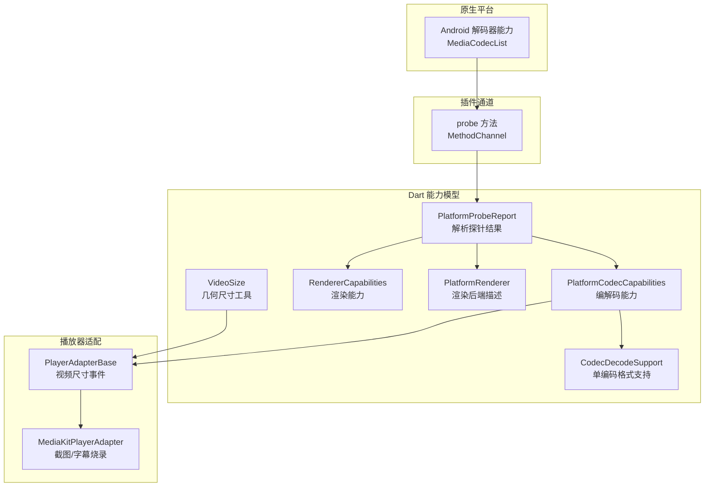
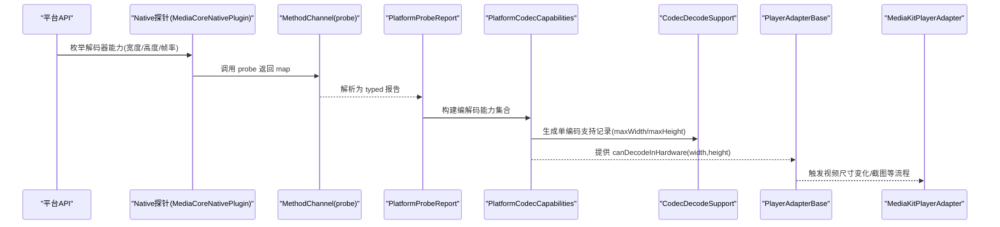
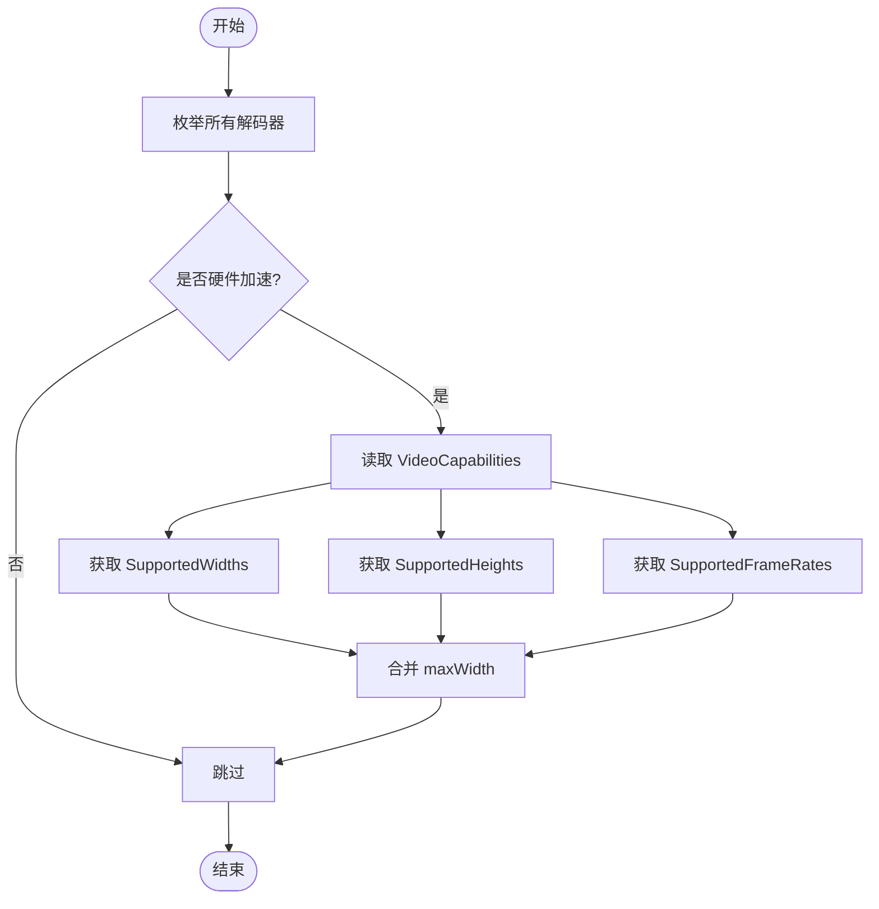
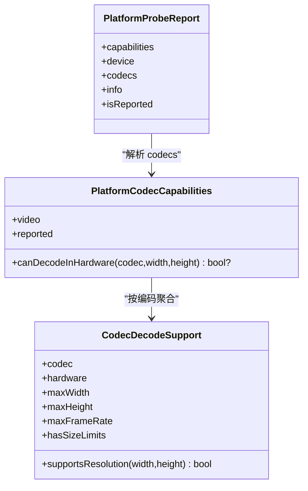
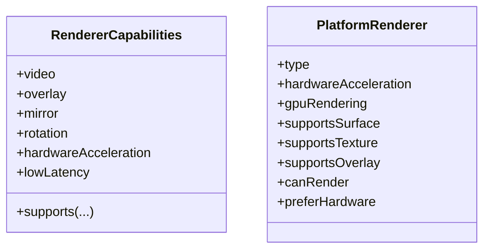
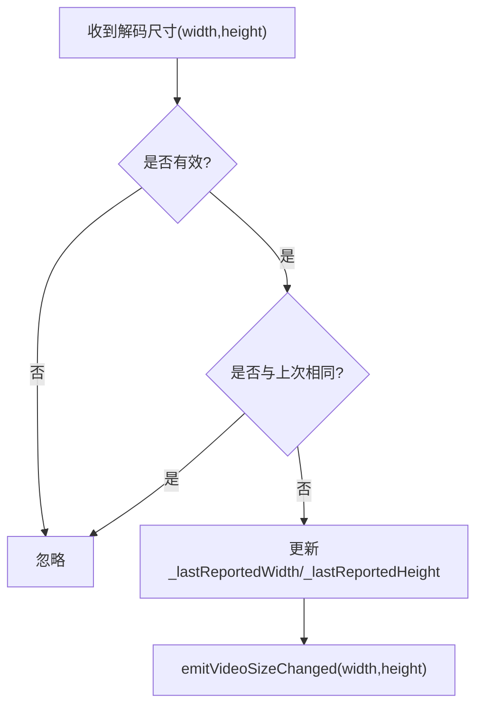
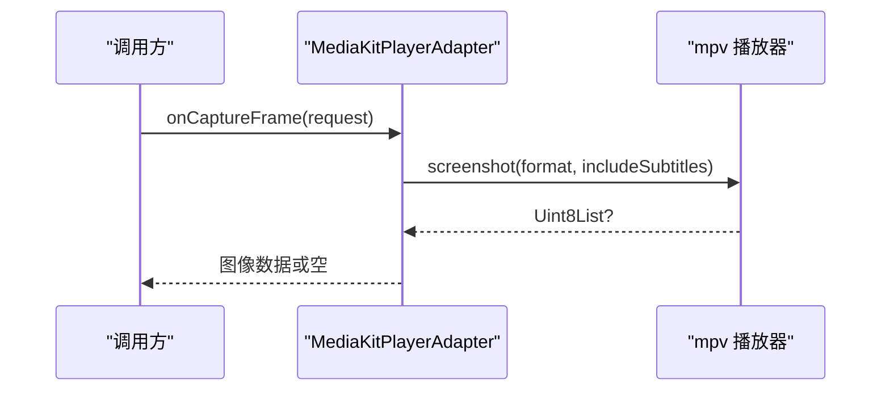
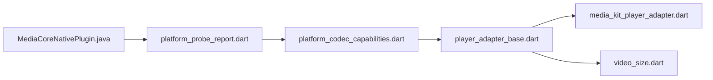

# 分辨率上限检测

<cite>
**本文引用的文件**   
- [platform_probe_report.dart](file://packages/media_core_native/lib/src/platform_probe_report.dart)
- [MediaCoreNativePlugin.java](file://packages/media_core_native/android/src/main/java/com/mediacore/nativeprobe/MediaCoreNativePlugin.java)
- [platform_codec_capabilities.dart](file://packages/media_core/lib/platform/platform_codec_capabilities.dart)
- [renderer_capabilities.dart](file://packages/media_core/lib/renderer/renderer_capabilities.dart)
- [platform_renderer.dart](file://packages/media_core/lib/platform/platform_renderer.dart)
- [video_size.dart](file://packages/media_core/lib/geometry/video_size.dart)
- [player_adapter_base.dart](file://packages/media_core/lib/adapter/player_adapter_base.dart)
- [media_kit_player_adapter.dart](file://packages/media_core_media_kit/lib/src/media_kit_player_adapter.dart)
- [screenshot_options.dart](file://packages/media_core/lib/screenshot/screenshot_options.dart)
- [platform_probe_test.dart](file://packages/media_core_native/test/platform_probe_test.dart)
</cite>

## 目录
1. [引言](#引言)
2. [项目结构](#项目结构)
3. [核心组件](#核心组件)
4. [架构总览](#架构总览)
5. [详细组件分析](#详细组件分析)
6. [依赖关系分析](#依赖关系分析)
7. [性能考量](#性能考量)
8. [故障排查指南](#故障排查指南)
9. [结论](#结论)
10. [附录](#附录)

## 引言
本文聚焦 Media Core 对“设备最大支持分辨率”的检测与使用，覆盖以下目标：
- 解释分辨率上限检测的实现原理：纹理大小限制、内存约束分析与宽高比兼容性检查。
- 说明不同平台的探测方法：Android 的解码器能力枚举、iOS 的上下文检测思路、桌面平台 OpenGL/Vulkan 查询思路。
- 梳理分辨率缓存机制与动态调整策略。
- 给出高分辨率视频的自适应降级方案与播放优化技巧。
- 提供调试方法与性能分析工具使用建议。

需要特别说明的是：当前仓库中已实现的分辨率上限主要来源于 Android 解码器能力枚举（宽度、高度、帧率），并通过 Dart 侧的能力模型进行统一消费；渲染端能力以布尔特性为主，未直接暴露纹理尺寸上限字段。因此，本文在“纹理大小限制”部分会明确区分“已实现路径”和“可扩展方向”。

## 项目结构
围绕分辨率上限检测的相关代码分布在 native 探针层、Dart 能力模型层以及播放器适配层：
- Native 探针层负责从平台 API 收集能力并上报给 Dart。
- Dart 能力模型层将原始数据转换为类型化的能力对象，并提供分辨率判断接口。
- 播放器适配层根据能力选择解码策略、处理视频尺寸变化与截图等场景。

**图表来源**
- [MediaCoreNativePlugin.java:28-55](file://packages/media_core_native/android/src/main/java/com/mediacore/nativeprobe/MediaCoreNativePlugin.java#L28-L55)
- [platform_probe_report.dart:1-29](file://packages/media_core_native/lib/src/platform_probe_report.dart#L1-L29)
- [platform_codec_capabilities.dart:88-186](file://packages/media_core/lib/platform/platform_codec_capabilities.dart#L88-L186)
- [renderer_capabilities.dart:1-34](file://packages/media_core/lib/renderer/renderer_capabilities.dart#L1-L34)
- [platform_renderer.dart:1-40](file://packages/media_core/lib/platform/platform_renderer.dart#L1-L40)
- [video_size.dart:55-121](file://packages/media_core/lib/geometry/video_size.dart#L55-L121)
- [player_adapter_base.dart:698-727](file://packages/media_core/lib/adapter/player_adapter_base.dart#L698-L727)
- [media_kit_player_adapter.dart:719-757](file://packages/media_core_media_kit/lib/src/media_kit_player_adapter.dart#L719-L757)

**章节来源**
- [MediaCoreNativePlugin.java:28-55](file://packages/media_core_native/android/src/main/java/com/mediacore/nativeprobe/MediaCoreNativePlugin.java#L28-L55)
- [platform_probe_report.dart:1-29](file://packages/media_core_native/lib/src/platform_probe_report.dart#L1-L29)

## 核心组件
- PlatformProbeReport：解析原生 probe 返回的 map，构造能力、设备、编解码与平台信息对象。缺失字段或整段缺失表示“未知”，而非“不支持”。
- PlatformCodecCapabilities / CodecDecodeSupport：维护每个视频编码格式的硬件解码支持与分辨率上限（maxWidth、maxHeight、maxFrameRate），并提供 supportsResolution 判断。
- RendererCapabilities / PlatformRenderer：描述渲染后端是否支持视频、叠加层、镜像、旋转、硬件加速、低延迟等布尔能力，不直接表达纹理尺寸上限。
- VideoSize：提供宽高比、缩放、适配等几何计算工具，用于后续分辨率适配与降级决策。
- PlayerAdapterBase：封装视频尺寸变化事件的发射逻辑，避免重复上报。
- MediaKitPlayerAdapter：截图流程示例，体现引擎捕获与字幕烧录的路由选择。

**章节来源**
- [platform_probe_report.dart:43-127](file://packages/media_core_native/lib/src/platform_probe_report.dart#L43-L127)
- [platform_codec_capabilities.dart:88-186](file://packages/media_core/lib/platform/platform_codec_capabilities.dart#L88-L186)
- [renderer_capabilities.dart:1-34](file://packages/media_core/lib/renderer/renderer_capabilities.dart#L1-L34)
- [platform_renderer.dart:1-40](file://packages/media_core/lib/platform/platform_renderer.dart#L1-L40)
- [video_size.dart:55-121](file://packages/media_core/lib/geometry/video_size.dart#L55-L121)
- [player_adapter_base.dart:698-727](file://packages/media_core/lib/adapter/player_adapter_base.dart#L698-L727)
- [media_kit_player_adapter.dart:719-757](file://packages/media_core_media_kit/lib/src/media_kit_player_adapter.dart#L719-L757)

## 架构总览
下图展示从原生平台到 Dart 能力模型再到播放器适配的完整链路，重点标注分辨率上限数据的流向。

**图表来源**
- [MediaCoreNativePlugin.java:286-310](file://packages/media_core_native/android/src/main/java/com/mediacore/nativeprobe/MediaCoreNativePlugin.java#L286-L310)
- [platform_probe_report.dart:43-127](file://packages/media_core_native/lib/src/platform_probe_report.dart#L43-L127)
- [platform_codec_capabilities.dart:219-284](file://packages/media_core/lib/platform/platform_codec_capabilities.dart#L219-L284)
- [player_adapter_base.dart:698-727](file://packages/media_core/lib/adapter/player_adapter_base.dart#L698-L727)
- [media_kit_player_adapter.dart:719-757](file://packages/media_core_media_kit/lib/src/media_kit_player_adapter.dart#L719-L757)

## 详细组件分析

### Android 解码器能力枚举与分辨率上限
Android 侧通过 MediaCodecList 遍历所有解码器，筛选硬件加速解码器，并聚合其支持的宽度、高度与帧率范围，最终输出每个编码格式的最大值窗口。

关键点：
- 仅保留硬件加速解码器，避免软件解码器干扰上限统计。
- 对每个编码格式取各解码器能力的最大值，形成“最宽支持窗口”。
- 若某解码器拒绝描述自身能力，则忽略该解码器，保持已有上限。

**图表来源**
- [MediaCoreNativePlugin.java:232-310](file://packages/media_core_native/android/src/main/java/com/mediacore/nativeprobe/MediaCoreNativePlugin.java#L232-L310)

**章节来源**
- [MediaCoreNativePlugin.java:232-310](file://packages/media_core_native/android/src/main/java/com/mediacore/nativeprobe/MediaCoreNativePlugin.java#L232-L310)

### Dart 侧能力模型与分辨率判断
Dart 侧将原生 map 解析为 PlatformProbeReport，再构建 PlatformCodecCapabilities 与 CodecDecodeSupport。CodecDecodeSupport 提供 hasSizeLimits 与 supportsResolution 方法，用于判断给定宽高是否在硬件解码支持范围内。

要点：
- 如果平台未报告分辨率上限（maxWidth/maxHeight 为 0），supportsResolution 默认返回 true，避免把“未知”误判为“不支持”。
- canDecodeInHardware 在未探测或未知编码时返回 null，调用方应允许引擎尝试，而不是直接拒绝硬件解码。

**图表来源**
- [platform_probe_report.dart:43-127](file://packages/media_core_native/lib/src/platform_probe_report.dart#L43-L127)
- [platform_codec_capabilities.dart:88-186](file://packages/media_core/lib/platform/platform_codec_capabilities.dart#L88-L186)
- [platform_codec_capabilities.dart:219-284](file://packages/media_core/lib/platform/platform_codec_capabilities.dart#L219-L284)

**章节来源**
- [platform_probe_report.dart:43-127](file://packages/media_core_native/lib/src/platform_probe_report.dart#L43-L127)
- [platform_codec_capabilities.dart:88-186](file://packages/media_core/lib/platform/platform_codec_capabilities.dart#L88-L186)
- [platform_codec_capabilities.dart:219-284](file://packages/media_core/lib/platform/platform_codec_capabilities.dart#L219-L284)

### 渲染能力与纹理大小限制
RendererCapabilities 与 PlatformRenderer 描述渲染后端的布尔能力（如 video、overlay、mirror、rotation、hardwareAcceleration、lowLatency、supportsSurface、supportsTexture、supportsOverlay）。它们不直接包含纹理尺寸上限字段。

这意味着：
- 当前分辨率上限检测主要基于解码器能力，而非渲染纹理上限。
- 若需引入纹理大小限制（例如 GL_MAX_TEXTURE_SIZE），应在渲染能力模型中扩展字段，并在播放器适配层结合 VideoSize 做兼容校验。

**图表来源**
- [renderer_capabilities.dart:1-34](file://packages/media_core/lib/renderer/renderer_capabilities.dart#L1-L34)
- [platform_renderer.dart:1-40](file://packages/media_core/lib/platform/platform_renderer.dart#L1-L40)

**章节来源**
- [renderer_capabilities.dart:1-34](file://packages/media_core/lib/renderer/renderer_capabilities.dart#L1-L34)
- [platform_renderer.dart:1-40](file://packages/media_core/lib/platform/platform_renderer.dart#L1-L40)

### 视频尺寸变化与宽高比兼容性
VideoSize 提供宽高比、缩放、适配等方法，PlayerAdapterBase 负责去重并上报视频尺寸变化事件。这些能力可用于后续分辨率适配与降级策略。

**图表来源**
- [player_adapter_base.dart:698-727](file://packages/media_core/lib/adapter/player_adapter_base.dart#L698-L727)
- [video_size.dart:55-121](file://packages/media_core/lib/geometry/video_size.dart#L55-L121)

**章节来源**
- [player_adapter_base.dart:698-727](file://packages/media_core/lib/adapter/player_adapter_base.dart#L698-L727)
- [video_size.dart:55-121](file://packages/media_core/lib/geometry/video_size.dart#L55-L121)

### 截图与分辨率的关系
MediaKitPlayerAdapter 的截图流程展示了引擎捕获与字幕烧录的选择逻辑。截图通常返回解码帧的分辨率，而表面捕获可能受像素比例影响。

**图表来源**
- [media_kit_player_adapter.dart:719-757](file://packages/media_core_media_kit/lib/src/media_kit_player_adapter.dart#L719-L757)
- [screenshot_options.dart:64-93](file://packages/media_core/lib/screenshot/screenshot_options.dart#L64-L93)

**章节来源**
- [media_kit_player_adapter.dart:719-757](file://packages/media_core_media_kit/lib/src/media_kit_player_adapter.dart#L719-L757)
- [screenshot_options.dart:64-93](file://packages/media_core/lib/screenshot/screenshot_options.dart#L64-L93)

## 依赖关系分析
- Native 探针依赖 Android MediaCodecList 与系统 API，产出能力 map。
- Dart 侧 PlatformProbeReport 依赖 method channel 返回值，解析为类型化对象。
- PlatformCodecCapabilities 依赖 VideoCodec 枚举与 CodecDecodeSupport，提供分辨率判断。
- PlayerAdapterBase 依赖 VideoSize 与能力模型，驱动视频尺寸事件。
- MediaKitPlayerAdapter 依赖底层播放器与截图选项，体现分辨率在截图中的表现。

**图表来源**
- [MediaCoreNativePlugin.java:28-55](file://packages/media_core_native/android/src/main/java/com/mediacore/nativeprobe/MediaCoreNativePlugin.java#L28-L55)
- [platform_probe_report.dart:1-29](file://packages/media_core_native/lib/src/platform_probe_report.dart#L1-L29)
- [platform_codec_capabilities.dart:88-186](file://packages/media_core/lib/platform/platform_codec_capabilities.dart#L88-L186)
- [player_adapter_base.dart:698-727](file://packages/media_core/lib/adapter/player_adapter_base.dart#L698-L727)
- [media_kit_player_adapter.dart:719-757](file://packages/media_core_media_kit/lib/src/media_kit_player_adapter.dart#L719-L757)
- [video_size.dart:55-121](file://packages/media_core/lib/geometry/video_size.dart#L55-L121)

**章节来源**
- [MediaCoreNativePlugin.java:28-55](file://packages/media_core_native/android/src/main/java/com/mediacore/nativeprobe/MediaCoreNativePlugin.java#L28-L55)
- [platform_probe_report.dart:1-29](file://packages/media_core_native/lib/src/platform_probe_report.dart#L1-L29)
- [platform_codec_capabilities.dart:88-186](file://packages/media_core/lib/platform/platform_codec_capabilities.dart#L88-L186)
- [player_adapter_base.dart:698-727](file://packages/media_core/lib/adapter/player_adapter_base.dart#L698-L727)
- [media_kit_player_adapter.dart:719-757](file://packages/media_core_media_kit/lib/src/media_kit_player_adapter.dart#L719-L757)
- [video_size.dart:55-121](file://packages/media_core/lib/geometry/video_size.dart#L55-L121)

## 性能考量
- 解码器能力枚举仅在进程启动时执行一次，避免频繁查询带来的开销。
- 使用“未知优先”的策略：当平台未报告分辨率上限时，不拒绝硬件解码，让引擎自行尝试，减少不必要的软解降级。
- 视频尺寸变化事件去重，避免 UI 层重复刷新。
- 截图超时与质量参数控制，防止长时间阻塞用户操作。

[本节为通用指导，不直接分析具体文件]

## 故障排查指南
- 确认 probe 是否成功：PlatformProbeReport.isReported 可判断是否有来自平台的实际回答。
- 检查编码格式支持：PlatformCodecCapabilities.canDecodeInHardware 返回 null 表示未知，false 表示平台明确不支持。
- 验证分辨率上限：CodecDecodeSupport.hasSizeLimits 为 false 表示平台未报告上限；supportsResolution 在未知上限时默认放行。
- 观察视频尺寸变化：PlayerAdapterBase.emitVideoSizeChangedIfChanged 确保尺寸变化被正确上报且无重复。
- 截图失败处理：MediaKitPlayerAdapter.onCaptureFrame 捕获异常并回退到表面捕获路线。

**章节来源**
- [platform_probe_report.dart:78-106](file://packages/media_core_native/lib/src/platform_probe_report.dart#L78-L106)
- [platform_codec_capabilities.dart:133-153](file://packages/media_core/lib/platform/platform_codec_capabilities.dart#L133-L153)
- [platform_codec_capabilities.dart:272-284](file://packages/media_core/lib/platform/platform_codec_capabilities.dart#L272-L284)
- [player_adapter_base.dart:698-727](file://packages/media_core/lib/adapter/player_adapter_base.dart#L698-L727)
- [media_kit_player_adapter.dart:719-757](file://packages/media_core_media_kit/lib/src/media_kit_player_adapter.dart#L719-L757)

## 结论
- 当前 Media Core 的分辨率上限检测主要基于 Android 解码器能力枚举，并通过 Dart 能力模型统一消费。
- 渲染能力模型以布尔特性为主，未直接暴露纹理尺寸上限；如需引入 GL_MAX_TEXTURE_SIZE 等平台限制，可在渲染能力模型中扩展字段并结合 VideoSize 做兼容校验。
- “未知不等于不支持”的设计原则确保了不会因探测缺失而错误地禁用硬件解码。
- 建议在高分辨率场景中结合解码器上限、内存约束与宽高比兼容性进行自适应降级，并通过截图与尺寸变化事件进行观测与调优。

[本节为总结性内容，不直接分析具体文件]

## 附录

### 不同平台的分辨率探测方法说明
- Android：通过 MediaCodecList 枚举硬件解码器，聚合 maxWidth、maxHeight、maxFrameRate。
- iOS：文档目标提及 EAGLContext 检测；当前仓库未提供对应实现，属于可扩展方向。
- 桌面平台：文档目标提及 OpenGL/Vulkan 查询；当前仓库未提供对应实现，属于可扩展方向。

[本节为概念性说明，不直接分析具体文件]

### 分辨率缓存机制与动态调整策略
- 缓存机制：Native 探针结果由 Provider 持有，避免重复探测。
- 动态调整：播放器适配层根据解码尺寸变化事件与能力模型进行渲染与解码策略调整。
- 建议：在新增纹理尺寸限制时，增加缓存键（平台+GPU型号）以避免重复查询。

**章节来源**
- [platform_probe_report.dart:148-161](file://packages/media_core_native/lib/src/platform_probe_report.dart#L148-L161)
- [player_adapter_base.dart:698-727](file://packages/media_core/lib/adapter/player_adapter_base.dart#L698-L727)

### 高分辨率视频的自适应降级方案与播放优化技巧
- 解码策略：当 canDecodeInHardware 返回 false 或 supportsResolution 为 false 时，切换到软解或降低分辨率。
- 渲染优化：根据 PlatformRenderer.supportsTexture/supportsSurface 选择更高效的渲染路径。
- 截图优化：设置合理的 pixelRatio 与 quality，避免超大图像导致内存压力。

**章节来源**
- [platform_codec_capabilities.dart:272-284](file://packages/media_core/lib/platform/platform_codec_capabilities.dart#L272-L284)
- [platform_renderer.dart:72-80](file://packages/media_core/lib/platform/platform_renderer.dart#L72-L80)
- [screenshot_options.dart:64-93](file://packages/media_core/lib/screenshot/screenshot_options.dart#L64-L93)

### 测试用例参考
- platform_probe_test.dart 展示了 probe 成功与失败时的行为，包括 reported 标志、能力字段与编解码能力判断。

**章节来源**
- [platform_probe_test.dart:38-95](file://packages/media_core_native/test/platform_probe_test.dart#L38-L95)