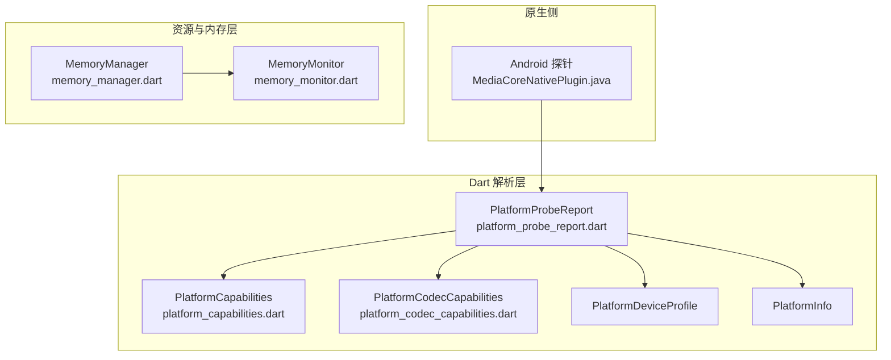
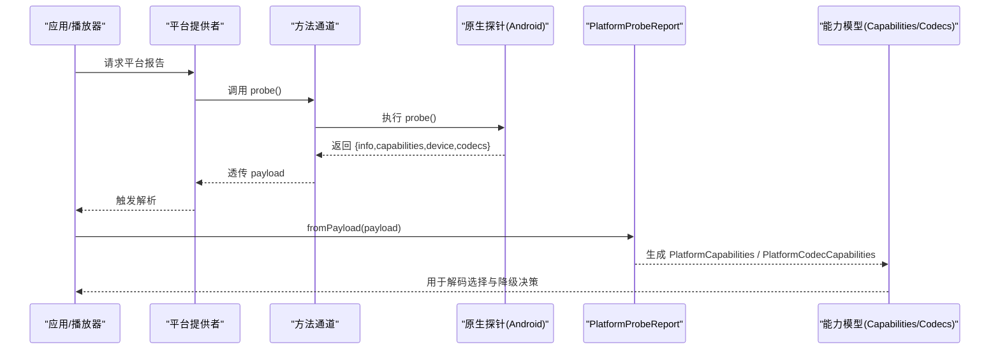
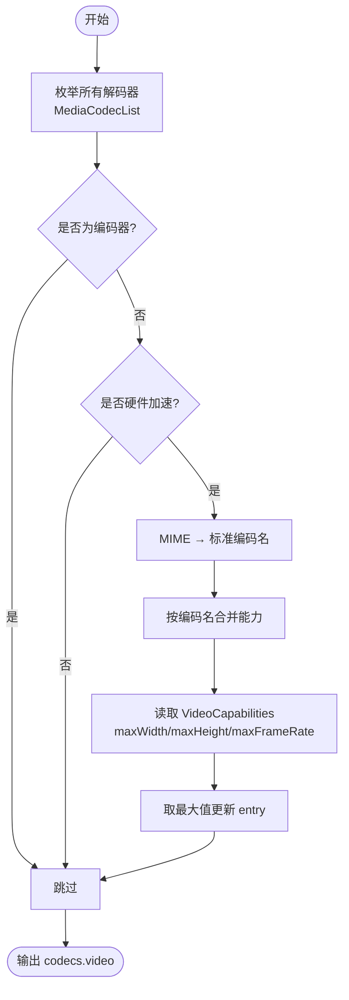
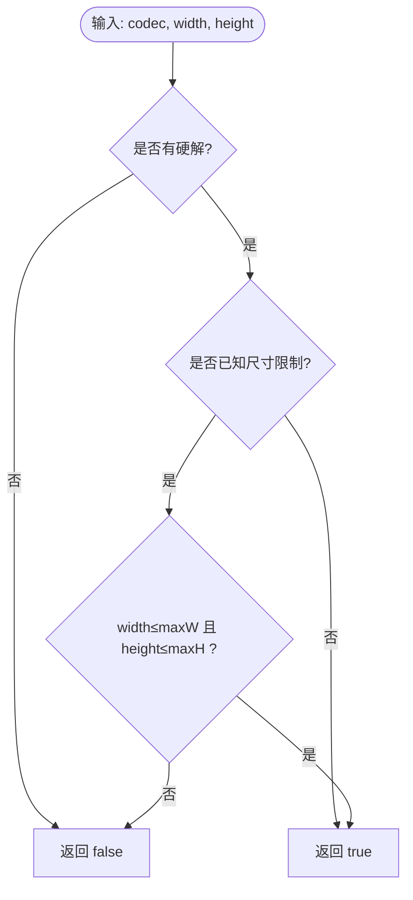
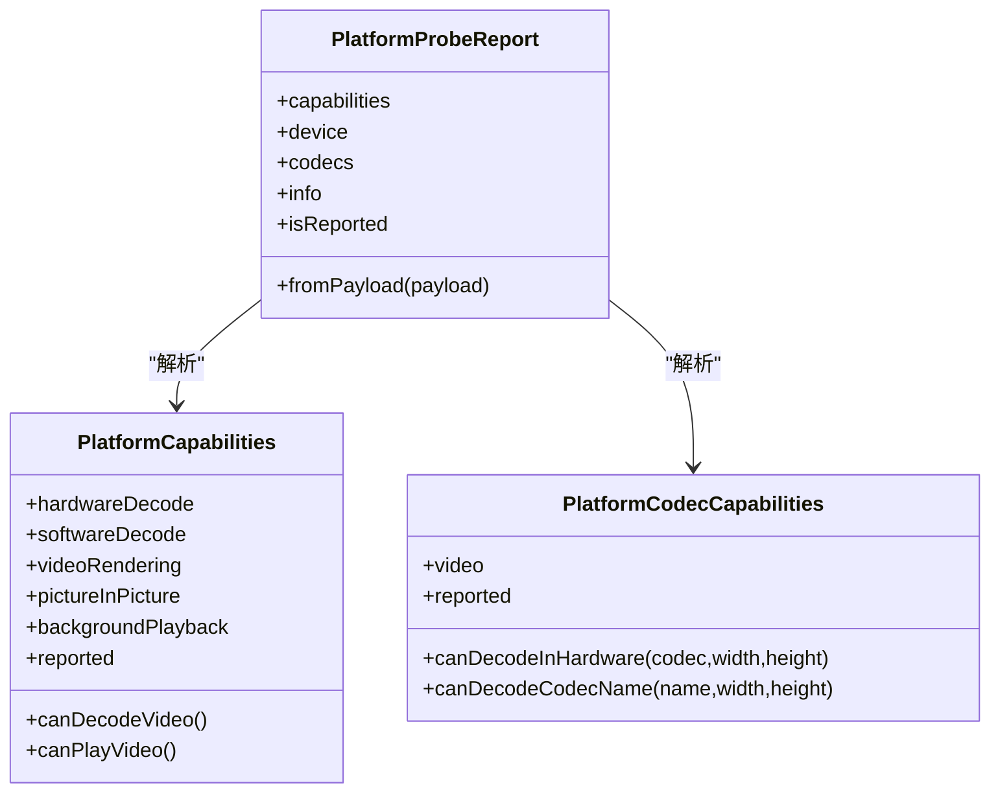
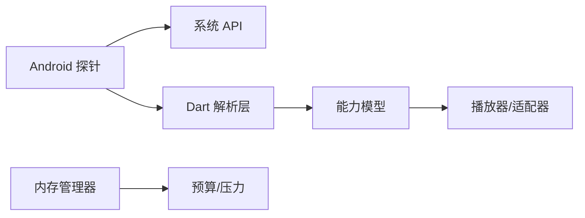
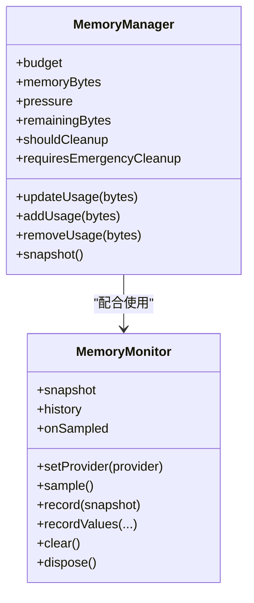

# 平台能力探针

<cite>
**本文引用的文件**   
- [platform_probe_report.dart](file://packages/media_core_native/lib/src/platform_probe_report.dart)
- [platform_capabilities.dart](file://packages/media_core/lib/platform/platform_capabilities.dart)
- [platform_codec_capabilities.dart](file://packages/media_core/lib/platform/platform_codec_capabilities.dart)
- [MediaCoreNativePlugin.java](file://packages/media_core_native/android/src/main/java/com/mediacore/nativeprobe/MediaCoreNativePlugin.java)
- [memory_manager.dart](file://packages/media_core_memory/lib/src/memory_manager.dart)
- [memory_monitor.dart](file://packages/media_core_memory/lib/src/memory_monitor.dart)
- [README.md（media_core_native）](file://packages/media_core_native/README.md)
</cite>

## 目录
1. [引言](#引言)
2. [项目结构](#项目结构)
3. [核心组件](#核心组件)
4. [架构总览](#架构总览)
5. [详细组件分析](#详细组件分析)
6. [依赖关系分析](#依赖关系分析)
7. [性能与内存监控](#性能与内存监控)
8. [降级策略与兼容性处理](#降级策略与兼容性处理)
9. [调试与排障指南](#调试与排障指南)
10. [结论](#结论)

## 引言
本文面向 Media Core 的“平台能力探针”，系统性说明其如何探测底层硬件与系统能力，并把这些事实转化为上层播放器可消费的模型。重点覆盖：
- 编解码硬解探测流程（H.264/H.265/VP9/AV1 等）
- 分辨率上限检测算法（最大宽高、帧率、未知边界的处理）
- 内存监控机制（堆/原生内存、压力分级）
- 性能监控指标（CPU/GPU/解码统计）
- 各平台 API 调用、缓存策略与动态更新
- 能力降级策略与兼容性方案
- 调试工具与性能分析最佳实践

## 项目结构
探针由三层组成：
- 原生侧实现：以 Android 为例，通过 `MediaCodecList` 枚举硬解器，汇总每个视频编码器的最大分辨率与帧率，同时收集设备信息、系统特性与能力标志。
- Dart 解析层：将方法通道返回的原始 Map 转换为类型化的 `PlatformProbeReport`，并进一步映射到 `PlatformCapabilities`、`PlatformDeviceProfile`、`PlatformCodecCapabilities` 与 `PlatformInfo`。
- 资源与内存层：`MemoryManager` 提供预算与压力视图，`MemoryMonitor` 负责采集设备内存快照与趋势历史。

图示来源
- [MediaCoreNativePlugin.java:155-162](file://packages/media_core_native/android/src/main/java/com/mediacore/nativeprobe/MediaCoreNativePlugin.java#L155-L162)
- [platform_probe_report.dart:43-56](file://packages/media_core_native/lib/src/platform_probe_report.dart#L43-L56)
- [platform_capabilities.dart:26-52](file://packages/media_core/lib/platform/platform_capabilities.dart#L26-L52)
- [platform_codec_capabilities.dart:214-237](file://packages/media_core/lib/platform/platform_codec_capabilities.dart#L214-L237)

章节来源
- [platform_probe_report.dart:1-162](file://packages/media_core_native/lib/src/platform_probe_report.dart#L1-L162)
- [MediaCoreNativePlugin.java:1-452](file://packages/media_core_native/android/src/main/java/com/mediacore/nativeprobe/MediaCoreNativePlugin.java#L1-L452)

## 核心组件
- PlatformProbeReport：统一解析原生侧 probe 返回的 payload，字段全部可选，缺失即表示“未知”而非“不支持”。
- PlatformCapabilities：描述平台级能力（硬解/软解、渲染、音频、PiP、全屏、外接屏、后台播放、网络/本地源）。
- PlatformCodecCapabilities：按视频编码器维度记录是否支持硬解、最大分辨率与帧率；对未命名编码器归入 other。
- MemoryManager：聚合模块内存使用或读取注册表总量，结合预算计算压力等级。
- MemoryMonitor：周期性采集设备内存快照，维护有界历史与事件流。

章节来源
- [platform_probe_report.dart:29-79](file://packages/media_core_native/lib/src/platform_probe_report.dart#L29-L79)
- [platform_capabilities.dart:26-118](file://packages/media_core/lib/platform/platform_capabilities.dart#L26-L118)
- [platform_codec_capabilities.dart:88-186](file://packages/media_core/lib/platform/platform_codec_capabilities.dart#L88-L186)
- [memory_manager.dart:25-70](file://packages/media_core_memory/lib/src/memory_manager.dart#L25-L70)
- [memory_monitor.dart:22-50](file://packages/media_core_memory/lib/src/memory_monitor.dart#L22-L50)

## 架构总览
探针从原生侧发起一次 probe 调用，返回 info/capabilities/device/codecs 四个区段。Dart 侧将其解析为强类型对象，供播放器适配器与资源协调器消费。

图示来源
- [platform_probe_report.dart:148-161](file://packages/media_core_native/lib/src/platform_probe_report.dart#L148-L161)
- [MediaCoreNativePlugin.java:140-162](file://packages/media_core_native/android/src/main/java/com/mediacore/nativeprobe/MediaCoreNativePlugin.java#L140-L162)

## 详细组件分析

### 编解码硬解探测流程（Android）
Android 侧通过 `MediaCodecList` 遍历所有解码器，过滤编码器，仅保留被标记为硬件加速的解码器，并按 MIME 类型归一化为 h264/hevc/vp9/av1/mpeg4/mpeg2/vc1 等标准名称。随后合并同一编码器的多解码器能力，取最大宽高与帧率作为该编码器的上限。

图示来源
- [MediaCoreNativePlugin.java:232-310](file://packages/media_core_native/android/src/main/java/com/mediacore/nativeprobe/MediaCoreNativePlugin.java#L232-L310)

章节来源
- [MediaCoreNativePlugin.java:223-360](file://packages/media_core_native/android/src/main/java/com/mediacore/nativeprobe/MediaCoreNativePlugin.java#L223-L360)

### 分辨率上限检测算法
Dart 侧的 `CodecDecodeSupport.supportsResolution` 遵循以下规则：
- 若未声明硬解，直接拒绝硬解路径。
- 若未上报尺寸限制（maxWidth/maxHeight 为 0），则视为“未知”，不拒绝任何分辨率。
- 若已上报限制，则要求 width ≤ maxWidth 且 height ≤ maxHeight。

图示来源
- [platform_codec_capabilities.dart:133-153](file://packages/media_core/lib/platform/platform_codec_capabilities.dart#L133-L153)

章节来源
- [platform_codec_capabilities.dart:88-186](file://packages/media_core/lib/platform/platform_codec_capabilities.dart#L88-L186)

### 能力模型与“未知”语义
- `PlatformProbeReport.fromPayload` 将所有字段设为可选，缺失即“未知”，避免把“未探测”误判为“不支持”。
- `PlatformCapabilities` 默认值偏乐观，但通过 `reported` 区分“平台明确回答”和“无人询问”。
- `PlatformCodecCapabilities.unknown` 的 `reported=false`，查询返回 null，让上层自行决定尝试或回退。

图示来源
- [platform_probe_report.dart:29-79](file://packages/media_core_native/lib/src/platform_probe_report.dart#L29-L79)
- [platform_capabilities.dart:26-118](file://packages/media_core/lib/platform/platform_capabilities.dart#L26-L118)
- [platform_codec_capabilities.dart:214-295](file://packages/media_core/lib/platform/platform_codec_capabilities.dart#L214-L295)

章节来源
- [platform_probe_report.dart:43-79](file://packages/media_core_native/lib/src/platform_probe_report.dart#L43-L79)
- [platform_capabilities.dart:26-118](file://packages/media_core/lib/platform/platform_capabilities.dart#L26-L118)
- [platform_codec_capabilities.dart:214-295](file://packages/media_core/lib/platform/platform_codec_capabilities.dart#L214-L295)

### 各平台探测 API 与行为差异
- Android：通过 `MediaCodecList` 枚举硬解器，结合 `ActivityManager` 获取内存与低 RAM 标记，通过 `PackageManager` 判断 PiP 与后台播放声明，通过 `DisplayManager` 判断外接显示。
- Windows：通过 `MFTEnumEx` 枚举 MFT 硬解（h264/hevc/vp9/av1），使用 `GlobalMemoryStatusEx` 与 `GetNativeSystemInfo` 获取内存与核数，使用 `IDXGIOutput6::GetDesc1` 判断 HDR 与多屏，使用 `RtlGetVersion` 获取真实系统版本。
- iOS/macOS：通过 `VTIsHardwareDecodeSupported` 检测 h264/hevc，结合系统 PiP 支持与 UI 配置；iOS 的系统 PiP 只报“平台支持”，实际进入 PiP 还需帧投递通路。
- Linux：不逐编解码器上报矩阵，仅通过渲染节点推断 GPU 驱动存在；内存来自 `/proc/meminfo`，外接屏通过 DRM connector 识别。

章节来源
- [README.md（media_core_native）:123-138](file://packages/media_core_native/README.md#L123-L138)
- [MediaCoreNativePlugin.java:181-220](file://packages/media_core_native/android/src/main/java/com/mediacore/nativeprobe/MediaCoreNativePlugin.java#L181-L220)

### 缓存策略与动态更新
- 原生侧不缓存：每次 probe 都重新枚举能力，保证结果反映当前系统状态。
- Dart 侧解析器不缓存：解析逻辑无缓存，具体缓存由上层 Provider 管理。
- 动态更新：当宿主需要刷新能力时，可再次调用 probe，得到新的 `PlatformProbeReport` 并替换旧模型。

章节来源
- [platform_probe_report.dart:19-28](file://packages/media_core_native/lib/src/platform_probe_report.dart#L19-L28)
- [MediaCoreNativePlugin.java:53-55](file://packages/media_core_native/android/src/main/java/com/mediacore/nativeprobe/MediaCoreNativePlugin.java#L53-L55)

## 依赖关系分析
- 原生 Android 插件依赖系统 API（MediaCodecList、ActivityManager、PackageManager、DisplayManager）。
- Dart 解析层依赖媒体核心能力模型（PlatformCapabilities、PlatformCodecCapabilities、PlatformInfo、PlatformDeviceProfile）。
- 内存子系统独立于探针，但可与探针提供的设备信息（如 totalRamMb、lowRamDevice）共同影响资源调度与压力阈值。

图示来源
- [MediaCoreNativePlugin.java:1-55](file://packages/media_core_native/android/src/main/java/com/mediacore/nativeprobe/MediaCoreNativePlugin.java#L1-L55)
- [platform_probe_report.dart:1-28](file://packages/media_core_native/lib/src/platform_probe_report.dart#L1-L28)
- [memory_manager.dart:1-30](file://packages/media_core_memory/lib/src/memory_manager.dart#L1-L30)

章节来源
- [MediaCoreNativePlugin.java:1-55](file://packages/media_core_native/android/src/main/java/com/mediacore/nativeprobe/MediaCoreNativePlugin.java#L1-L55)
- [platform_probe_report.dart:1-28](file://packages/media_core_native/lib/src/platform_probe_report.dart#L1-L28)
- [memory_manager.dart:1-30](file://packages/media_core_memory/lib/src/memory_manager.dart#L1-L30)

## 性能与内存监控

### 内存监控机制
- `MemoryManager` 对外暴露当前内存字节数、剩余容量、是否需要清理与紧急清理等信号；它既可以聚合模块上报的使用量，也可以直接读取 `MemoryRegistry` 的权威总量。
- `MemoryMonitor` 负责采集设备内存快照（usedBytes、availableBytes、externalBytes），维护有界历史与广播流，便于观察趋势与泄漏。

图示来源
- [memory_manager.dart:25-117](file://packages/media_core_memory/lib/src/memory_manager.dart#L25-L117)
- [memory_monitor.dart:22-144](file://packages/media_core_memory/lib/src/memory_monitor.dart#L22-L144)

章节来源
- [memory_manager.dart:25-117](file://packages/media_core_memory/lib/src/memory_manager.dart#L25-L117)
- [memory_monitor.dart:22-144](file://packages/media_core_memory/lib/src/memory_monitor.dart#L22-L144)

### 性能监控指标建议
- CPU 使用率：在 Android 可通过 `ActivityManager.getProcessMemoryInfo` 与系统进程采样估算；在 Windows 可使用性能计数器。
- GPU 利用率：Windows 可用 DXGI/DXGIInfoQueue 或厂商工具；Android 可用 GPU Profiler 或 vendor 工具链。
- 解码性能统计：结合探针上报的硬解能力与实际解码失败次数、重初始化次数、卡顿时长进行回归分析。

[本节为通用指导，不直接分析具体文件]

## 降级策略与兼容性处理
- “未知”不等于“不支持”：当 probe 失败或未上报某项能力时，上层应视为“可自行决定”，而不是直接禁用硬解。
- 分辨率未知时的宽容策略：若平台未上报尺寸限制，不应拒绝任何分辨率，因为“不知道上限”不等于“上限为零”。
- 硬解失败的回退：若硬解解码失败，应自动回退到软解；对于 HEVC/AV1/VP9 等高复杂度格式，软解成本显著，需结合内存与 CPU 压力做二次降级（降低码率/分辨率）。
- 平台差异：Linux 不逐编解码器上报矩阵，仅通过渲染节点判断 GPU 驱动存在；iOS 系统 PiP 只报“平台支持”，实际进入 PiP 还需要帧投递通路。

章节来源
- [platform_codec_capabilities.dart:133-153](file://packages/media_core/lib/platform/platform_codec_capabilities.dart#L133-L153)
- [platform_codec_capabilities.dart:207-213](file://packages/media_core/lib/platform/platform_codec_capabilities.dart#L207-L213)
- [README.md（media_core_native）:133-138](file://packages/media_core_native/README.md#L133-L138)

## 调试与排障指南
- 查看能力报告：使用 example 中的“能力报告”界面，打印探针原样答案，确认 info/capabilities/device/codecs 四区段是否完整。
- 检查硬解枚举：在 Android 上确认 `MediaCodecList` 是否可枚举，某些 OEM 定制 ROM 可能拒绝访问导致 codecs 为空。
- 验证 PiP 与后台播放：PiP 取决于系统特性与清单声明；后台播放取决于前台服务权限声明。
- 内存趋势分析：通过 `MemoryMonitor.onSampled` 订阅快照，观察 usedBytes/externalBytes 趋势，定位泄漏或峰值。
- 常见错误：
  - 探针失败：Dart 侧会吞掉异常并返回 unknown，不会阻止播放启动。
  - 能力误判：不要把“未探测”当作“不支持”，应优先尝试硬解并在失败后回退。

章节来源
- [platform_probe_report.dart:148-161](file://packages/media_core_native/lib/src/platform_probe_report.dart#L148-L161)
- [MediaCoreNativePlugin.java:140-152](file://packages/media_core_native/android/src/main/java/com/mediacore/nativeprobe/MediaCoreNativePlugin.java#L140-L152)
- [README.md（media_core_native）:140-142](file://packages/media_core_native/README.md#L140-L142)

## 结论
Media Core 的平台能力探针通过原生侧枚举与 Dart 侧类型化解析，将底层硬件与系统能力稳定地传递给上层。其关键设计在于：
- 以“未知”语义避免误判，确保探针失败不影响播放。
- 以“宽窗口”合并多解码器能力，给出保守而可用的分辨率上限。
- 将能力模型与内存监控解耦，使资源调度与压力感知具备可扩展性。
- 在各平台间保持最小契约，允许逐步扩展而不破坏既有行为。