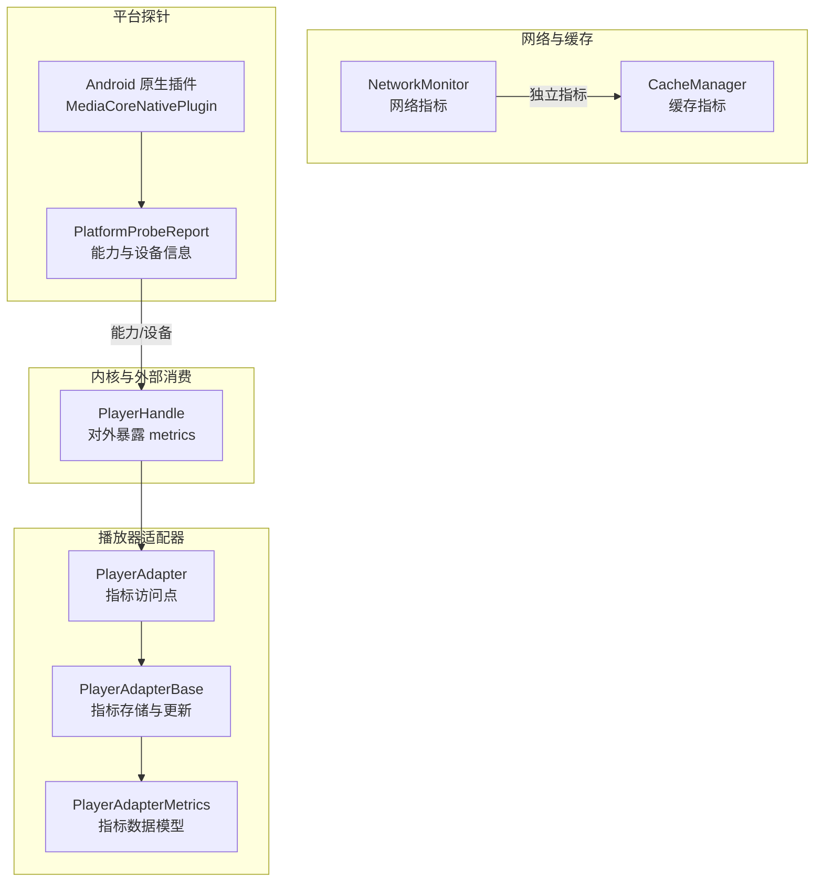
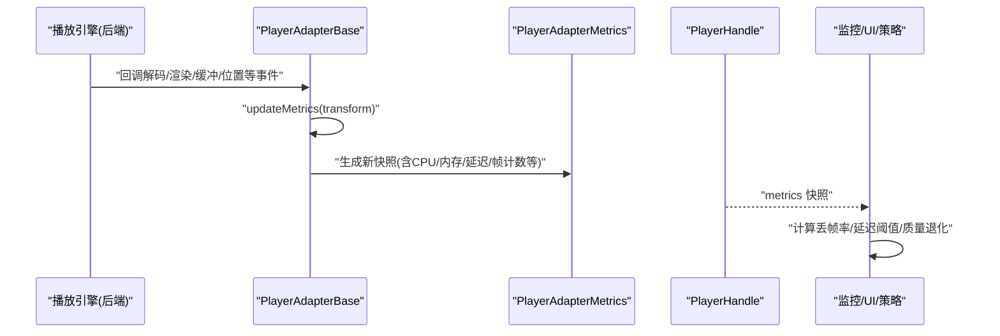
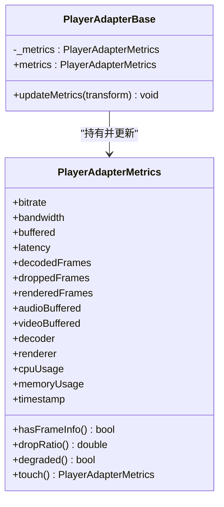
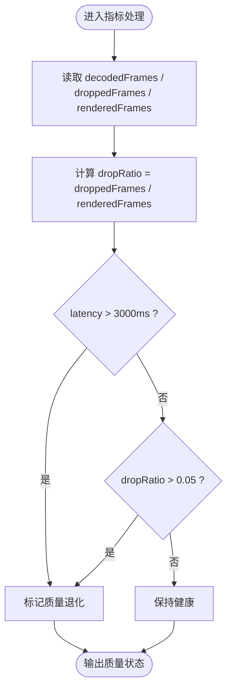
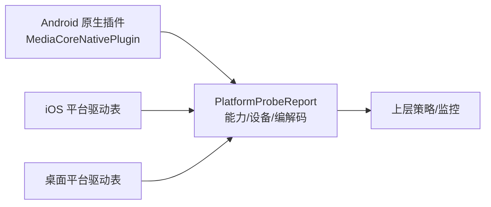
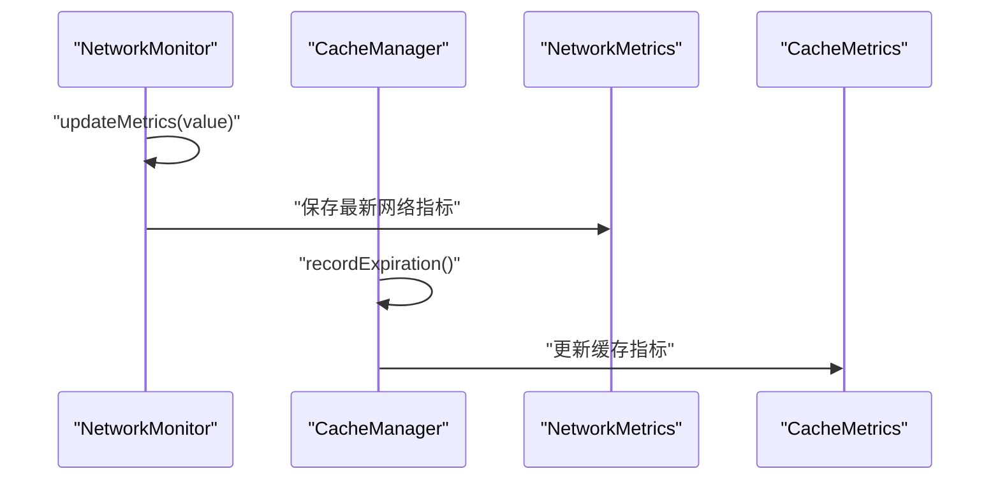
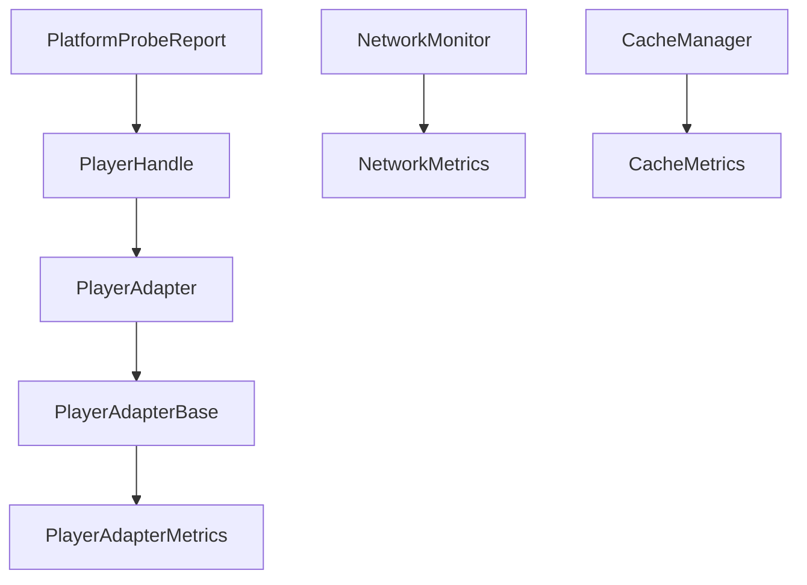

# 性能指标监控

<cite>
**本文引用的文件**   
- [player_adapter_metrics.dart](file://packages/media_core/lib/adapter/player_adapter_metrics.dart)
- [player_adapter.dart](file://packages/media_core/lib/adapter/player_adapter.dart)
- [player_adapter_base.dart](file://packages/media_core/lib/adapter/player_adapter_base.dart)
- [player_handle.dart](file://packages/media_core/lib/kernel/player_handle.dart)
- [network_monitor.dart](file://packages/media_core/lib/network/network_monitor.dart)
- [network_metrics.dart](file://packages/media_core/lib/network/network_metrics.dart)
- [cache_manager.dart](file://packages/media_core/lib/cache/cache_manager.dart)
- [cache_metrics.dart](file://packages/media_core/lib/cache/cache_metrics.dart)
- [platform_probe_test.dart](file://packages/media_core_native/test/platform_probe_test.dart)
- [MediaCoreNativePlugin.java](file://packages/media_core_native/android/src/main/java/com/mediacore/nativeprobe/MediaCoreNativePlugin.java)
- [README.md](file://README.md)
</cite>

## 目录
1. [引言](#引言)
2. [项目结构](#项目结构)
3. [核心组件](#核心组件)
4. [架构总览](#架构总览)
5. [详细组件分析](#详细组件分析)
6. [依赖关系分析](#依赖关系分析)
7. [性能考量](#性能考量)
8. [故障排查指南](#故障排查指南)
9. [结论](#结论)
10. [附录](#附录)

## 引言
本文面向 Media Core 的性能指标监控体系，聚焦以下目标：
- CPU 使用率、GPU 利用率与解码性能的采集与上报路径
- 帧率、延迟与吞吐量的关键算法与判定逻辑
- Android/iOS/桌面平台的性能 API 集成点与能力探针
- 采样策略、聚合计算与异常检测机制
- 瓶颈定位工具、调优建议与基准测试方法

本说明以代码仓库中的适配器指标模型、网络与缓存监控、平台探针为事实依据，并结合示例工程中对内存与设备快照的使用方式，形成可操作的监控与诊断指南。

## 项目结构
围绕性能指标的关键代码分布在以下模块：
- 播放器适配器层：定义并暴露运行时指标数据模型，提供更新接口
- 内核句柄：对外暴露当前适配器的指标快照
- 网络与缓存子系统：各自维护独立的指标对象与更新入口
- 平台探针：通过原生侧收集设备与编解码能力，供上层决策与监控参考
- 示例工程：演示如何注入设备级内存快照与读取报告

图表来源
- [player_adapter.dart:41-63](file://packages/media_core/lib/adapter/player_adapter.dart#L41-L63)
- [player_adapter_base.dart:93-134](file://packages/media_core/lib/adapter/player_adapter_base.dart#L93-L134)
- [player_adapter_metrics.dart:28-78](file://packages/media_core/lib/adapter/player_adapter_metrics.dart#L28-L78)
- [player_handle.dart:424-424](file://packages/media_core/lib/kernel/player_handle.dart#L424-L424)
- [network_monitor.dart:75-153](file://packages/media_core/lib/network/network_monitor.dart#L75-L153)
- [cache_manager.dart:44-44](file://packages/media_core/lib/cache/cache_manager.dart#L44-L44)
- [platform_probe_test.dart:38-95](file://packages/media_core_native/test/platform_probe_test.dart#L38-L95)
- [MediaCoreNativePlugin.java:1-26](file://packages/media_core_native/android/src/main/java/com/mediacore/nativeprobe/MediaCoreNativePlugin.java#L1-L26)

章节来源
- [README.md:105-176](file://README.md#L105-L176)

## 核心组件
- PlayerAdapterMetrics：播放器适配器运行时指标的数据载体，包含码率、带宽、缓冲时长、延迟、解码/丢帧/渲染帧计数、音频/视频缓冲、解码器/渲染器名称、CPU 使用率、内存占用与时间戳；并提供帧信息判断、丢帧率、质量退化判定与时间戳刷新等扩展方法。
- PlayerAdapter / PlayerAdapterBase：适配器抽象与模板基类，负责生命周期、事件门控、能力门控与指标快照的更新入口 updateMetrics。
- PlayerHandle：对外暴露当前适配器的 metrics，供上层 UI 或监控系统消费。
- NetworkMonitor / NetworkMetrics：网络侧指标与更新入口。
- CacheManager / CacheMetrics：缓存侧指标与过期记录。
- PlatformProbeReport（由原生探针产出）：设备能力、编解码能力、系统信息与模拟器标识等，用于上层策略与监控。

章节来源
- [player_adapter_metrics.dart:6-105](file://packages/media_core/lib/adapter/player_adapter_metrics.dart#L6-L105)
- [player_adapter.dart:41-63](file://packages/media_core/lib/adapter/player_adapter.dart#L41-L63)
- [player_adapter_base.dart:93-134](file://packages/media_core/lib/adapter/player_adapter_base.dart#L93-L134)
- [player_adapter_base.dart:820-824](file://packages/media_core/lib/adapter/player_adapter_base.dart#L820-L824)
- [player_handle.dart:424-424](file://packages/media_core/lib/kernel/player_handle.dart#L424-L424)
- [network_monitor.dart:75-153](file://packages/media_core/lib/network/network_monitor.dart#L75-L153)
- [cache_manager.dart:44-44](file://packages/media_core/lib/cache/cache_manager.dart#L44-L44)
- [platform_probe_test.dart:38-95](file://packages/media_core_native/test/platform_probe_test.dart#L38-L95)

## 架构总览
下图展示从底层引擎到上层监控的数据流：

图表来源
- [player_adapter_base.dart:820-824](file://packages/media_core/lib/adapter/player_adapter_base.dart#L820-L824)
- [player_adapter_metrics.dart:28-105](file://packages/media_core/lib/adapter/player_adapter_metrics.dart#L28-L105)
- [player_handle.dart:424-424](file://packages/media_core/lib/kernel/player_handle.dart#L424-L424)

## 详细组件分析

### 播放器适配器指标模型与更新
- 指标字段覆盖网络、缓冲、延迟、解码/渲染帧、音频/视频缓冲、解码器/渲染器、CPU 使用率、内存占用与时间戳。
- 扩展方法提供：
  - hasFrameInfo：是否存在帧信息
  - dropRatio：丢帧率 = droppedFrames / renderedFrames（分母为 0 时返回 0）
  - degraded：质量退化判定，丢帧率 > 5% 或延迟 > 3000ms
  - touch：刷新时间戳
- 更新入口：
  - PlayerAdapterBase.updateMetrics 接收函数式变换，原子替换内部 _metrics 快照

图表来源
- [player_adapter_metrics.dart:28-105](file://packages/media_core/lib/adapter/player_adapter_metrics.dart#L28-L105)
- [player_adapter_base.dart:93-134](file://packages/media_core/lib/adapter/player_adapter_base.dart#L93-L134)
- [player_adapter_base.dart:820-824](file://packages/media_core/lib/adapter/player_adapter_base.dart#L820-L824)

章节来源
- [player_adapter_metrics.dart:28-105](file://packages/media_core/lib/adapter/player_adapter_metrics.dart#L28-L105)
- [player_adapter_base.dart:93-134](file://packages/media_core/lib/adapter/player_adapter_base.dart#L93-L134)
- [player_adapter_base.dart:820-824](file://packages/media_core/lib/adapter/player_adapter_base.dart#L820-L824)

### 帧率监控、延迟测量与吞吐量统计
- 帧率与丢帧：
  - 通过 decodedFrames、droppedFrames、renderedFrames 累计值，结合时间窗口可计算帧率与丢帧率
  - 丢帧率由扩展方法 dropRatio 直接给出
- 延迟：
  - latency 字段表示当前播放延迟，配合 degraded 阈值（>3000ms）进行质量降级判定
- 吞吐量：
  - bandwidth 表示当前网络吞吐，bitrate 表示当前码率，可用于评估网络与解码是否匹配

图表来源
- [player_adapter_metrics.dart:80-99](file://packages/media_core/lib/adapter/player_adapter_metrics.dart#L80-L99)

章节来源
- [player_adapter_metrics.dart:30-78](file://packages/media_core/lib/adapter/player_adapter_metrics.dart#L30-L78)
- [player_adapter_metrics.dart:80-99](file://packages/media_core/lib/adapter/player_adapter_metrics.dart#L80-L99)

### 不同平台的性能 API 集成
- Android：
  - 原生插件 MediaCoreNativePlugin 暴露能力探针，包括硬件解码、分辨率上限、内存/CPU 核数、系统信息等
  - 上层通过 PlatformProbeReport 解析结果，用于策略与监控
- iOS：
  - 通过媒体框架能力与平台特性探测（例如视频输出驱动选择），在测试中体现平台差异
- 桌面平台：
  - 默认视频输出驱动选择 GPU，音频驱动按平台配置
  - 能力探针同样提供系统信息与编解码能力

图表来源
- [MediaCoreNativePlugin.java:1-26](file://packages/media_core_native/android/src/main/java/com/mediacore/nativeprobe/MediaCoreNativePlugin.java#L1-L26)
- [platform_probe_test.dart:38-95](file://packages/media_core_native/test/platform_probe_test.dart#L38-L95)

章节来源
- [MediaCoreNativePlugin.java:1-26](file://packages/media_core_native/android/src/main/java/com/mediacore/nativeprobe/MediaCoreNativePlugin.java#L1-L26)
- [platform_probe_test.dart:38-95](file://packages/media_core_native/test/platform_probe_test.dart#L38-L95)

### 网络与缓存指标的聚合
- 网络指标：
  - NetworkMonitor 维护 NetworkMetrics 实例，并提供 updateMetrics 更新入口
- 缓存指标：
  - CacheManager 暴露 CacheMetrics，并在过期等场景调用 recordExpiration 更新指标

图表来源
- [network_monitor.dart:75-153](file://packages/media_core/lib/network/network_monitor.dart#L75-L153)
- [cache_manager.dart:44-44](file://packages/media_core/lib/cache/cache_manager.dart#L44-L44)

章节来源
- [network_monitor.dart:75-153](file://packages/media_core/lib/network/network_monitor.dart#L75-L153)
- [cache_manager.dart:44-44](file://packages/media_core/lib/cache/cache_manager.dart#L44-L44)

## 依赖关系分析
- PlayerHandle 依赖 PlayerAdapter.metrics 暴露指标
- PlayerAdapterBase 持有并更新 PlayerAdapterMetrics
- 网络与缓存子系统各自维护独立指标，不耦合播放器指标
- 平台探针产物 PlatformProbeReport 被上层用于能力与设备信息决策

图表来源
- [player_handle.dart:424-424](file://packages/media_core/lib/kernel/player_handle.dart#L424-L424)
- [player_adapter.dart:41-63](file://packages/media_core/lib/adapter/player_adapter.dart#L41-L63)
- [player_adapter_base.dart:93-134](file://packages/media_core/lib/adapter/player_adapter_base.dart#L93-L134)
- [network_monitor.dart:75-153](file://packages/media_core/lib/network/network_monitor.dart#L75-L153)
- [cache_manager.dart:44-44](file://packages/media_core/lib/cache/cache_manager.dart#L44-L44)
- [platform_probe_test.dart:38-95](file://packages/media_core_native/test/platform_probe_test.dart#L38-L95)

章节来源
- [player_handle.dart:424-424](file://packages/media_core/lib/kernel/player_handle.dart#L424-L424)
- [player_adapter.dart:41-63](file://packages/media_core/lib/adapter/player_adapter.dart#L41-L63)
- [player_adapter_base.dart:93-134](file://packages/media_core/lib/adapter/player_adapter_base.dart#L93-L134)
- [network_monitor.dart:75-153](file://packages/media_core/lib/network/network_monitor.dart#L75-L153)
- [cache_manager.dart:44-44](file://packages/media_core/lib/cache/cache_manager.dart#L44-L44)
- [platform_probe_test.dart:38-95](file://packages/media_core_native/test/platform_probe_test.dart#L38-L95)

## 性能考量
- 采样策略
  - 指标快照通过 updateMetrics 原子替换，避免并发写入竞争
  - 时间戳由 touch 统一刷新，便于下游做时间窗口聚合
- 聚合计算
  - 丢帧率基于 renderedFrames 与 droppedFrames 比值
  - 质量退化同时考虑丢帧率与延迟阈值
- 异常检测
  - 当延迟超过 3000ms 或丢帧率超过 5%，视为质量退化
- 平台能力
  - 通过 PlatformProbeReport 获取硬解能力、分辨率上限、CPU 核数、内存等信息，辅助策略与监控阈值调整

[本节为通用指导，不直接分析具体文件]

## 故障排查指南
- 卡顿与掉帧
  - 检查 PlayerAdapterMetrics.dropRatio 与 PlayerAdapterMetrics.degraded
  - 关注 latency 是否持续高于 3000ms
- 解码压力
  - 观察 cpuUsage 与 memoryUsage 是否持续增长
  - 结合 PlatformProbeReport 的硬件解码能力与最大分辨率，判断是否需要降码率或切换软解
- 网络瓶颈
  - 对比 bandwidth 与 bitrate，若带宽长期低于码率，需优化网络或自适应码率
- 缓存问题
  - 查看 CacheMetrics 的过期与命中率，必要时调整预取策略
- 设备资源
  - 示例工程中演示了如何通过 MediaCoreMemory 注入设备内存快照并读取报告，帮助识别内存压力与预算使用情况

章节来源
- [player_adapter_metrics.dart:80-99](file://packages/media_core/lib/adapter/player_adapter_metrics.dart#L80-L99)
- [platform_probe_test.dart:38-95](file://packages/media_core_native/test/platform_probe_test.dart#L38-L95)

## 结论
Media Core 将性能指标集中在 PlayerAdapterMetrics 中，并通过 PlayerAdapterBase 提供安全的更新入口；上层通过 PlayerHandle 消费指标，结合网络与缓存指标以及平台探针信息，形成完整的监控与诊断闭环。建议在实现具体后端时：
- 在引擎回调中及时更新解码/渲染帧计数、延迟与缓冲
- 上报 CPU/内存使用率与时间戳
- 根据 PlatformProbeReport 的能力与设备信息动态调整策略与阈值

[本节为总结性内容，不直接分析具体文件]

## 附录
- 基准测试建议
  - 固定码率与分辨率，统计单位时间内 decodedFrames/renderedFrames/droppedFrames，计算帧率与丢帧率
  - 在不同网络条件下测量 latency 与 bandwidth，绘制延迟-吞吐曲线
  - 使用 PlatformProbeReport 的硬件解码能力与分辨率上限，验证高码率/高分辨率下的稳定性
- 性能调优建议
  - 若 cpuUsage 偏高且 dropRatio 上升，优先降低码率或分辨率
  - 若 latency 持续升高，检查网络带宽与缓冲策略
  - 若 memoryUsage 增长过快，减少并发流数量或降低单流内存占用

[本节为通用指导，不直接分析具体文件]