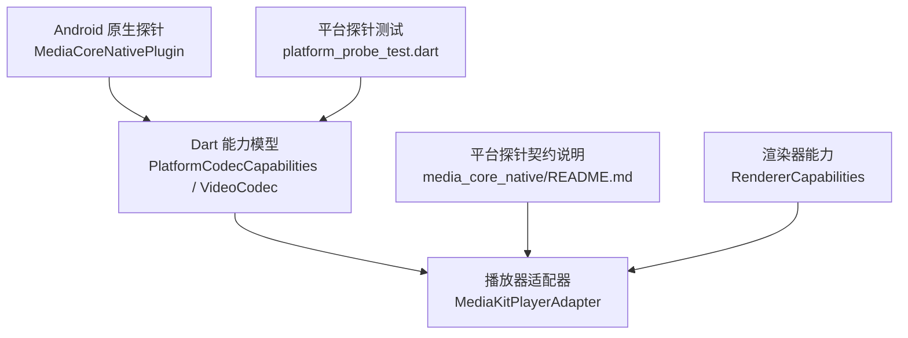
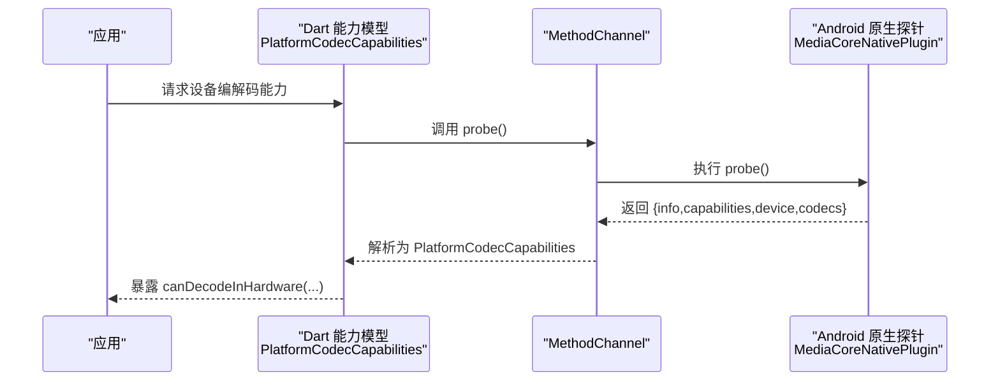
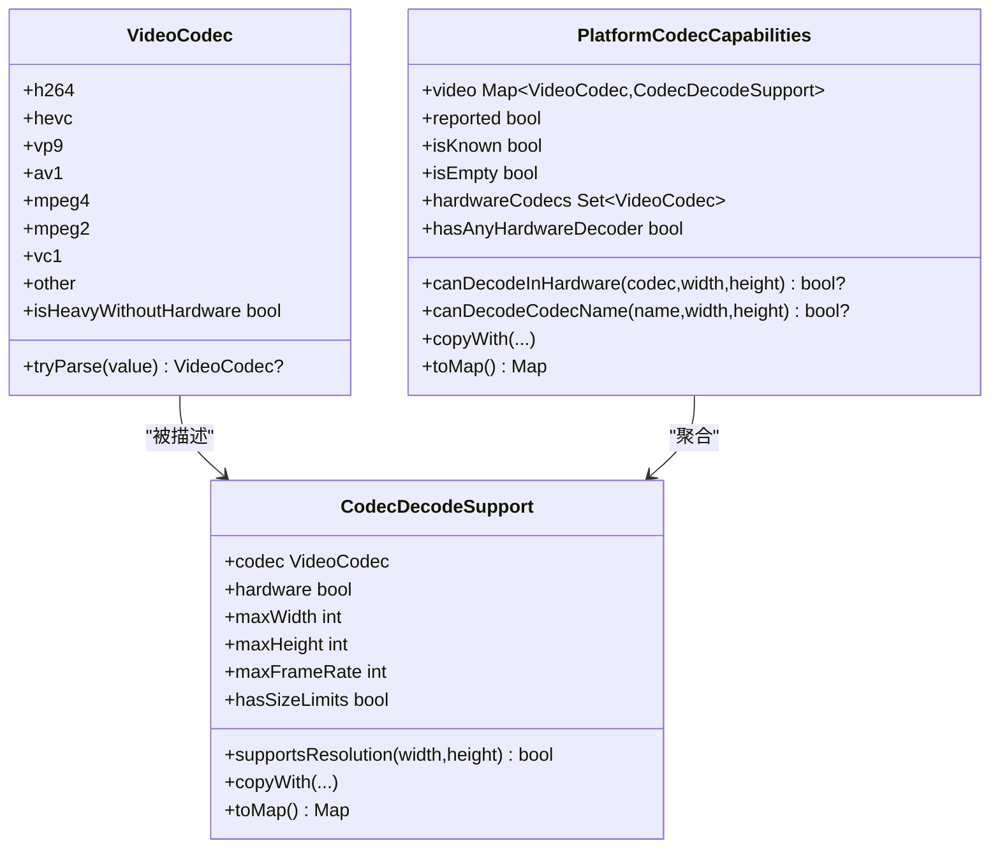
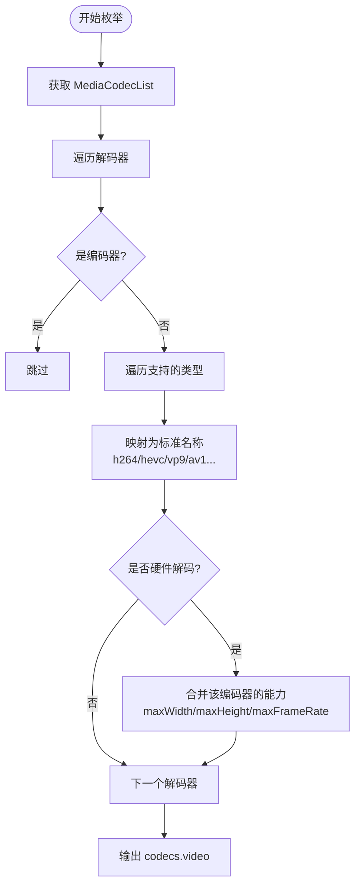
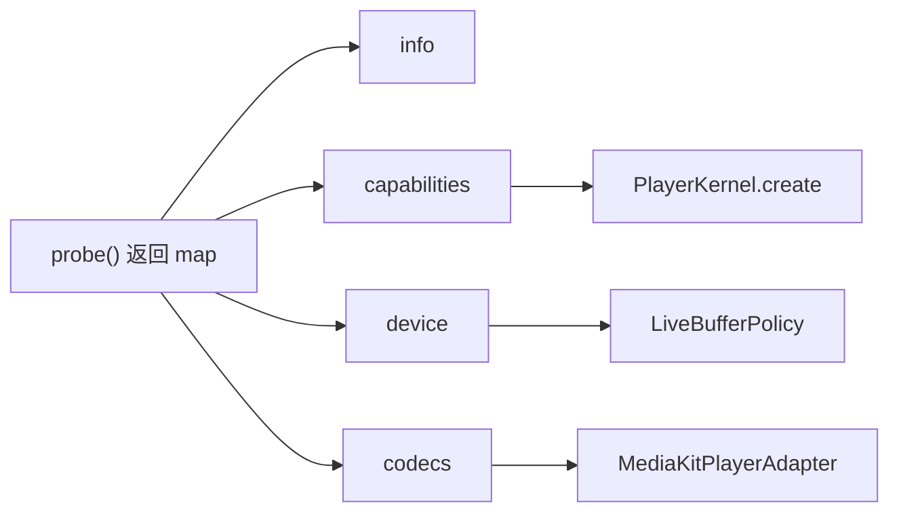
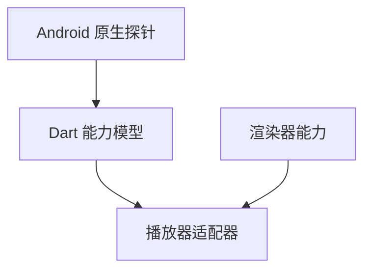

# 编解码能力探测

<cite>
**本文引用的文件**   
- [packages/media_core/lib/platform/platform_codec_capabilities.dart](file://packages/media_core/lib/platform/platform_codec_capabilities.dart)
- [packages/media_core_native/android/src/main/java/com/mediacore/nativeprobe/MediaCoreNativePlugin.java](file://packages/media_core_native/android/src/main/java/com/mediacore/nativeprobe/MediaCoreNativePlugin.java)
- [packages/media_core_native/README.md](file://packages/media_core_native/README.md)
- [packages/media_core_native/test/platform_probe_test.dart](file://packages/media_core_native/test/platform_probe_test.dart)
- [packages/media_core_media_kit/lib/src/media_kit_player_adapter.dart](file://packages/media_core_media_kit/lib/src/media_kit_player_adapter.dart)
- [packages/media_core/renderer/renderer_capabilities.dart](file://packages/media_core/renderer/renderer_capabilities.dart)
- [packages/media_core_audio/README.md](file://packages/media_core_audio/README.md)
</cite>

## 目录
1. [引言](#引言)
2. [项目结构](#项目结构)
3. [核心组件](#核心组件)
4. [架构总览](#架构总览)
5. [详细组件分析](#详细组件分析)
6. [依赖关系分析](#依赖关系分析)
7. [性能与基准测试](#性能与基准测试)
8. [故障诊断与降级策略](#故障诊断与降级策略)
9. [结论](#结论)

## 引言
本文聚焦 Media Core 对底层硬件编解码能力的探测机制，覆盖视频格式（H.264、H.265/HEVC、VP9、AV1）的硬件加速检测流程，以及音频编解码兼容性检测方法。文档同时说明 Android、iOS、Windows、macOS、Linux 等平台在探测 API 上的差异，解释能力缓存与动态更新策略，给出性能基准测试方法与降级策略，并提供常见问题的诊断思路。

## 项目结构
围绕“编解码能力探测”的关键代码分布在以下位置：
- Dart 侧能力模型：`platform_codec_capabilities.dart`
- Android 原生探针实现：`MediaCoreNativePlugin.java`
- 平台探针契约与消费点说明：`media_core_native/README.md`
- 平台探针单元测试：`platform_probe_test.dart`
- 播放器适配器对能力的裁剪与使用：`media_kit_player_adapter.dart`
- 渲染器能力模型：`renderer_capabilities.dart`
- 音频模块平台支持说明：`media_core_audio/README.md`

**图示来源**
- [packages/media_core/lib/platform/platform_codec_capabilities.dart:1-315](file://packages/media_core/lib/platform/platform_codec_capabilities.dart#L1-L315)
- [packages/media_core_native/android/src/main/java/com/mediacore/nativeprobe/MediaCoreNativePlugin.java:1-452](file://packages/media_core_native/android/src/main/java/com/mediacore/nativeprobe/MediaCoreNativePlugin.java#L1-L452)
- [packages/media_core_native/README.md:80-106](file://packages/media_core_native/README.md#L80-L106)
- [packages/media_core_native/test/platform_probe_test.dart:63-95](file://packages/media_core_native/test/platform_probe_test.dart#L63-L95)
- [packages/media_core_media_kit/lib/src/media_kit_player_adapter.dart:106-132](file://packages/media_core_media_kit/lib/src/media_kit_player_adapter.dart#L106-L132)
- [packages/media_core/renderer/renderer_capabilities.dart:92-147](file://packages/media_core/renderer/renderer_capabilities.dart#L92-L147)

**章节来源**
- [packages/media_core/lib/platform/platform_codec_capabilities.dart:1-315](file://packages/media_core/lib/platform/platform_codec_capabilities.dart#L1-L315)
- [packages/media_core_native/android/src/main/java/com/mediacore/nativeprobe/MediaCoreNativePlugin.java:1-452](file://packages/media_core_native/android/src/main/java/com/mediacore/nativeprobe/MediaCoreNativePlugin.java#L1-L452)
- [packages/media_core_native/README.md:80-106](file://packages/media_core_native/README.md#L80-L106)

## 核心组件
- 视频编解码枚举与解析：`VideoCodec` 提供 H.264、H.265/HEVC、VP9、AV1、MPEG-4、MPEG-2、VC-1 等统一词汇表，并兼容多种引擎拼写（如 hevc/h265/video/hevc、avc1.xxxx）。
- 单编解码器能力记录：`CodecDecodeSupport` 描述是否硬件解码、最大宽高与帧率上限；当上限未知时以 0 表示“未知”，而非“不支持”。
- 平台级编解码能力集合：`PlatformCodecCapabilities` 聚合各视频编码器的能力，提供 `canDecodeInHardware` 查询；未探测或未知编码器返回 `null`，明确区分“未知”和“不支持”。
- Android 原生探针：通过 `MediaCodecList` 枚举所有解码器，过滤出硬件解码器，合并同一编码器的最大分辨率与帧率范围，输出到 Dart 侧。
- 平台探针契约：仅一个 `probe` 方法，返回 info/capabilities/device/codecs 四段数据；缺失字段或缺失整段都表示“未知”，不等同于“不支持”。
- 播放器适配器裁剪：根据运行环境（如 Web）裁剪能力声明，避免上层规划器误判复合源或截图等能力。
- 渲染器能力：独立于编解码能力，描述渲染路径（叠加层、旋转、低延迟等），供播放链路选择合适渲染后端。

**章节来源**
- [packages/media_core/lib/platform/platform_codec_capabilities.dart:9-86](file://packages/media_core/lib/platform/platform_codec_capabilities.dart#L9-L86)
- [packages/media_core/lib/platform/platform_codec_capabilities.dart:88-186](file://packages/media_core/lib/platform/platform_codec_capabilities.dart#L88-L186)
- [packages/media_core/lib/platform/platform_codec_capabilities.dart:188-315](file://packages/media_core/lib/platform/platform_codec_capabilities.dart#L188-L315)
- [packages/media_core_native/android/src/main/java/com/mediacore/nativeprobe/MediaCoreNativePlugin.java:223-360](file://packages/media_core_native/android/src/main/java/com/mediacore/nativeprobe/MediaCoreNativePlugin.java#L223-L360)
- [packages/media_core_native/README.md:80-106](file://packages/media_core_native/README.md#L80-L106)
- [packages/media_core_media_kit/lib/src/media_kit_player_adapter.dart:106-132](file://packages/media_core_media_kit/lib/src/media_kit_player_adapter.dart#L106-L132)
- [packages/media_core/renderer/renderer_capabilities.dart:92-147](file://packages/media_core/renderer/renderer_capabilities.dart#L92-L147)

## 架构总览
下图展示从原生探针到 Dart 能力模型再到播放器适配器的完整调用链。

**图示来源**
- [packages/media_core_native/android/src/main/java/com/mediacore/nativeprobe/MediaCoreNativePlugin.java:140-163](file://packages/media_core_native/android/src/main/java/com/mediacore/nativeprobe/MediaCoreNativePlugin.java#L140-L163)
- [packages/media_core/lib/platform/platform_codec_capabilities.dart:214-315](file://packages/media_core/lib/platform/platform_codec_capabilities.dart#L214-L315)

## 详细组件分析

### 视频编解码能力模型（Dart 侧）
- `VideoCodec.tryParse` 兼容多种引擎命名，将 MIME 或字符串映射到稳定枚举。
- `CodecDecodeSupport.supportsResolution` 在无硬件解码时直接拒绝；有硬件解码但尺寸未知时放行，避免把“未知”误判为“不支持”。
- `PlatformCodecCapabilities.canDecodeInHardware` 在未探测或未知编码器时返回 `null`，让上层决定尝试软解或走恢复链路。

**图示来源**
- [packages/media_core/lib/platform/platform_codec_capabilities.dart:9-86](file://packages/media_core/lib/platform/platform_codec_capabilities.dart#L9-L86)
- [packages/media_core/lib/platform/platform_codec_capabilities.dart:88-186](file://packages/media_core/lib/platform/platform_codec_capabilities.dart#L88-L186)
- [packages/media_core/lib/platform/platform_codec_capabilities.dart:188-315](file://packages/media_core/lib/platform/platform_codec_capabilities.dart#L188-L315)

**章节来源**
- [packages/media_core/lib/platform/platform_codec_capabilities.dart:9-86](file://packages/media_core/lib/platform/platform_codec_capabilities.dart#L9-L86)
- [packages/media_core/lib/platform/platform_codec_capabilities.dart:88-186](file://packages/media_core/lib/platform/platform_codec_capabilities.dart#L88-L186)
- [packages/media_core/lib/platform/platform_codec_capabilities.dart:188-315](file://packages/media_core/lib/platform/platform_codec_capabilities.dart#L188-L315)

### Android 原生探针实现
- 通过 `MediaCodecList` 遍历所有解码器，跳过编码器，只保留硬件解码器。
- 对每个硬件解码器，读取其支持的宽高与帧率范围，取最大值作为该编码器的能力上限。
- 若 OEM 系统拒绝列出编解码器，则 codecs 块为空，Dart 侧视为“未知”，不会错误地禁用硬解。
- 硬件加速判断：API 29+ 使用 `isHardwareAccelerated()`；更早版本通过名称前缀排除软件解码器。

**图示来源**
- [packages/media_core_native/android/src/main/java/com/mediacore/nativeprobe/MediaCoreNativePlugin.java:223-360](file://packages/media_core_native/android/src/main/java/com/mediacore/nativeprobe/MediaCoreNativePlugin.java#L223-L360)

**章节来源**
- [packages/media_core_native/android/src/main/java/com/mediacore/nativeprobe/MediaCoreNativePlugin.java:223-360](file://packages/media_core_native/android/src/main/java/com/mediacore/nativeprobe/MediaCoreNativePlugin.java#L223-L360)

### 平台探针契约与消费点
- 通道方法只有一个 `probe`，返回最多四段数据：info、capabilities、device、codecs。
- 缺失字段或缺失整段都表示“未知”，不是“不支持”。
- 消费点包括：
  - `PlayerKernel.create` → `SessionContext.platform`
  - `PlayerKernel.create` → `PlayerAdapterContext`
  - `MediaKitPlayerAdapter._applyDecoderPolicy`：设备无某编码器的硬解时直接软解，避免浪费一次注定失败的硬解尝试。
  - `LiveBufferPolicy`：低内存设备的前向/后向缓冲字节上限。

**图示来源**
- [packages/media_core_native/README.md:80-106](file://packages/media_core_native/README.md#L80-L106)

**章节来源**
- [packages/media_core_native/README.md:80-106](file://packages/media_core_native/README.md#L80-L106)

### 播放器适配器对能力的裁剪
- 在 Web 环境下，媒体_kit 驱动 HTML video 元素，没有外部音轨/字幕通道，因此会裁剪 composite 支持。
- 同样会关闭截图与引擎选项能力，避免上层反复重建播放器。
- 这些裁剪确保规划器不会路由无法实现的复合源，从而避免静默失败。

**章节来源**
- [packages/media_core_media_kit/lib/src/media_kit_player_adapter.dart:106-132](file://packages/media_core_media_kit/lib/src/media_kit_player_adapter.dart#L106-L132)

### 渲染器能力
- 渲染器能力关注视频渲染路径（叠加层、镜像、旋转、硬件加速、低延迟），与编解码能力互补。
- 用于选择适合的渲染后端，保证画面呈现质量与性能。

**章节来源**
- [packages/media_core/renderer/renderer_capabilities.dart:92-147](file://packages/media_core/renderer/renderer_capabilities.dart#L92-L147)

### 音频编解码兼容性检测
- 音频模块的平台支持清单显示：Android、Windows、macOS、Linux、iOS 均支持播放/队列/歌词等能力；Web 不支持本地文件系统访问。
- 音频兼容性更多由具体播放器后端与系统音频栈决定；本仓库中音频模块主要提供跨平台抽象与桌面歌词窗口等能力，并未在此处实现统一的音频编解码矩阵探测。
- 对于 AAC、MP3、FLAC、Opus 等格式，建议结合具体播放器后端（如 media_kit、better_player 等）的能力报告进行验证。

**章节来源**
- [packages/media_core_audio/README.md:69-85](file://packages/media_core_audio/README.md#L69-L85)

## 依赖关系分析
- Dart 能力模型依赖稳定的 `VideoCodec` 枚举，屏蔽不同引擎的命名差异。
- Android 原生探针依赖 `MediaCodecList`、`ActivityManager`、`PackageManager`、`DisplayManager` 等系统 API。
- 播放器适配器依赖 `PlatformCodecCapabilities` 来决定解码策略（硬解优先、软解兜底）。
- 渲染器能力与编解码能力相互独立，共同影响播放体验。

**图示来源**
- [packages/media_core_native/android/src/main/java/com/mediacore/nativeprobe/MediaCoreNativePlugin.java:1-452](file://packages/media_core_native/android/src/main/java/com/mediacore/nativeprobe/MediaCoreNativePlugin.java#L1-L452)
- [packages/media_core/lib/platform/platform_codec_capabilities.dart:1-315](file://packages/media_core/lib/platform/platform_codec_capabilities.dart#L1-L315)
- [packages/media_core_media_kit/lib/src/media_kit_player_adapter.dart:106-132](file://packages/media_core_media_kit/lib/src/media_kit_player_adapter.dart#L106-L132)
- [packages/media_core/renderer/renderer_capabilities.dart:92-147](file://packages/media_core/renderer/renderer_capabilities.dart#L92-L147)

**章节来源**
- [packages/media_core_native/android/src/main/java/com/mediacore/nativeprobe/MediaCoreNativePlugin.java:1-452](file://packages/media_core_native/android/src/main/java/com/mediacore/nativeprobe/MediaCoreNativePlugin.java#L1-L452)
- [packages/media_core/lib/platform/platform_codec_capabilities.dart:1-315](file://packages/media_core/lib/platform/platform_codec_capabilities.dart#L1-L315)
- [packages/media_core_media_kit/lib/src/media_kit_player_adapter.dart:106-132](file://packages/media_core_media_kit/lib/src/media_kit_player_adapter.dart#L106-L132)
- [packages/media_core/renderer/renderer_capabilities.dart:92-147](file://packages/media_core/renderer/renderer_capabilities.dart#L92-L147)

## 性能与基准测试
- 基准维度建议：
  - 启动时间：首次 probe 耗时与后续复用能力的时间差。
  - 解码吞吐：不同编码（H.264/H.265/VP9/AV1）在硬解与软解下的 CPU/GPU 占用、丢帧率、首帧时间。
  - 分辨率与帧率边界：针对 `maxWidth/maxHeight/maxFrameRate` 的越界行为与回退策略。
  - 低内存场景：`lowRamDevice` 触发时的缓冲策略与卡顿表现。
- 测试方法建议：
  - 使用固定码率与分辨率的视频样本集，分别在不同设备上跑通硬解与软解路径。
  - 对比 `canDecodeInHardware` 返回 true/false/null 三种情况下的实际解码路径。
  - 在 Web 与非 Web 环境下分别验证适配器裁剪后的能力声明是否导致计划失败。

[本节为通用指导，不直接分析具体文件]

## 故障诊断与降级策略
- 常见问题与定位：
  - 探针失败：原生侧捕获异常并以“未知”处理，不影响播放；检查 `NativePlatformProvider.isReady` 与 `PlatformCodecCapabilities.reported`。
  - 未知编码器：`canDecodeInHardware` 返回 null，应允许引擎尝试软解或走恢复链路。
  - 尺寸未知：`maxWidth/maxHeight` 为 0 表示未知，不应据此拒绝硬解。
  - 平台 PiP 与后台播放：PiP 与后台播放能力需结合平台特性与应用清单声明综合判断。
- 降级策略：
  - 无硬解：直接软解，避免浪费一次硬解尝试。
  - 低内存设备：降低缓冲上限，减少内存峰值。
  - Web 环境：裁剪截图、引擎选项、composite 支持，避免不可用能力误导规划器。

**章节来源**
- [packages/media_core_native/test/platform_probe_test.dart:63-95](file://packages/media_core_native/test/platform_probe_test.dart#L63-L95)
- [packages/media_core/lib/platform/platform_codec_capabilities.dart:188-315](file://packages/media_core/lib/platform/platform_codec_capabilities.dart#L188-L315)
- [packages/media_core_native/README.md:80-106](file://packages/media_core_native/README.md#L80-L106)
- [packages/media_core_media_kit/lib/src/media_kit_player_adapter.dart:106-132](file://packages/media_core_media_kit/lib/src/media_kit_player_adapter.dart#L106-L132)

## 结论
Media Core 的编解码能力探测以“未知不等于不支持”为核心原则，通过 Android 原生探针枚举硬件解码器并上报能力，Dart 侧以稳定枚举与能力模型统一表达，播放器适配器在此基础上做环境与能力裁剪，最终形成稳健的解码决策与降级路径。对于 iOS、Windows、macOS、Linux，平台探针契约保持一致，缺失信息一律视为未知，确保播放链路不因探测失败而退化。音频编解码兼容性建议结合具体播放器后端能力进行验证。