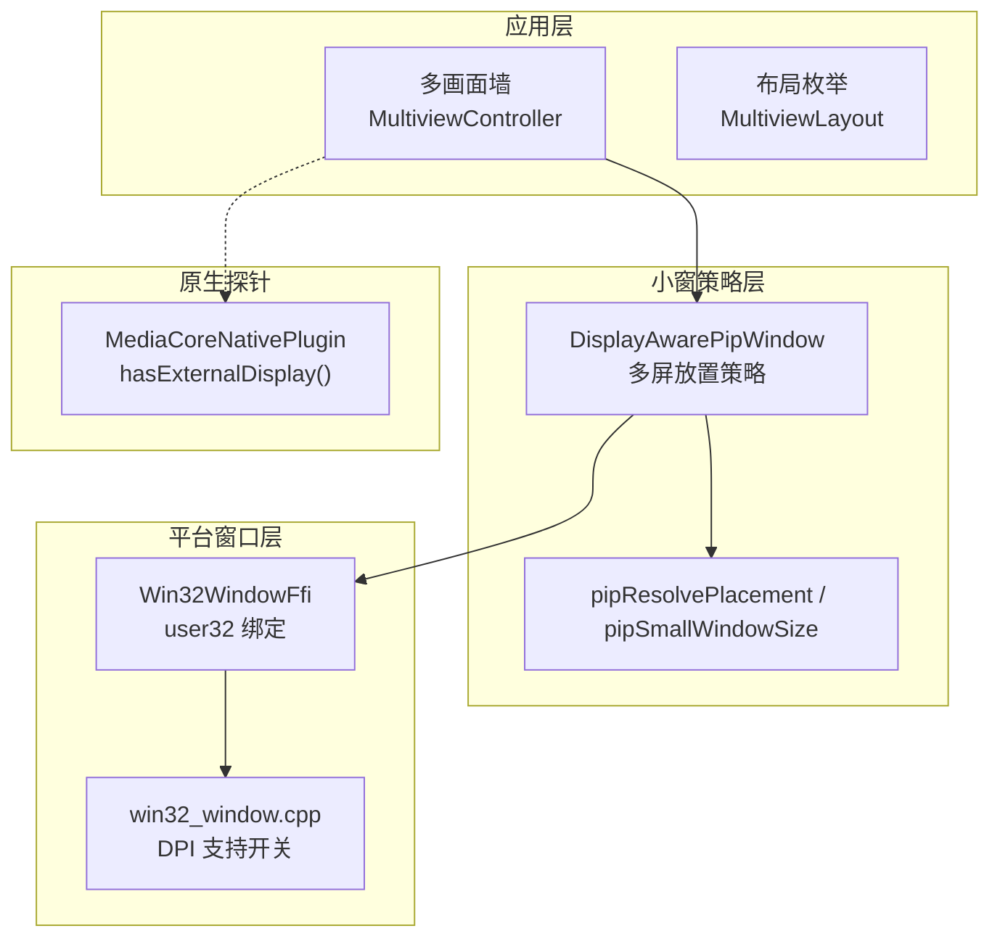
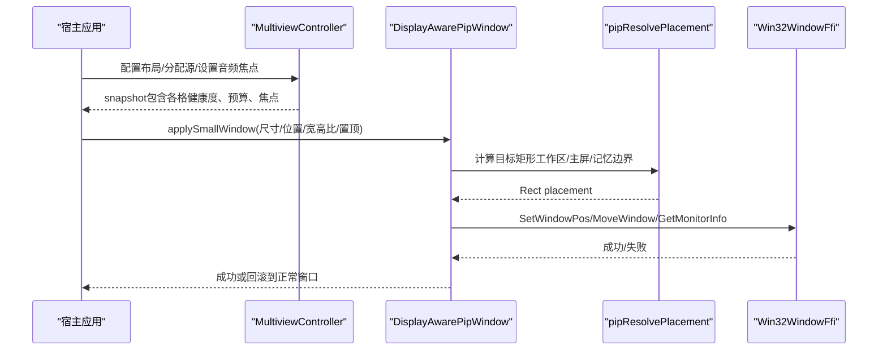
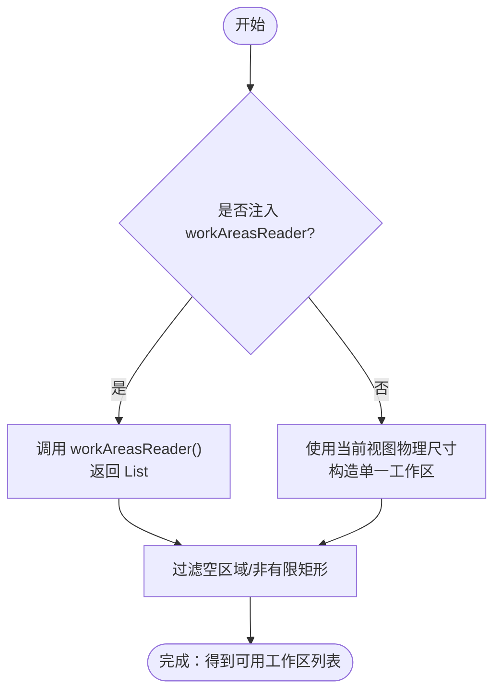
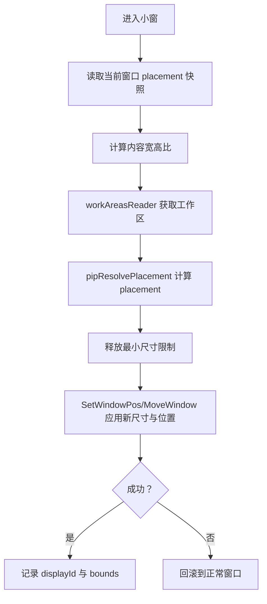
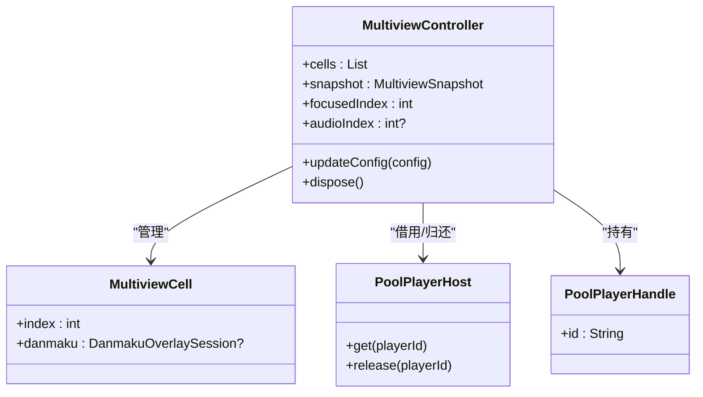
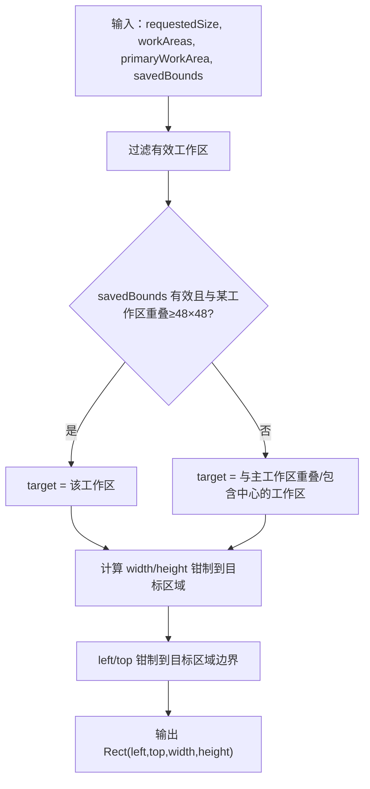
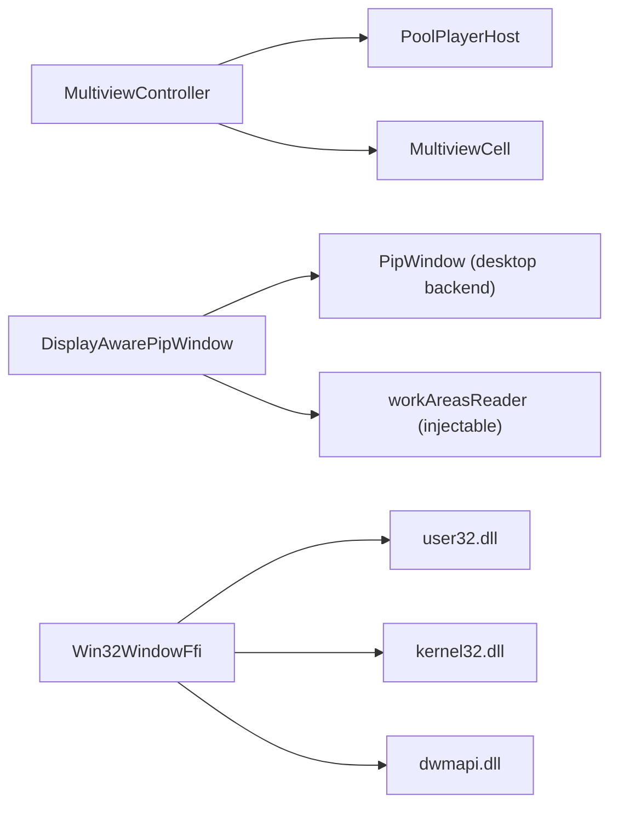

# 多显示器支持

<cite>
**本文引用的文件**   
- [media_core_multiview.dart](file://packages/media_core_multiview/lib/media_core_multiview.dart)
- [multiview_controller.dart](file://packages/media_core_multiview/lib/src/multiview_controller.dart)
- [multiview_layout.dart](file://packages/media_core_multiview/lib/src/multiview_layout.dart)
- [display_pip_window.dart](file://packages/media_core_pip/lib/src/display_pip_window.dart)
- [win32_window_ffi.dart](file://packages/media_core_win32/lib/src/win32_window_ffi.dart)
- [MediaCoreNativePlugin.java](file://packages/media_core_native/android/src/main/java/com/mediacore/nativeprobe/MediaCoreNativePlugin.java)
- [README.md（媒体核心原生探针）](file://packages/media_core_native/README.md)
- [win32_window.cpp](file://example/windows/runner/win32_window.cpp)
</cite>

## 目录
1. [简介](#简介)
2. [项目结构](#项目结构)
3. [核心组件](#核心组件)
4. [架构总览](#架构总览)
5. [详细组件分析](#详细组件分析)
6. [依赖关系分析](#依赖关系分析)
7. [性能考虑](#性能考虑)
8. [故障排查指南](#故障排查指南)
9. [结论](#结论)

## 简介
本文面向 Media Core 在多显示器环境下的适配与优化，围绕以下目标展开：
- 显示器检测机制：枚举显示器、获取工作区与主屏信息。
- 分辨率与 DPI 适配：不同 DPI 设置下的缩放因子计算、像素密度适配与窗口尺寸约束。
- 多屏同步机制：播放器实例管理、状态同步与跨屏播放控制。
- 窗口定位算法：主显示器识别、窗口放置策略与边界检测。
- 色彩空间管理：HDR 支持与显示设备特性探测的接入点说明。
- 桌面环境兼容：Windows、macOS、Linux 的集成方式与差异。
- 性能优化与常见问题：解码预算、巡更与重启风暴防护、回滚与错误恢复。

本仓库中，多显示器能力由“多画面墙”“小窗（PiP）策略层”“Win32 窗口 FFI”“原生探针”共同构成；上层通过可注入的显示器读取器解耦平台实现，便于在不同桌面环境中复用同一套布局与定位逻辑。

## 项目结构
与多显示器相关的关键代码分布在以下包与文件中：
- media_core_multiview：多画面墙控制器、布局与快照，负责按布局容量与解码预算组织多个播放器实例。
- media_core_pip：桌面小窗策略层，提供跨显示器的工作区感知、记忆化边界与放置算法。
- media_core_win32：基于 user32.dll 的 Win32 窗口操作封装，用于全屏、移动、尺寸与 monitor 信息读取。
- media_core_native：原生探针，报告外接显示器等系统能力。
- example/windows/runner：示例工程中的 DPI 支持启用逻辑。

**图表来源**
- [multiview_controller.dart:39-73](file://packages/media_core_multiview/lib/src/multiview_controller.dart#L39-L73)
- [display_pip_window.dart:77-122](file://packages/media_core_pip/lib/src/display_pip_window.dart#L77-L122)
- [win32_window_ffi.dart:174-194](file://packages/media_core_win32/lib/src/win32_window_ffi.dart#L174-L194)
- [MediaCoreNativePlugin.java:432-446](file://packages/media_core_native/android/src/main/java/com/mediacore/nativeprobe/MediaCoreNativePlugin.java#L432-L446)

**章节来源**
- [media_core_multiview.dart:1-29](file://packages/media_core_multiview/lib/media_core_multiview.dart#L1-L29)
- [multiview_controller.dart:39-73](file://packages/media_core_multiview/lib/src/multiview_controller.dart#L39-L73)
- [multiview_layout.dart:1-59](file://packages/media_core_multiview/lib/src/multiview_layout.dart#L1-L59)
- [display_pip_window.dart:77-122](file://packages/media_core_pip/lib/src/display_pip_window.dart#L77-L122)
- [win32_window_ffi.dart:174-194](file://packages/media_core_win32/lib/src/win32_window_ffi.dart#L174-L194)
- [MediaCoreNativePlugin.java:432-446](file://packages/media_core_native/android/src/main/java/com/mediacore/nativeprobe/MediaCoreNativePlugin.java#L432-L446)

## 核心组件
- 多画面墙控制器（MultiviewController）
  - 职责：为每个格子分配一个播放器实例，保持唯一音频归属与焦点格，维护解码预算、停滞检测与自动重启，并提供逐格弹幕路由。
  - 多显示器关联：墙本身不直接渲染网格，而是通过宿主将播放器交给具体显示位置；墙关注的是“有多少个解码器在运行”，避免多屏时把资源耗尽。
- 布局（MultiviewLayout）
  - 定义单屏、双屏、四宫格、九宫格与聚焦布局，给出每类布局的容量、行列数与是否含聚焦格。
- 小窗策略层（DisplayAwarePipWindow）
  - 职责：跨显示器的小窗放置、记忆化边界、最小尺寸释放、失败回滚与序列化操作队列。
  - 关键函数：pipResolvePlacement（根据工作区与保存边界计算最终矩形）、pipSmallWindowSize（按宽高比确定小窗尺寸）。
- Win32 窗口 FFI（Win32WindowFfi）
  - 职责：通过 user32.dll 进行窗口查找、样式修改、移动/尺寸设置、placement 快照/恢复、MonitorFromWindow/GetMonitorInfoW 获取 monitor 信息。
- 原生探针（MediaCoreNativePlugin）
  - 职责：报告系统能力，包括是否有外接显示器（Android DisplayManager），以及编解码矩阵、内存等信息。

**章节来源**
- [multiview_controller.dart:39-73](file://packages/media_core_multiview/lib/src/multiview_controller.dart#L39-L73)
- [multiview_layout.dart:1-59](file://packages/media_core_multiview/lib/src/multiview_layout.dart#L1-L59)
- [display_pip_window.dart:77-122](file://packages/media_core_pip/lib/src/display_pip_window.dart#L77-L122)
- [win32_window_ffi.dart:174-194](file://packages/media_core_win32/lib/src/win32_window_ffi.dart#L174-L194)
- [MediaCoreNativePlugin.java:432-446](file://packages/media_core_native/android/src/main/java/com/mediacore/nativeprobe/MediaCoreNativePlugin.java#L432-L446)

## 架构总览
下图展示多显示器环境下，从“墙”到“小窗策略”再到“平台窗口”的数据与控制流：

**图表来源**
- [multiview_controller.dart:39-73](file://packages/media_core_multiview/lib/src/multiview_controller.dart#L39-L73)
- [display_pip_window.dart:212-328](file://packages/media_core_pip/lib/src/display_pip_window.dart#L212-L328)
- [win32_window_ffi.dart:462-511](file://packages/media_core_win32/lib/src/win32_window_ffi.dart#L462-L511)

## 详细组件分析

### 显示器检测与工作区枚举
- Android 原生探针通过 DisplayManager.getDisplays 判断是否存在外接显示器，并返回布尔能力。
- Flutter 侧小窗策略层通过可注入的 workAreasReader 获取所有显示器的工作区列表；若未注入，则回退到当前视图的物理尺寸作为单一工作区。
- Windows 平台通过 MonitorFromWindow 与 GetMonitorInfoW 获取窗口所在 monitor 的 rcMonitor，用于全屏与边界计算。

**图表来源**
- [display_pip_window.dart:367-382](file://packages/media_core_pip/lib/src/display_pip_window.dart#L367-L382)
- [MediaCoreNativePlugin.java:432-446](file://packages/media_core_native/android/src/main/java/com/mediacore/nativeprobe/MediaCoreNativePlugin.java#L432-L446)
- [win32_window_ffi.dart:462-490](file://packages/media_core_win32/lib/src/win32_window_ffi.dart#L462-L490)

**章节来源**
- [MediaCoreNativePlugin.java:432-446](file://packages/media_core_native/android/src/main/java/com/mediacore/nativeprobe/MediaCoreNativePlugin.java#L432-L446)
- [display_pip_window.dart:367-382](file://packages/media_core_pip/lib/src/display_pip_window.dart#L367-L382)
- [win32_window_ffi.dart:462-490](file://packages/media_core_win32/lib/src/win32_window_ffi.dart#L462-L490)

### 分辨率适配与 DPI 处理
- Windows 示例工程中动态加载 EnableNonClientDpiScaling，以启用 Per-Monitor V1 的 DPI 感知。
- Win32WindowFfi 通过 user32 接口进行窗口移动与尺寸设置，结合 monitor 信息确保窗口落在正确显示器上。
- 小窗策略层根据内容宽高比计算小窗尺寸，并在进入小窗前释放最小尺寸限制，以便达到紧凑尺寸；退出时恢复原最小尺寸。

**图表来源**
- [win32_window.cpp:40-54](file://example/windows/runner/win32_window.cpp#L40-L54)
- [display_pip_window.dart:231-328](file://packages/media_core_pip/lib/src/display_pip_window.dart#L231-L328)
- [win32_window_ffi.dart:462-511](file://packages/media_core_win32/lib/src/win32_window_ffi.dart#L462-L511)

**章节来源**
- [win32_window.cpp:40-54](file://example/windows/runner/win32_window.cpp#L40-L54)
- [display_pip_window.dart:231-328](file://packages/media_core_pip/lib/src/display_pip_window.dart#L231-L328)
- [win32_window_ffi.dart:462-511](file://packages/media_core_win32/lib/src/win32_window_ffi.dart#L462-L511)

### 多屏同步机制（播放器实例管理与状态同步）
- MultiviewController 为每个格子持有 PoolPlayerHandle，并通过 PoolPlayerHost 复用播放器实例，避免冷启动开销。
- 通过 PlayerTransportState 子流监控每个格子的播放进度，停滞超过阈值则在解码预算内重启；上一轮未完成时不再开启第二轮扫描，防止“重启风暴”。
- 音频焦点与视频焦点分离：被听的格子与被看的格子可以不同，muteAll 会记住静音前的音频模式，取消静音不会改变混合模式。

**图表来源**
- [multiview_controller.dart:74-173](file://packages/media_core_multiview/lib/src/multiview_controller.dart#L74-L173)

**章节来源**
- [multiview_controller.dart:74-173](file://packages/media_core_multiview/lib/src/multiview_controller.dart#L74-L173)

### 窗口定位算法（主显示器识别、放置策略与边界检测）
- pipResolvePlacement 的核心逻辑：
  - 优先尝试匹配已保存的边界：只要保存边界与某个工作区重叠至少 48×48，就认为该显示器仍有效。
  - 否则选择与主工作区重叠或包含其中心的显示器。
  - 对请求尺寸进行最小宽度/高度钳制，并将位置限制在工作区内，默认放在右下角留 margin。
- pipDisplayIdForPosition 根据位置坐标反查显示器 id，用于持久化 displayId 与 bounds 的对应关系。

**图表来源**
- [display_pip_window.dart:84-122](file://packages/media_core_pip/lib/src/display_pip_window.dart#L84-L122)

**章节来源**
- [display_pip_window.dart:84-122](file://packages/media_core_pip/lib/src/display_pip_window.dart#L84-L122)

### 色彩空间管理与 HDR 支持
- 当前仓库未直接实现色彩空间/HDR 切换逻辑；但原生探针具备“能力上报”通道，可在未来扩展显示设备特性探测（如 HDR 支持、色域、亮度范围）。
- 建议接入点：
  - 在原生探针中增加显示设备特性字段（例如 supportsHDR、colorGamut、maxBrightness）。
  - 在播放器适配器能力（PlayerAdapterCapabilities）中暴露 supportsHDR 与色彩配置。
  - 在小窗/全屏策略中根据能力调整渲染管线与色彩空间。

[本节为概念性说明，不涉及具体文件实现]

### 桌面环境兼容性
- Windows：
  - 通过 user32.dll 直接绑定窗口操作，支持 monitor 信息读取、placement 快照/恢复、全屏与拖拽。
  - 示例工程启用 EnableNonClientDpiScaling 以支持 Per-Monitor V1 DPI。
- macOS/Linux：
  - 小窗策略层默认后端使用 window_manager；策略层本身与平台解耦，仅负责放置与记忆化。
- Android：
  - 原生探针通过 DisplayManager 判断外接显示器存在与否，可作为能力上报的一部分。

**章节来源**
- [win32_window_ffi.dart:174-194](file://packages/media_core_win32/lib/src/win32_window_ffi.dart#L174-L194)
- [win32_window.cpp:40-54](file://example/windows/runner/win32_window.cpp#L40-L54)
- [MediaCoreNativePlugin.java:432-446](file://packages/media_core_native/android/src/main/java/com/mediacore/nativeprobe/MediaCoreNativePlugin.java#L432-L446)
- [README.md（媒体核心原生探针）:123-138](file://packages/media_core_native/README.md#L123-L138)

## 依赖关系分析
- MultiviewController 依赖 PoolPlayerHost 管理播放器实例生命周期，并通过 MultiviewCell 聚合弹幕会话与健康状态。
- DisplayAwarePipWindow 依赖 PipWindow 抽象（默认 desktop 后端），并通过 workAreasReader 注入显示器枚举，从而与平台解耦。
- Win32WindowFfi 依赖 user32.dll 与 kernel32.dll/dwmapi.dll，提供底层窗口操作。
- 原生探针独立于 UI 层，仅提供系统能力数据。

**图表来源**
- [multiview_controller.dart:74-173](file://packages/media_core_multiview/lib/src/multiview_controller.dart#L74-L173)
- [display_pip_window.dart:137-160](file://packages/media_core_pip/lib/src/display_pip_window.dart#L137-L160)
- [win32_window_ffi.dart:174-194](file://packages/media_core_win32/lib/src/win32_window_ffi.dart#L174-L194)

**章节来源**
- [multiview_controller.dart:74-173](file://packages/media_core_multiview/lib/src/multiview_controller.dart#L74-L173)
- [display_pip_window.dart:137-160](file://packages/media_core_pip/lib/src/display_pip_window.dart#L137-L160)
- [win32_window_ffi.dart:174-194](file://packages/media_core_win32/lib/src/win32_window_ffi.dart#L174-L194)

## 性能考虑
- 解码预算与格子数量：
  - 每个格子是一个解码器，墙必须尊重 effectiveMaxCells；当 ResourcePressure 升高时立即生效，而不是等待下一次 tick。
  - 策略包括：仅保留焦点格、让平台丢帧、拒绝新格子。
- 停滞检测与重启风暴防护：
  - 每 2 秒检查一次播放进度；若上一轮扫描未完成，不再开启第二轮，避免重复计数与并发重启。
  - 对于带 playlist 的格子，预算耗尽后前进到下一个房间，避免“盯着一帧静止画面”。
- 小窗最小尺寸与回滚：
  - 进入小窗前释放最小尺寸限制，以便达到紧凑尺寸；失败时逐步回滚到正常窗口，保证状态一致性。
- 序列化操作队列：
  - 所有窗口操作串行执行，避免竞态条件导致的布局错乱。

**章节来源**
- [multiview_controller.dart:39-73](file://packages/media_core_multiview/lib/src/multiview_controller.dart#L39-L73)
- [multiview_controller.dart:120-144](file://packages/media_core_multiview/lib/src/multiview_controller.dart#L120-L144)
- [display_pip_window.dart:300-328](file://packages/media_core_pip/lib/src/display_pip_window.dart#L300-L328)
- [display_pip_window.dart:386-397](file://packages/media_core_pip/lib/src/display_pip_window.dart#L386-L397)

## 故障排查指南
- 小窗无法出现在预期显示器：
  - 检查 workAreasReader 是否正确返回所有显示器的工作区。
  - 确认 pipDisplayIdForPosition 能根据位置坐标匹配到正确的 displayId。
  - 验证 savedBounds 是否与当前显示器匹配（displayId 与重叠面积）。
- 小窗尺寸异常或被裁剪：
  - 检查 pipResolvePlacement 的 width/height 钳制逻辑与 placementMargin。
  - 确认进入小窗前是否释放了最小尺寸限制。
- 多屏下全屏错位：
  - 检查 Win32WindowFfi 的 MonitorFromWindow/GetMonitorInfoW 是否返回正确的 rcMonitor。
  - 确认 SetWindowPos 的参数是否包含 SWP_FRAMECHANGED。
- 解码卡顿与格子变黑：
  - 查看 MultiviewController 的 snapshot.budgetExceeded 与 cell 健康状态。
  - 确认 ResourcePressure 上报后策略是否立即生效。
  - 检查停滞检测是否因异步体耗时导致重复扫描。

**章节来源**
- [display_pip_window.dart:84-122](file://packages/media_core_pip/lib/src/display_pip_window.dart#L84-L122)
- [display_pip_window.dart:231-328](file://packages/media_core_pip/lib/src/display_pip_window.dart#L231-L328)
- [win32_window_ffi.dart:462-511](file://packages/media_core_win32/lib/src/win32_window_ffi.dart#L462-L511)
- [multiview_controller.dart:39-73](file://packages/media_core_multiview/lib/src/multiview_controller.dart#L39-L73)

## 结论
Media Core 的多显示器支持通过“多画面墙 + 小窗策略层 + 平台窗口 FFI + 原生探针”的分层设计实现：
- 多画面墙专注于解码预算、格子健康与焦点/音频管理，避免在多屏场景下资源耗尽。
- 小窗策略层提供跨显示器的工作区感知、记忆化边界与稳健的放置算法，并与平台后端解耦。
- Win32 层提供底层窗口操作与 monitor 信息，示例工程启用 DPI 支持以确保界面清晰。
- 原生探针可扩展显示设备特性，为未来的 HDR 与色彩空间管理预留接入点。

在实际部署中，建议：
- 始终注入 workAreasReader，以获得准确的显示器枚举与工作区。
- 在宿主层根据 ResourcePressure 调整 MultiviewConfig.effectiveMaxCells。
- 对小窗的最小尺寸与 placementMargin 进行调优，以适应不同 DPI 与屏幕密度。
- 在 Windows 上启用 Per-Monitor V1 DPI 支持，并确保 SetWindowPos 参数正确。
- 在原生探针中扩展显示设备特性，为后续 HDR/色域管理做准备。