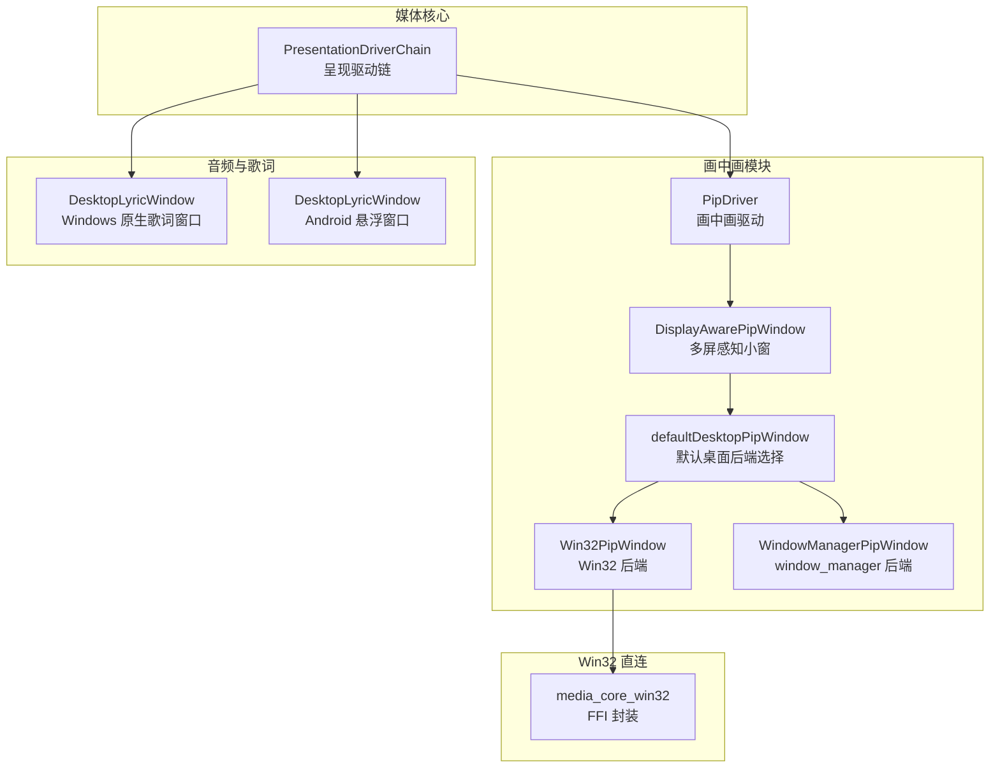
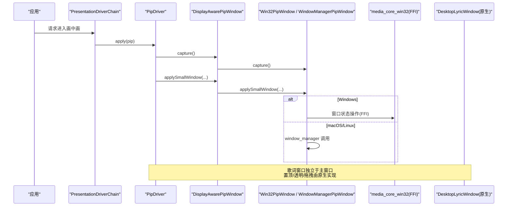
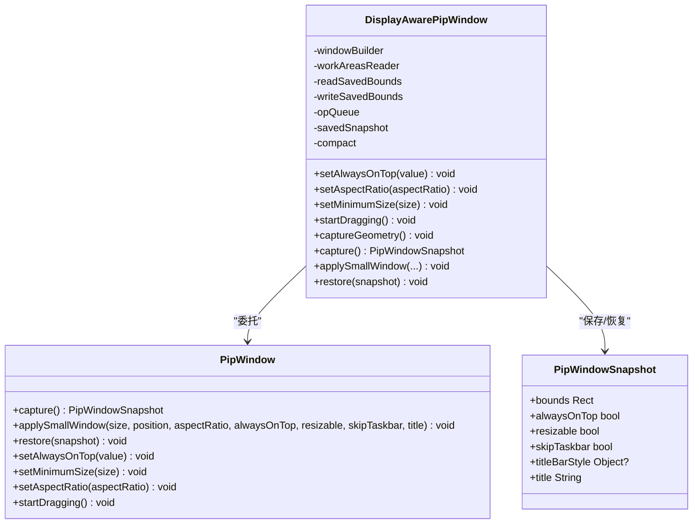
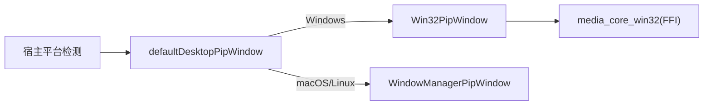
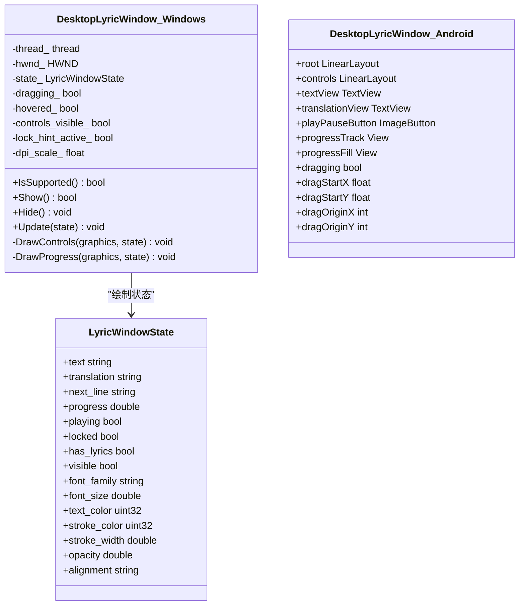
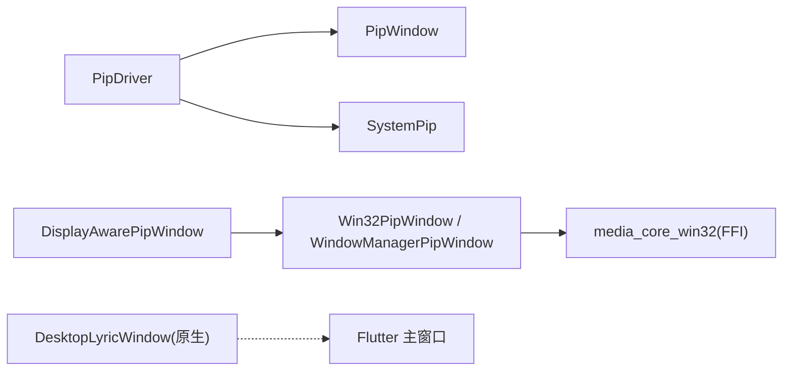

# 桌面特性支持

<cite>
**本文引用的文件**   
- [media_core_pip.dart](file://packages/media_core_pip/lib/media_core_pip.dart)
- [pip_driver.dart](file://packages/media_core_pip/lib/src/pip_driver.dart)
- [pip_window.dart](file://packages/media_core_pip/lib/src/pip_window.dart)
- [desktop_pip_window.dart](file://packages/media_core_pip/lib/src/desktop_pip_window.dart)
- [display_pip_window.dart](file://packages/media_core_pip/lib/src/display_pip_window.dart)
- [win32_pip_window.dart](file://packages/media_core_pip/lib/src/win32_pip_window.dart)
- [window_manager_pip_window.dart](file://packages/media_core_pip/lib/src/window_manager_pip_window.dart)
- [media_core_win32.dart](file://packages/media_core_win32/lib/media_core_win32.dart)
- [win32_window_ffi.dart](file://packages/media_core_win32/lib/src/win32_window_ffi.dart)
- [desktop_lyric_window.h](file://packages/media_core_audio/windows/desktop_lyric_window.h)
- [DesktopLyricWindow.java](file://packages/media_core_audio/android/src/main/java/com/mediacore/audio/DesktopLyricWindow.java)
- [README.md](file://packages/media_core_audio/README.md)
</cite>

## 目录
1. [简介](#简介)
2. [项目结构](#项目结构)
3. [核心组件](#核心组件)
4. [架构总览](#架构总览)
5. [详细组件分析](#详细组件分析)
6. [依赖关系分析](#依赖关系分析)
7. [性能与优化](#性能与优化)
8. [故障排查指南](#故障排查指南)
9. [结论](#结论)

## 简介
本文面向桌面平台，系统性梳理 Media Core 在桌面端的特有能力与实现方式，重点覆盖：
- 桌面歌词窗口的原生实现：窗口管理、透明度控制、置顶显示、拖拽交互。
- 画中画模式的平台差异处理：Windows 的 PiP API、macOS 的 Picture-in-Picture、Linux 的 XDG 规范支持。
- 多显示器支持：分辨率适配、DPI 缩放、多屏同步与位置记忆。
- 键盘快捷键映射、鼠标手势与触摸板手势的处理思路。
- 桌面 UI 优化、窗口动画与系统托盘集成建议。
- 各桌面环境兼容性处理与主题适配方案。
- 性能优化技巧与常见问题排查方法。

## 项目结构
Media Core 将“桌面小窗”和“画中画”作为可插拔能力组织在不同包中：
- media_core_pip：统一的画中画驱动与桌面窗口策略，按平台选择后端。
- media_core_win32：绕过 window_manager 的 frameless 快速路径，直接通过 FFI 调用 Win32 窗口状态操作。
- media_core_audio：包含桌面歌词窗口的原生实现（Windows GDI+ 分层窗口、Android 悬浮层等）。

图表来源
- [media_core_pip.dart:1-41](file://packages/media_core_pip/lib/media_core_pip.dart#L1-L41)
- [pip_driver.dart:1-100](file://packages/media_core_pip/lib/src/pip_driver.dart#L1-L100)
- [desktop_pip_window.dart:1-37](file://packages/media_core_pip/lib/src/desktop_pip_window.dart#L1-L37)
- [media_core_win32.dart:1-10](file://packages/media_core_win32/lib/media_core_win32.dart#L1-L10)
- [desktop_lyric_window.h:1-149](file://packages/media_core_audio/windows/desktop_lyric_window.h#L1-L149)
- [DesktopLyricWindow.java:54-100](file://packages/media_core_audio/android/src/main/java/com/mediacore/audio/DesktopLyricWindow.java#L54-L100)

章节来源
- [media_core_pip.dart:1-41](file://packages/media_core_pip/lib/media_core_pip.dart#L1-L41)
- [media_core_win32.dart:1-10](file://packages/media_core_win32/lib/media_core_win32.dart#L1-L10)
- [desktop_lyric_window.h:1-149](file://packages/media_core_audio/windows/desktop_lyric_window.h#L1-L149)
- [DesktopLyricWindow.java:54-100](file://packages/media_core_audio/android/src/main/java/com/mediacore/audio/DesktopLyricWindow.java#L54-L100)

## 核心组件
- PipDriver：统一入口，负责进入/退出画中画、维护 isPip 状态、视频尺寸与形状、生命周期钩子、移动端系统 PiP 对接。
- PipWindow：桌面窗口抽象接口，定义 capture/applySmallWindow/restore/setAlwaysOnTop/setMinimumSize/setAspectRatio/startDragging 等操作。
- DisplayAwarePipWindow：在 PipWindow 之上叠加多屏感知、位置记忆、最小尺寸释放、失败回滚与序列化队列。
- defaultDesktopPipWindow：按平台选择 Win32PipWindow（Windows）或 WindowManagerPipWindow（macOS/Linux）。
- media_core_win32：提供 Win32 窗口快照/恢复、无边框移动、全屏等 FFI 能力，避免依赖 window_manager 的 frameless 快速路径。
- DesktopLyricWindow（Windows/Android）：原生歌词窗口，独立线程/消息循环，置顶、透明、拖拽、进度条与控制按钮。

章节来源
- [pip_driver.dart:51-100](file://packages/media_core_pip/lib/src/pip_driver.dart#L51-L100)
- [pip_window.dart:1-92](file://packages/media_core_pip/lib/src/pip_window.dart#L1-L92)
- [display_pip_window.dart:124-157](file://packages/media_core_pip/lib/src/display_pip_window.dart#L124-L157)
- [desktop_pip_window.dart:8-37](file://packages/media_core_pip/lib/src/desktop_pip_window.dart#L8-L37)
- [media_core_win32.dart:1-10](file://packages/media_core_win32/lib/media_core_win32.dart#L1-L10)
- [desktop_lyric_window.h:49-145](file://packages/media_core_audio/windows/desktop_lyric_window.h#L49-L145)
- [DesktopLyricWindow.java:54-100](file://packages/media_core_audio/android/src/main/java/com/mediacore/audio/DesktopLyricWindow.java#L54-L100)

## 架构总览
下图展示从应用到平台原生的完整链路：呈现驱动链分发请求，PipDriver 根据平台走桌面小窗或系统 PiP；桌面端由 DisplayAwarePipWindow 做布局与策略，再委托具体后端；Win32 直连绕过插件快速路径；歌词窗口以原生窗口运行，与应用主窗口解耦。

图表来源
- [pip_driver.dart:238-262](file://packages/media_core_pip/lib/src/pip_driver.dart#L238-L262)
- [pip_driver.dart:367-431](file://packages/media_core_pip/lib/src/pip_driver.dart#L367-L431)
- [display_pip_window.dart:212-328](file://packages/media_core_pip/lib/src/display_pip_window.dart#L212-L328)
- [desktop_pip_window.dart:8-37](file://packages/media_core_pip/lib/src/desktop_pip_window.dart#L8-L37)
- [media_core_win32.dart:1-10](file://packages/media_core_win32/lib/media_core_win32.dart#L1-L10)
- [desktop_lyric_window.h:49-145](file://packages/media_core_audio/windows/desktop_lyric_window.h#L49-L145)

## 详细组件分析

### 画中画驱动 PipDriver
职责与行为要点：
- 平台分支：桌面端使用应用可控的小窗口；移动端使用系统 PiP（Android/iOS），需要 URL 转交与返回回调。
- 状态一致性：isPip 跟随系统状态流更新，包括系统主动结束 PiP 的情况。
- 视频尺寸与形状：onVideoSize/onVideoRect 用于计算小窗尺寸与可选的源矩形提示；桌面端可按比例锁定宽高比。
- 生命周期钩子：beforeEnter/afterEnter/beforeExit/afterExit，钩子失败不阻断过渡，仅记录日志。
- 错误语义：不支持的平台或不可用情况抛出 UnsupportedError，便于上层区分“驱动走错路”和“设备拒绝”。

```mermaid
flowchart TD
Start(["进入/离开 PiP"]) --> CheckMode{"请求模式"}
CheckMode --> |pip| Enter["进入 PiP"]
CheckMode --> |normal| Leave["离开 PiP"]
CheckMode --> |其他| Throw["抛出 UnsupportedError"]
Enter --> Platform{"平台类型"}
Platform --> |desktop| Desktop["桌面小窗流程"]
Platform --> |mobile| Mobile["系统 PiP 流程"]
Platform --> |unsupported| Error["抛出 UnsupportedError"]
Desktop --> Capture["捕获窗口快照"]
Capture --> Size["计算小窗尺寸/位置"]
Size --> Apply["应用小窗属性<br/>置顶/可调整大小/任务栏跳过"]
Apply --> Hook["触发 afterEnter 钩子"]
Mobile --> Resolve["解析可播放媒体 URL"]
Resolve --> Enable["启用系统 PiP"]
Enable --> Status["监听系统状态变化"]
Status --> Return["系统关闭时 onHandoffReturn 回调"]
Leave --> Restore["恢复窗口快照"]
Restore --> Hook2["触发 afterExit 钩子"]
```

图表来源
- [pip_driver.dart:238-262](file://packages/media_core_pip/lib/src/pip_driver.dart#L238-L262)
- [pip_driver.dart:317-365](file://packages/media_core_pip/lib/src/pip_driver.dart#L317-L365)
- [pip_driver.dart:367-431](file://packages/media_core_pip/lib/src/pip_driver.dart#L367-L431)
- [pip_driver.dart:433-493](file://packages/media_core_pip/lib/src/pip_driver.dart#L433-L493)
- [pip_driver.dart:499-531](file://packages/media_core_pip/lib/src/pip_driver.dart#L499-L531)

章节来源
- [pip_driver.dart:12-49](file://packages/media_core_pip/lib/src/pip_driver.dart#L12-L49)
- [pip_driver.dart:51-100](file://packages/media_core_pip/lib/src/pip_driver.dart#L51-L100)
- [pip_driver.dart:169-182](file://packages/media_core_pip/lib/src/pip_driver.dart#L169-L182)
- [pip_driver.dart:213-236](file://packages/media_core_pip/lib/src/pip_driver.dart#L213-L236)
- [pip_driver.dart:238-262](file://packages/media_core_pip/lib/src/pip_driver.dart#L238-L262)
- [pip_driver.dart:317-365](file://packages/media_core_pip/lib/src/pip_driver.dart#L317-L365)
- [pip_driver.dart:367-431](file://packages/media_core_pip/lib/src/pip_driver.dart#L367-L431)
- [pip_driver.dart:433-493](file://packages/media_core_pip/lib/src/pip_driver.dart#L433-L493)
- [pip_driver.dart:499-531](file://packages/media_core_pip/lib/src/pip_driver.dart#L499-L531)
- [pip_driver.dart:579-612](file://packages/media_core_pip/lib/src/pip_driver.dart#L579-L612)

### 桌面窗口抽象与多屏策略
- PipWindow：定义窗口快照、应用小窗、恢复、置顶、最小尺寸、宽高比、拖拽等能力。
- DisplayAwarePipWindow：
  - 多屏工作区识别与匹配：根据位置判断显示器 ID，支持跨屏记忆。
  - 位置与尺寸策略：优先复用已保存的边界，否则基于主屏工作区计算右下角偏移；对长边/短边进行下限保护，避免过小。
  - 失败回滚：进入失败回退到正常窗口，退出失败回退到紧凑窗口。
  - 序列化队列：保证窗口操作串行执行，避免竞态。

图表来源
- [pip_window.dart:1-92](file://packages/media_core_pip/lib/src/pip_window.dart#L1-L92)
- [display_pip_window.dart:124-157](file://packages/media_core_pip/lib/src/display_pip_window.dart#L124-L157)
- [display_pip_window.dart:192-206](file://packages/media_core_pip/lib/src/display_pip_window.dart#L192-L206)
- [display_pip_window.dart:212-328](file://packages/media_core_pip/lib/src/display_pip_window.dart#L212-L328)
- [display_pip_window.dart:330-399](file://packages/media_core_pip/lib/src/display_pip_window.dart#L330-L399)

章节来源
- [pip_window.dart:1-92](file://packages/media_core_pip/lib/src/pip_window.dart#L1-L92)
- [display_pip_window.dart:18-34](file://packages/media_core_pip/lib/src/display_pip_window.dart#L18-L34)
- [display_pip_window.dart:35-56](file://packages/media_core_pip/lib/src/display_pip_window.dart#L35-L56)
- [display_pip_window.dart:58-122](file://packages/media_core_pip/lib/src/display_pip_window.dart#L58-L122)
- [display_pip_window.dart:124-157](file://packages/media_core_pip/lib/src/display_pip_window.dart#L124-L157)
- [display_pip_window.dart:192-206](file://packages/media_core_pip/lib/src/display_pip_window.dart#L192-L206)
- [display_pip_window.dart:212-328](file://packages/media_core_pip/lib/src/display_pip_window.dart#L212-L328)
- [display_pip_window.dart:330-399](file://packages/media_core_pip/lib/src/display_pip_window.dart#L330-L399)

### 平台后端选择与 Win32 直连
- defaultDesktopPipWindow：
  - Windows：使用 Win32PipWindow，直接 user32 调用，避免 window_manager 的 frameless 快速路径潜在问题。
  - macOS/Linux：使用 WindowManagerPipWindow，沿用 window_manager 的帧无快速路径。
- media_core_win32：
  - 通过 dart:ffi 暴露 Win32 窗口快照/恢复、无边框移动、全屏等能力，使 fullscreen 与 PiP 层不依赖 window_manager 的 frameless 快速路径。

图表来源
- [desktop_pip_window.dart:8-37](file://packages/media_core_pip/lib/src/desktop_pip_window.dart#L8-L37)
- [media_core_win32.dart:1-10](file://packages/media_core_win32/lib/media_core_win32.dart#L1-L10)

章节来源
- [desktop_pip_window.dart:8-37](file://packages/media_core_pip/lib/src/desktop_pip_window.dart#L8-L37)
- [media_core_win32.dart:1-10](file://packages/media_core_win32/lib/media_core_win32.dart#L1-L10)

### 桌面歌词窗口（Windows/Android）
- Windows 实现要点：
  - 独立线程与消息循环，避免阻塞 Flutter 平台线程。
  - 无边框、始终置顶、逐像素透明（layered window），使用 GDI+ 绘制。
  - 状态结构体集中保存文本、翻译、下一行、进度、播放状态、锁定、可见性、样式（字体、颜色、描边、透明度、对齐）。
  - 交互：拖拽、悬停、控件命中区域、锁提示计时、DPI 缩放。
- Android 实现要点：
  - 悬浮窗口（TYPE_APPLICATION_OVERLAY），包含根布局、控制条、进度条、播放/暂停、上一首/下一首、锁定芯片等。
  - 拖拽状态与起始坐标、原点坐标、是否正在拖拽等。

图表来源
- [desktop_lyric_window.h:24-47](file://packages/media_core_audio/windows/desktop_lyric_window.h#L24-L47)
- [desktop_lyric_window.h:49-145](file://packages/media_core_audio/windows/desktop_lyric_window.h#L49-L145)
- [DesktopLyricWindow.java:54-100](file://packages/media_core_audio/android/src/main/java/com/mediacore/audio/DesktopLyricWindow.java#L54-L100)

章节来源
- [desktop_lyric_window.h:24-47](file://packages/media_core_audio/windows/desktop_lyric_window.h#L24-L47)
- [desktop_lyric_window.h:49-145](file://packages/media_core_audio/windows/desktop_lyric_window.h#L49-L145)
- [DesktopLyricWindow.java:54-100](file://packages/media_core_audio/android/src/main/java/com/mediacore/audio/DesktopLyricWindow.java#L54-L100)
- [README.md:14-32](file://packages/media_core_audio/README.md#L14-L32)

## 依赖关系分析
- PipDriver 依赖 PipWindow 抽象与 SystemPip 抽象，解耦平台差异。
- DisplayAwarePipWindow 依赖 defaultDesktopPipWindow 选择具体后端，并注入多屏枚举与持久化读写。
- Win32PipWindow 依赖 media_core_win32 提供的 FFI 能力，避免 window_manager 的 frameless 快速路径。
- 歌词窗口与主应用解耦，通过原生窗口独立运行，避免阻塞 Flutter 平台线程。

图表来源
- [pip_driver.dart:86-100](file://packages/media_core_pip/lib/src/pip_driver.dart#L86-L100)
- [display_pip_window.dart:124-157](file://packages/media_core_pip/lib/src/display_pip_window.dart#L124-L157)
- [desktop_pip_window.dart:8-37](file://packages/media_core_pip/lib/src/desktop_pip_window.dart#L8-L37)
- [media_core_win32.dart:1-10](file://packages/media_core_win32/lib/media_core_win32.dart#L1-L10)
- [desktop_lyric_window.h:49-145](file://packages/media_core_audio/windows/desktop_lyric_window.h#L49-L145)

章节来源
- [pip_driver.dart:86-100](file://packages/media_core_pip/lib/src/pip_driver.dart#L86-L100)
- [display_pip_window.dart:124-157](file://packages/media_core_pip/lib/src/display_pip_window.dart#L124-L157)
- [desktop_pip_window.dart:8-37](file://packages/media_core_pip/lib/src/desktop_pip_window.dart#L8-L37)
- [media_core_win32.dart:1-10](file://packages/media_core_win32/lib/media_core_win32.dart#L1-L10)
- [desktop_lyric_window.h:49-145](file://packages/media_core_audio/windows/desktop_lyric_window.h#L49-L145)

## 性能与优化
- 歌词窗口渲染：
  - Windows 使用独立线程与消息循环，避免阻塞 Flutter 平台线程；状态更新通过互斥量与 posted message 同步，确保绘制原子性。
  - Android 悬浮窗口采用轻量视图层级，拖拽与进度更新尽量在主线程外批量刷新。
- 画中画窗口：
  - 先释放最小尺寸再缩小窗口，避免后端最小尺寸限制导致无法达到紧凑尺寸。
  - 使用序列化队列串行化窗口操作，减少重绘与状态抖动。
  - 失败回滚分步执行，单步失败不影响后续恢复步骤。
- 多屏与 DPI：
  - DisplayAwarePipWindow 根据工作区与 DPI 计算合理位置与尺寸，避免贴边与过小。
  - 记住的边界按显示器 ID 匹配，跨屏切换时保持用户偏好。
- 移动端系统 PiP：
  - 在进入前校验视频尺寸与可播放 URL，避免空窗或无效请求。
  - 系统状态变更通过流监听，及时同步 isPip 与生命周期钩子。

[本节为通用指导，不直接分析具体文件]

## 故障排查指南
- 画中画不可用：
  - 检查平台分支是否正确（桌面/移动/不支持）。
  - 移动端需安装系统 PiP 实现并配置 pipMediaResolver；若返回 null，会抛出 UnsupportedError。
  - 桌面端确认 defaultDesktopPipWindow 选择的后端可用（Windows 直连、macOS/Linux 使用 window_manager）。
- 小窗位置异常：
  - 检查 workAreasReader 返回的工作区是否有效；若无，则回退到当前视图工作区。
  - 检查 savedBounds 是否与当前显示器匹配；若不匹配，将重新计算位置。
- 窗口无法缩小：
  - 确认是否在缩小前调用了 setMinimumSize(Size.zero)。
  - 检查后端是否支持 setMinimumSize；不支持的后端应忽略该调用。
- 歌词窗口卡顿或无响应：
  - Windows：确认歌词窗口在独立线程运行，未阻塞 Flutter 平台线程。
  - Android：检查悬浮窗口权限与 TYPE_APPLICATION_OVERLAY 的使用。
- 生命周期钩子失败：
  - 钩子失败不会阻断过渡，但会记录警告日志；检查 beforeEnter/afterEnter/beforeExit/afterExit 的实现。

章节来源
- [pip_driver.dart:169-182](file://packages/media_core_pip/lib/src/pip_driver.dart#L169-L182)
- [pip_driver.dart:433-493](file://packages/media_core_pip/lib/src/pip_driver.dart#L433-L493)
- [display_pip_window.dart:330-399](file://packages/media_core_pip/lib/src/display_pip_window.dart#L330-L399)
- [desktop_lyric_window.h:49-145](file://packages/media_core_audio/windows/desktop_lyric_window.h#L49-L145)
- [DesktopLyricWindow.java:54-100](file://packages/media_core_audio/android/src/main/java/com/mediacore/audio/DesktopLyricWindow.java#L54-L100)

## 结论
Media Core 在桌面平台的特性通过清晰的抽象与可插拔后端实现了跨平台的一致体验：
- 画中画：PipDriver 统一入口，DisplayAwarePipWindow 提供多屏策略，Win32 直连提升稳定性。
- 歌词窗口：原生窗口独立运行，置顶、透明、拖拽与进度控制完善。
- 多屏与 DPI：工作区识别、位置记忆与尺寸下限保护保障用户体验。
- 移动端系统 PiP：URL 转交与状态同步确保系统级画中画的可靠性。
结合上述设计与优化，可在不同桌面环境与主题下获得稳定、流畅且可定制的桌面媒体体验。

[本节为总结性内容，不直接分析具体文件]