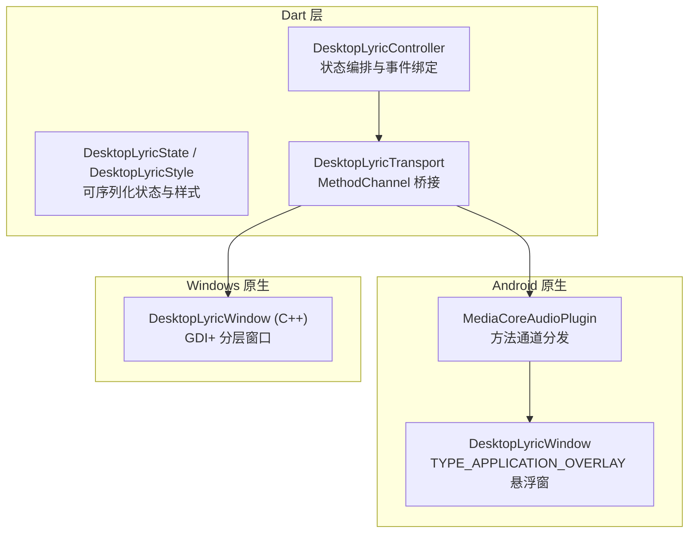
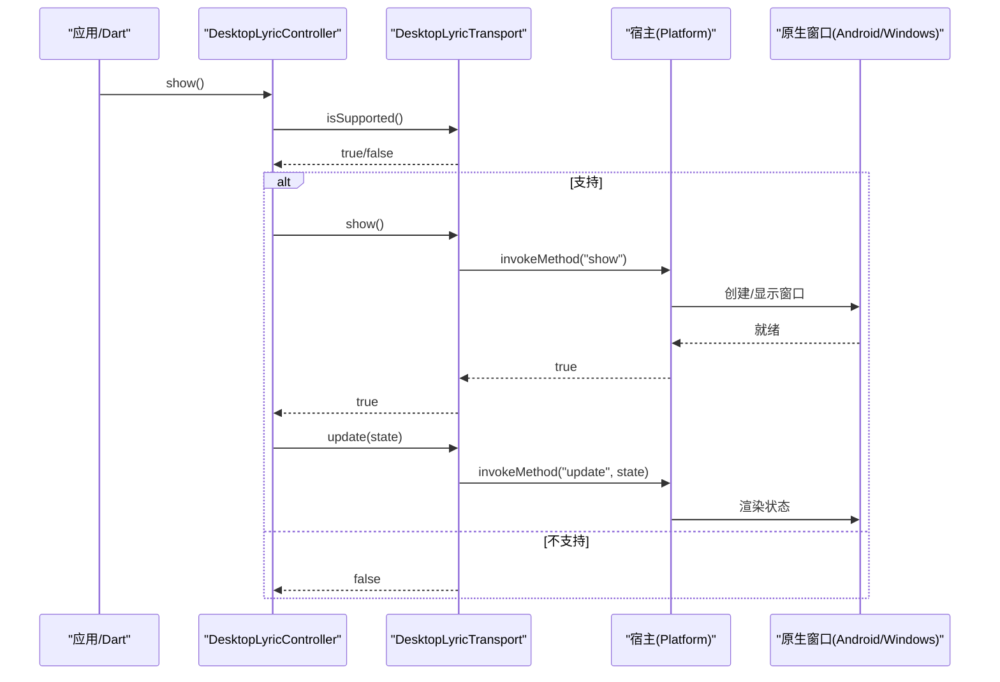
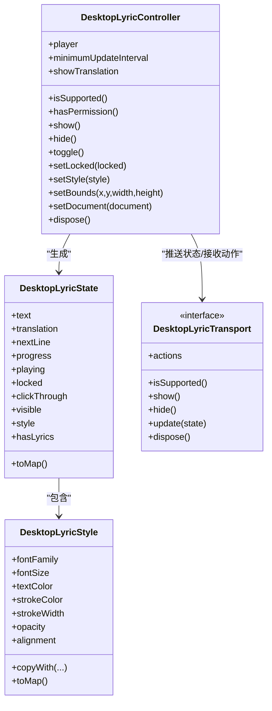
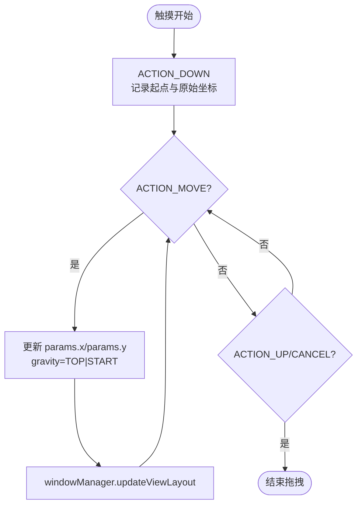
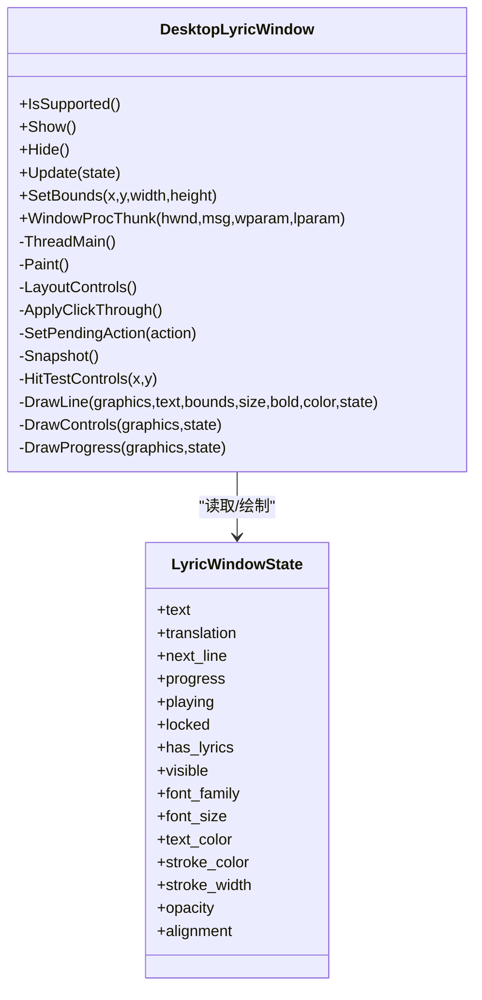
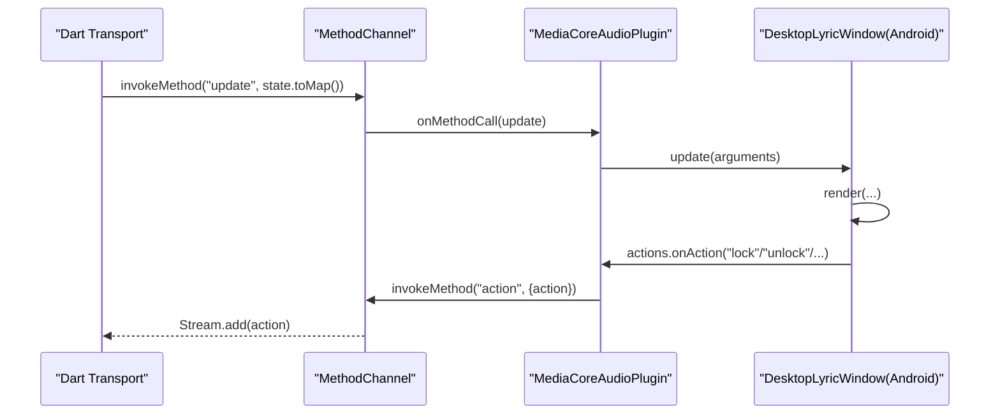
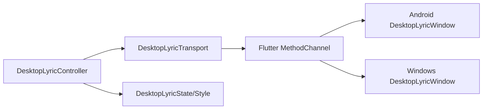

# 歌词窗口

<cite>
**本文引用的文件**   
- [desktop_lyric_controller.dart](file://packages/media_core_audio/lib/src/desktop_lyric/desktop_lyric_controller.dart)
- [desktop_lyric_state.dart](file://packages/media_core_audio/lib/src/desktop_lyric/desktop_lyric_state.dart)
- [desktop_lyric_transport.dart](file://packages/media_core_audio/lib/src/desktop_lyric/desktop_lyric_transport.dart)
- [MediaCoreAudioPlugin.java](file://packages/media_core_audio/android/src/main/java/com/mediacore/audio/MediaCoreAudioPlugin.java)
- [DesktopLyricWindow.java](file://packages/media_core_audio/android/src/main/java/com/mediacore/audio/DesktopLyricWindow.java)
- [desktop_lyric_window.h](file://packages/media_core_audio/windows/desktop_lyric_window.h)
</cite>

## 目录
1. [简介](#简介)
2. [项目结构](#项目结构)
3. [核心组件](#核心组件)
4. [架构总览](#架构总览)
5. [详细组件分析](#详细组件分析)
6. [依赖关系分析](#依赖关系分析)
7. [性能与渲染优化](#性能与渲染优化)
8. [桌面环境兼容性与主题适配](#桌面环境兼容性与主题适配)
9. [故障排查指南](#故障排查指南)
10. [结论](#结论)

## 简介
本文面向 Media Core 在桌面平台的“歌词窗口”功能，系统性说明其原生实现机制、生命周期管理、内存优化策略，以及透明度控制、置顶显示、拖拽交互、文本渲染与动画效果。同时覆盖不同桌面环境的兼容性处理与主题适配方案，并提供常见问题排查方法与性能调优建议。

该能力由 Dart 层负责歌词解析、时间轴计算与状态编排，通过平台无关的传输协议将完整状态下发到各平台的原生窗口：Windows 使用 GDI+ 绘制的无边框分层窗口；Android 使用 TYPE_APPLICATION_OVERLAY 悬浮窗；macOS/Linux/iOS/Web 等按各自平台实现或返回不支持。

## 项目结构
围绕“歌词窗口”的关键代码分布在以下位置：
- Dart 逻辑与状态定义：packages/media_core_audio/lib/src/desktop_lyric
- Android 原生悬浮窗实现：packages/media_core_audio/android/src/main/java/com/mediacore/audio
- Windows 原生分层窗口头文件：packages/media_core_audio/windows

**图示来源**
- [desktop_lyric_controller.dart:14-51](file://packages/media_core_audio/lib/src/desktop_lyric/desktop_lyric_controller.dart#L14-L51)
- [desktop_lyric_transport.dart:31-53](file://packages/media_core_audio/lib/src/desktop_lyric/desktop_lyric_transport.dart#L31-L53)
- [MediaCoreAudioPlugin.java:117-181](file://packages/media_core_audio/android/src/main/java/com/mediacore/audio/MediaCoreAudioPlugin.java#L117-L181)
- [DesktopLyricWindow.java:25-46](file://packages/media_core_audio/android/src/main/java/com/mediacore/audio/DesktopLyricWindow.java#L25-L46)
- [desktop_lyric_window.h:49-60](file://packages/media_core_audio/windows/desktop_lyric_window.h#L49-L60)

**章节来源**
- [desktop_lyric_controller.dart:14-51](file://packages/media_core_audio/lib/src/desktop_lyric/desktop_lyric_controller.dart#L14-L51)
- [desktop_lyric_transport.dart:31-53](file://packages/media_core_audio/lib/src/desktop_lyric/desktop_lyric_transport.dart#L31-L53)

## 核心组件
- DesktopLyricController：订阅播放状态与歌词时间轴，计算当前行、翻译与下一行，生成 DesktopLyricState 并推送到传输层；处理用户操作（上一首/下一首/播放暂停/关闭/锁定）。
- DesktopLyricState / DesktopLyricStyle：描述要显示的文本、进度、播放状态、锁定、可见性、样式（字体、字号、颜色、描边、透明度、对齐）等，支持序列化跨平台传输。
- DesktopLyricTransport：抽象传输接口，默认 MethodChannelDesktopLyricTransport 通过 Flutter MethodChannel 与宿主通信；NoopDesktopLyricTransport 用于不支持的平台降级。
- Android DesktopLyricWindow：基于 WindowManager.TYPE_APPLICATION_OVERLAY 的悬浮视图，负责布局、绘制、点击穿透、拖拽移动、进度条与控件。
- Windows DesktopLyricWindow：独立线程 + 消息循环的分层窗口，使用 GDI+ 绘制文本、控件与进度条，支持悬停控件、拖拽、点击穿透与 DPI 缩放。

**章节来源**
- [desktop_lyric_controller.dart:14-51](file://packages/media_core_audio/lib/src/desktop_lyric/desktop_lyric_controller.dart#L14-L51)
- [desktop_lyric_state.dart:1-161](file://packages/media_core_audio/lib/src/desktop_lyric/desktop_lyric_state.dart#L1-L161)
- [desktop_lyric_transport.dart:31-72](file://packages/media_core_audio/lib/src/desktop_lyric/desktop_lyric_transport.dart#L31-L72)
- [DesktopLyricWindow.java:25-46](file://packages/media_core_audio/android/src/main/java/com/mediacore/audio/DesktopLyricWindow.java#L25-L46)
- [desktop_lyric_window.h:49-60](file://packages/media_core_audio/windows/desktop_lyric_window.h#L49-L60)

## 架构总览
歌词窗口采用“Dart 逻辑 + 平台原生窗口 + 传输协议”的分层架构。Dart 层不直接创建窗口，而是通过 DesktopLyricTransport 发送完整状态；平台侧根据能力决定是否支持，并在支持时创建并维护原生窗口。

**图示来源**
- [desktop_lyric_controller.dart:117-142](file://packages/media_core_audio/lib/src/desktop_lyric/desktop_lyric_controller.dart#L117-L142)
- [desktop_lyric_transport.dart:110-152](file://packages/media_core_audio/lib/src/desktop_lyric/desktop_lyric_transport.dart#L110-L152)
- [MediaCoreAudioPlugin.java:117-181](file://packages/media_core_audio/android/src/main/java/com/mediacore/audio/MediaCoreAudioPlugin.java#L117-L181)

## 详细组件分析

### Dart 控制器与状态
- 控制器职责：
  - 订阅播放器状态流与歌词时间轴变化，驱动歌词行切换与进度更新。
  - 当歌曲切换时加载歌词文档，更新 Timeline 并触发一次强制推送。
  - 对样式、锁定、可见性等变更进行去抖与增量判断，避免重复刷新。
- 状态与样式：
  - DesktopLyricState 包含文本、翻译、下一行、进度、播放状态、锁定、点击穿透、可见性、样式与是否有歌词标记。
  - DesktopLyricStyle 包含字体族、字号、文本色、描边色、描边宽度、透明度、水平对齐方式，并提供 toMap 序列化。

**图示来源**
- [desktop_lyric_controller.dart:36-101](file://packages/media_core_audio/lib/src/desktop_lyric/desktop_lyric_controller.dart#L36-L101)
- [desktop_lyric_state.dart:7-76](file://packages/media_core_audio/lib/src/desktop_lyric/desktop_lyric_state.dart#L7-L76)
- [desktop_lyric_state.dart:90-161](file://packages/media_core_audio/lib/src/desktop_lyric/desktop_lyric_state.dart#L90-L161)
- [desktop_lyric_transport.dart:54-72](file://packages/media_core_audio/lib/src/desktop_lyric/desktop_lyric_transport.dart#L54-L72)

**章节来源**
- [desktop_lyric_controller.dart:117-142](file://packages/media_core_audio/lib/src/desktop_lyric/desktop_lyric_controller.dart#L117-L142)
- [desktop_lyric_controller.dart:234-255](file://packages/media_core_audio/lib/src/desktop_lyric/desktop_lyric_controller.dart#L234-L255)
- [desktop_lyric_controller.dart:257-272](file://packages/media_core_audio/lib/src/desktop_lyric/desktop_lyric_controller.dart#L257-L272)
- [desktop_lyric_controller.dart:274-289](file://packages/media_core_audio/lib/src/desktop_lyric/desktop_lyric_controller.dart#L274-L289)
- [desktop_lyric_controller.dart:296-338](file://packages/media_core_audio/lib/src/desktop_lyric/desktop_lyric_controller.dart#L296-L338)
- [desktop_lyric_state.dart:7-76](file://packages/media_core_audio/lib/src/desktop_lyric/desktop_lyric_state.dart#L7-L76)
- [desktop_lyric_state.dart:90-161](file://packages/media_core_audio/lib/src/desktop_lyric/desktop_lyric_state.dart#L90-L161)

### Android 原生悬浮窗
- 窗口类型与权限：
  - 使用 TYPE_APPLICATION_OVERLAY 悬浮窗，配合 SYSTEM_ALERT_WINDOW 权限；首次展示会引导用户开启权限。
  - 使用 Application Context 添加 View，无需 Activity，随进程存活，与播放服务生命周期一致。
- 生命周期：
  - show()：检查权限→必要时跳转系统设置→创建根视图→addView。
  - hide()：removeView，捕获异常以容忍窗口已销毁的情况。
  - dispose()：清理 Handler 回调与引用。
- 渲染与布局：
  - 根容器为垂直 LinearLayout，包含顶部控件栏（上一首/播放暂停/下一首/锁定/关闭）、主歌词 TextView、翻译 TextView、下一行 TextView、进度条（双 View 权重表示进度）。
  - 背景为半透明圆角矩形，文字阴影模拟描边效果。
- 透明度与置顶：
  - 背景色带 Alpha 值实现半透明；窗口层级由系统悬浮窗类型决定，始终位于上层。
- 置顶与点击穿透（锁定）：
  - 锁定后先短暂显示控件提示，再隐藏控件并启用 FLAG_NOT_TOUCHABLE 使窗口点击穿透。
- 拖拽交互：
  - 监听根视图触摸事件，ACTION_DOWN 记录起点与原始坐标，ACTION_MOVE 实时计算新坐标并更新 LayoutParams，ACTION_UP/CANCEL 结束拖拽。
  - 拖动期间固定 gravity 为 TOP|START，确保位置生效。
- 边界检测：
  - y 坐标限制为非负，防止上移出屏；宽度在拖动中取 root 实际宽度。
- 吸附对齐：
  - 未提供自动吸附逻辑；可通过 setBounds 从 Dart 层设置 x/y/width/height 完成最终定位。

**图示来源**
- [DesktopLyricWindow.java:459-500](file://packages/media_core_audio/android/src/main/java/com/mediacore/audio/DesktopLyricWindow.java#L459-L500)

**章节来源**
- [DesktopLyricWindow.java:25-46](file://packages/media_core_audio/android/src/main/java/com/mediacore/audio/DesktopLyricWindow.java#L25-L46)
- [DesktopLyricWindow.java:110-158](file://packages/media_core_audio/android/src/main/java/com/mediacore/audio/DesktopLyricWindow.java#L110-L158)
- [DesktopLyricWindow.java:160-222](file://packages/media_core_audio/android/src/main/java/com/mediacore/audio/DesktopLyricWindow.java#L160-L222)
- [DesktopLyricWindow.java:228-312](file://packages/media_core_audio/android/src/main/java/com/mediacore/audio/DesktopLyricWindow.java#L228-L312)
- [DesktopLyricWindow.java:360-398](file://packages/media_core_audio/android/src/main/java/com/mediacore/audio/DesktopLyricWindow.java#L360-L398)
- [DesktopLyricWindow.java:409-453](file://packages/media_core_audio/android/src/main/java/com/mediacore/audio/DesktopLyricWindow.java#L409-L453)
- [DesktopLyricWindow.java:459-500](file://packages/media_core_audio/android/src/main/java/com/mediacore/audio/DesktopLyricWindow.java#L459-L500)

### Windows 原生分层窗口
- 窗口特性：
  - 无边框、始终置顶、逐像素 Alpha 的分层窗口，使用 GDI+ 绘制。
  - 不在 Flutter 窗口内部，保证能覆盖其他应用。
- 线程模型：
  - 独立线程 + 独立消息循环，避免阻塞 Flutter 平台线程。
  - 状态通过 Update 传入（互斥量保护），用户操作通过回调回传，再由插件封送回平台线程调用 Dart API。
- 状态结构：
  - LyricWindowState 包含文本、翻译、下一行、进度、播放状态、锁定、是否有歌词、可见性以及样式（字体族、字号、文本色、描边色、描边宽度、透明度、对齐）。
- 交互能力：
  - 悬停控件区域、拖拽移动、点击穿透（锁定）、DPI 缩放感知。
- 绘制流程：
  - Paint 负责整体重绘；DrawLine 绘制单行文本及描边；DrawControls 绘制控件；DrawProgress 绘制进度条。

**图示来源**
- [desktop_lyric_window.h:29-47](file://packages/media_core_audio/windows/desktop_lyric_window.h#L29-L47)
- [desktop_lyric_window.h:61-145](file://packages/media_core_audio/windows/desktop_lyric_window.h#L61-L145)

**章节来源**
- [desktop_lyric_window.h:49-60](file://packages/media_core_audio/windows/desktop_lyric_window.h#L49-L60)
- [desktop_lyric_window.h:61-145](file://packages/media_core_audio/windows/desktop_lyric_window.h#L61-L145)

### 方法通道与宿主分发
- Dart 侧 MethodChannelDesktopLyricTransport：
  - 暴露 isSupported/show/hide/update/setBounds/actions/dispose。
  - 安装 action 回调处理器，将宿主发来的 action 名称映射为枚举并广播。
- Android 侧 MediaCoreAudioPlugin：
  - 转发 isSupported/show/hide/update/setBounds 到 DesktopLyricWindow。
  - 将窗口按钮点击封装为 action 并通过 channel 回传给 Dart。

**图示来源**
- [desktop_lyric_transport.dart:167-197](file://packages/media_core_audio/lib/src/desktop_lyric/desktop_lyric_transport.dart#L167-L197)
- [desktop_lyric_transport.dart:199-230](file://packages/media_core_audio/lib/src/desktop_lyric/desktop_lyric_transport.dart#L199-L230)
- [MediaCoreAudioPlugin.java:117-181](file://packages/media_core_audio/android/src/main/java/com/mediacore/audio/MediaCoreAudioPlugin.java#L117-L181)

**章节来源**
- [desktop_lyric_transport.dart:74-89](file://packages/media_core_audio/lib/src/desktop_lyric/desktop_lyric_transport.dart#L74-L89)
- [desktop_lyric_transport.dart:167-197](file://packages/media_core_audio/lib/src/desktop_lyric/desktop_lyric_transport.dart#L167-L197)
- [MediaCoreAudioPlugin.java:117-181](file://packages/media_core_audio/android/src/main/java/com/mediacore/audio/MediaCoreAudioPlugin.java#L117-L181)

## 依赖关系分析
- 耦合与内聚：
  - Controller 与 Transport 解耦，便于替换实现或降级。
  - State/Style 纯数据对象，无副作用，易于序列化与比较。
  - 平台窗口实现仅消费状态，不持有 Dart 对象，降低跨语言耦合。
- 外部依赖：
  - Flutter MethodChannel 作为跨语言通信桥梁。
  - Android WindowManager 与权限系统。
  - Windows GDI+ 与 Win32 窗口 API。

**图示来源**
- [desktop_lyric_controller.dart:14-51](file://packages/media_core_audio/lib/src/desktop_lyric/desktop_lyric_controller.dart#L14-L51)
- [desktop_lyric_transport.dart:31-72](file://packages/media_core_audio/lib/src/desktop_lyric/desktop_lyric_transport.dart#L31-L72)

**章节来源**
- [desktop_lyric_controller.dart:14-51](file://packages/media_core_audio/lib/src/desktop_lyric/desktop_lyric_controller.dart#L14-L51)
- [desktop_lyric_transport.dart:31-72](file://packages/media_core_audio/lib/src/desktop_lyric/desktop_lyric_transport.dart#L31-L72)

## 性能与渲染优化
- 减少无效刷新：
  - Controller 在 _push 中进行帧级比较，若可视内容未变化则跳过传输。
  - Android 仅在锁定状态改变时重新应用窗口标志，避免每行歌词都延迟 click-through 过渡。
- 进度更新节流：
  - minimumUpdateInterval 控制词级进度更新的频率，避免高频刷新造成抖动。
- 轻量状态传输：
  - 每次传输完整状态而非增量，避免跨线程/跨进程的状态不一致。
- 绘制优化：
  - Android 使用两个子 View 的 weight 表示进度，避免等待布局测量像素宽度。
  - Windows 使用 GDI+ 绘制文本与控件，按需重绘。
- 内存与资源：
  - Android 在 dispose 中移除 Handler 回调并释放视图引用。
  - Windows 独立线程与互斥量保护状态，避免竞态。

**章节来源**
- [desktop_lyric_controller.dart:296-338](file://packages/media_core_audio/lib/src/desktop_lyric/desktop_lyric_controller.dart#L296-L338)
- [DesktopLyricWindow.java:191-201](file://packages/media_core_audio/android/src/main/java/com/mediacore/audio/DesktopLyricWindow.java#L191-L201)
- [DesktopLyricWindow.java:289-297](file://packages/media_core_audio/android/src/main/java/com/mediacore/audio/DesktopLyricWindow.java#L289-L297)
- [DesktopLyricWindow.java:154-158](file://packages/media_core_audio/android/src/main/java/com/mediacore/audio/DesktopLyricWindow.java#L154-L158)
- [desktop_lyric_window.h:24-28](file://packages/media_core_audio/windows/desktop_lyric_window.h#L24-L28)

## 桌面环境兼容性与主题适配
- 平台能力探测：
  - Transport.isSupported 缓存结果，MissingPluginException 或 PlatformException 均视为不支持。
  - Android 首次 show 需要 SYSTEM_ALERT_WINDOW 权限，否则返回 false 并引导用户授权。
- 置顶与层级：
  - Android 悬浮窗天然位于上层；Windows 分层窗口设置为 always-on-top。
- 点击穿透（锁定）：
  - Android 通过 FLAG_NOT_TOUCHABLE 实现点击穿透，并先显示锁定提示再隐藏控件。
  - Windows 通过 ApplyClickThrough 调整窗口属性。
- 主题与样式：
  - 支持文本色、描边色、透明度、字号、字体族与水平对齐。
  - Android 使用半透明背景与阴影模拟描边；Windows 支持逐像素 Alpha。
- 多桌面环境：
  - macOS/Linux 等平台按各自实现；iOS/Web 不支持跨应用悬浮窗，isSupported 返回 false。

**章节来源**
- [desktop_lyric_transport.dart:110-138](file://packages/media_core_audio/lib/src/desktop_lyric/desktop_lyric_transport.dart#L110-L138)
- [desktop_lyric_transport.dart:140-152](file://packages/media_core_audio/lib/src/desktop_lyric/desktop_lyric_transport.dart#L140-L152)
- [DesktopLyricWindow.java:506-533](file://packages/media_core_audio/android/src/main/java/com/mediacore/audio/DesktopLyricWindow.java#L506-L533)
- [DesktopLyricWindow.java:409-453](file://packages/media_core_audio/android/src/main/java/com/mediacore/audio/DesktopLyricWindow.java#L409-L453)
- [desktop_lyric_window.h:49-60](file://packages/media_core_audio/windows/desktop_lyric_window.h#L49-L60)

## 故障排查指南
- 悬浮窗无法显示（Android）：
  - 检查是否授予 SYSTEM_ALERT_WINDOW 权限；若未授权，show 会返回 false 并打开系统设置页。
  - 某些厂商 ROM 即使授权也可能拒绝 addView，需捕获异常并降级处理。
- 窗口不可点击（锁定后）：
  - 锁定后窗口进入点击穿透模式，控件会在短暂提示后隐藏；需要通过 Dart 层 setLocked(false) 解锁。
- 进度条不更新：
  - 确认 minimumUpdateInterval 设置合理；若过短可能导致频繁刷新，过长则进度卡顿。
- 文本不显示或空白：
  - 检查歌词文档是否为空；Controller 在无歌词时显示占位符“♪”。
- 窗口位置异常：
  - Android 拖动时 y 坐标限制为非负；如需吸附对齐，可在拖动结束后调用 setBounds 设置目标位置。
- 平台不支持：
  - iOS/Web 不支持跨应用悬浮窗；isSupported 返回 false 属于正常降级。

**章节来源**
- [DesktopLyricWindow.java:110-138](file://packages/media_core_audio/android/src/main/java/com/mediacore/audio/DesktopLyricWindow.java#L110-L138)
- [DesktopLyricWindow.java:409-453](file://packages/media_core_audio/android/src/main/java/com/mediacore/audio/DesktopLyricWindow.java#L409-L453)
- [DesktopLyricWindow.java:459-500](file://packages/media_core_audio/android/src/main/java/com/mediacore/audio/DesktopLyricWindow.java#L459-L500)
- [desktop_lyric_controller.dart:257-272](file://packages/media_core_audio/lib/src/desktop_lyric/desktop_lyric_controller.dart#L257-L272)
- [desktop_lyric_transport.dart:110-138](file://packages/media_core_audio/lib/src/desktop_lyric/desktop_lyric_transport.dart#L110-L138)

## 结论
歌词窗口通过 Dart 层的状态编排与平台原生窗口的分离设计，实现了跨桌面环境的稳定显示与交互。Android 悬浮窗与 Windows 分层窗口分别承担各自的渲染与交互职责，并通过 MethodChannel 与 Dart 层解耦。系统在透明度、置顶、点击穿透、拖拽与进度渲染等方面提供了完善的实现，同时兼顾了性能与内存优化。针对不同桌面环境与主题需求，开发者可通过样式配置与 setBounds 进行灵活适配。对于常见权限、ROM 兼容与交互问题，本文提供了排查路径与建议。