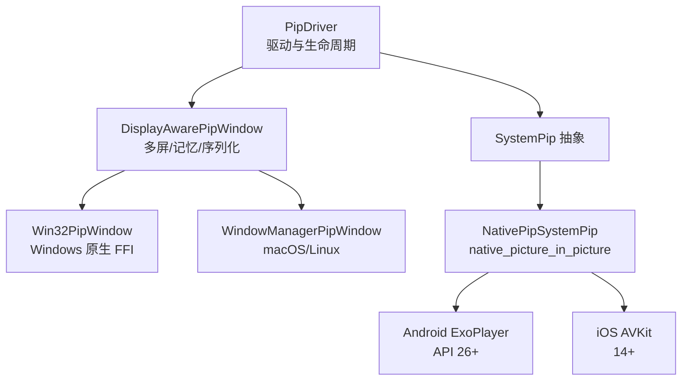
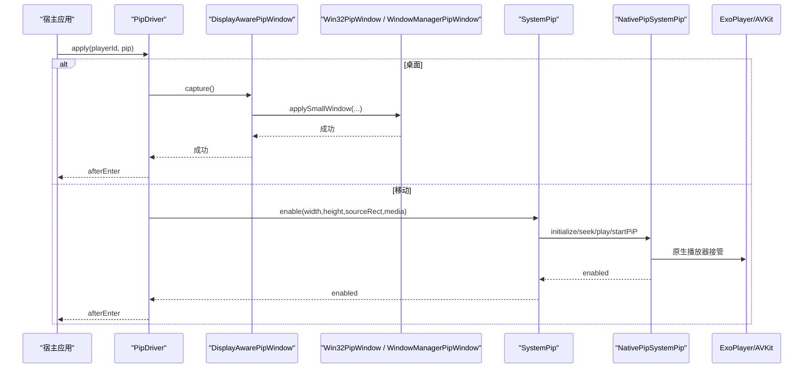
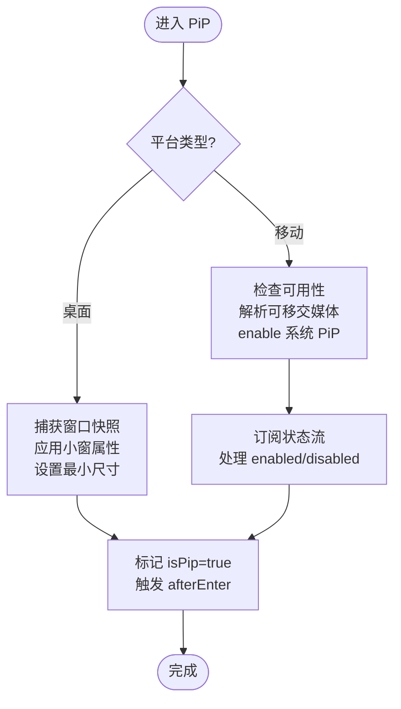
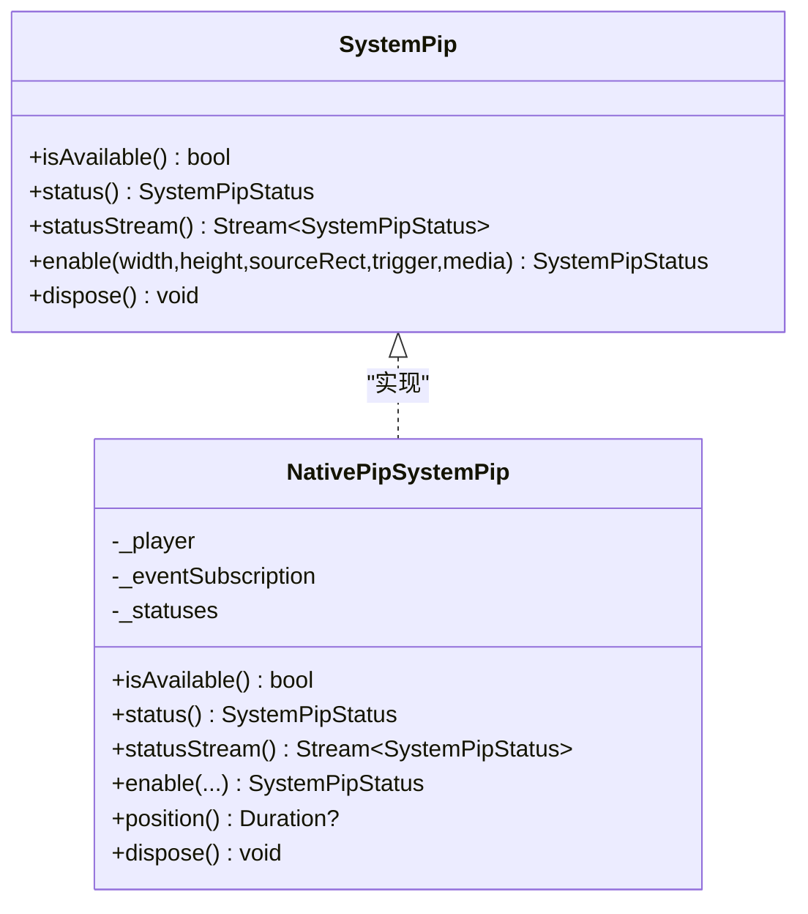
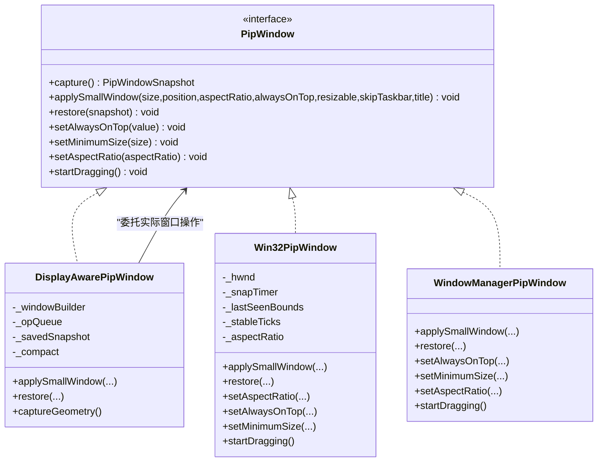
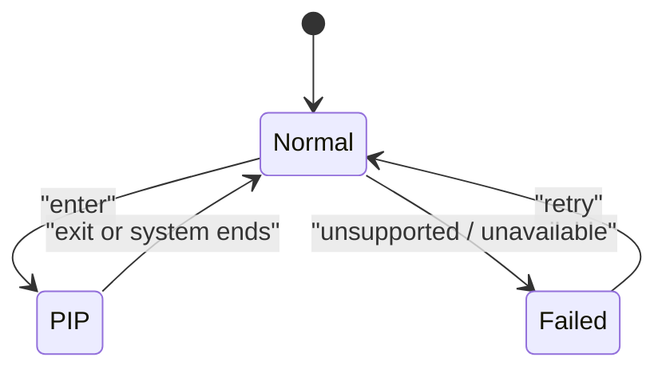
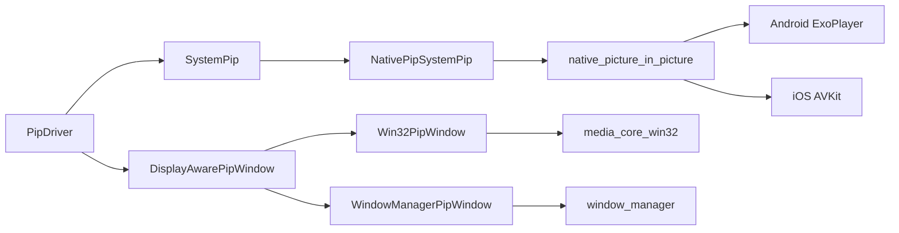

# 画中画模式

<cite>
**本文引用的文件**   
- [README.md](file://packages/media_core_pip/README.md)
- [pubspec.yaml](file://packages/media_core_pip/pubspec.yaml)
- [pip_driver.dart](file://packages/media_core_pip/lib/src/pip_driver.dart)
- [system_pip.dart](file://packages/media_core_pip/lib/src/system_pip.dart)
- [native_pip_system_pip.dart](file://packages/media_core_pip/lib/src/native_pip_system_pip.dart)
- [pip_window.dart](file://packages/media_core_pip/lib/src/pip_window.dart)
- [display_pip_window.dart](file://packages/media_core_pip/lib/src/display_pip_window.dart)
- [win32_pip_window.dart](file://packages/media_core_pip/lib/src/win32_pip_window.dart)
- [window_manager_pip_window.dart](file://packages/media_core_pip/lib/src/window_manager_pip_window.dart)
- [desktop_pip_window.dart](file://packages/media_core_pip/lib/src/desktop_pip_window.dart)
</cite>

## 更新摘要
**变更内容**   
- 完全重构了画中画功能，从浮动窗口方法替换为原生系统 PiP 驱动
- 引入 platform-specific plugins (native_picture_in_picture) 用于 Android ExoPlayer 和 iOS AVKit 集成
- 实现了真正的系统级 PiP 支持，采用接管式播放机制
- 更新了移动端架构，使用 SystemPip 抽象层处理平台差异

## 目录
1. [简介](#简介)
2. [项目结构](#项目结构)
3. [核心组件](#核心组件)
4. [架构总览](#架构总览)
5. [详细组件分析](#详细组件分析)
6. [依赖关系分析](#依赖关系分析)
7. [性能与调试](#性能与调试)
8. [故障排查与降级策略](#故障排查与降级策略)
9. [结论](#结论)

## 简介
本包为 media_core 提供画中画能力：桌面端是应用完全掌控的常驻置顶小窗；Android/iOS 走系统级 PiP，通过 `native_picture_in_picture` 插件（ExoPlayer/AVKit）实现真正的系统级 PiP 支持，由原生播放器接管并移交播放。Web 不支持。

**重大更新**：完全重构了移动端架构，从之前的浮动窗口方法替换为原生系统 PiP 驱动，提供了真正的系统级画中画支持。

- 桌面路径
  - Windows：Win32PipWindow，直接 user32 FFI 调用，绕过 window_manager 在无边框快路径下的样式更新问题。
  - macOS/Linux：WindowManagerPipWindow，基于 window_manager 插件实现窗口行为控制。
  - 默认后端选择：defaultDesktopPipWindow()，宿主可按平台注入自定义 PipWindow。
- 移动路径
  - Android/iOS：NativePipSystemPip，基于 native_picture_in_picture 插件（ExoPlayer/AVKit），进入 PiP 是一次"移交"：宿主需提供可被原生播放器打开的 URL 和位置，退出时回调交还进度。
- 契约与状态
  - PipDriver 实现 KernelPresentationDriver，仅服务 PresentationMode.pip。
  - SystemPip 抽象出移动端系统 PiP API，暴露可用性、当前状态、状态流和 enable 请求。
  - PipWindow 抽象出桌面窗口操作，包括快照、应用小窗、恢复、置顶、最小尺寸、比例锁定和拖动。

**章节来源**
- [README.md:1-115](file://packages/media_core_pip/README.md#L1-L115)
- [pubspec.yaml:1-31](file://packages/media_core_pip/pubspec.yaml#L1-L31)

## 项目结构
media_core_pip 将"驱动层""平台接口层""桌面窗口后端""移动端系统 PiP 实现"分层解耦：

**图表来源**
- [pip_driver.dart:86-150](file://packages/media_core_pip/lib/src/pip_driver.dart#L86-L150)
- [display_pip_window.dart:124-160](file://packages/media_core_pip/lib/src/display_pip_window.dart#L124-L160)
- [win32_pip_window.dart:8-35](file://packages/media_core_pip/lib/src/win32_pip_window.dart#L8-L35)
- [window_manager_pip_window.dart:6-22](file://packages/media_core_pip/lib/src/window_manager_pip_window.dart#L6-L22)
- [system_pip.dart:91-157](file://packages/media_core_pip/lib/src/system_pip.dart#L91-L157)
- [native_pip_system_pip.dart:7-30](file://packages/media_core_pip/lib/src/native_pip_system_pip.dart#L7-L30)

**章节来源**
- [pip_driver.dart:86-150](file://packages/media_core_pip/lib/src/pip_driver.dart#L86-L150)
- [display_pip_window.dart:124-160](file://packages/media_core_pip/lib/src/display_pip_window.dart#L124-L160)
- [system_pip.dart:91-157](file://packages/media_core_pip/lib/src/system_pip.dart#L91-L157)

## 核心组件
- PipDriver
  - 负责进入/离开 PiP、计算小窗尺寸、维护 isPip 状态、触发生命周期钩子。
  - 桌面路径：捕获窗口快照 → 缩进角落 → 设置置顶/跳过任务栏/比例锁定/最小尺寸。
  - 移动路径：校验视频尺寸 → 解析可移交媒体 → 调用 SystemPip.enable → 订阅系统状态流。
- SystemPip / NativePipSystemPip
  - SystemPip 定义可用性、状态、状态流和 enable 契约。
  - NativePipSystemPip 封装 native_picture_in_picture，处理自动 PiP、事件翻译、手移交结束回调。
  - **新增**：真正的系统级 PiP 支持，使用 ExoPlayer (Android) 和 AVKit (iOS) 作为原生播放器。
- PipWindow / DisplayAwarePipWindow
  - PipWindow 抽象窗口操作；DisplayAwarePipWindow 增加多屏感知、记忆几何、失败回滚、操作序列化。
  - 具体后端：Win32PipWindow（Windows）、WindowManagerPipWindow（macOS/Linux）。

**章节来源**
- [pip_driver.dart:86-150](file://packages/media_core_pip/lib/src/pip_driver.dart#L86-L150)
- [system_pip.dart:91-157](file://packages/media_core_pip/lib/src/system_pip.dart#L91-L157)
- [native_pip_system_pip.dart:7-30](file://packages/media_core_pip/lib/src/native_pip_system_pip.dart#L7-L30)
- [pip_window.dart:32-92](file://packages/media_core_pip/lib/src/pip_window.dart#L32-L92)
- [display_pip_window.dart:124-160](file://packages/media_core_pip/lib/src/display_pip_window.dart#L124-L160)

## 架构总览
下图展示从上层驱动到各平台后端的完整调用链，以及桌面与移动两条路径的分发逻辑。

**图表来源**
- [pip_driver.dart:317-493](file://packages/media_core_pip/lib/src/pip_driver.dart#L317-L493)
- [display_pip_window.dart:212-328](file://packages/media_core_pip/lib/src/display_pip_window.dart#L212-L328)
- [native_pip_system_pip.dart:101-153](file://packages/media_core_pip/lib/src/native_pip_system_pip.dart#L101-L153)

## 详细组件分析

### 驱动层：PipDriver
职责
- 根据平台分发到桌面或移动路径。
- 维护 isPip、videoWidth/Height、videoRect，驱动小窗形状与位置。
- 管理生命周期钩子 beforeEnter/afterEnter/beforeExit/afterExit。
- 移动端订阅系统 PiP 状态流，处理系统主动退出时的"移交归还"。

关键流程
- 初始化：仅在移动端订阅 statusStream。
- onVideoSize/onVideoRect：更新视频尺寸与屏幕矩形，必要时刷新桌面窗口比例。
- apply：pip→_enterPip；normal→_leavePip。
- _enterDesktopPip：capture → applySmallWindow → setMinimumSize（非致命）。
- _enterMobilePip：isAvailable → pipMediaResolver → enable → _handleSystemStatus。
- _handleSystemStatus：根据 enabled/automatic 切换 isPip，并在结束时触发 onHandoffReturn。

错误与降级
- unsupported 平台抛 UnsupportedError。
- 移动端未安装 SystemPip 或未报告视频尺寸抛 StateError。
- 无法移交源抛 UnsupportedError。
- 平台拒绝进入 PiP 抛 UnsupportedError。
- 生命周期钩子失败不阻断过渡，仅记录警告。

**图表来源**
- [pip_driver.dart:317-493](file://packages/media_core_pip/lib/src/pip_driver.dart#L317-L493)
- [pip_driver.dart:499-552](file://packages/media_core_pip/lib/src/pip_driver.dart#L499-L552)

**章节来源**
- [pip_driver.dart:86-150](file://packages/media_core_pip/lib/src/pip_driver.dart#L86-L150)
- [pip_driver.dart:317-493](file://packages/media_core_pip/lib/src/pip_driver.dart#L317-L493)
- [pip_driver.dart:499-577](file://packages/media_core_pip/lib/src/pip_driver.dart#L499-L577)

### 移动端系统 PiP：SystemPip 与 NativePipSystemPip
契约
- isAvailable/status/statusStream：描述设备与系统是否支持、当前状态及变化。
- enable：传入视频宽高、可选 sourceRectHint、trigger 与 handoff 媒体。
- dispose：释放资源。

实现要点
- 支持自动 PiP（onLeaveApp）与立即进入（immediate）。
- 需要 SystemPipMedia.url（HTTP(S)/file）与 position；否则抛出 UnsupportedError。
- 通过 onPipEvent 翻译 willStart/willStop/didStart/didStop/restoreUI 等事件。
- didStop/restoreUI 触发 _finishHandoff，回调 onHandoffEnd 让宿主恢复引擎。

**重大更新**：NativePipSystemPip 现在使用 native_picture_in_picture 插件，该插件拥有自己的播放表面——Android 上使用 ExoPlayer (API 26+)，iOS 上使用 AVKit (14+)。进入 PiP 不再是简单的重渲染，而是真正的"移交"过程。

**图表来源**
- [system_pip.dart:91-157](file://packages/media_core_pip/lib/src/system_pip.dart#L91-L157)
- [native_pip_system_pip.dart:30-153](file://packages/media_core_pip/lib/src/native_pip_system_pip.dart#L30-L153)

**章节来源**
- [system_pip.dart:91-157](file://packages/media_core_pip/lib/src/system_pip.dart#L91-L157)
- [native_pip_system_pip.dart:7-30](file://packages/media_core_pip/lib/src/native_pip_system_pip.dart#L7-L30)
- [native_pip_system_pip.dart:101-153](file://packages/media_core_pip/lib/src/native_pip_system_pip.dart#L101-L153)
- [native_pip_system_pip.dart:171-225](file://packages/media_core_pip/lib/src/native_pip_system_pip.dart#L171-L225)

### 桌面窗口后端：PipWindow 与具体实现
抽象
- capture：捕获窗口 bounds、alwaysOnTop、resizable、skipTaskbar、title、titleBarStyle。
- applySmallWindow：应用小窗 size/position/aspectRatio/alwaysOnTop/resizable/skipTaskbar/title。
- restore：恢复到 capture 时的快照。
- setAlwaysOnTop/setMinimumSize/setAspectRatio/startDragging：运行时调整。

Windows：Win32PipWindow
- 使用 media_core_win32 的 Win32WindowFfi 直接调用 user32，避免 window_manager 在隐藏标题栏时的"无操作但返回成功"的陷阱。
- 关键序列：setResizable → setSkipTaskbar → setRoundedCorners → applyBounds（含 SWP_FRAMECHANGED）。
- 恢复：优先回放 Win32WindowSnapshot（placement+style/ex-style），否则重建 skipTaskbar/resizable/bounds。
- 形状对齐：定时轮询窗口边界，拖拽稳定后按视频比例修正高度/宽度，防止黑边。
- setMinimumSize：当句柄存在时委托给 window_manager 的最小尺寸机制。

macOS/Linux：WindowManagerPipWindow
- 通过 window_manager 静态 API 完成 capture/apply/restore。
- apply 顺序：置顶/可缩放/比例锁定 → 隐藏系统标题栏 → 设置大小/位置 → 跳过任务栏。
- restore：先恢复 chrome（TitleBarStyle.normal），再设置 bounds，避免闪烁。

**图表来源**
- [pip_window.dart:32-92](file://packages/media_core_pip/lib/src/pip_window.dart#L32-L92)
- [display_pip_window.dart:124-160](file://packages/media_core_pip/lib/src/display_pip_window.dart#L124-L160)
- [win32_pip_window.dart:8-35](file://packages/media_core_pip/lib/src/win32_pip_window.dart#L8-L35)
- [window_manager_pip_window.dart:6-22](file://packages/media_core_pip/lib/src/window_manager_pip_window.dart#L6-L22)

**章节来源**
- [pip_window.dart:32-92](file://packages/media_core_pip/lib/src/pip_window.dart#L32-L92)
- [display_pip_window.dart:124-160](file://packages/media_core_pip/lib/src/display_pip_window.dart#L124-L160)
- [win32_pip_window.dart:8-35](file://packages/media_core_pip/lib/src/win32_pip_window.dart#L8-L35)
- [win32_pip_window.dart:77-137](file://packages/media_core_pip/lib/src/win32_pip_window.dart#L77-L137)
- [win32_pip_window.dart:139-201](file://packages/media_core_pip/lib/src/win32_pip_window.dart#L139-L201)
- [win32_pip_window.dart:203-244](file://packages/media_core_pip/lib/src/win32_pip_window.dart#L203-L244)
- [window_manager_pip_window.dart:22-85](file://packages/media_core_pip/lib/src/window_manager_pip_window.dart#L22-L85)

### 生命周期与状态同步
- 进入桌面 PiP：beforeEnter → capture → applySmallWindow → afterEnter → setMinimumSize（非致命）。
- 离开桌面 PiP：beforeExit → restore → afterExit。
- 移动 PiP：
  - 进入：beforeEnter → enable → afterEnter。
  - 系统主动退出：statusStream 推送 disabled → afterExit → onHandoffReturn（若配置）。
- isPip 变更通过 onPipChanged 广播。

**图表来源**
- [pip_driver.dart:317-365](file://packages/media_core_pip/lib/src/pip_driver.dart#L317-L365)
- [pip_driver.dart:499-552](file://packages/media_core_pip/lib/src/pip_driver.dart#L499-L552)

**章节来源**
- [pip_driver.dart:317-365](file://packages/media_core_pip/lib/src/pip_driver.dart#L317-L365)
- [pip_driver.dart:499-552](file://packages/media_core_pip/lib/src/pip_driver.dart#L499-L552)

### 窗口行为控制
- 大小调整
  - 桌面：默认 resizable=true，允许用户拖边调整；DisplayAwarePipWindow 会记住长边比例，结合视频 aspect 重新推导短边。
  - 移动：系统 PiP 尺寸由系统决定，App 不可直接指定；可通过 requestSourceRectHint 提示动画起点。
- 位置锁定
  - 桌面：缩进至上一窗口右下角，带 cornerSpacing 留白；多屏环境下匹配显示器工作区。
  - 移动：sourceRectHint 来自 onVideoRect，为空则不提供。
- 最小化支持
  - 桌面：setMinimumSize 用于限制小窗下限；失败不影响进入流程。
  - 移动：不适用。
- 置顶与任务栏
  - 桌面：alwaysOnTop=true；skipTaskbar 由配置决定。
  - 移动：不适用。

**章节来源**
- [pip_driver.dart:367-431](file://packages/media_core_pip/lib/src/pip_driver.dart#L367-L431)
- [display_pip_window.dart:231-328](file://packages/media_core_pip/lib/src/display_pip_window.dart#L231-L328)
- [win32_pip_window.dart:139-201](file://packages/media_core_pip/lib/src/win32_pip_window.dart#L139-L201)
- [window_manager_pip_window.dart:38-85](file://packages/media_core_pip/lib/src/window_manager_pip_window.dart#L38-L85)

## 依赖关系分析
- 内部依赖
  - PipDriver 依赖 DisplayAwarePipWindow（桌面）与 SystemPip（移动）。
  - DisplayAwarePipWindow 委托具体 PipWindow 实现（Win32PipWindow 或 WindowManagerPipWindow）。
  - NativePipSystemPip 依赖 native_picture_in_picture 插件。
- 外部依赖
  - window_manager：macOS/Linux 窗口行为。
  - media_core_win32：Windows 原生 FFI。
  - native_picture_in_picture：Android/iOS 系统 PiP 接管式播放器。

**图表来源**
- [pubspec.yaml:15-24](file://packages/media_core_pip/pubspec.yaml#L15-L24)
- [pip_driver.dart:6-10](file://packages/media_core_pip/lib/src/pip_driver.dart#L6-L10)
- [native_pip_system_pip.dart:3-5](file://packages/media_core_pip/lib/src/native_pip_system_pip.dart#L3-L5)
- [win32_pip_window.dart:3-6](file://packages/media_core_pip/lib/src/win32_pip_window.dart#L3-L6)
- [window_manager_pip_window.dart:1-4](file://packages/media_core_pip/lib/src/window_manager_pip_window.dart#L1-L4)

**章节来源**
- [pubspec.yaml:15-24](file://packages/media_core_pip/pubspec.yaml#L15-L24)
- [pip_driver.dart:6-10](file://packages/media_core_pip/lib/src/pip_driver.dart#L6-L10)

## 性能与调试
- 性能特性
  - 桌面窗口操作通过 DisplayAwarePipWindow 的队列序列化，避免并发重绘与布局抖动。
  - Windows 后端使用定时器轮询窗口边界，拖拽稳定后才进行比例修正，减少频繁 resize。
  - 移动端事件监听延迟创建，避免在未支持平台上因通道异常导致启动失败。
- 调试技巧
  - 使用 PipDriver.onPipChanged 观察状态切换。
  - 在生命周期钩子中打印 beforeEnter/afterEnter/beforeExit/afterExit 顺序，确认宿主侧暂停/恢复时机。
  - 移动端通过 onHandoffReturn 回调读取 NativePipSystemPip.position，核对进度交接是否正确。
  - 桌面端可替换 desktopWindow 为测试替身，验证 applySmallWindow/restore 的参数与顺序。
- 监控建议
  - 记录进入/离开耗时、最小尺寸设置失败次数、比例锁定失败次数。
  - 统计移动端 enable 失败原因（不可用、无视频尺寸、无法移交源、平台拒绝）。

**章节来源**
- [display_pip_window.dart:386-399](file://packages/media_core_pip/lib/src/display_pip_window.dart#L386-L399)
- [win32_pip_window.dart:139-201](file://packages/media_core_pip/lib/src/win32_pip_window.dart#L139-L201)
- [native_pip_system_pip.dart:171-225](file://packages/media_core_pip/lib/src/native_pip_system_pip.dart#L171-L225)

## 故障排查与降级策略
- 常见错误
  - 平台不支持：PipPlatform.unsupported → 抛 UnsupportedError。
  - 移动端未安装 SystemPip：抛 UnsupportedError。
  - 移动端未报告视频尺寸：抛 StateError，需先调用 onVideoSize。
  - 无法移交源：pipMediaResolver 返回 null → 抛 UnsupportedError。
  - 平台拒绝进入 PiP：enable 返回 unavailable → 抛 UnsupportedError。
  - 生命周期钩子失败：不阻断过渡，仅记录警告。
- 降级策略
  - 桌面 setMinimumSize 失败：不阻塞进入流程，后续 leave 时恢复正常最小尺寸。
  - macOS/Linux 窗口管理器 API 不可靠：遵循其返回值如实上报，宿主可注入自定义 PipWindow。
  - Wayland 下 keep_above 不保证生效：由合成器裁决，不做假设。
  - 移动端自动 PiP 不可用时：仅保留显式 enter，丢失"离开应用自动缩小"的顺滑体验。
- 移动端前置配置
  - Android：MainActivity 继承 FlutterFragmentActivity，Manifest 声明 supportsPictureInPicture="true"。
  - iOS：Info.plist 包含 UIBackgroundModes.audio。

**章节来源**
- [pip_driver.dart:317-493](file://packages/media_core_pip/lib/src/pip_driver.dart#L317-L493)
- [pip_driver.dart:554-577](file://packages/media_core_pip/lib/src/pip_driver.dart#L554-L577)
- [README.md:33-48](file://packages/media_core_pip/README.md#L33-L48)
- [README.md:95-102](file://packages/media_core_pip/README.md#L95-L102)

## 结论
该方案以 PipDriver 为中心，将桌面与移动两条路径统一在一致的契约之下：桌面通过 PipWindow 抽象精确控制窗口行为，移动通过 SystemPip 抽象对接系统 PiP 与原生播放器。**重大更新**：移动端现在使用 native_picture_in_picture 插件提供真正的系统级 PiP 支持，通过 ExoPlayer (Android) 和 AVKit (iOS) 实现接管式播放，相比之前的浮动窗口方法提供了更好的性能和用户体验。

设计强调"失败即报错"，避免静默降级导致的 UI 不一致；同时提供足够的扩展点（desktopWindow、systemPip、lifecycleHooks、pipMediaResolver）供宿主定制。对于复杂场景，建议结合生命周期钩子与 onHandoffReturn 完成播放器的暂停/恢复与进度同步，并通过日志与状态流建立完善的可观测性。

新的架构确保了：
- 真正的系统级 PiP 支持，而非模拟实现
- 更好的性能和电池效率
- 与系统其他应用的无缝集成
- 更稳定的跨平台兼容性