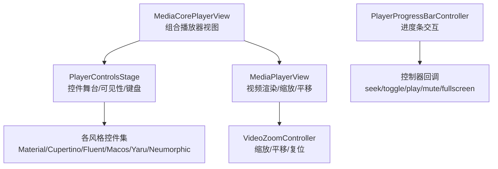
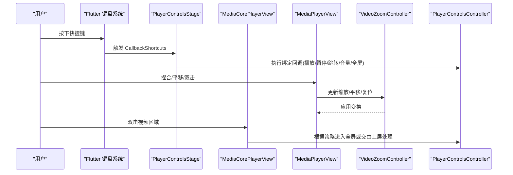
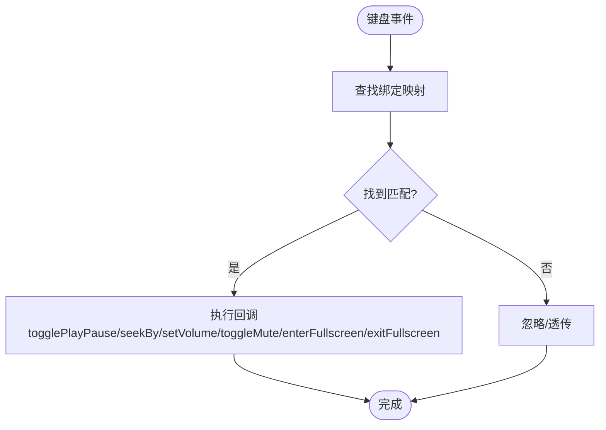
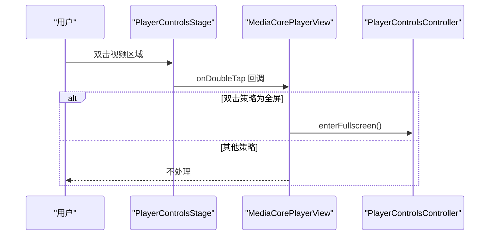
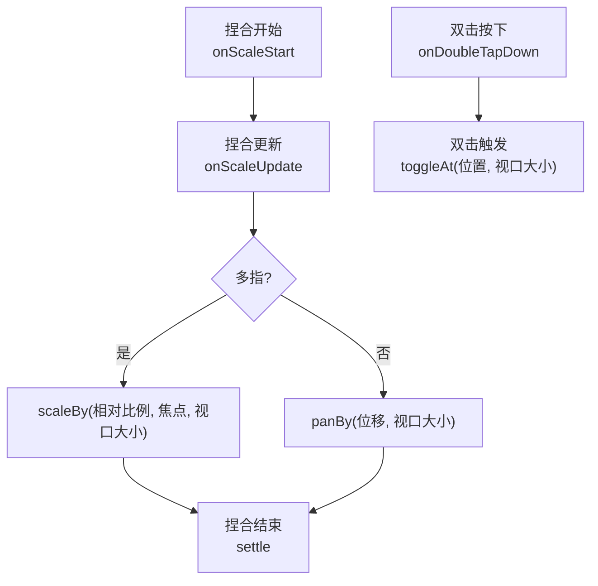
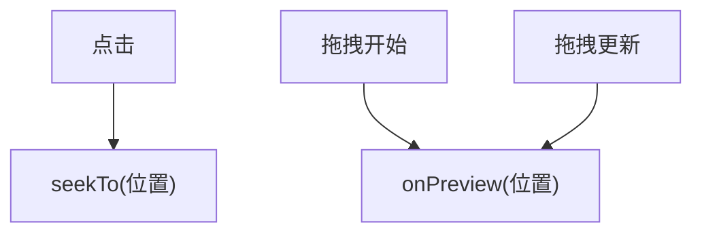
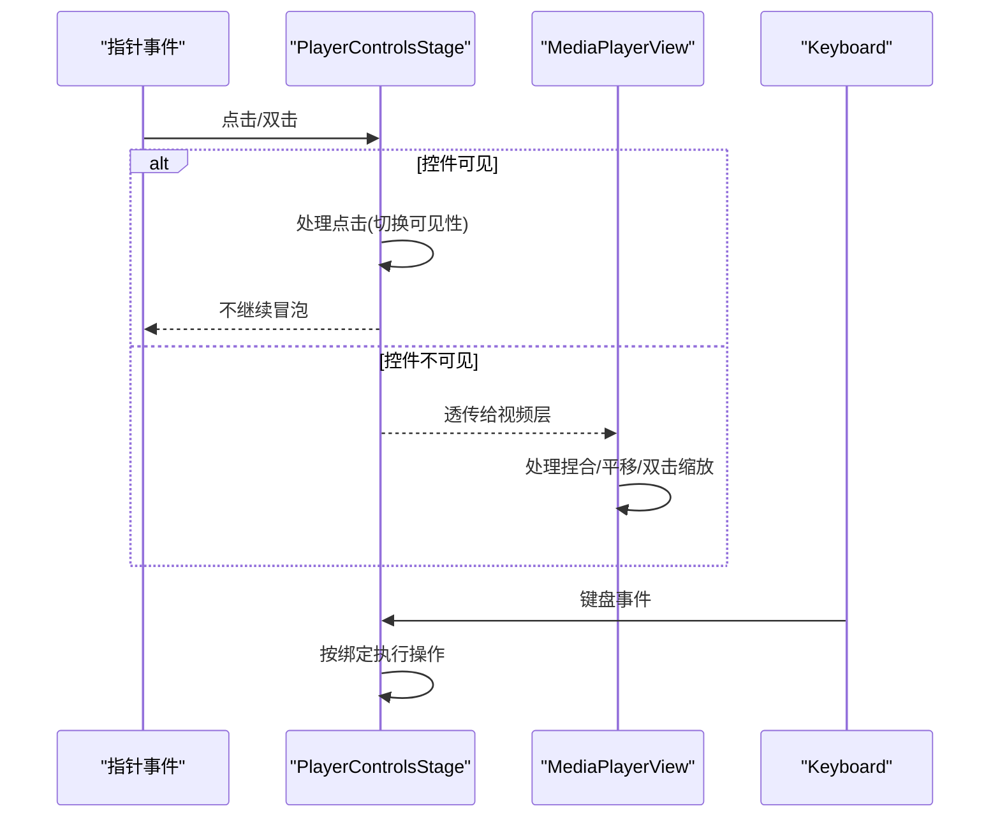
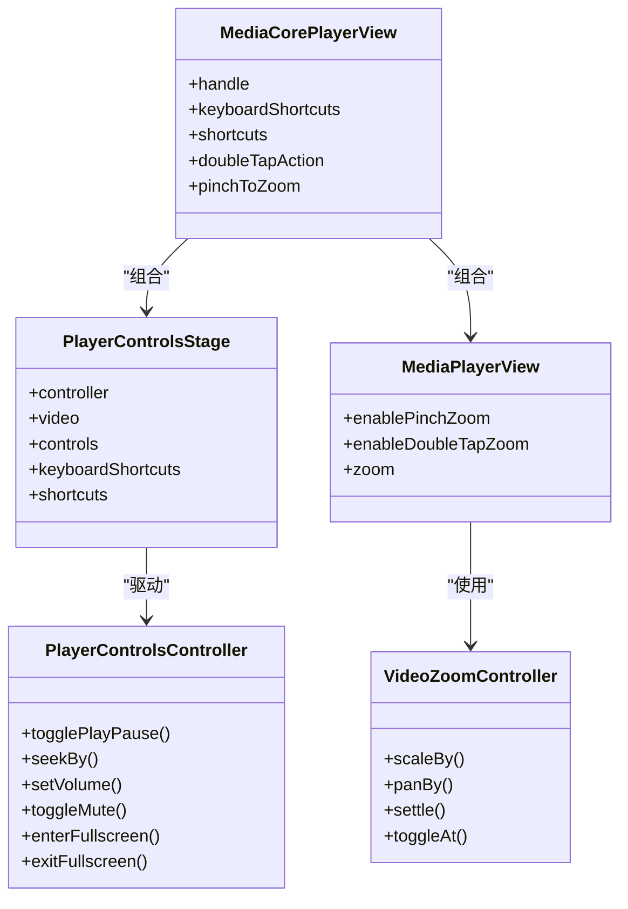

# 输入处理

<cite>
**本文引用的文件**   
- [player_controls_stage.dart](file://packages/media_core_ui/lib/src/common/player_controls_stage.dart)
- [media_core_player_view.dart](file://packages/media_core_ui/lib/src/media_core_player_view.dart)
- [media_player_view.dart](file://packages/media_core/lib/renderer/media_player_view.dart)
- [player_progress_bar.dart](file://packages/media_core_ui/lib/src/common/player_progress_bar.dart)
</cite>

## 目录
1. [简介](#简介)
2. [项目结构](#项目结构)
3. [核心组件](#核心组件)
4. [架构总览](#架构总览)
5. [详细组件分析](#详细组件分析)
6. [依赖关系分析](#依赖关系分析)
7. [性能与防抖](#性能与防抖)
8. [故障排查指南](#故障排查指南)
9. [结论](#结论)
10. [附录：配置与扩展](#附录配置与扩展)

## 简介
本文件聚焦 Media Core 在桌面平台的用户输入处理，覆盖键盘快捷键、鼠标手势、触摸板/多点触控缩放与平移、事件分发机制、设备兼容性与优先级管理，并提供输入绑定的配置方法与自定义扩展指南。文档以 UI 层与渲染层的实际实现为依据，帮助读者理解从 Flutter 手势到播放器控制器的完整链路。

## 项目结构
围绕输入处理的代码主要分布在 UI 层与渲染层：
- UI 层负责组合播放器视图、控件样式、可见性策略、键盘快捷键与双击行为。
- 渲染层负责视频区域的缩放、平移、双击放大等指针手势。
- 进度条组件提供点击与拖拽交互，驱动播放位置跳转与预览。

图表来源
- [media_core_player_view.dart:64-196](file://packages/media_core_ui/lib/src/media_core_player_view.dart#L64-L196)
- [player_controls_stage.dart:76-188](file://packages/media_core_ui/lib/src/common/player_controls_stage.dart#L76-L188)
- [media_player_view.dart:116-140](file://packages/media_core/lib/renderer/media_player_view.dart#L116-L140)

章节来源
- [media_core_player_view.dart:64-196](file://packages/media_core_ui/lib/src/media_core_player_view.dart#L64-L196)
- [player_controls_stage.dart:76-188](file://packages/media_core_ui/lib/src/common/player_controls_stage.dart#L76-L188)
- [media_player_view.dart:116-140](file://packages/media_core/lib/renderer/media_player_view.dart#L116-L140)

## 核心组件
- PlayerShortcuts：定义桌面端键盘快捷键映射（播放/暂停、快进/快退、音量、静音、全屏、退出全屏），并暴露可配置的步进参数。
- PlayerControlsStage：封装视频与控件的堆叠、悬停显示、点击/双击、以及通过 CallbackShortcuts 注入键盘绑定。
- MediaCorePlayerView：组装 MediaPlayerView、控件集合与 PlayerControlsStage，决定双击动作（缩放或全屏）、是否启用捏合缩放、自动隐藏策略等。
- MediaPlayerView：承载视频渲染与指针手势，支持捏合缩放、平移、双击放大，以及与 VideoZoomController 的联动。
- PlayerProgressBarController：进度条的点击与拖拽交互，触发 seekTo 与预览回调。

章节来源
- [player_controls_stage.dart:24-57](file://packages/media_core_ui/lib/src/common/player_controls_stage.dart#L24-L57)
- [player_controls_stage.dart:76-188](file://packages/media_core_ui/lib/src/common/player_controls_stage.dart#L76-L188)
- [media_core_player_view.dart:64-196](file://packages/media_core_ui/lib/src/media_core_player_view.dart#L64-L196)
- [media_player_view.dart:116-140](file://packages/media_core/lib/renderer/media_player_view.dart#L116-L140)
- [player_progress_bar.dart:178-212](file://packages/media_core_ui/lib/src/common/player_progress_bar.dart#L178-L212)

## 架构总览
下图展示桌面端输入从 Flutter 手势到播放器控制的调用链：

图表来源
- [player_controls_stage.dart:176-181](file://packages/media_core_ui/lib/src/common/player_controls_stage.dart#L176-L181)
- [media_core_player_view.dart:318-327](file://packages/media_core_ui/lib/src/media_core_player_view.dart#L318-L327)
- [media_player_view.dart:465-484](file://packages/media_core/lib/renderer/media_player_view.dart#L465-L484)

## 详细组件分析

### 键盘快捷键映射
- 默认映射遵循 mpv/VLC/YouTube 约定：空格/k 播放/暂停；左右方向键 ±5s；j/l ±10s；上下方向键 ±5% 音量；m 静音；f 全屏；escape 退出全屏。
- 通过 PlayerShortcuts.bindings 返回 ShortcutActivator → VoidCallback 映射，由 PlayerControlsStage 使用 CallbackShortcuts 注册到焦点节点。
- 可通过构造参数调整 seekStep、largeSeekStep、volumeStep，从而定制步长。

图表来源
- [player_controls_stage.dart:24-57](file://packages/media_core_ui/lib/src/common/player_controls_stage.dart#L24-L57)
- [player_controls_stage.dart:176-181](file://packages/media_core_ui/lib/src/common/player_controls_stage.dart#L176-L181)

章节来源
- [player_controls_stage.dart:24-57](file://packages/media_core_ui/lib/src/common/player_controls_stage.dart#L24-L57)
- [player_controls_stage.dart:176-181](file://packages/media_core_ui/lib/src/common/player_controls_stage.dart#L176-L181)

### 鼠标手势与双击行为
- 双击行为由 MediaCorePlayerView 根据风格决定：触摸风格默认“缩放”，指针风格默认“全屏”。
- 当选择“全屏”时，双击视频区域会调用控制器的 enterFullscreen；否则不处理。
- 控件层对点击与双击分别处理：单击切换控件可见性，双击委托给上层策略。

图表来源
- [media_core_player_view.dart:18-44](file://packages/media_core_ui/lib/src/media_core_player_view.dart#L18-L44)
- [media_core_player_view.dart:318-327](file://packages/media_core_ui/lib/src/media_core_player_view.dart#L318-L327)
- [player_controls_stage.dart:162-170](file://packages/media_core_ui/lib/src/common/player_controls_stage.dart#L162-L170)

章节来源
- [media_core_player_view.dart:18-44](file://packages/media_core_ui/lib/src/media_core_player_view.dart#L18-L44)
- [media_core_player_view.dart:318-327](file://packages/media_core_ui/lib/src/media_core_player_view.dart#L318-L327)
- [player_controls_stage.dart:162-170](file://packages/media_core_ui/lib/src/common/player_controls_stage.dart#L162-L170)

### 触摸板手势与缩放/平移
- 视频区域支持捏合缩放与平移：enablePinchZoom 开启后，GestureDetector 监听 onScaleStart/Update/End，计算相对缩放比并调用 VideoZoomController.scaleBy/panBy/settle。
- 双击放大：enableDoubleTapZoom 开启后，记录双击位置并在 onDoubleTap 中调用 toggleAt 进行定点缩放。
- 尺寸变化时会对缩放进行重新钳制，避免在全屏/旋转/分屏后出现越界。

图表来源
- [media_player_view.dart:465-484](file://packages/media_core/lib/renderer/media_player_view.dart#L465-L484)
- [media_player_view.dart:488-494](file://packages/media_core/lib/renderer/media_player_view.dart#L488-L494)

章节来源
- [media_player_view.dart:116-140](file://packages/media_core/lib/renderer/media_player_view.dart#L116-L140)
- [media_player_view.dart:465-484](file://packages/media_core/lib/renderer/media_player_view.dart#L465-L484)
- [media_player_view.dart:488-494](file://packages/media_core/lib/renderer/media_player_view.dart#L488-L494)

### 进度条交互
- 点击立即跳转到对应位置。
- 水平拖拽开始/更新时设置预览位置，供上层显示时间戳或缩略图预览。
- 结合 MouseRegion 提供点击光标与悬停状态。

图表来源
- [player_progress_bar.dart:191-212](file://packages/media_core_ui/lib/src/common/player_progress_bar.dart#L191-L212)

章节来源
- [player_progress_bar.dart:178-212](file://packages/media_core_ui/lib/src/common/player_progress_bar.dart#L178-L212)

### 输入事件分发机制
- 捕获与冒泡：控件层使用 IgnorePointer 与 AnimatedOpacity 控制控件层是否拦截指针事件；仅在控件可见时接收指针，避免遮挡视频拖拽。
- 焦点与键盘：PlayerControlsStage 内部维护 FocusNode，并通过 CallbackShortcuts 将快捷键绑定到焦点节点，确保键盘事件优先被播放器消费。
- 双击策略：MediaCorePlayerView 根据风格与配置决定双击是“缩放”还是“全屏”，并将结果传递给 Stage 或直接调用控制器。

图表来源
- [player_controls_stage.dart:144-181](file://packages/media_core_ui/lib/src/common/player_controls_stage.dart#L144-L181)
- [media_player_view.dart:465-484](file://packages/media_core/lib/renderer/media_player_view.dart#L465-L484)

章节来源
- [player_controls_stage.dart:144-181](file://packages/media_core_ui/lib/src/common/player_controls_stage.dart#L144-L181)
- [media_player_view.dart:465-484](file://packages/media_core/lib/renderer/media_player_view.dart#L465-L484)

### 不同输入设备的兼容性
- 鼠标与键盘：通过 Flutter 的 PointerDeviceKind 与 LogicalKeyboardKey 抽象，统一处理点击、双击、方向键、字母键与修饰键。
- 触摸与多点触控：通过 enablePinchZoom 与 enableDoubleTapZoom 开关控制捏合与双击缩放；触摸风格默认双击缩放，指针风格默认双击全屏。
- 媒体键与全局热键：当前仓库未提供全局热键注册或媒体键（如播放/暂停）的专用处理；如需全局热键，应在宿主应用侧集成平台能力，再转发到 PlayerControlsController。

章节来源
- [media_core_player_view.dart:18-44](file://packages/media_core_ui/lib/src/media_core_player_view.dart#L18-L44)
- [media_core_player_view.dart:120-124](file://packages/media_core_ui/lib/src/media_core_player_view.dart#L120-L124)
- [media_player_view.dart:116-140](file://packages/media_core/lib/renderer/media_player_view.dart#L116-L140)

### 输入事件的优先级管理与防抖
- 优先级：控件层仅在可见时拦截指针，避免遮挡视频手势；键盘事件通过焦点节点优先消费。
- 防抖：控件自动隐藏逻辑基于空闲延迟，悬停或交互会刷新可见性；双击与捏合缩放通过相对比例与 settle 收敛，避免连续抖动。
- 进度条拖拽：拖拽过程中仅更新预览位置，不频繁触发 seek，减少不必要的状态变更。

章节来源
- [player_controls_stage.dart:144-181](file://packages/media_core_ui/lib/src/common/player_controls_stage.dart#L144-L181)
- [media_player_view.dart:465-484](file://packages/media_core/lib/renderer/media_player_view.dart#L465-L484)
- [player_progress_bar.dart:191-212](file://packages/media_core_ui/lib/src/common/player_progress_bar.dart#L191-L212)

## 依赖关系分析
- MediaCorePlayerView 依赖 PlayerControlsStage 与 MediaPlayerView，并组合多种控件风格。
- PlayerControlsStage 依赖 PlayerControlsController 与 PlayerShortcuts，负责可见性与键盘绑定。
- MediaPlayerView 依赖 VideoZoomController 处理缩放与平移。
- PlayerProgressBarController 通过控制器回调驱动播放位置。

图表来源
- [media_core_player_view.dart:64-196](file://packages/media_core_ui/lib/src/media_core_player_view.dart#L64-L196)
- [player_controls_stage.dart:76-188](file://packages/media_core_ui/lib/src/common/player_controls_stage.dart#L76-L188)
- [media_player_view.dart:116-140](file://packages/media_core/lib/renderer/media_player_view.dart#L116-L140)

章节来源
- [media_core_player_view.dart:64-196](file://packages/media_core_ui/lib/src/media_core_player_view.dart#L64-L196)
- [player_controls_stage.dart:76-188](file://packages/media_core_ui/lib/src/common/player_controls_stage.dart#L76-L188)
- [media_player_view.dart:116-140](file://packages/media_core/lib/renderer/media_player_view.dart#L116-L140)

## 性能与防抖
- 捏合缩放采用相对比例计算，避免累积误差；settle 用于动画收敛。
- 双击缩放基于固定位置与视口大小进行钳制，防止越界重绘。
- 控件自动隐藏基于空闲计时，悬停或交互会重置计时，减少频繁重建。
- 进度条拖拽只更新预览位置，避免每帧触发 seek。

[本节为通用指导，无需列出具体文件来源]

## 故障排查指南
- 快捷键无效：确认 PlayerControlsStage.keyboardShortcuts 已启用且焦点位于播放器；检查 shortcuts 映射是否被覆盖。
- 双击未生效：确认 MediaCorePlayerView.doubleTapAction 与 enableDoubleTapZoom 配置是否符合预期；若为“全屏”，需宿主支持全屏。
- 捏合缩放异常：检查 enablePinchZoom 与 zoom 控制器是否同时启用；确认视口尺寸更新后调用了 settle。
- 进度条拖动卡顿：确认 onPreview 回调开销较大时可改为节流或合并更新。

章节来源
- [player_controls_stage.dart:176-181](file://packages/media_core_ui/lib/src/common/player_controls_stage.dart#L176-L181)
- [media_core_player_view.dart:318-327](file://packages/media_core_ui/lib/src/media_core_player_view.dart#L318-L327)
- [media_player_view.dart:465-484](file://packages/media_core/lib/renderer/media_player_view.dart#L465-L484)
- [player_progress_bar.dart:191-212](file://packages/media_core_ui/lib/src/common/player_progress_bar.dart#L191-L212)

## 结论
Media Core 在桌面端的输入处理以 UI 层与渲染层解耦的方式实现：UI 层负责快捷键与双击策略，渲染层专注视频手势与缩放。该设计便于在不同风格与平台上保持一致的用户体验，同时保留足够的扩展点以适配宿主应用的特殊需求。

[本节为总结，无需列出具体文件来源]

## 附录：配置与扩展
- 键盘快捷键配置
  - 通过 PlayerShortcuts.seekStep、largeSeekStep、volumeStep 调整步长。
  - 通过 PlayerControlsStage.shortcuts 替换默认映射，或在宿主侧扩展回调。
- 双击行为配置
  - 通过 MediaCorePlayerView.doubleTapAction 选择“缩放”或“全屏”。
  - 触摸风格默认缩放，指针风格默认全屏。
- 捏合与双击缩放
  - 通过 MediaCorePlayerView.pinchToZoom 与 enableDoubleTapZoom 控制。
  - 可传入外部 VideoZoomController 以共享缩放状态。
- 自定义控件与手势
  - 通过 MediaCorePlayerView.controls 替换控件集。
  - 在 PlayerControlsStage.onTapVideo/onDoubleTap 中注入宿主逻辑。
- 全局热键与媒体键
  - 当前仓库未内置；建议在宿主应用侧注册平台级热键，然后调用 PlayerControlsController 的方法。

章节来源
- [player_controls_stage.dart:24-57](file://packages/media_core_ui/lib/src/common/player_controls_stage.dart#L24-L57)
- [media_core_player_view.dart:120-124](file://packages/media_core_ui/lib/src/media_core_player_view.dart#L120-L124)
- [media_core_player_view.dart:318-327](file://packages/media_core_ui/lib/src/media_core_player_view.dart#L318-L327)