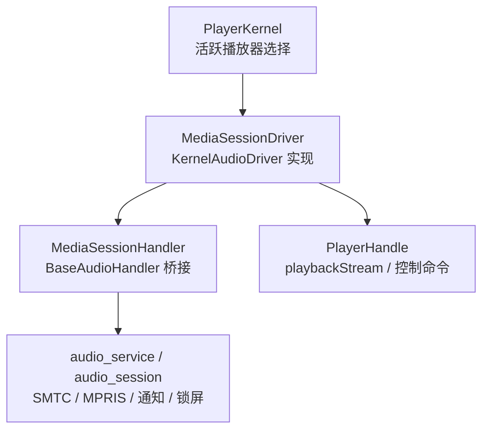
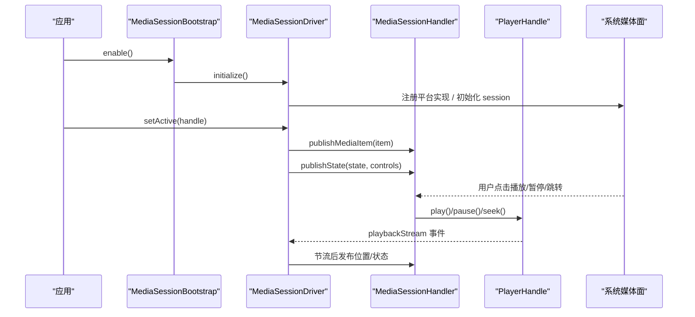
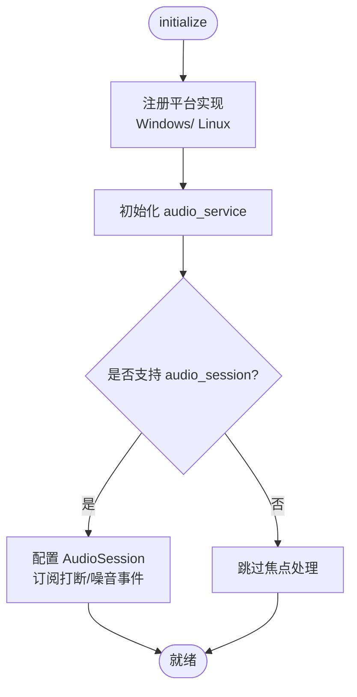
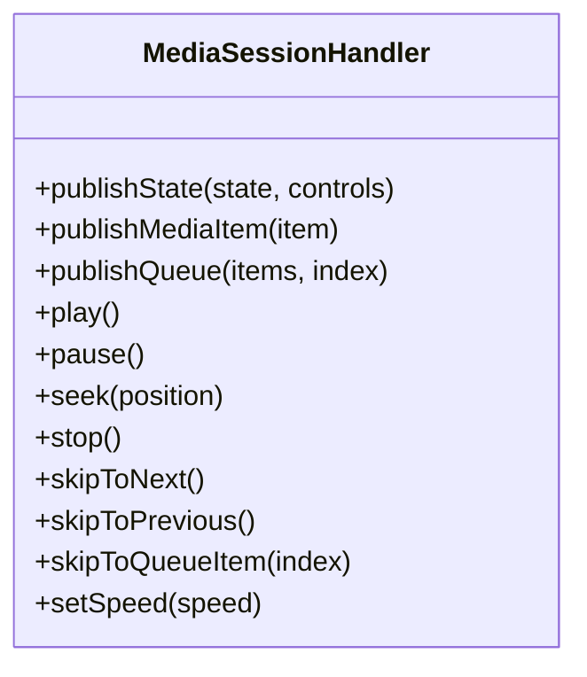
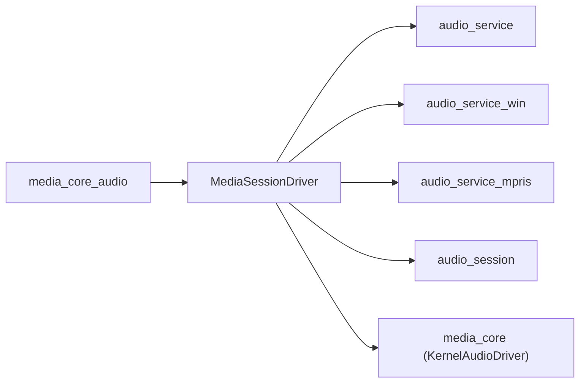

# 系统媒体面

<cite>
**本文引用的文件**   
- [README.md](file://README.md)
- [example/main.dart](file://example/lib/main.dart)
- [media_core_mediasession/README.md](file://packages/media_core_mediasession/README.md)
- [media_session_driver.dart](file://packages/media_core_mediasession/lib/src/media_session_driver.dart)
- [media_session_handler.dart](file://packages/media_core_mediasession/lib/src/media_session_handler.dart)
- [media_session_config.dart](file://packages/media_core_mediasession/lib/src/media_session_config.dart)
- [audio_policy.dart](file://packages/media_core/lib/policy/audio_policy.dart)
- [audio.md](file://doc/en/audio.md)
- [media_core_audio/README.md](file://packages/media_core_audio/README.md)
- [media_core_notify.dart](file://packages/media_core_notify/lib/media_core_notify.dart)
</cite>

## 目录
1. [引言](#引言)
2. [项目结构](#项目结构)
3. [核心组件](#核心组件)
4. [架构总览](#架构总览)
5. [详细组件分析](#详细组件分析)
6. [依赖关系分析](#依赖关系分析)
7. [性能考量](#性能考量)
8. [故障排查指南](#故障排查指南)
9. [结论](#结论)
10. [附录：平台与权限清单](#附录平台与权限清单)

## 引言
本文件聚焦“系统媒体面”能力，说明 Media Core 如何与操作系统媒体服务深度集成，覆盖通知系统集成、锁屏控制界面、SMTC（System Media Transport Controls）与 MPRIS（Media Player Remote Interfacing Specification）支持；解释音频焦点管理机制（获取、释放、抢占策略），跨平台媒体会话的生命周期管理、元数据同步与播放状态同步；并给出 Android 的 MediaSession、iOS 的 AVAudioSession、Windows 的 MediaControl 等平台的特定实现要点。同时提供权限配置、清单文件设置与特殊处理指南，以及常见问题解决方案和性能优化建议。

## 项目结构
系统媒体面由 `media_core_mediasession` 包提供，作为内核的 `KernelAudioDriver` 实现，负责把任意播放器（视频或音频）接入系统媒体面：Android 通知与锁屏、iOS 控制中心 Now Playing、Windows SMTC、Linux MPRIS，并处理音频焦点打断与耳机拔出等事件。该能力独立成包，避免视频宿主被迫依赖音乐模块。

**图示来源**
- [media_session_driver.dart:13-48](file://packages/media_core_mediasession/lib/src/media_session_driver.dart#L13-L48)
- [media_session_handler.dart:69-78](file://packages/media_core_mediasession/lib/src/media_session_handler.dart#L69-L78)

**章节来源**
- [README.md:105-111](file://README.md#L105-L111)
- [media_core_mediasession/README.md:1-15](file://packages/media_core_mediasession/README.md#L1-L15)

## 核心组件
- MediaSessionDriver：进程内唯一的系统媒体面驱动，负责初始化 platform session、订阅播放器状态、构建控件、处理打断与噪音事件，并把活跃播放器绑定到系统媒体面。
- MediaSessionHandler：基于 BaseAudioHandler 的桥接层，将系统侧的播放/暂停/跳转/速度等命令转发给活跃播放器，同时将播放状态与媒体项推送到系统媒体面。
- MediaSessionConfig：系统媒体面的可配置项，包括通知渠道、控件显示、打断行为、音量压低比例、快退步长、图标资源名等。
- AudioPolicy：内核侧音频策略，定义是否启用音频焦点、丢失时暂停或压低音量、后台播放、默认音量等策略。

**章节来源**
- [media_session_driver.dart:49-113](file://packages/media_core_mediasession/lib/src/media_session_driver.dart#L49-L113)
- [media_session_handler.dart:1-67](file://packages/media_core_mediasession/lib/src/media_session_handler.dart#L1-L67)
- [media_session_config.dart:1-31](file://packages/media_core_mediasession/lib/src/media_session_config.dart#L1-L31)
- [audio_policy.dart:1-42](file://packages/media_core/lib/policy/audio_policy.dart#L1-L42)

## 架构总览
系统媒体面在应用启动时通过 `MediaSessionBootstrap.enable()` 一次性启用，之后每个创建的播放器自动挂载到系统媒体面。驱动内部维护一个活跃播放器引用，订阅其 `playbackStream`，按节流策略推送位置更新，并在系统侧收到用户操作时回调到活跃播放器。

**图示来源**
- [example/main.dart:32-51](file://example/lib/main.dart#L32-L51)
- [media_session_driver.dart:132-187](file://packages/media_core_mediasession/lib/src/media_session_driver.dart#L132-L187)
- [media_session_handler.dart:131-153](file://packages/media_core_mediasession/lib/src/media_session_handler.dart#L131-L153)

## 详细组件分析

### MediaSessionDriver：系统媒体面驱动
- 生命周期
  - `initialize()`：注册平台实现（Windows 的 SMTC、Linux 的 MPRIS），初始化 `audio_service`，可选配置 `audio_session` 以处理音频焦点打断与耳机拔出。
  - `dispose()`：取消订阅、清理 handler 状态、清空媒体项。
- 活跃播放器绑定
  - `setActive(handle)`：切换活跃播放器，发布当前媒体项与状态，订阅 `playbackStream`，流结束时自动解绑。
  - `refresh()`：当初始化完成后补发已缓存的绑定，或在同一 handle 换源后刷新展示。
- 打断与噪音
  - 监听 `interruptionEventStream`：根据打断类型执行“压低音量”或“暂停”，并在打断结束后恢复音量或继续播放。
  - 监听 `becomingNoisyEventStream`：耳机拔出时暂停播放。
- 控件构建
  - `_buildControls(playing)`：根据是否安装队列传输决定显示“上一首/下一首”还是“后退/前进”步进按钮，始终包含播放/暂停与停止。
- 状态发布节流
  - `_publishCurrent(handle)`：对仅位置变化的 tick 进行节流（约每秒一次），减少通知重建与锁屏进度条重绘带来的电量与发热。

**图示来源**
- [media_session_driver.dart:132-187](file://packages/media_core_mediasession/lib/src/media_session_driver.dart#L132-L187)

**章节来源**
- [media_session_driver.dart:119-187](file://packages/media_core_mediasession/lib/src/media_session_driver.dart#L119-L187)
- [media_session_driver.dart:238-303](file://packages/media_core_mediasession/lib/src/media_session_driver.dart#L238-L303)
- [media_session_driver.dart:309-343](file://packages/media_core_mediasession/lib/src/media_session_driver.dart#L309-L343)
- [media_session_driver.dart:370-445](file://packages/media_core_mediasession/lib/src/media_session_driver.dart#L370-L445)

### MediaSessionHandler：平台命令桥接
- 出站方向（播放器 → 系统媒体面）
  - `publishState(state, controls)`：推送播放状态（播放中、位置、时长、速度）与控件列表。
  - `publishMediaItem(item)`：推送当前媒体项（标题、专辑、艺术家、封面 URI）。
  - `publishQueue(items, index)`：推送队列，并将当前条目作为 mediaItem。
- 入站方向（系统媒体面 → 播放器）
  - 覆写 `play/pause/seek/stop/skipToNext/skipToPrevious/skipToQueueItem/setSpeed`，将系统命令转发给构造时传入的回调，最终落到活跃播放器。
  - 未安装的回调回退到 BaseAudioHandler 默认行为，避免“静默失败”。

**图示来源**
- [media_session_handler.dart:69-235](file://packages/media_core_mediasession/lib/src/media_session_handler.dart#L69-L235)

**章节来源**
- [media_session_handler.dart:131-170](file://packages/media_core_mediasession/lib/src/media_session_handler.dart#L131-L170)
- [media_session_handler.dart:172-235](file://packages/media_core_mediasession/lib/src/media_session_handler.dart#L172-L235)

### MediaSessionConfig：系统媒体面配置
- 通知渠道与前台行为（Android）
  - `androidNotificationChannelId` / `androidNotificationChannelName` / `androidNotificationOngoing` / `androidStopOnRemoveTask` / `androidCompactActionIndices`。
- 控件与交互
  - `showControls` / `showSeekButtons` / `seekStep` / 各图标 drawable 名称。
- 音频焦点与打断
  - `processInterruptions` / `pauseOnBecomingNoisy` / `duckFactor` / `resumeAfterInterruption`。
- 预设
  - `MediaSessionConfig.video()`：为单媒体（视频）场景提供合适的默认值（如不同的通知渠道名与紧凑动作索引）。

**章节来源**
- [media_session_config.dart:1-129](file://packages/media_core_mediasession/lib/src/media_session_config.dart#L1-L129)

### 音频焦点与策略（AudioPolicy）
- 策略字段
  - `enableAudioFocus`：是否启用音频焦点管理。
  - `pauseOnAudioLoss` / `duckOnAudioLoss`：焦点丢失时暂停或压低音量（二者互斥逻辑由方法封装）。
  - `allowBackgroundPlayback`：允许后台播放。
  - `restoreVolume` / `defaultVolume` / `startMuted` / `keepAudioWhenVideoHidden`：音量与静音策略。
- 决策方法
  - `shouldPauseOnFocusLoss()` / `shouldDuckOnFocusLoss()`：集中判断是否暂停或压低音量。

**章节来源**
- [audio_policy.dart:1-136](file://packages/media_core/lib/policy/audio_policy.dart#L1-L136)

### 与音乐模块的关系
- `media_core_audio` 依赖 `media_core_mediasession`，并提供 `MediaCoreAudio`（历史别名）与 `MusicBackgroundBinding`，复用同一套系统媒体面实现，避免重复开发。
- 音乐模块关注音源解析、队列推进、歌词与下载等业务逻辑，不重复实现通知/锁屏/SMTC/MPRIS。

**章节来源**
- [media_core_audio/README.md:5-12](file://packages/media_core_audio/README.md#L5-L12)

## 依赖关系分析
- 外部依赖
  - `audio_service`：统一的媒体服务抽象，承载通知、锁屏、SMTC、MPRIS。
  - `audio_service_win`：Windows 平台 SMTC 实现。
  - `audio_service_mpris`：Linux 平台 MPRIS 实现。
  - `audio_session`：音频会话与打断事件（Android/iOS/macOS）。
- 内部依赖
  - `media_core`：内核契约（`KernelAudioDriver`、`PlayerHandle`）。
  - `media_core_audio`：复用媒体面能力。

**图示来源**
- [media_session_driver.dart:1-11](file://packages/media_core_mediasession/lib/src/media_session_driver.dart#L1-L11)
- [media_core_audio/README.md:5-12](file://packages/media_core_audio/README.md#L5-L12)

**章节来源**
- [media_session_driver.dart:1-11](file://packages/media_core_mediasession/lib/src/media_session_driver.dart#L1-L11)
- [media_core_audio/README.md:5-12](file://packages/media_core_audio/README.md#L5-L12)

## 性能考量
- 状态发布节流
  - 位置更新最多每秒一次，避免频繁重建通知与锁屏进度条，降低电量与发热。
- 控件构建与图标
  - 缺少图标会导致通知控件完全不显示，需确保 drawable 资源存在。
- 队列与单媒体差异
  - 有队列时显示“上一首/下一首”，无队列时显示“后退/前进”步进按钮，符合平台用户预期。
- 打断处理
  - 打断期间压低音量或暂停，打断结束后恢复音量或继续播放，避免长时间占用音频资源。

**章节来源**
- [media_session_driver.dart:408-445](file://packages/media_core_mediasession/lib/src/media_session_driver.dart#L408-L445)
- [media_session_config.dart:1-31](file://packages/media_core_mediasession/lib/src/media_session_config.dart#L1-L31)

## 故障排查指南
- 通知控件不显示
  - 检查 `MediaSessionConfig.showControls` 与各图标 drawable 名称是否正确，缺图标会导致控件全部隐藏。
- 锁屏条目消失（iOS）
  - 确认 `Info.plist` 中已声明后台音频模式。
- Android 通知权限
  - API 33+ 需要 `POST_NOTIFICATIONS` 运行时权限；可通过 `AudioPermission.notifications` 或自有权限插件申请。
- 活动/服务/接收器缺失
  - Android 必须声明 `AudioServiceActivity`、`AudioService`、`MediaButtonReceiver`，否则无法正常工作。
- 多驱动冲突
  - 进程内只能有一个驱动实例；`MediaSessionBootstrap.enable()` 保证独占，避免多个驱动互相抢占。
- 没有焦点处理能力
  - 某些平台不支持 `audio_session`，此时仍可使用媒体面，但焦点处理不可用。

**章节来源**
- [media_core_mediasession/README.md:64-68](file://packages/media_core_mediasession/README.md#L64-L68)
- [media_session_driver.dart:167-187](file://packages/media_core_mediasession/lib/src/media_session_driver.dart#L167-L187)
- [media_core_notify.dart:24-35](file://packages/media_core_notify/lib/media_core_notify.dart#L24-L35)

## 结论
系统媒体面通过 `MediaSessionDriver` 将任意播放器统一接入系统通知、锁屏、SMTC 与 MPRIS，并以 `MediaSessionHandler` 桥接平台命令与播放器控制。配合 `MediaSessionConfig` 与内核的 `AudioPolicy`，可实现一致的音频焦点与打断策略。该能力独立成包，既让视频宿主无需依赖音乐模块，也让音乐模块复用同一实现，从而简化跨平台媒体体验的开发与维护。

## 附录：平台与权限清单
- Android
  - 清单条目：`AudioServiceActivity`、`AudioService`、`MediaButtonReceiver`。
  - 运行时权限：API 33+ 需要 `POST_NOTIFICATIONS`。
  - 通知渠道：通过 `MediaSessionConfig` 配置 ID 与名称。
- iOS
  - `Info.plist` 中开启后台音频模式。
- Windows
  - 通过 `audio_service_win` 启用 SMTC（系统媒体传输控件）。
- Linux
  - 通过 `audio_service_mpris` 启用 MPRIS（GNOME/KDE 媒体部件与媒体键）。
- macOS
  - 通过 `audio_service` 的 iOS 路径可用锁屏条目。

**章节来源**
- [media_core_mediasession/README.md:74-82](file://packages/media_core_mediasession/README.md#L74-L82)
- [media_session_driver.dart:123-128](file://packages/media_core_mediasession/lib/src/media_session_driver.dart#L123-L128)