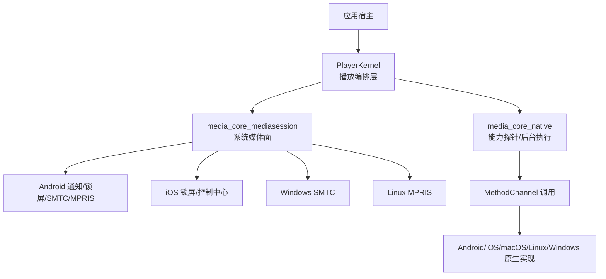
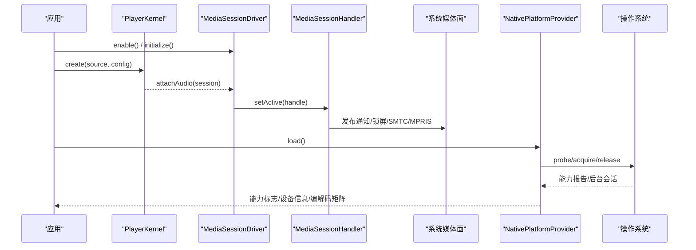
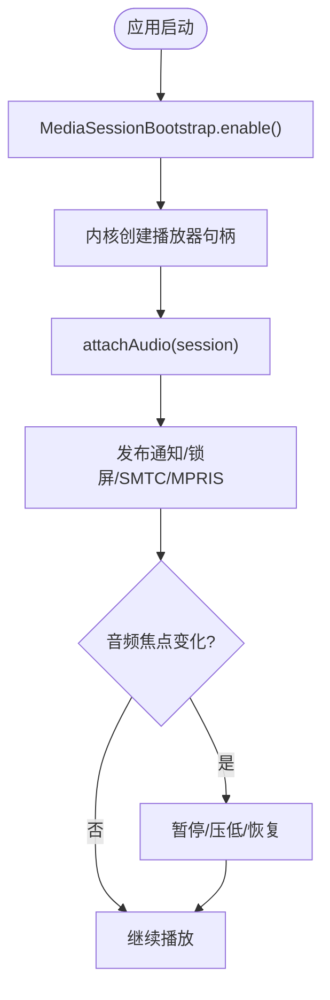
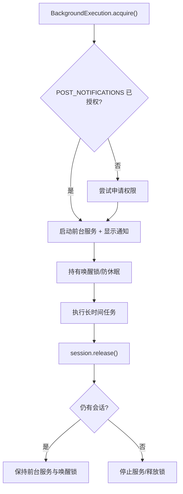
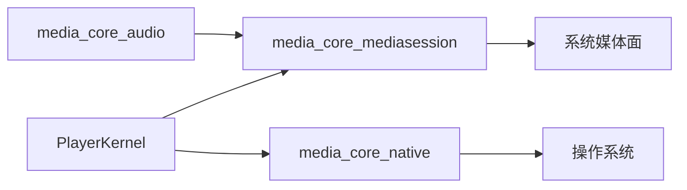

# 系统集成

<cite>
**本文引用的文件**   
- [README.md](file://README.md)
- [media_core_native/README.md](file://packages/media_core_native/README.md)
- [media_core_native.dart](file://packages/media_core_native/lib/media_core_native.dart)
- [native_platform_provider.dart](file://packages/media_core_native/lib/src/native_platform_provider.dart)
- [platform_probe_report.dart](file://packages/media_core_native/lib/src/platform_probe_report.dart)
- [method_channel_media_core_native.dart](file://packages/media_core_native/lib/src/method_channel_media_core_native.dart)
- [background_execution.dart](file://packages/media_core_native/lib/src/background_execution.dart)
- [media_core_mediasession/README.md](file://packages/media_core_mediasession/README.md)
- [media_core_mediasession.dart](file://packages/media_core_mediasession/lib/media_core_mediasession.dart)
- [media_session_bootstrap.dart](file://packages/media_core_mediasession/lib/src/media_session_bootstrap.dart)
- [media_session_driver.dart](file://packages/media_core_mediasession/lib/src/media_session_driver.dart)
- [media_session_handler.dart](file://packages/media_core_mediasession/lib/src/media_session_handler.dart)
- [permissions.md](file://packages/media_core_audio/doc/permissions.md)
</cite>

## 目录
1. [引言](#引言)
2. [项目结构](#项目结构)
3. [核心组件](#核心组件)
4. [架构总览](#架构总览)
5. [详细组件分析](#详细组件分析)
6. [依赖关系分析](#依赖关系分析)
7. [性能与资源特性](#性能与资源特性)
8. [权限与平台清单](#权限与平台清单)
9. [调试、分析与故障排查](#调试分析与故障排查)
10. [结论](#结论)

## 引言
本文件聚焦 Media Core 在操作系统与硬件层面的深度集成，覆盖以下主题：
- 系统媒体面：通知、锁屏、SMTC、MPRIS 与音频焦点管理。
- 平台能力探针：编解码硬解探测、分辨率上限检测、内存与 CPU 信息、系统特性。
- 后台保活：前台服务、唤醒锁、防休眠策略与各平台差异。
- 桌面歌词窗口与画中画模式的平台差异处理。
- 各平台权限配置、清单条目与特殊处理。
- 最佳实践、兼容性方案与调试分析方法。

Media Core 的核心包保持平台无关，平台相关能力通过 `media_core_native`（能力探针与后台执行）和 `media_core_mediasession`（系统媒体面）等能力包接入内核，遵循“能力靠声明、未知不等于不支持”的原则。

**章节来源**
- [README.md:5-12](file://README.md#L5-L12)
- [README.md:83-90](file://README.md#L83-L90)
- [README.md:159-168](file://README.md#L159-L168)

## 项目结构
围绕系统集成，主要涉及两个能力包：
- `media_core_native`：提供原生平台能力入口，包括能力探针与后台执行。
- `media_core_mediasession`：将任意播放器挂载到系统媒体面，统一通知、锁屏、SMTC、MPRIS 与音频焦点。

**图表来源**
- [media_core_mediasession.dart:1-47](file://packages/media_core_mediasession/lib/media_core_mediasession.dart#L1-L47)
- [media_core_native.dart:1-43](file://packages/media_core_native/lib/media_core_native.dart#L1-L43)

**章节来源**
- [README.md:187-213](file://README.md#L187-L213)
- [media_core_native.dart:1-43](file://packages/media_core_native/lib/media_core_native.dart#L1-L43)
- [media_core_mediasession.dart:1-47](file://packages/media_core_mediasession/lib/media_core_mediasession.dart#L1-L47)

## 核心组件
- 系统媒体面驱动
  - `MediaSessionBootstrap.enable()`：进程级一次启用，之后每个播放器自动挂载到系统媒体面。
  - `MediaSessionDriver`：初始化并绑定活跃播放器，负责状态同步与控件展示。
  - `MediaSessionHandler`：桥接播放器事件与平台媒体面，处理音频焦点、打断、耳机拔出等。
- 平台能力探针
  - `NativePlatformProvider.load()`：一次性查询设备能力，缓存后随 session 与适配器下发。
  - `PlatformProbeReport`：通道载荷映射为核心类型（能力标志、设备信息、编解码矩阵）。
  - MethodChannel 契约：`probe`、`acquire`、`release`。
- 后台保活
  - `BackgroundExecution.acquire/release`：前台服务 + 通知 + 唤醒锁；跨平台防休眠策略。

**章节来源**
- [media_core_mediasession/README.md:19-36](file://packages/media_core_mediasession/README.md#L19-L36)
- [media_core_native/README.md:67-107](file://packages/media_core_native/README.md#L67-L107)
- [media_core_native.dart:18-43](file://packages/media_core_native/lib/media_core_native.dart#L18-L43)

## 架构总览
Media Core 的集成架构由“内核 + 能力包 + 平台实现”组成：
- 内核持有会话、回放、几何、恢复决策等编排对象。
- 能力包通过接口挂入内核，核心不反向依赖它们。
- 平台实现位于 `media_core_native` 与各平台原生代码中。

**图表来源**
- [media_core_mediasession.dart:1-47](file://packages/media_core_mediasession/lib/media_core_mediasession.dart#L1-L47)
- [media_core_native.dart:18-43](file://packages/media_core_native/lib/media_core_native.dart#L18-L43)

**章节来源**
- [README.md:55-90](file://README.md#L55-L90)
- [media_core_mediasession/README.md:1-15](file://packages/media_core_mediasession/README.md#L1-L15)
- [media_core_native/README.md:67-107](file://packages/media_core_native/README.md#L67-L107)

## 详细组件分析

### 系统媒体面（通知、锁屏、SMTC、MPRIS、音频焦点）
- 启用方式
  - 进程级启用：`MediaSessionBootstrap.enable()`，之后所有播放器自动挂载。
  - 手动路径：创建 `MediaSessionDriver`，`initialize()` 后 `kernel.attachAudio(session)`。
- 状态同步节奏
  - 位置每秒最多发一次，其余状态立即发；避免频繁重建通知导致耗电发热。
  - seek 或换时间线时立刻刷新。
- 音频焦点与打断
  - 来电、其他播放器抢占时暂停/压低音量；耳机拔出暂停。
- 平台支持
  - Android：通知控件、锁屏、媒体键、前台服务。
  - iOS：锁屏/控制中心 Now Playing、媒体键。
  - Windows：SMTC（系统媒体传输控件、音量浮层）。
  - Linux：MPRIS（D-Bus），GNOME/KDE 媒体部件与媒体键。
  - macOS：通过 audio_service 的 iOS 路径，锁屏条目可用。

**图表来源**
- [media_core_mediasession/README.md:19-36](file://packages/media_core_mediasession/README.md#L19-L36)
- [media_core_mediasession/README.md:53-68](file://packages/media_core_mediasession/README.md#L53-L68)

**章节来源**
- [media_core_mediasession/README.md:1-15](file://packages/media_core_mediasession/README.md#L1-L15)
- [media_core_mediasession/README.md:19-36](file://packages/media_core_mediasession/README.md#L19-L36)
- [media_core_mediasession/README.md:53-68](file://packages/media_core_mediasession/README.md#L53-L68)
- [media_core_mediasession/README.md:74-82](file://packages/media_core_mediasession/README.md#L74-L82)

### 平台能力探针（编解码硬解、分辨率上限、内存与性能监控）
- 探针入口
  - `NativePlatformProvider.load()` 一次性查询，结果缓存并随 session 与适配器下发。
- 通道契约
  - Dart → 平台：`probe`、`acquire`、`release`。
  - 上报 map 四段可选：info、capabilities、device、codecs。
- 关键语义
  - 缺失字段/整段/调用失败 = “未知”，不是“不支持”。
  - `PlatformCodecCapabilities.canDecodeInHardware` 返回 null 表示未知，false 才是平台明确不支持。
  - 探针失败时 provider 未就绪，不做降级。
- 消费点
  - SessionContext.platform：能力标志不再写死。
  - PlayerAdapterContext：platform/device/codecs 随播放器下传。
  - 后端适配：按设备能力决定硬解/软解策略。
  - 直播缓冲策略：低内存设备限制前向/后向缓冲字节上限。

```mermaid
classDiagram
class NativePlatformProvider {
+load() Future
+refresh() void
+isReady bool
}
class PlatformProbeReport {
+info
+capabilities
+device
+codecs
}
class PlatformCapabilities {
+hardwareDecode
+softwareDecode
+pictureInPicture
+backgroundPlayback
}
class PlatformDeviceProfile {
+cpuCores
+totalRamMb
+lowRamDevice
+supports64BitAbi
}
class PlatformCodecCapabilities {
+canDecodeInHardware
+maxWidth
+maxHeight
+maxFrameRate
}
NativePlatformProvider --> PlatformProbeReport : "解析通道载荷"
PlatformProbeReport --> PlatformCapabilities : "包含"
PlatformProbeReport --> PlatformDeviceProfile : "包含"
PlatformProbeReport --> PlatformCodecCapabilities : "逐编解码器"
```

**图表来源**
- [media_core_native.dart:18-43](file://packages/media_core_native/lib/media_core_native.dart#L18-L43)
- [platform_probe_report.dart:29-99](file://packages/media_core_native/lib/src/platform_probe_report.dart#L29-L99)

**章节来源**
- [media_core_native/README.md:67-107](file://packages/media_core_native/README.md#L67-L107)
- [media_core_native.dart:18-43](file://packages/media_core_native/lib/media_core_native.dart#L18-L43)

### 后台保活机制（前台服务、唤醒锁、防休眠）
- 使用方式
  - `BackgroundExecution.acquire(notification)` 获取会话，finally 中 `session.release()`。
- 平台行为
  - Android：前台服务（API 34+ dataSync）、通知、PARTIAL_WAKE_LOCK；Android 15 dataSync 每天 6 小时额度，超时清理。
  - iOS：后台任务断言（过渡窗口约 30 秒），长录制需应用声明 audio 后台模式。
  - macOS：beginActivity(.idleSystemSleepDisabled)，系统不睡，屏幕可关。
  - Windows：SetThreadExecutionState(ES_SYSTEM_REQUIRED)，系统不睡（不阻止息屏）。
  - Linux：未实现 logind Inhibit，acquire 返回 null。
- 通知与计数
  - 一条通知描述最新启动的会话；释放幂等；按 id 计数共享前台服务与通知。

**图表来源**
- [background_execution.dart:19-65](file://packages/media_core_native/lib/src/background_execution.dart#L19-L65)

**章节来源**
- [media_core_native/README.md:14-65](file://packages/media_core_native/README.md#L14-L65)
- [media_core_native.dart:18-43](file://packages/media_core_native/lib/media_core_native.dart#L18-L43)

### 桌面歌词窗口与画中画模式
- 桌面歌词窗口
  - 音乐模块提供桌面歌词原生窗口；Android 需要 SYSTEM_ALERT_WINDOW 权限，请求会跳转到系统设置页。
  - iOS 不支持跨应用窗口；macOS/Linux/Windows 支持浮动窗口。
- 画中画模式
  - 桌面：置顶小窗（可锁宽高比）。
  - Android/iOS：系统 PiP（`native_picture_in_picture` 接管式）；移动端“能进不能出”是平台事实。
  - iOS 的系统 PiP 只报“平台支持”，但帧投递层尚未提供，因此 `SystemPip` 仍返回不可用。

**章节来源**
- [permissions.md:25-32](file://packages/media_core_audio/doc/permissions.md#L25-L32)
- [permissions.md:82-86](file://packages/media_core_audio/doc/permissions.md#L82-L86)
- [media_core_native/README.md:122-138](file://packages/media_core_native/README.md#L122-L138)

### 权限配置与清单文件
- 运行时权限（`AudioPermissionService`）
  - notifications：Android 13+ POST_NOTIFICATIONS；其他平台 granted。
  - mediaLibrary：扫描本地音乐所需。
  - desktopLyricOverlay：SYSTEM_ALERT_WINDOW（Android），无对话框，跳转系统设置。
- 宿主必须声明
  - Android：AudioServiceActivity、AudioService、MediaButtonReceiver；库清单合并权限与前台服务声明。
  - iOS：Info.plist 中 UIBackgroundModes.audio。
  - Windows/macOS/Linux：无需运行时权限；Linux Wayland 点击穿透注意事项见文档。

**章节来源**
- [permissions.md:7-32](file://packages/media_core_audio/doc/permissions.md#L7-L32)
- [permissions.md:34-70](file://packages/media_core_audio/doc/permissions.md#L34-L70)
- [permissions.md:72-86](file://packages/media_core_audio/doc/permissions.md#L72-L86)

## 依赖关系分析
- 能力包通过接口挂入内核，核心不反向依赖能力包。
- `media_core_mediasession` 独立于音乐模块，视频播放器也可使用系统媒体面。
- `media_core_native` 提供平台能力入口，被内核与能力包共同消费。

**图表来源**
- [README.md:175-184](file://README.md#L175-L184)
- [media_core_mediasession.dart:1-47](file://packages/media_core_mediasession/lib/media_core_mediasession.dart#L1-L47)
- [media_core_native.dart:1-43](file://packages/media_core_native/lib/media_core_native.dart#L1-L43)

**章节来源**
- [README.md:175-184](file://README.md#L175-L184)

## 性能与资源特性
- 系统媒体面
  - 状态发布节流：位置每秒最多一次，避免频繁重建通知造成耗电与发热。
  - 控件表按需展示，减少不必要的 UI 重建。
- 能力探针
  - 一次查询、缓存复用；未知值不触发错误降级，保留引擎试错空间。
  - 编解码硬解与分辨率上限用于优化解码策略与缓冲预算。
- 后台保活
  - 前台服务与唤醒锁仅在必要时持有；Android 15 dataSync 额度耗尽时安全收尾。
  - 多任务共享通知与前台服务，按 id 计数释放。

[本节为通用指导，不直接分析具体文件]

## 调试、分析与故障排查
- 日志与内存
  - 分级日志默认静默，按需开启；分类与模块一一对应。
  - 内存记账：模块申报贡献者求和 + 设备实测快照；四级压力阈值驱动。
- 常见问题
  - 通知不出现：检查 Android 13+ POST_NOTIFICATIONS 权限与宿主清单；图标名是否存在。
  - 锁屏条目消失：iOS 是否声明 audio 后台模式。
  - 后台录制中断：确认前台服务与唤醒锁是否成功获取；Android 15 dataSync 额度是否耗尽。
  - 硬解未生效：确认探针是否返回未知；若未知，允许引擎自行尝试硬解。
- 诊断建议
  - 打印平台探针报告，核对 capabilities/device/codecs 字段。
  - 观察系统媒体面状态流，确认位置更新频率与控件表现。
  - 对后台任务记录会话 id 与生命周期事件，定位释放顺序问题。

**章节来源**
- [README.md:133-146](file://README.md#L133-L146)
- [media_core_native/README.md:122-138](file://packages/media_core_native/README.md#L122-L138)
- [media_core_mediasession/README.md:53-68](file://packages/media_core_mediasession/README.md#L53-L68)

## 结论
Media Core 通过能力包将系统媒体面与平台能力解耦地接入内核，既保证核心稳定，又提供丰富的平台集成能力：
- 系统媒体面一行启用，全进程自动挂载，统一通知、锁屏、SMTC、MPRIS 与音频焦点。
- 平台能力探针以“未知不等于不支持”为原则，避免误判导致功能缺失。
- 后台保活在多平台提供一致语义，同时尊重平台限制与配额。
- 桌面歌词与画中画在各平台有差异，能力包如实暴露平台事实，宿主据此做兼容处理。
- 权限与清单由宿主声明，库侧仅合并必要项并提供运行时权限引导。

[本节为总结性内容，不直接分析具体文件]