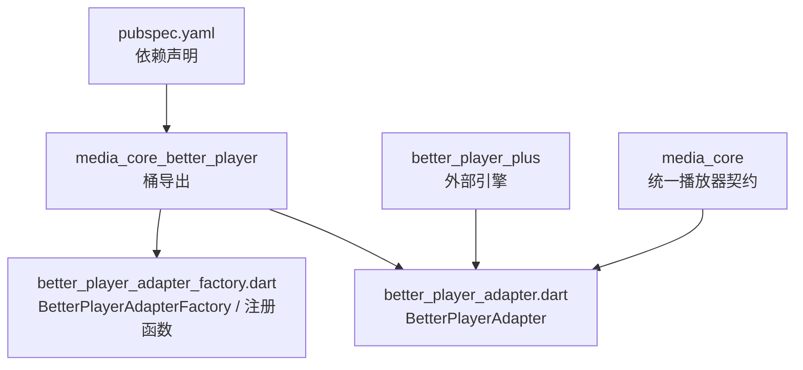
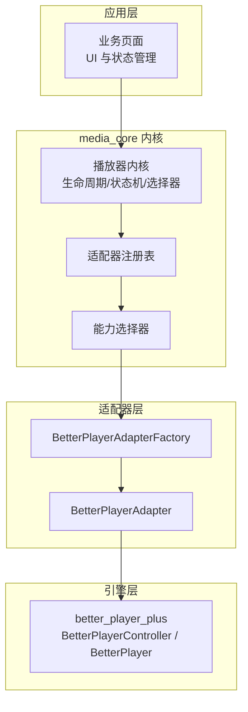
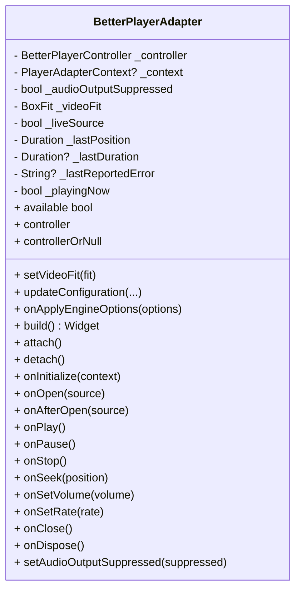
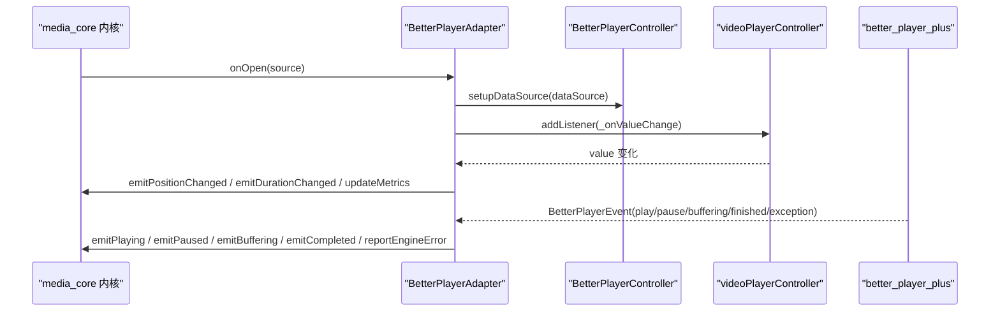
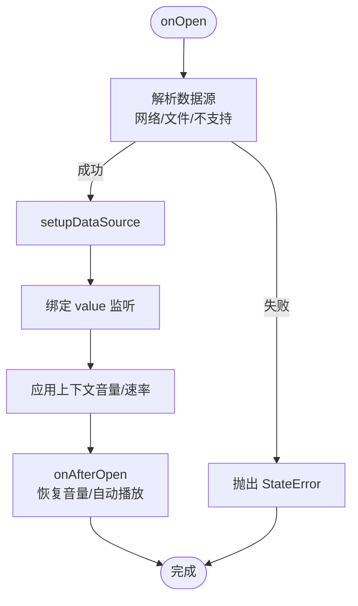
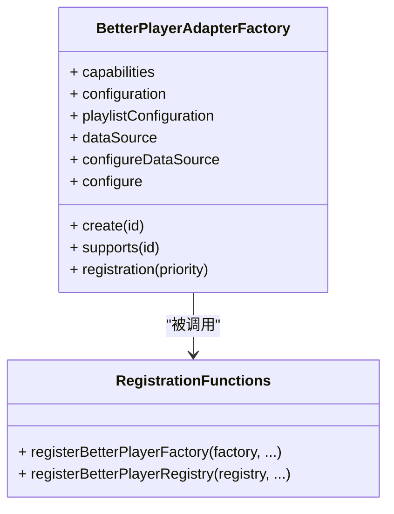
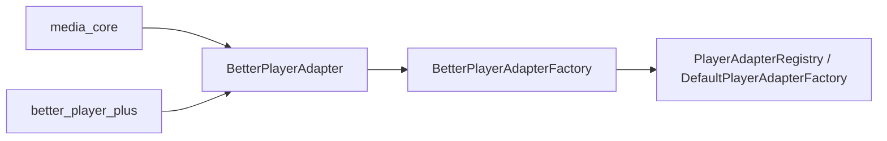

# Better Player 适配器

<cite>
**本文引用的文件**   
- [media_core_better_player.dart](file://packages/media_core_better_player/lib/media_core_better_player.dart)
- [better_player_adapter.dart](file://packages/media_core_better_player/lib/src/better_player_adapter.dart)
- [better_player_adapter_factory.dart](file://packages/media_core_better_player/lib/src/better_player_adapter_factory.dart)
- [pubspec.yaml](file://packages/media_core_better_player/pubspec.yaml)
- [adapter.md](file://doc/zh-Hans/adapter.md)
</cite>

## 目录
1. [简介](#简介)
2. [项目结构](#项目结构)
3. [核心组件](#核心组件)
4. [架构总览](#架构总览)
5. [详细组件分析](#详细组件分析)
6. [依赖关系分析](#依赖关系分析)
7. [性能与轻量特性](#性能与轻量特性)
8. [配置与定制指南](#配置与定制指南)
9. [Flutter 生态集成](#flutter-生态集成)
10. [适用场景](#适用场景)
11. [迁移指南](#迁移指南)
12. [常见问题解答](#常见问题解答)
13. [结论](#结论)

## 简介
Better Player 适配器是 media_core 的纯 Flutter 播放后端之一，基于 better_player_plus 实现。它通过统一的 `PlayerAdapter` 合约接入 media_core 的播放器内核，对外暴露一致的打开、播放、暂停、停止、跳转、音量、速率、关闭和销毁等能力，同时把 Better Player 的视频控件、事件、状态和指标映射到 media_core 的事件流与状态机中。

该适配器的主要优势包括：
- 纯 Flutter 实现：不直接依赖平台原生播放器通道，便于在 Flutter 层统一控制 UI 与行为。
- 生态集成：复用 media_core 的工厂、注册表、选择器、生命周期、错误处理、预加载、回放策略等通用能力。
- 开发便利性：提供控制器注入、数据源构建器、上下文配置、视频填充模式、音频抑制等扩展点。
- 跨平台一致性：以 media_core 的统一抽象屏蔽底层差异，上层业务无需关心具体引擎。

## 项目结构
media_core_better_player 包采用“桶导出 + 源码分层”的组织方式：
- 顶层 barrel 文件负责对外导出引擎类型和适配器实现。
- src 目录包含适配器核心逻辑与工厂注册逻辑。
- pubspec 声明对 media_core 和 better_player_plus 的依赖。

**图表来源**
- [media_core_better_player.dart:1-12](file://packages/media_core_better_player/lib/media_core_better_player.dart#L1-L12)
- [better_player_adapter.dart:1-10](file://packages/media_core_better_player/lib/src/better_player_adapter.dart#L1-L10)
- [better_player_adapter_factory.dart:1-5](file://packages/media_core_better_player/lib/src/better_player_adapter_factory.dart#L1-L5)
- [pubspec.yaml:14-19](file://packages/media_core_better_player/pubspec.yaml#L14-L19)

**章节来源**
- [media_core_better_player.dart:1-12](file://packages/media_core_better_player/lib/media_core_better_player.dart#L1-L12)
- [pubspec.yaml:1-25](file://packages/media_core_better_player/pubspec.yaml#L1-L25)

## 核心组件
- BetterPlayerAdapter：基于 better_player_plus 的 `PlayerAdapter` 实现，同时实现 `PlayerVideo`，负责视频表面、事件转发、状态同步、指标更新、能力声明和生命周期管理。
- BetterPlayerAdapterFactory：创建 BetterPlayerAdapter 实例，支持共享能力、默认配置、数据源和实例级自定义回调。
- 注册函数：提供将 Better Player 适配器注册到 `DefaultPlayerAdapterFactory` 或 `PlayerAdapterRegistry` 的工具方法。

这些组件的职责边界清晰：
- Adapter 专注播放执行与状态映射。
- Factory 专注实例化与参数装配。
- 注册函数专注与 media_core 的工厂/注册表对接。

**章节来源**
- [better_player_adapter.dart:41-73](file://packages/media_core_better_player/lib/src/better_player_adapter.dart#L41-L73)
- [better_player_adapter_factory.dart:7-57](file://packages/media_core_better_player/lib/src/better_player_adapter_factory.dart#L7-L57)

## 架构总览
Better Player 适配器位于 media_core 的适配器层，向上承接媒体内核，向下封装 better_player_plus。

**图表来源**
- [better_player_adapter_factory.dart:45-56](file://packages/media_core_better_player/lib/src/better_player_adapter_factory.dart#L45-L56)
- [better_player_adapter.dart:41-50](file://packages/media_core_better_player/lib/src/better_player_adapter.dart#L41-L50)
- [media_core_better_player.dart:7-11](file://packages/media_core_better_player/lib/media_core_better_player.dart#L7-L11)

## 详细组件分析

### BetterPlayerAdapter
BetterPlayerAdapter 是 Better Player 适配器的核心类，承担以下职责：
- 持有并初始化 BetterPlayerController。
- 将 Better Player 的事件转换为 media_core 的播放器事件。
- 将 videoPlayerController 的值变化映射为位置、时长、缓冲、尺寸等指标。
- 实现 PlayerVideo，返回 BetterPlayer 控件作为视频输出。
- 声明 defaultCapabilities，表达直播、seek、音量、速率、硬解、全屏、协议与格式支持。

关键设计要点：
- 视频填充通过 `setOverriddenFit` 设置，而不是包裹额外 Widget。
- 音频抑制通过启动时静音避免初始化阶段出现爆音。
- play/pause 去抖：Better Player 在缓冲期间会报告非播放状态，适配器内部用 `_playingNow` 与缓冲事件区分真实播放状态与缓冲抖动。
- 错误上报去重：同一异常消息不会重复上报。
- 生命周期清理：dispose 使用强制释放，避免原生资源泄漏。

**图表来源**
- [better_player_adapter.dart:41-73](file://packages/media_core_better_player/lib/src/better_player_adapter.dart#L41-L73)
- [better_player_adapter.dart:152-193](file://packages/media_core_better_player/lib/src/better_player_adapter.dart#L152-L193)
- [better_player_adapter.dart:206-225](file://packages/media_core_better_player/lib/src/better_player_adapter.dart#L206-L225)
- [better_player_adapter.dart:231-467](file://packages/media_core_better_player/lib/src/better_player_adapter.dart#L231-L467)
- [better_player_adapter.dart:639-659](file://packages/media_core_better_player/lib/src/better_player_adapter.dart#L639-L659)

**章节来源**
- [better_player_adapter.dart:9-34](file://packages/media_core_better_player/lib/src/better_player_adapter.dart#L9-L34)
- [better_player_adapter.dart:41-73](file://packages/media_core_better_player/lib/src/better_player_adapter.dart#L41-L73)
- [better_player_adapter.dart:152-193](file://packages/media_core_better_player/lib/src/better_player_adapter.dart#L152-L193)
- [better_player_adapter.dart:231-467](file://packages/media_core_better_player/lib/src/better_player_adapter.dart#L231-L467)
- [better_player_adapter.dart:487-518](file://packages/media_core_better_player/lib/src/better_player_adapter.dart#L487-L518)
- [better_player_adapter.dart:520-633](file://packages/media_core_better_player/lib/src/better_player_adapter.dart#L520-L633)
- [better_player_adapter.dart:639-659](file://packages/media_core_better_player/lib/src/better_player_adapter.dart#L639-L659)

### BetterPlayerAdapter 事件与值监听流程
Better Player 的事件只描述“模式切换”，而位置、时长、缓冲区间等数值来自 `videoPlayerController.value`。适配器分别处理两类数据源：
- 事件流：初始化、分辨率变化、播放、暂停、缓冲开始/结束、完成、异常。
- 值监听：位置、时长、缓冲结束时间、视频尺寸。

**图表来源**
- [better_player_adapter.dart:273-365](file://packages/media_core_better_player/lib/src/better_player_adapter.dart#L273-L365)
- [better_player_adapter.dart:520-633](file://packages/media_core_better_player/lib/src/better_player_adapter.dart#L520-L633)

**章节来源**
- [better_player_adapter.dart:273-365](file://packages/media_core_better_player/lib/src/better_player_adapter.dart#L273-L365)
- [better_player_adapter.dart:520-633](file://packages/media_core_better_player/lib/src/better_player_adapter.dart#L520-L633)

### BetterPlayerAdapter 生命周期与错误处理
生命周期关键点：
- onInitialize：注入控制器或创建控制器；订阅事件；应用初始 fit。
- onOpen：解析数据源；可选 transform；setupDataSource；绑定值监听；应用上下文音量与速率。
- onAfterOpen：根据音频抑制策略恢复音量；必要时自动播放。
- onPlay/onPause/onStop/onSeek：调用控制器对应方法；stop 时对非直播源重置到开头。
- onClose/onDispose：移除监听；清理状态；强制释放控制器。

错误处理关键点：
- engineReportsOpenFailure：检查 hasError 或最近上报的错误消息。
- exception 事件：去重后通过 reportEngineError 上报。
- 关闭时尝试 seekTo(0)，失败则忽略，保证关闭健壮性。

**图表来源**
- [better_player_adapter.dart:273-365](file://packages/media_core_better_player/lib/src/better_player_adapter.dart#L273-L365)
- [better_player_adapter.dart:421-467](file://packages/media_core_better_player/lib/src/better_player_adapter.dart#L421-L467)
- [better_player_adapter.dart:495-518](file://packages/media_core_better_player/lib/src/better_player_adapter.dart#L495-L518)

**章节来源**
- [better_player_adapter.dart:231-467](file://packages/media_core_better_player/lib/src/better_player_adapter.dart#L231-L467)
- [better_player_adapter.dart:495-518](file://packages/media_core_better_player/lib/src/better_player_adapter.dart#L495-L518)

### BetterPlayerAdapter 能力声明
defaultCapabilities 表达 Better Player 在该适配器中的能力边界：
- 播放控制：直播、seek、暂停、停止、速率、音量、静音。
- 视频能力：视频尺寸变化、硬解、全屏。
- 协议与格式：由 BetterPlayerFormats 提供。

注意：
- 软件解码能力未声明为支持。
- 音频轨道禁用能力未实现，因此音频-only 模式由 presentation 层决定是否挂载该引擎的视频表面。

**章节来源**
- [better_player_adapter.dart:639-659](file://packages/media_core_better_player/lib/src/better_player_adapter.dart#L639-L659)

### BetterPlayerAdapter 工厂与注册
BetterPlayerAdapterFactory 提供：
- 共享 capabilities。
- 默认 configuration、playlistConfiguration、dataSource。
- configureDataSource：每次打开前可改写数据源。
- configure：每个实例构造后可做一次性自定义。
- registration：生成注册条目，携带能力与优先级。
- registerBetterPlayerFactory：注册到 DefaultPlayerAdapterFactory。
- registerBetterPlayerRegistry：注册到 PlayerAdapterRegistry。

**图表来源**
- [better_player_adapter_factory.dart:7-57](file://packages/media_core_better_player/lib/src/better_player_adapter_factory.dart#L7-L57)
- [better_player_adapter_factory.dart:59-105](file://packages/media_core_better_player/lib/src/better_player_adapter_factory.dart#L59-L105)

**章节来源**
- [better_player_adapter_factory.dart:7-57](file://packages/media_core_better_player/lib/src/better_player_adapter_factory.dart#L7-L57)
- [better_player_adapter_factory.dart:59-105](file://packages/media_core_better_player/lib/src/better_player_adapter_factory.dart#L59-L105)

## 依赖关系分析
- 内部依赖：media_core 的 PlayerAdapter、PlayerVideo、PlayerSource、PlayerAdapterConfig、PlayerAdapterContext、PlayerAdapterCapabilities 等。
- 外部依赖：better_player_plus 的 BetterPlayerController、BetterPlayer、BetterPlayerConfiguration、BetterPlayerControlsConfiguration、BetterPlayerDataSource、BetterPlayerEventType、BetterPlayerFormats。
- 包依赖：pubspec 明确声明 media_core 与 better_player_plus。

**图表来源**
- [pubspec.yaml:14-19](file://packages/media_core_better_player/pubspec.yaml#L14-L19)
- [better_player_adapter.dart:1-5](file://packages/media_core_better_player/lib/src/better_player_adapter.dart#L1-L5)
- [better_player_adapter_factory.dart:1-3](file://packages/media_core_better_player/lib/src/better_player_adapter_factory.dart#L1-L3)

**章节来源**
- [pubspec.yaml:14-19](file://packages/media_core_better_player/pubspec.yaml#L14-L19)
- [better_player_adapter.dart:1-5](file://packages/media_core_better_player/lib/src/better_player_adapter.dart#L1-L5)
- [better_player_adapter_factory.dart:1-3](file://packages/media_core_better_player/lib/src/better_player_adapter_factory.dart#L1-L3)

## 性能与轻量特性
Better Player 适配器在实现上做了多项针对性能和稳定性的优化：
- 启动速度：
  - 默认隐藏 Better Player 控件，减少不必要的 UI 初始化开销。
  - 通过 handleLifecycle: false 让生命周期由 media_core 统一管理，避免重复生命周期处理。
- 内存占用：
  - dispose 使用 forceDispose，确保原生资源被释放，避免后台继续播放或占用硬件解码器。
  - 关闭时移除 value 监听，防止后续事件泄漏到下一个 source。
- 包体积：
  - 仅依赖 better_player_plus 与 media_core，没有引入额外重型 UI 框架。
- 状态稳定性：
  - 缓冲抖动不会导致频繁播放/暂停状态切换，降低下游观察者重建成本。
  - 错误消息去重，避免重复上报造成 UI 抖动。

这些优化使 Better Player 适配器适合简单播放需求、快速原型开发和资源受限环境。

**章节来源**
- [better_player_adapter.dart:245-257](file://packages/media_core_better_player/lib/src/better_player_adapter.dart#L245-L257)
- [better_player_adapter.dart:446-467](file://packages/media_core_better_player/lib/src/better_player_adapter.dart#L446-L467)
- [better_player_adapter.dart:520-580](file://packages/media_core_better_player/lib/src/better_player_adapter.dart#L520-L580)

## 配置与定制指南

### 播放器控件定制
BetterPlayerAdapter 默认隐藏 Better Player 控件，以便上层自由定制 UI。若需要启用控件，可通过 BetterPlayerConfiguration 的 controlsConfiguration 进行设置。

常用定制点：
- 显示或隐藏控件。
- 自定义控件样式（由 better_player_plus 提供的控件配置项决定）。
- 控制自动播放、循环播放、混合音频等行为。

建议：
- 如果上层已有完整控件体系，保持 showControls: false，并通过 PlayerVideo.build 返回的 BetterPlayer 控件作为渲染目标。
- 如果需要使用 Better Player 内置控件，可在 configuration 中开启并调整样式。

**章节来源**
- [better_player_adapter.dart:245-257](file://packages/media_core_better_player/lib/src/better_player_adapter.dart#L245-L257)
- [media_core_better_player.dart:7-11](file://packages/media_core_better_player/lib/media_core_better_player.dart#L7-L11)

### 手势交互配置
Better Player 的手势交互通常由 BetterPlayer 控件自身处理。由于适配器默认隐藏控件，上层可以完全接管手势；若启用控件，则手势行为受 better_player_plus 控件配置影响。

建议：
- 自定义手势时，优先隐藏 Better Player 控件，并在上层 Widget 中处理点击、双击、滑动等交互。
- 若依赖内置手势，请结合 BetterPlayerControlsConfiguration 调整行为。

**章节来源**
- [better_player_adapter.dart:206-217](file://packages/media_core_better_player/lib/src/better_player_adapter.dart#L206-L217)
- [better_player_adapter.dart:245-257](file://packages/media_core_better_player/lib/src/better_player_adapter.dart#L245-L257)

### 主题样式设置
Better Player 的主题样式由 better_player_plus 的控件配置决定。适配器本身不维护主题对象，而是将 BetterPlayer 控件交给上层插入到 widget tree 中。

建议：
- 在上层 MaterialApp 或 Theme 中定义全局主题。
- 通过 BetterPlayerControlsConfiguration 覆盖控件颜色、图标、布局等样式。
- 如需动态换肤，可在运行时更新 BetterPlayerConfiguration 并触发引擎重建。

**章节来源**
- [better_player_adapter.dart:206-217](file://packages/media_core_better_player/lib/src/better_player_adapter.dart#L206-L217)
- [better_player_adapter.dart:245-257](file://packages/media_core_better_player/lib/src/better_player_adapter.dart#L245-L257)

### 数据源与协议支持
BetterPlayerAdapter 支持：
- 网络数据源：HTTP、HTTPS、HLS、DASH 等由 better_player_plus 支持的协议。
- 本地文件数据源。
- 不支持 asset 数据源：better_player_plus 未暴露 asset 数据源类型。

协议与格式能力来源于 BetterPlayerFormats.supportedProtocols 与 supportedFormats。

**章节来源**
- [better_player_adapter.dart:495-518](file://packages/media_core_better_player/lib/src/better_player_adapter.dart#L495-L518)
- [better_player_adapter.dart:657-658](file://packages/media_core_better_player/lib/src/better_player_adapter.dart#L657-L658)

### 高级配置选项
BetterPlayerAdapter 暴露的高级配置包括：
- configuration：BetterPlayerConfiguration，用于控制器创建时的基础配置。
- playlistConfiguration：BetterPlayerPlaylistConfiguration，用于播放列表配置。
- dataSource：预先配置的 BetterPlayerDataSource。
- configureDataSource：每次打开前的数据源改写回调。
- updateConfiguration：在不重建控制器的情况下更新下一次使用的配置。
- setAudioOutputSuppressed：下次打开时抑制音频输出，避免初始化爆音。

**章节来源**
- [better_player_adapter.dart:61-73](file://packages/media_core_better_player/lib/src/better_player_adapter.dart#L61-L73)
- [better_player_adapter.dart:95-105](file://packages/media_core_better_player/lib/src/better_player_adapter.dart#L95-L105)
- [better_player_adapter.dart:473-486](file://packages/media_core_better_player/lib/src/better_player_adapter.dart#L473-L486)

## Flutter 生态集成

### 与其他 UI 组件协作
BetterPlayerAdapter 实现 PlayerVideo，build 返回 BetterPlayer 控件。上层可以将该控件放入 Column、Stack、PageView、ListView 等任意容器，并结合 Overlay、Modal、全屏、画中画等 Flutter 生态组件。

建议：
- 将 PlayerVideo.build 的结果作为视频区域渲染。
- 使用 Flutter 的 Theme、MediaQuery、LayoutBuilder 等工具适配不同屏幕。
- 使用 Overlay 或 Modal 展示播放控件、进度条、字幕、弹幕等。

**章节来源**
- [better_player_adapter.dart:206-217](file://packages/media_core_better_player/lib/src/better_player_adapter.dart#L206-L217)

### 状态管理与响应式更新
BetterPlayerAdapter 将 Better Player 的状态映射为 media_core 的播放器状态与事件。上层可以通过 media_core 的状态管理方案（如 Provider、Riverpod、Bloc、GetX 等）订阅状态变化，并驱动 UI 更新。

建议：
- 订阅 playing、paused、buffering、completed、error 等事件。
- 订阅 position、duration、buffered、videoSize 等指标。
- 当用户操作改变 volume、rate、looping 时，优先使用 onApplyEngineOptions 的 live 路径，避免不必要的引擎重建。

**章节来源**
- [better_player_adapter.dart:107-146](file://packages/media_core_better_player/lib/src/better_player_adapter.dart#L107-L146)
- [better_player_adapter.dart:520-633](file://packages/media_core_better_player/lib/src/better_player_adapter.dart#L520-L633)

### 生命周期与可见性
BetterPlayerAdapter 默认不接管系统生命周期，交由 media_core 管理。这样可以在多页面、多播放器场景中统一处理初始化、销毁、前台后台切换。

建议：
- 在页面进入时打开播放器，离开时关闭或暂停。
- 在多播放器列表中，结合 visibility 与生命周期策略避免后台持续解码。

**章节来源**
- [better_player_adapter.dart:245-257](file://packages/media_core_better_player/lib/src/better_player_adapter.dart#L245-L257)
- [adapter.md:23-27](file://doc/zh-Hans/adapter.md#L23-L27)

## 适用场景
Better Player 适配器适合以下场景：
- 简单播放需求：不需要复杂原生播放器定制，希望用纯 Flutter 实现即可。
- 快速原型开发：借助 better_player_plus 的控件与配置，快速搭建播放界面。
- 资源受限环境：通过隐藏控件、抑制音频、合理生命周期管理，降低内存与 CPU 压力。
- 网络与本地文件播放：HTTP/HTTPS/HLS/DASH 与本地文件是最常见的播放来源。

不适合的场景：
- 需要 asset 数据源直接播放：当前 better_player_plus 未暴露 asset 数据源类型。
- 需要精细控制软件解码：适配器未声明支持软件解码。
- 需要音频-only 模式且必须关闭视频解码：该能力由 presentation 层决定是否挂载视频表面，但引擎侧无法关闭视频解码。

**章节来源**
- [better_player_adapter.dart:478-486](file://packages/media_core_better_player/lib/src/better_player_adapter.dart#L478-L486)
- [better_player_adapter.dart:495-518](file://packages/media_core_better_player/lib/src/better_player_adapter.dart#L495-L518)
- [better_player_adapter.dart:651-654](file://packages/media_core_better_player/lib/src/better_player_adapter.dart#L651-L654)

## 迁移指南

### 从其他后端迁移到 Better Player
迁移步骤建议：
1. 确认源端播放器是否支持网络与文件数据源。
2. 将源端的 URI、协议、头部信息映射到 BetterPlayerDataSource。
3. 将源端的播放控制 API 映射到 BetterPlayerAdapter 的 onPlay、onPause、onSeek、onSetVolume、onSetRate。
4. 将源端的状态与事件映射到 media_core 的播放器状态与事件。
5. 使用 BetterPlayerAdapter.defaultCapabilities 校验能力是否满足业务需求。
6. 如有必要，使用 configureDataSource 对数据源进行最后一步改写。

API 映射参考：
- 打开：onOpen -> setupDataSource。
- 播放：onPlay -> controller.play。
- 暂停：onPause -> controller.pause。
- 停止：onStop -> pause + seekTo(0)。
- 跳转：onSeek -> controller.seekTo。
- 音量：onSetVolume -> controller.setVolume。
- 速率：onSetRate -> controller.setSpeed。
- 关闭：onClose -> pause + seekTo(0)。
- 销毁：onDispose -> dispose(forceDispose: true)。

**章节来源**
- [better_player_adapter.dart:389-467](file://packages/media_core_better_player/lib/src/better_player_adapter.dart#L389-L467)
- [better_player_adapter.dart:495-518](file://packages/media_core_better_player/lib/src/better_player_adapter.dart#L495-L518)

### 配置转换
- 将旧后端的播放器配置转换为 BetterPlayerConfiguration。
- 将旧后端的播放列表配置转换为 BetterPlayerPlaylistConfiguration。
- 将旧后端的媒体源转换为 BetterPlayerDataSource。
- 使用 configureDataSource 处理特殊 header、代理、认证等场景。

**章节来源**
- [better_player_adapter.dart:61-73](file://packages/media_core_better_player/lib/src/better_player_adapter.dart#L61-L73)
- [better_player_adapter.dart:307-314](file://packages/media_core_better_player/lib/src/better_player_adapter.dart#L307-L314)

## 常见问题解答

### 为什么 asset 资源无法直接播放？
better_player_plus 未暴露 asset 数据源类型。若需要播放 asset，应先加载字节数据，再通过 memory 数据源类型播放。

**章节来源**
- [better_player_adapter.dart:504-515](file://packages/media_core_better_player/lib/src/better_player_adapter.dart#L504-L515)
- [media_core_better_player.dart:3-4](file://packages/media_core_better_player/lib/media_core_better_player.dart#L3-L4)

### 为什么直播流的速率控制没有意义？
直播流没有可回退的时间线，速率控制对直播没有实际意义。适配器在 open 时标记 liveSource，并在相关逻辑中避免无意义的速率变更。

**章节来源**
- [better_player_adapter.dart:155-157](file://packages/media_core_better_player/lib/src/better_player_adapter.dart#L155-L157)
- [better_player_adapter.dart:405-409](file://packages/media_core_better_player/lib/src/better_player_adapter.dart#L405-L409)

### 为什么会出现缓冲导致的播放/暂停抖动？
Better Player 在缓冲期间会报告非播放状态，适配器通过缓冲事件与 `_playingNow` 去抖，避免将缓冲抖动误报为真实播放状态变化。

**章节来源**
- [better_player_adapter.dart:25-32](file://packages/media_core_better_player/lib/src/better_player_adapter.dart#L25-L32)
- [better_player_adapter.dart:536-555](file://packages/media_core_better_player/lib/src/better_player_adapter.dart#L536-L555)

### 如何避免初始化阶段的爆音？
使用 setAudioOutputSuppressed(true) 在下次打开时抑制音频输出，待源初始化完成后恢复音量，必要时再自动播放。

**章节来源**
- [better_player_adapter.dart:473-486](file://packages/media_core_better_player/lib/src/better_player_adapter.dart#L473-L486)
- [better_player_adapter.dart:367-387](file://packages/media_core_better_player/lib/src/better_player_adapter.dart#L367-L387)

### 如何动态更新播放器配置？
调用 updateConfiguration 更新下一次控制器创建时使用的配置；若要让新配置立即生效，需触发引擎重建。

**章节来源**
- [better_player_adapter.dart:88-105](file://packages/media_core_better_player/lib/src/better_player_adapter.dart#L88-L105)

### 如何判断某个 Source 是否可由 Better Player 打开？
查看 PlayerAdapterCapabilities 中的 supportedProtocols 与 supportedFormats，并结合 source 的类型（网络、文件、asset）判断。

**章节来源**
- [better_player_adapter.dart:639-659](file://packages/media_core_better_player/lib/src/better_player_adapter.dart#L639-L659)
- [better_player_adapter.dart:495-518](file://packages/media_core_better_player/lib/src/better_player_adapter.dart#L495-L518)

## 结论
Better Player 适配器为 media_core 提供了一个纯 Flutter 实现的播放后端。它通过统一的 PlayerAdapter 合约接入 media_core 内核，复用其生命周期、状态机、选择器与错误处理能力，同时封装 better_player_plus 的控制器与控件。对于简单播放、快速原型和资源受限环境，它是一个轻量、稳定且易于集成的选择。

在实际项目中，建议：
- 优先使用 media_core 的统一 API 控制播放。
- 通过 BetterPlayerConfiguration 和 BetterPlayerControlsConfiguration 定制控件与行为。
- 使用 configureDataSource 处理特殊数据源需求。
- 关注直播、缓冲、错误上报等边界情况，确保状态稳定。
- 在资源受限环境中合理使用音频抑制、隐藏控件和生命周期管理。