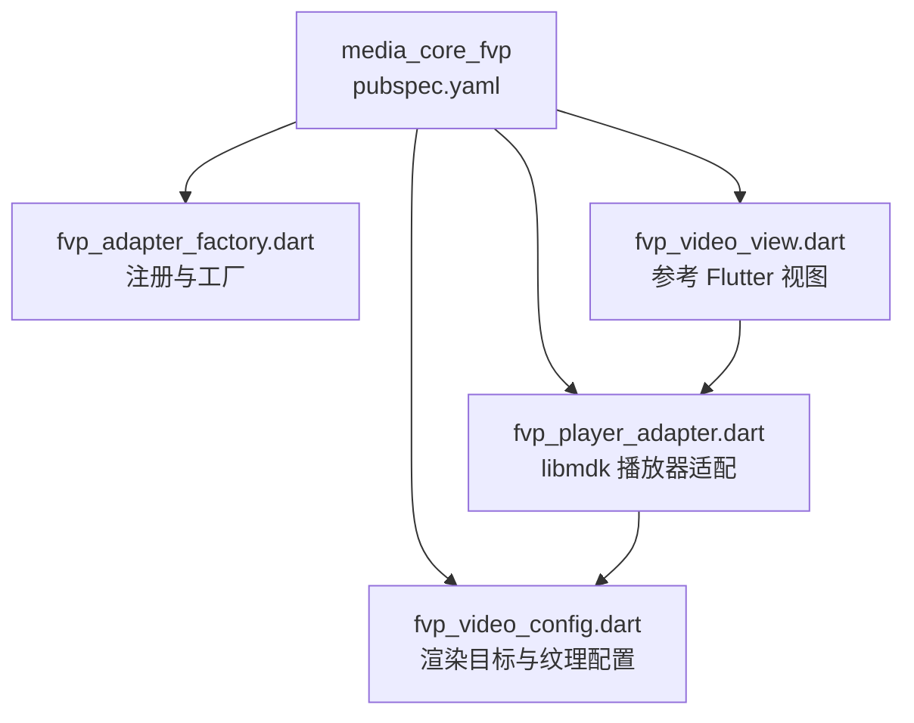
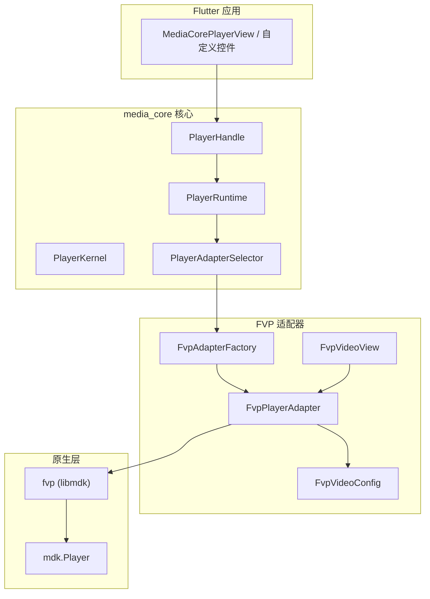
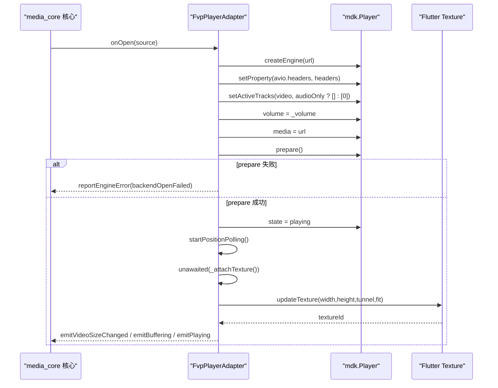
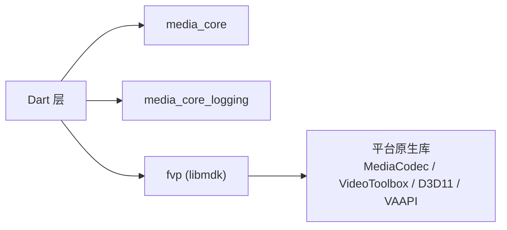

# FVP 适配器

<cite>
**本文引用的文件**   
- [README.md](file://README.md)
- [packages/media_core_fvp/README.md](file://packages/media_core_fvp/README.md)
- [packages/media_core_fvp/pubspec.yaml](file://packages/media_core_fvp/pubspec.yaml)
- [packages/media_core_fvp/lib/src/fvp_adapter_factory.dart](file://packages/media_core_fvp/lib/src/fvp_adapter_factory.dart)
- [packages/media_core_fvp/lib/src/fvp_player_adapter.dart](file://packages/media_core_fvp/lib/src/fvp_player_adapter.dart)
- [packages/media_core_fvp/lib/src/fvp_video_config.dart](file://packages/media_core_fvp/lib/src/fvp_video_config.dart)
- [packages/media_core_fvp/lib/src/fvp_video_view.dart](file://packages/media_core_fvp/lib/src/fvp_video_view.dart)
</cite>

## 目录
1. [引言](#引言)
2. [项目结构](#项目结构)
3. [核心组件](#核心组件)
4. [架构总览](#架构总览)
5. [详细组件分析](#详细组件分析)
6. [依赖关系分析](#依赖关系分析)
7. [性能与优化策略](#性能与优化策略)
8. [媒体格式、编解码器与高级能力](#媒体格式编解码器与高级能力)
9. [桌面端特性与系统媒体服务集成](#桌面端特性与系统媒体服务集成)
10. [性能基准与测试建议](#性能基准与测试建议)
11. [开发调试指南](#开发调试指南)
12. [故障排查](#故障排查)
13. [结论](#结论)

## 引言
FVP 适配器是基于 libmdk（fvp 包）的 media_core 后端，提供一条“当前 FFmpeg + 平台硬解优先”的解码路径。它面向桌面端和移动端统一接入，作为默认引擎无法播放时的恢复通道，尤其擅长处理老引擎会丢画面的流，例如传统 HEVC FLV。该适配器遵循 media_core 的 `PlayerAdapter` 契约，同时实现 `PlayerVideo`，由适配器统一持有 Flutter `Texture` 的生命周期，避免 UI 层误释放视频资源。

## 项目结构
FVP 适配器的源码集中在 `packages/media_core_fvp`，采用“工厂 + 适配器 + 渲染配置 + 参考视图”的组织方式：

**图表来源**
- [packages/media_core_fvp/pubspec.yaml:1-33](file://packages/media_core_fvp/pubspec.yaml#L1-L33)
- [packages/media_core_fvp/lib/src/fvp_adapter_factory.dart:1-114](file://packages/media_core_fvp/lib/src/fvp_adapter_factory.dart#L1-L114)
- [packages/media_core_fvp/lib/src/fvp_player_adapter.dart:1-810](file://packages/media_core_fvp/lib/src/fvp_player_adapter.dart#L1-L810)
- [packages/media_core_fvp/lib/src/fvp_video_config.dart:1-75](file://packages/media_core_fvp/lib/src/fvp_video_config.dart#L1-L75)
- [packages/media_core_fvp/lib/src/fvp_video_view.dart:1-35](file://packages/media_core_fvp/lib/src/fvp_video_view.dart#L1-L35)

**章节来源**
- [packages/media_core_fvp/README.md:1-69](file://packages/media_core_fvp/README.md#L1-L69)
- [packages/media_core_fvp/pubspec.yaml:1-33](file://packages/media_core_fvp/pubspec.yaml#L1-L33)

## 核心组件
- **FvpAdapterFactory**：负责创建 `FvpPlayerAdapter`，并提供 `registration()` 以注册到内核或默认工厂；支持全局属性、解码器列表、音频后端、视频配置以及实例化后的回调定制。
- **FvpPlayerAdapter**：基于 libmdk 的播放器适配实现，封装 open/play/pause/seek/volume/rate/audioOnly/engineOptions 等生命周期与运行时控制，并实现 `PlayerVideo` 管理 Texture。
- **FvpVideoConfig**：描述渲染目标上限、填充色、对齐、采样质量、最大尺寸约束模式以及是否使用 tunnel 直通平台 surface。
- **FvpVideoView**：参考实现，直接订阅适配器的 listenable，让宿主拥有控件树但纹理所有权仍归适配器。

**章节来源**
- [packages/media_core_fvp/lib/src/fvp_adapter_factory.dart:11-63](file://packages/media_core_fvp/lib/src/fvp_adapter_factory.dart#L11-L63)
- [packages/media_core_fvp/lib/src/fvp_player_adapter.dart:26-119](file://packages/media_core_fvp/lib/src/fvp_player_adapter.dart#L26-L119)
- [packages/media_core_fvp/lib/src/fvp_video_config.dart:8-50](file://packages/media_core_fvp/lib/src/fvp_video_config.dart#L8-L50)
- [packages/media_core_fvp/lib/src/fvp_video_view.dart:15-33](file://packages/media_core_fvp/lib/src/fvp_video_view.dart#L15-L33)

## 架构总览
FVP 适配器在 media_core 中的位置是“后端适配层”，向上暴露统一的 `PlayerAdapter` 接口，向下通过 fvp 包的 `mdk.Player` 调用 libmdk。

**图表来源**
- [README.md:55-90](file://README.md#L55-L90)
- [packages/media_core_fvp/lib/src/fvp_adapter_factory.dart:32-63](file://packages/media_core_fvp/lib/src/fvp_adapter_factory.dart#L32-L63)
- [packages/media_core_fvp/lib/src/fvp_player_adapter.dart:26-119](file://packages/media_core_fvp/lib/src/fvp_player_adapter.dart#L26-L119)

## 详细组件分析

### FvpAdapterFactory
职责：
- 声明后端 id `kFvpPlayerBackendId = 'fvp'`。
- 构造时共享 capabilities、properties、videoDecoders、audioBackends、videoConfig。
- `create(id)` 创建具体适配器，并可执行 `configure` 回调进行实例级定制。
- `registration(priority)` 生成注册项，默认优先级为 80，便于与 media_kit 并存并按能力选择。
- 提供 `registerFvpFactory` 与 `registerFvpRegistry` 快捷注册方法。

设计要点：
- 能力信息随注册项携带，使选择器在实例化前就能做能力匹配。
- properties 透传到每个引擎实例，适合代理、白名单等底层设置。

**章节来源**
- [packages/media_core_fvp/lib/src/fvp_adapter_factory.dart:8-63](file://packages/media_core_fvp/lib/src/fvp_adapter_factory.dart#L8-L63)
- [packages/media_core_fvp/lib/src/fvp_adapter_factory.dart:65-114](file://packages/media_core_fvp/lib/src/fvp_adapter_factory.dart#L65-L114)

### FvpPlayerAdapter
职责：
- 实现 `PlayerAdapterBase` 与 `PlayerVideo`。
- 管理 mdk.Player 生命周期：每源一引擎，open 时创建新 player，close/dispose 时释放。
- 将 libmdk 的状态事件映射为 media_core 的 playing/paused/buffering/completed 等事件。
- 通过定时器轮询 position、buffered、volume，弥补 libmdk 不提供这些流的问题。
- 管理 Texture 生命周期：attach/release、几何尺寸上报、tunnel 模式、maxWidth/maxHeight 限制。
- 支持 engineOptions：videoDecoders、audioDecoders、audioBackends 及通用 property。

关键流程：

**图表来源**
- [packages/media_core_fvp/lib/src/fvp_player_adapter.dart:144-201](file://packages/media_core_fvp/lib/src/fvp_player_adapter.dart#L144-L201)
- [packages/media_core_fvp/lib/src/fvp_player_adapter.dart:327-353](file://packages/media_core_fvp/lib/src/fvp_player_adapter.dart#L327-L353)
- [packages/media_core_fvp/lib/src/fvp_player_adapter.dart:700-735](file://packages/media_core_fvp/lib/src/fvp_player_adapter.dart#L700-L735)

#### 生命周期与状态机
- `onInitialize`：不创建引擎，因为引擎按源创建。
- `onBeforeOpen`：重置 live/openFailed/playing/buffering/volume 等状态。
- `onOpen`：创建引擎、写入请求头、设置轨道、音量、media、prepare；prepare 负值或 MediaStatus.invalid 都视为打开失败。
- `onAfterOpen`：异步 attachTexture，并重新施加 audioOnly 与音量抑制。
- `onPlay/onPause/onStop`：映射到 mdk.PlaybackState，并去重发送 playing/paused 事件。
- `onSeek/onSetVolume/onSetRate/onSetAudioOnly`：分别映射到 seek、volume、playbackRate、setActiveTracks。
- `onClose/onDispose`：停止轮询、释放纹理、释放引擎、dispose notifier。

**章节来源**
- [packages/media_core_fvp/lib/src/fvp_player_adapter.dart:127-321](file://packages/media_core_fvp/lib/src/fvp_player_adapter.dart#L127-L321)

#### 引擎选项与属性
- `onApplyEngineOptions`：若已有引擎则尝试立即应用；否则暂存到 `_pendingEngineOptions`，下次 open 创建引擎时生效。
- 特殊 key：`videoDecoders`、`audioDecoders`、`audioBackends`；其他 key 走 `setProperty`。
- properties 在每次创建引擎时逐条写入，适合代理、http_proxy 等。

**章节来源**
- [packages/media_core_fvp/lib/src/fvp_player_adapter.dart:355-418](file://packages/media_core_fvp/lib/src/fvp_player_adapter.dart#L355-L418)
- [packages/media_core_fvp/lib/src/fvp_player_adapter.dart:327-353](file://packages/media_core_fvp/lib/src/fvp_player_adapter.dart#L327-L353)

#### 纹理与几何
- `_attachTexture`：等待 `textureSize`，超时返回 null；若为 null 且未重试过，则对当前 URL 做一次 re-prepare；成功后调用 `updateTexture` 创建 Flutter Texture。
- `_releaseTexture`：清空 textureId 与 size，并调用 `updateTexture(-1)` 释放；释放过程带超时保护。
- `buildSurface`：根据 textureId、size、fit 构建 Flutter 画面；若无纹理则显示背景色。
- `FvpVideoConfig.tunnel`：直通平台 surface，跳过 libmdk GL 渲染器，此时 maxWidth/maxHeight 与滤镜不再生效。

**章节来源**
- [packages/media_core_fvp/lib/src/fvp_player_adapter.dart:696-783](file://packages/media_core_fvp/lib/src/fvp_player_adapter.dart#L696-L783)
- [packages/media_core_fvp/lib/src/fvp_video_config.dart:32-50](file://packages/media_core_fvp/lib/src/fvp_video_config.dart#L32-L50)

#### 位置、缓冲与音量轮询
- 每 500ms 轮询一次 position、buffered、volume，并 emit 对应事件与 metrics。
- 直播场景下 duration 为零，避免看门狗误判为有界文件。

**章节来源**
- [packages/media_core_fvp/lib/src/fvp_player_adapter.dart:548-607](file://packages/media_core_fvp/lib/src/fvp_player_adapter.dart#L548-L607)

#### 能力声明
- 默认 capabilities 包含 live、seek、pause、stop、rateControl、volumeControl、audioOnly、engineOptions、videoSizeChanged、hardwareDecoder、fullscreen。
- supportedProtocols 与 supportedFormats 来自 `FvpFormats`。

**章节来源**
- [packages/media_core_fvp/lib/src/fvp_player_adapter.dart:789-810](file://packages/media_core_fvp/lib/src/fvp_player_adapter.dart#L789-L810)

### FvpVideoConfig
作用：
- fit：帧如何嵌入分配空间。
- fill：背景色。
- alignment：视频在视口内的对齐。
- filterQuality：Texture 采样质量。
- maxWidth/maxHeight：渲染目标上限，防止 4K 源在 1080p UI 中分配全分辨率 RGBA 纹理。
- fitMaxSize：保持宽高比还是逐轴夹紧。
- tunnel：直通平台 surface，跳过 libmdk GL 渲染器。

**章节来源**
- [packages/media_core_fvp/lib/src/fvp_video_config.dart:8-50](file://packages/media_core_fvp/lib/src/fvp_video_config.dart#L8-L50)

### FvpVideoView
作用：
- 参考实现，读取 adapter.textureListenable、sizeListenable、fitListenable，再调用 adapter.buildSurface。
- 让宿主拥有控件树，但纹理所有权仍归适配器。

**章节来源**
- [packages/media_core_fvp/lib/src/fvp_video_view.dart:5-33](file://packages/media_core_fvp/lib/src/fvp_video_view.dart#L5-L33)

## 依赖关系分析
- Dart 层依赖：
  - `flutter`：UI 与 ValueNotifier。
  - `media_core`：PlayerAdapter 契约、能力模型、日志、错误码。
  - `media_core_logging`：分级日志。
  - `fvp`：libmdk 原生插件，提供 `mdk.Player`、`MediaInfo`、`PlaybackState`、`MediaStatus`。
- 原生层依赖：
  - fvp 包解析 libmdk 及其平台硬解路径（MediaCodec、VideoToolbox、D3D11、VAAPI）。
  - 桌面构建自行解析 fvp 的原生依赖，而非 vendor 精简副本。

**图表来源**
- [packages/media_core_fvp/pubspec.yaml:15-27](file://packages/media_core_fvp/pubspec.yaml#L15-L27)
- [packages/media_core_fvp/README.md:3-10](file://packages/media_core_fvp/README.md#L3-L10)

**章节来源**
- [packages/media_core_fvp/pubspec.yaml:15-27](file://packages/media_core_fvp/pubspec.yaml#L15-L27)
- [packages/media_core_fvp/README.md:3-10](file://packages/media_core_fvp/README.md#L3-L10)

## 性能与优化策略
- 每源一引擎：避免跨源复用导致渲染目标尺寸错乱；open 时重建 player，close 时释放。
- 纹理上限：通过 maxWidth/maxHeight 限制渲染目标大小，避免弱 GPU 被 4K 纹理压垮。
- Tunnel 模式：直通平台 surface，跳过 libmdk GL 渲染器，减少一次 GPU 合成，但禁用滤镜与尺寸上限。
- 轮询频率：position/buffered/volume 每 500ms 轮询，平衡实时性与 CPU 开销。
- 事件去重：playing/paused 只发一次，避免 UI 重复刷新。
- 几何重试：当 textureSize 返回 null 时，最多对当前 URL 做一次 re-prepare，避免健康流被反复拆掉。
- 音频输出抑制：引擎切换期间把音量压到 0，避免声音泄露。

**章节来源**
- [packages/media_core_fvp/lib/src/fvp_player_adapter.dart:23-25](file://packages/media_core_fvp/lib/src/fvp_player_adapter.dart#L23-L25)
- [packages/media_core_fvp/lib/src/fvp_player_adapter.dart:558-586](file://packages/media_core_fvp/lib/src/fvp_player_adapter.dart#L558-L586)
- [packages/media_core_fvp/lib/src/fvp_player_adapter.dart:700-783](file://packages/media_core_fvp/lib/src/fvp_player_adapter.dart#L700-L783)
- [packages/media_core_fvp/lib/src/fvp_video_config.dart:32-50](file://packages/media_core_fvp/lib/src/fvp_video_config.dart#L32-L50)

## 媒体格式、编解码器与高级能力
- 解码路径：libmdk 自带较新的 FFmpeg，优先平台硬解（MediaCodec、VideoToolbox、D3D11、VAAPI），FFmpeg 与 dav1d 作为软解退路。
- 典型优势：能播放老引擎丢画面的流，例如 codec id 12 的传统 HEVC FLV。
- 高级编码与 HDR：文档未明确列出支持的容器与编码清单；能力通过 `supportedFormats` 与 `supportedProtocols` 暴露，具体取决于设备与 libmdk 构建。
- 空间音频：文档未说明空间音频处理能力；音频后端顺序可通过 `audioBackends` 调整，但并未声明空间音频专属能力。
- 复合源与字幕：明确不支持轨道与字幕选择、滤镜、hwdec 信息、缓冲比例、循环、播放列表、元数据；复合源声明为 `CompositeSupport.none`。
- 抓帧：不支持引擎抓帧，截图走渲染面抓取路径。

**章节来源**
- [packages/media_core_fvp/README.md:3-10](file://packages/media_core_fvp/README.md#L3-L10)
- [packages/media_core_fvp/README.md:48-57](file://packages/media_core_fvp/README.md#L48-L57)
- [packages/media_core_fvp/lib/src/fvp_player_adapter.dart:789-810](file://packages/media_core_fvp/lib/src/fvp_player_adapter.dart#L789-L810)

## 桌面端特性与系统媒体服务集成
- 平台支持：跟随 fvp 声明的平台，包括 Android、iOS、macOS、Windows、Linux；Web 不在其列表内。
- 桌面端硬解路径：由 libmdk 选择 D3D11、VAAPI 等。
- 多显示器支持：文档未说明 FVP 适配器本身提供多显示器能力；多显示器通常由上层窗口/呈现驱动或系统 PiP 方案处理。
- GPU 加速：通过平台硬解与可选 tunnel 直通 surface 降低合成成本。
- 系统媒体服务：本仓库的媒体面（通知、锁屏、SMTC、MPRIS、音频焦点）由 `media_core_mediasession` 提供；FVP 适配器本身不直接集成系统媒体键或后台播放控制，而是通过 media_core 的统一会话机制挂载。

**章节来源**
- [packages/media_core_fvp/README.md:58-61](file://packages/media_core_fvp/README.md#L58-L61)
- [README.md:105-124](file://README.md#L105-L124)
- [README.md:148-168](file://README.md#L148-L168)

## 性能基准与测试建议
由于仓库未提供现成的 FVP 基准报告，建议按以下维度自建测试：
- 解码速度：对比不同源（H.264/H.265、FLV、TS、MP4）、不同分辨率（1080p/4K）、不同后端（media_kit vs fvp）的首帧时间、平均 FPS、卡顿次数。
- 内存使用：记录 open/close 前后 Dart heap、native 内存快照（如可用），关注 Texture 释放是否及时。
- CPU 占用：观察轮询定时器、GPU 合成、硬解/软解切换对 CPU/GPU 的影响。
- 网络与缓冲：统计 buffered 增长曲线、rebuffer 次数、网络抖动下的恢复行为。
- 回归场景：codec id 12 HEVC FLV、无视频流纯音频、geometry 延迟到达、prepare 失败、texture 创建失败。

建议指标采集点：
- `emitDurationChanged`、`emitPositionChanged`、`emitBuffering`、`emitVolumeChanged`、`emitVideoSizeChangedIfChanged`。
- `reportEngineError` 的错误码与消息。
- `available`、`hasSource`、`engineReportsOpenFailure`。

**章节来源**
- [packages/media_core_fvp/lib/src/fvp_player_adapter.dart:558-586](file://packages/media_core_fvp/lib/src/fvp_player_adapter.dart#L558-L586)
- [packages/media_core_fvp/lib/src/fvp_player_adapter.dart:617-618](file://packages/media_core_fvp/lib/src/fvp_player_adapter.dart#L617-L618)
- [packages/media_core_fvp/lib/src/fvp_player_adapter.dart:624-626](file://packages/media_core_fvp/lib/src/fvp_player_adapter.dart#L624-L626)

## 开发调试指南
- 启用分级日志：
  - 使用 `MediaCoreLog.level` 与 `MediaCoreLog.setCategoryLevel` 开启 renderer 或相关分类日志。
  - 可附加内存 ring sink 收集调试期日志。
- 查看原生层日志：
  - libmdk 的 decoder 失败事件会以负 error 形式上报，适配器将其记录为 debug 日志。
- 性能分析：
  - 关注 `_startPositionPolling` 的 500ms 定时器与 `_attachTexture` 的 10 秒几何超时。
  - 使用 flutter devtools 观察 Texture 创建与释放。
- 内存泄漏检测：
  - 确保 onClose/onDispose 中 `_stopPositionPolling`、`_releaseTexture`、`_disposeEngine` 均被执行。
  - 检查 `_subscriptions` 是否全部 cancel。
- 常见陷阱：
  - 不要跨源复用 mdk.Player。
  - 不要在 UI 层手动 detach 纹理；纹理生命周期由适配器统一管理。
  - 请求头注入防护：含 `\r\n:` 的头名或含 `\r\n` 的值会被丢弃。

**章节来源**
- [packages/media_core_fvp/lib/src/fvp_player_adapter.dart:437-451](file://packages/media_core_fvp/lib/src/fvp_player_adapter.dart#L437-L451)
- [packages/media_core_fvp/lib/src/fvp_player_adapter.dart:453-468](file://packages/media_core_fvp/lib/src/fvp_player_adapter.dart#L453-L468)
- [packages/media_core_fvp/lib/src/fvp_player_adapter.dart:420-435](file://packages/media_core_fvp/lib/src/fvp_player_adapter.dart#L420-L435)
- [packages/media_core_fvp/lib/src/fvp_player_adapter.dart:769-783](file://packages/media_core_fvp/lib/src/fvp_player_adapter.dart#L769-L783)

## 故障排查
- 打开失败：
  - prepare 返回负值或 MediaStatus.invalid 都会被视为打开失败，核心会换线路或换后端。
- 只有声音没有画面：
  - 检查 geometry 是否到达；若 textureSize 超时为 null，适配器会重试一次 re-prepare。
  - 确认 audioOnly 未被误设为 true。
- 纹理创建失败：
  - updateTexture 返回负值会报告引擎错误；检查 maxWidth/maxHeight/tunnel 配置。
- 直播卡顿：
  - 适配器没有解码帧回调，看门狗不能为这个引擎装帧停滞定时器；应依赖 position 推进判断。
- 请求头异常：
  - 含非法字符的请求头会被丢弃；检查代理或签名 URL 的 header 构造逻辑。

**章节来源**
- [packages/media_core_fvp/lib/src/fvp_player_adapter.dart:164-177](file://packages/media_core_fvp/lib/src/fvp_player_adapter.dart#L164-L177)
- [packages/media_core_fvp/lib/src/fvp_player_adapter.dart:505-546](file://packages/media_core_fvp/lib/src/fvp_player_adapter.dart#L505-L546)
- [packages/media_core_fvp/lib/src/fvp_player_adapter.dart:700-783](file://packages/media_core_fvp/lib/src/fvp_player_adapter.dart#L700-L783)
- [packages/media_core_fvp/lib/src/fvp_player_adapter.dart:437-451](file://packages/media_core_fvp/lib/src/fvp_player_adapter.dart#L437-L451)

## 结论
FVP 适配器为 media_core 提供了一条稳定、现代且兼容性强解码路径。它以 libmdk 为核心，优先平台硬解，并在需要时回退到 FFmpeg/dav1d；通过每源一引擎、纹理上限、tunnel 直通、轮询与事件去重等策略，兼顾性能与稳定性。虽然它不直接提供多显示器、HDR、空间音频、抓帧等高级能力，但可作为默认引擎失败时的可靠后备，尤其适合处理老引擎无法播放的流。结合 media_core 的恢复决策链与系统媒体面，FVP 能在复杂场景中提升整体播放成功率与用户体验。