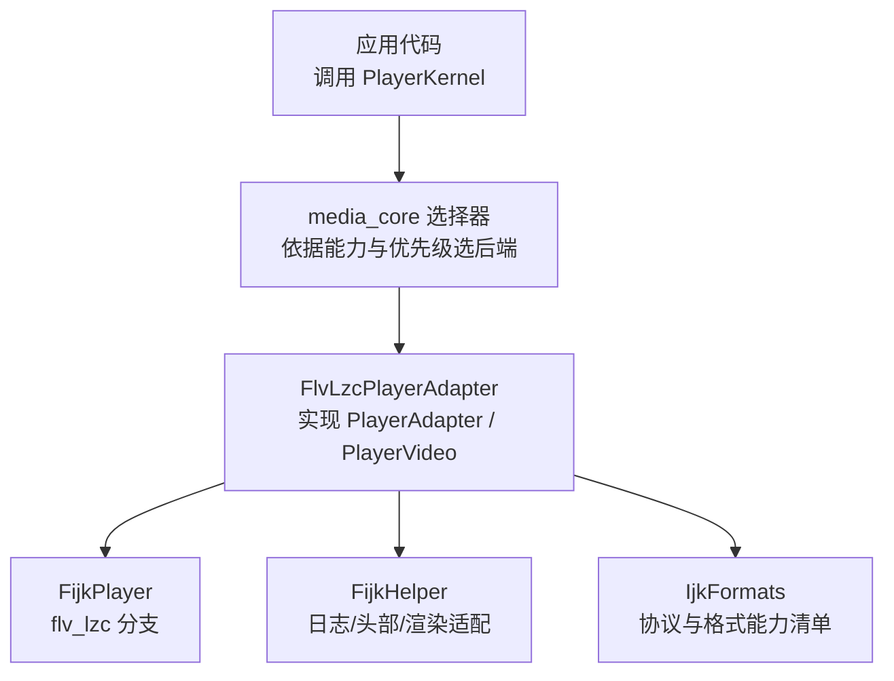
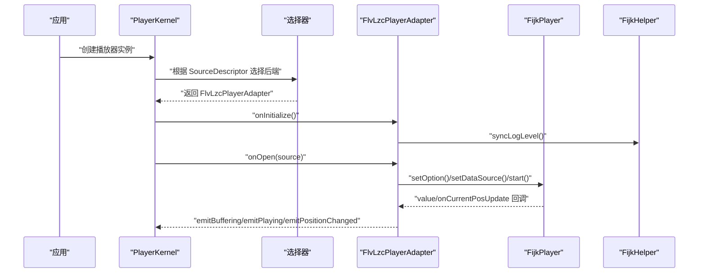
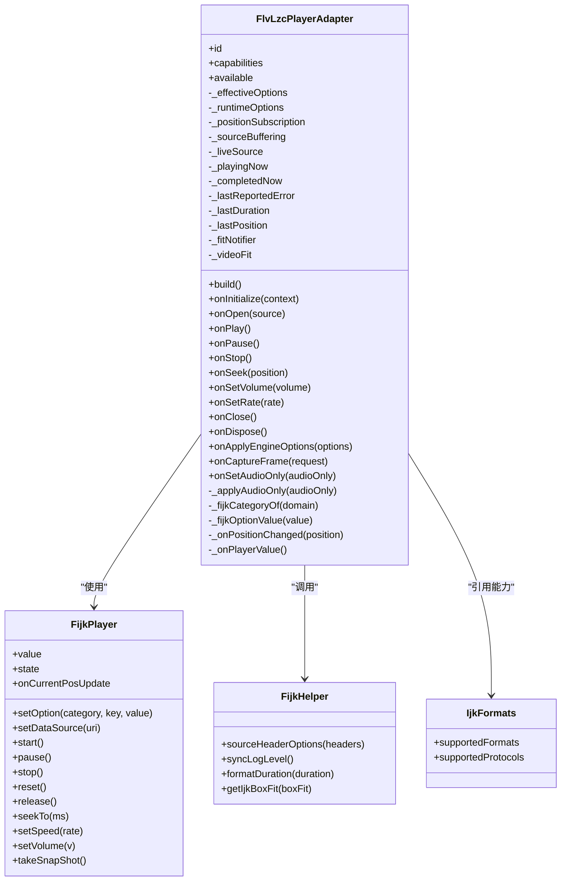
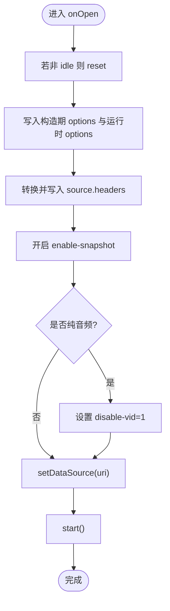
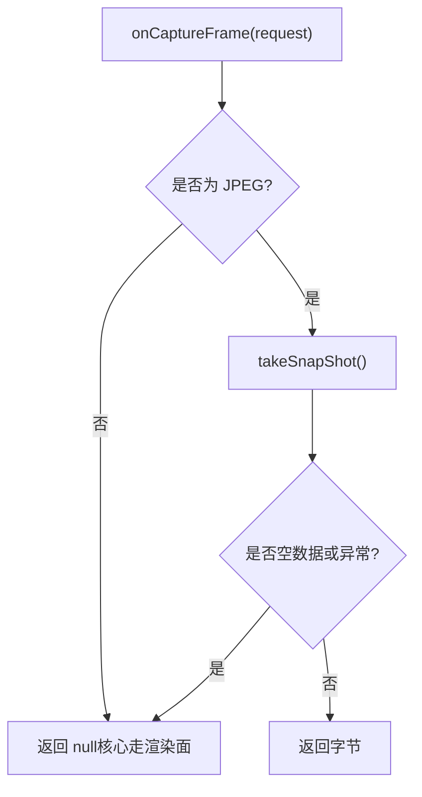
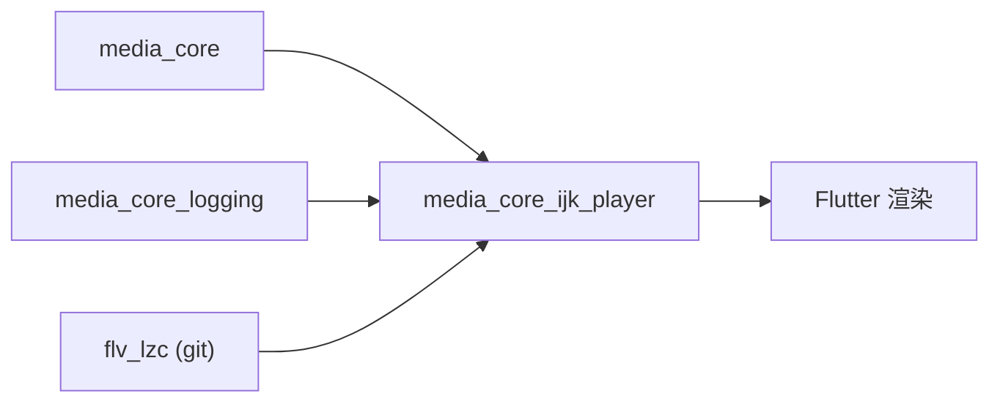
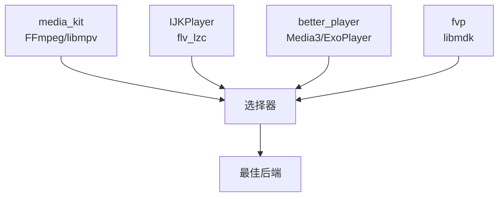

# IJK Player 适配器

<cite>
**本文引用的文件**   
- [README.md](file://packages/media_core_ijk_player/README.md)
- [pubspec.yaml](file://packages/media_core_ijk_player/pubspec.yaml)
- [flv_lzc_player_adapter.dart](file://packages/media_core_ijk_player/lib/src/flv_lzc_player_adapter.dart)
- [fijk_helper.dart](file://packages/media_core_ijk_player/lib/src/fijk_helper.dart)
- [media_format_constants.dart](file://packages/media_core/media_core/lib/util/media_format_constants.dart)
- [adapter.md（中文文档）](file://doc/zh-Hans/adapter.md)
</cite>

## 目录
1. [简介](#简介)
2. [项目结构](#项目结构)
3. [核心组件](#核心组件)
4. [架构总览](#架构总览)
5. [详细组件分析](#详细组件分析)
6. [依赖关系分析](#依赖关系分析)
7. [性能与资源特性](#性能与资源特性)
8. [平台差异与集成要点](#平台差异与集成要点)
9. [与其他后端对比](#与其他后端对比)
10. [移动端优化最佳实践](#移动端优化最佳实践)
11. [故障排除指南](#故障排除指南)
12. [结论](#结论)

## 简介
IJK Player 适配器基于 FFmpeg 的 ijkplayer（flv_lzc 分支），在 media_core 的统一播放器适配器契约之上，提供对 FLV、HLS、DASH、RTMP、RTSP、HTTP(S)、UDP/RTP、本地文件等协议与容器的支持。该适配器的优势在于：
- 成熟的移动端原生库生态，适合直播与低延迟场景；
- 对 H.265/HEVC 等现代编码具备良好兼容性；
- 通过 EngineOption 暴露底层 ijk 选项，便于按业务调优解码器、缓冲、网络与渲染行为；
- 与 media_core 的选择器、能力声明、事件模型和生命周期管理无缝对接。

本适配器默认优先级低于 media_kit，高于 fvp 与 better_player，因此通常作为“备选但可靠”的后端，尤其在 FLV 与 H.265 路径上表现稳健。

**章节来源**
- [README.md:1-11](file://packages/media_core_ijk_player/README.md#L1-L11)
- [adapter.md（中文文档）:1-21](file://doc/zh-Hans/adapter.md#L1-L21)

## 项目结构
media_core_ijk_player 包围绕 FlvLzcPlayerAdapter 展开，核心职责包括：
- 将 FijkPlayer 接入 media_core 的 PlayerAdapter 契约；
- 处理引擎选项、请求头、截图开关、纯音频模式、状态与进度映射；
- 提供 FijkHelper 工具，封装日志级别同步、Header 转换、尺寸适配等通用逻辑。

**图表来源**
- [flv_lzc_player_adapter.dart:11-18](file://packages/media_core_ijk_player/lib/src/flv_lzc_player_adapter.dart#L11-L18)
- [fijk_helper.dart:6-24](file://packages/media_core_ijk_player/lib/src/fijk_helper.dart#L6-L24)
- [media_format_constants.dart:115-168](file://packages/media_core/media_core/lib/util/media_format_constants.dart#L115-L168)

**章节来源**
- [README.md:5-11](file://packages/media_core_ijk_player/README.md#L5-L11)
- [flv_lzc_player_adapter.dart:11-18](file://packages/media_core_ijk_player/lib/src/flv_lzc_player_adapter.dart#L11-L18)

## 核心组件
- FlvLzcPlayerAdapter：实现媒体播放的核心生命周期（初始化、打开、播放、暂停、停止、seek、音量、速率、关闭、释放），并实现 PlayerVideo 以承载画面渲染。
- FijkHelper：封装 ijk 相关辅助方法，包括 HTTP 请求头转换、日志级别同步、时长格式化、Flutter BoxFit 到 FijkFit 的映射。
- IjkFormats：声明 ijkplayer 支持的容器、流式清单与 URI 协议集合，用于能力匹配与后端选择打分。

关键职责划分：
- Adapter 负责执行与状态映射；
- Helper 负责跨层工具；
- Formats 负责能力声明；
- pubspec 锁定 flv_lzc 引擎分支，保证构建可复现。

**章节来源**
- [flv_lzc_player_adapter.dart:11-18](file://packages/media_core_ijk_player/lib/src/flv_lzc_player_adapter.dart#L11-L18)
- [fijk_helper.dart:6-24](file://packages/media_core_ijk_player/lib/src/fijk_helper.dart#L6-L24)
- [media_format_constants.dart:115-168](file://packages/media_core/media_core/lib/util/media_format_constants.dart#L115-L168)
- [pubspec.yaml:17-30](file://packages/media_core_ijk_player/pubspec.yaml#L17-L30)

## 架构总览
IJK Player 适配器在 media_core 的整体架构中扮演“具体后端实现”的角色，对外暴露统一 API，对内委托 FijkPlayer 完成解码与渲染。

**图表来源**
- [flv_lzc_player_adapter.dart:184-251](file://packages/media_core_ijk_player/lib/src/flv_lzc_player_adapter.dart#L184-L251)
- [fijk_helper.dart:50-60](file://packages/media_core_ijk_player/lib/src/fijk_helper.dart#L50-L60)

## 详细组件分析

### FlvLzcPlayerAdapter 类图

**图表来源**
- [flv_lzc_player_adapter.dart:11-469](file://packages/media_core_ijk_player/lib/src/flv_lzc_player_adapter.dart#L11-L469)
- [fijk_helper.dart:6-104](file://packages/media_core_ijk_player/lib/src/fijk_helper.dart#L6-L104)
- [media_format_constants.dart:115-168](file://packages/media_core/media_core/lib/util/media_format_constants.dart#L115-L168)

**章节来源**
- [flv_lzc_player_adapter.dart:11-469](file://packages/media_core_ijk_player/lib/src/flv_lzc_player_adapter.dart#L11-L469)

### 打开与播放流程

**图表来源**
- [flv_lzc_player_adapter.dart:202-251](file://packages/media_core_ijk_player/lib/src/flv_lzc_player_adapter.dart#L202-L251)

**章节来源**
- [flv_lzc_player_adapter.dart:202-251](file://packages/media_core_ijk_player/lib/src/flv_lzc_player_adapter.dart#L202-L251)

### 截图与纯音频逻辑
- 截图：仅 JPEG 由原生快照直接返回；PNG 请求返回 null，核心回退到渲染面抓取。
- 纯音频：通过 player 分类的 disable-vid 关闭视频解码，而非隐藏画面；available 在 audio-only 时返回 false，避免空纹理。

**图表来源**
- [flv_lzc_player_adapter.dart:338-362](file://packages/media_core_ijk_player/lib/src/flv_lzc_player_adapter.dart#L338-L362)

**章节来源**
- [flv_lzc_player_adapter.dart:338-362](file://packages/media_core_ijk_player/lib/src/flv_lzc_player_adapter.dart#L338-L362)

## 依赖关系分析
- 包依赖：
  - flutter SDK；
  - media_core（统一适配器契约与能力模型）；
  - media_core_logging（日志枢纽）；
  - flv_lzc（ijkplayer 的 flv_lzc 分支，git 引用）。
- 运行时依赖：
  - Android/iOS 原生 ijkplayer 库；
  - Flutter 渲染管线（FijkView）。

**图表来源**
- [pubspec.yaml:17-30](file://packages/media_core_ijk_player/pubspec.yaml#L17-L30)

**章节来源**
- [pubspec.yaml:1-35](file://packages/media_core_ijk_player/pubspec.yaml#L1-L35)

## 性能与资源特性
- 解码器选择：
  - 可通过 EngineOption 指定 mediacodec 等参数，启用硬件解码；
  - supportsHardwareDecoder 为 true，表明声明了硬解能力。
- 缓冲策略：
  - 通过 format 分类的 reconnect、timeout 等选项控制网络重连与超时；
  - 异步准备阶段触发 buffering 事件，状态去重避免重复上报。
- 渲染优化：
  - build() 使用 FijkView，并提供 setVideoFit 映射到 FijkFit；
  - available 在 idle/error/audio-only 状态下返回 false，避免无效纹理。
- 内存与生命周期：
  - onDispose 中取消订阅、释放 FijkPlayer，并对 release 异常做兜底；
  - 位置更新通过 onCurrentPosUpdate 监听，减少频繁计算。

**章节来源**
- [flv_lzc_player_adapter.dart:146-172](file://packages/media_core_ijk_player/lib/src/flv_lzc_player_adapter.dart#L146-L172)
- [flv_lzc_player_adapter.dart:306-321](file://packages/media_core_ijk_player/lib/src/flv_lzc_player_adapter.dart#L306-L321)
- [flv_lzc_player_adapter.dart:371-444](file://packages/media_core_ijk_player/lib/src/flv_lzc_player_adapter.dart#L371-L444)

## 平台差异与集成要点
- 平台支持：
  - 仅 Android 与 iOS；桌面/Web 应使用 media_kit 或 fvp。
- 原生库集成：
  - flv_lzc 分支包含 Android/iOS 原生 ijkplayer 库；
  - 日志级别通过 FijkHelper.syncLogLevel 与宿主日志枢纽对齐。
- 权限与配置：
  - 网络访问需遵循平台网络配置；
  - 请求头经 HttpHeaderSanitizer 校验后透传，确保安全性。
- 性能调优：
  - 建议在 onInitialize 前设置日志级别，避免首次 open 加载原生库的额外开销；
  - 通过 EngineOption 调整 mediacodec、reconnect、timeout 等参数。

**章节来源**
- [README.md:64-68](file://packages/media_core_ijk_player/README.md#L64-L68)
- [fijk_helper.dart:26-60](file://packages/media_core_ijk_player/lib/src/fijk_helper.dart#L26-L60)
- [flv_lzc_player_adapter.dart:184-196](file://packages/media_core_ijk_player/lib/src/flv_lzc_player_adapter.dart#L184-L196)

## 与其他后端对比
- 协议与格式覆盖：
  - IJKPlayer 与 media_kit 共享 FFmpeg 容器基础，但 IJKPlayer 明确排除了 mxf，且部分协议（如 srt/ftp/ftps）依赖可选库；
  - better_player_plus 基于 Media3/ExoPlayer，提取器集更窄，不支持某些容器与协议；
  - fvp（libmdk）自带 FFmpeg，容器覆盖广，但协议白名单较保守。
- 能力与优先级：
  - IJKPlayer 默认优先级较低于 media_kit，但在 FLV/H.265 路径上稳定可用；
  - 选择器会依据协议、格式、直播能力与优先级打分。

**图表来源**
- [media_format_constants.dart:47-113](file://packages/media_core/media_core/lib/util/media_format_constants.dart#L47-L113)
- [media_format_constants.dart:115-168](file://packages/media_core/media_core/lib/util/media_format_constants.dart#L115-L168)
- [media_format_constants.dart:170-235](file://packages/media_core/media_core/lib/util/media_format_constants.dart#L170-L235)
- [media_format_constants.dart:237-291](file://packages/media_core/media_core/lib/util/media_format_constants.dart#L237-L291)

**章节来源**
- [media_format_constants.dart:47-113](file://packages/media_core/media_core/lib/util/media_format_constants.dart#L47-L113)
- [media_format_constants.dart:115-168](file://packages/media_core/media_core/lib/util/media_format_constants.dart#L115-L168)
- [media_format_constants.dart:170-235](file://packages/media_core/media_core/lib/util/media_format_constants.dart#L170-L235)
- [media_format_constants.dart:237-291](file://packages/media_core/media_core/lib/util/media_format_constants.dart#L237-L291)

## 移动端优化最佳实践
- 内存管理：
  - 在 onDispose 中释放 FijkPlayer，并忽略 release 异常以避免崩溃；
  - 避免长时间持有 FijkPlayer 实例，按需重建。
- 电池优化：
  - 合理设置 timeout 与 reconnect，减少无效重试；
  - 在后台或不可见时降低帧率或暂停播放。
- 用户体验：
  - 使用 setVideoFit 控制画面填充方式，避免黑边或拉伸；
  - 对直播源拒绝 seek，避免 UI 误导；
  - 截图仅在 JPEG 下走原生快照，PNG 走渲染面，兼顾兼容性与质量。

**章节来源**
- [flv_lzc_player_adapter.dart:306-321](file://packages/media_core_ijk_player/lib/src/flv_lzc_player_adapter.dart#L306-L321)
- [flv_lzc_player_adapter.dart:267-293](file://packages/media_core_ijk_player/lib/src/flv_lzc_player_adapter.dart#L267-L293)
- [flv_lzc_player_adapter.dart:338-362](file://packages/media_core_ijk_player/lib/src/flv_lzc_player_adapter.dart#L338-L362)

## 故障排除指南
- 编译问题：
  - flv_lzc 为 git 依赖，无法发布到 pub.dev；需在本地或私有仓库按路径/git 引用；
  - 确认 Flutter 与 SDK 版本满足约束。
- 运行时错误：
  - 直播源 seek 抛出 UnsupportedError，属预期行为；
  - 截图 PNG 返回 null，核心自动回退渲染面；
  - 原生快照失败或平台缺失时，视为无帧。
- 性能瓶颈：
  - 检查是否启用 mediacodec；
  - 调整 reconnect/timeout；
  - 观察 buffering 事件频率，避免频繁状态切换。
- 日志排查：
  - 通过 MediaCoreLog.level 控制引擎日志级别；
  - syncLogLevel 在 onInitialize 中首次调用，避免重复下发。

**章节来源**
- [pubspec.yaml:6-8](file://packages/media_core_ijk_player/pubspec.yaml#L6-L8)
- [flv_lzc_player_adapter.dart:267-293](file://packages/media_core_ijk_player/lib/src/flv_lzc_player_adapter.dart#L267-L293)
- [flv_lzc_player_adapter.dart:338-362](file://packages/media_core_ijk_player/lib/src/flv_lzc_player_adapter.dart#L338-L362)
- [fijk_helper.dart:26-60](file://packages/media_core_ijk_player/lib/src/fijk_helper.dart#L26-L60)

## 结论
IJK Player 适配器在 media_core 中提供了成熟、稳定的移动端播放后端，尤其适合 FLV 与 H.265 场景。通过 EngineOption 暴露底层能力，结合 IjkFormats 的能力声明，可在协议、格式与直播能力上进行精细选择。配合合理的缓冲、解码与渲染配置，能够在 Android/iOS 上获得良好的性能与体验。对于复杂网络与多后端环境，建议结合选择器与 fallback 机制，动态挑选最优后端。