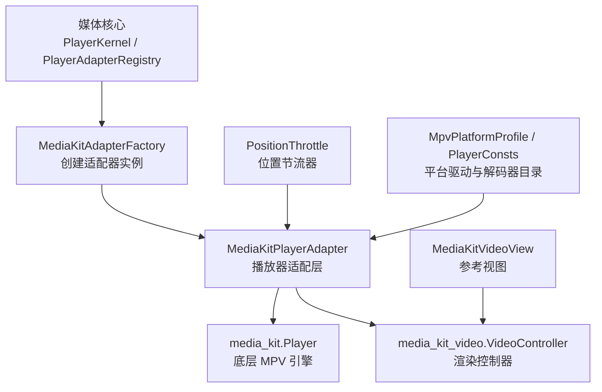
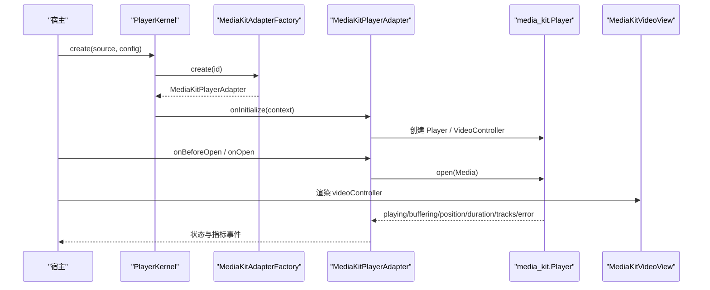
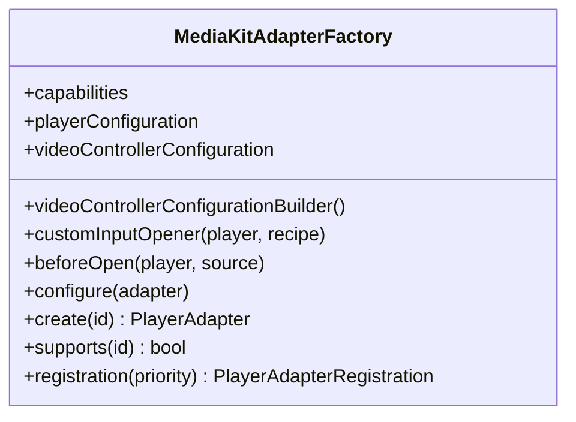
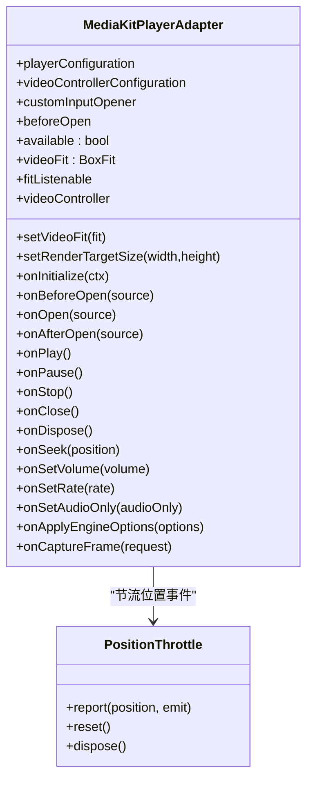
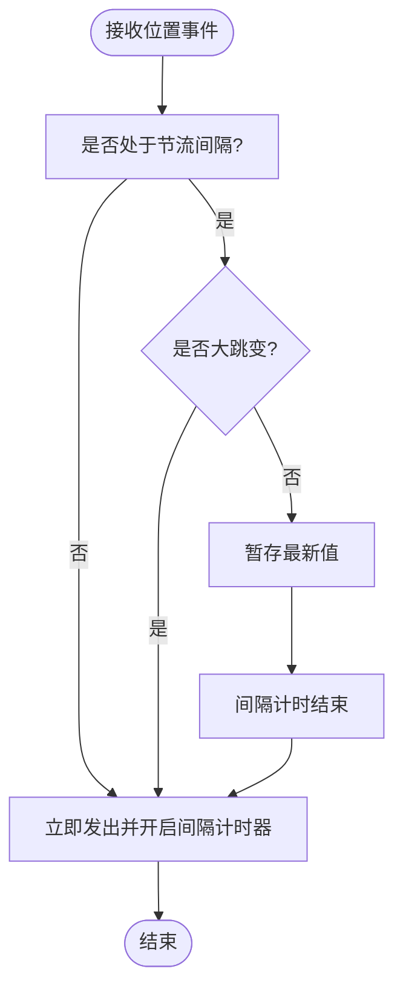
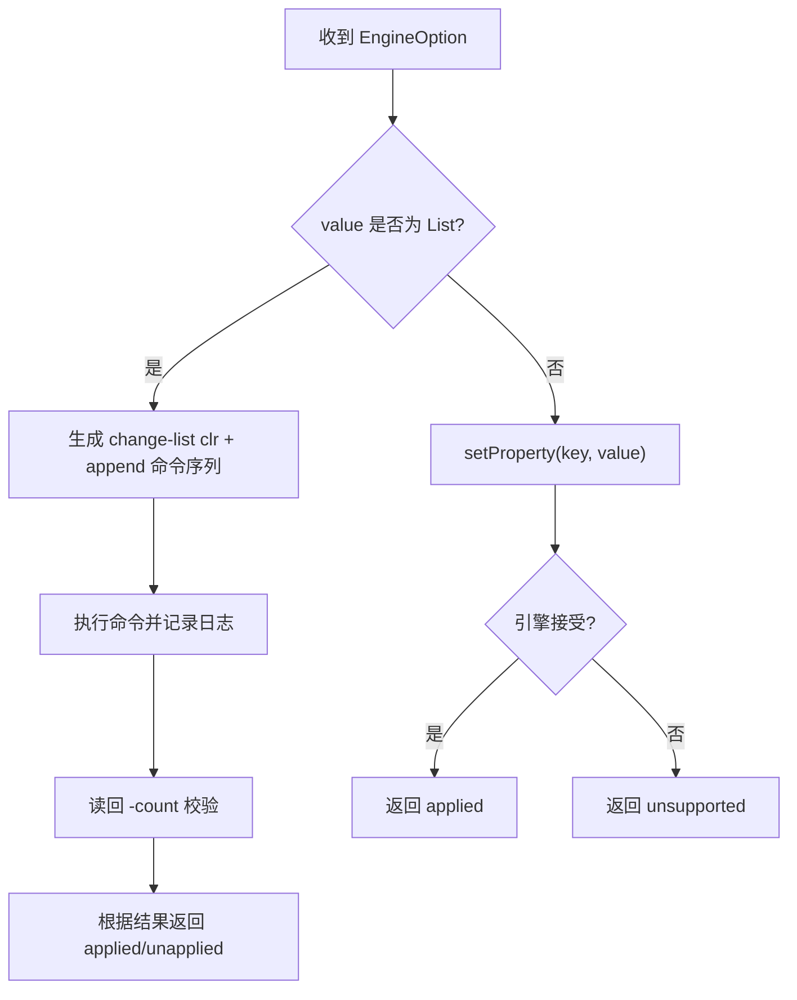
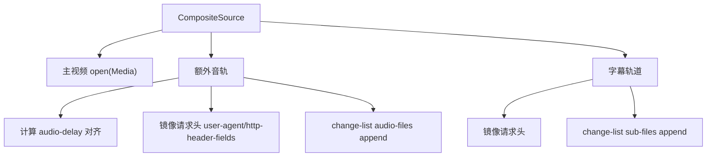
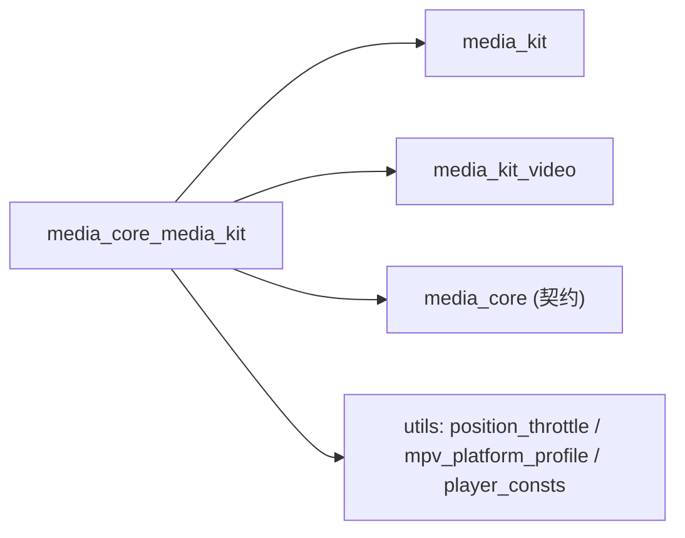

# Media Kit 适配器

<cite>
**本文引用的文件**   
- [README.md](file://packages/media_core_media_kit/README.md)
- [media_core_media_kit.dart](file://packages/media_core_media_kit/lib/media_core_media_kit.dart)
- [media_kit_adapter_factory.dart](file://packages/media_core_media_kit/lib/src/media_kit_adapter_factory.dart)
- [media_kit_player_adapter.dart](file://packages/media_core_media_kit/lib/src/media_kit_player_adapter.dart)
- [media_kit_player_adapter_engine.dart](file://packages/media_core_media_kit/lib/src/media_kit_player_adapter_engine.dart)
- [media_kit_video_view.dart](file://packages/media_core_media_kit/lib/src/media_kit_video_view.dart)
- [position_throttle.dart](file://packages/media_core_media_kit/lib/src/position_throttle.dart)
- [mpv_platform_profile.dart](file://packages/media_core_media_kit/lib/src/utils/mpv_platform_profile.dart)
- [player_consts.dart](file://packages/media_core_media_kit/lib/src/utils/player_consts.dart)
- [README.md](file://README.md)
</cite>

## 目录
1. [简介](#简介)
2. [项目结构](#项目结构)
3. [核心组件](#核心组件)
4. [架构总览](#架构总览)
5. [详细组件分析](#详细组件分析)
6. [依赖关系分析](#依赖关系分析)
7. [性能与调优](#性能与调优)
8. [常见问题排查](#常见问题排查)
9. [最佳实践](#最佳实践)
10. [结论](#结论)

## 简介
Media Kit 适配器是 media_core 的默认首选后端，基于 media_kit（libmpv）实现。它提供广泛的协议与容器支持、原生平台能力、抓帧、纯音频模式、复合源外部音轨挂载、引擎选项运行时调参等能力；同时通过 PositionThrottle 将 libmpv 的高频位置事件收敛到 UI 节奏，避免弱机上信息流卡顿。该适配器在四个后端中优先级最高，适合追求“开箱即用、覆盖最广”的场景。

**章节来源**
- [README.md:1-13](file://packages/media_core_media_kit/README.md#L1-L13)
- [README.md:148-157](file://README.md#L148-L157)

## 项目结构
本包对外暴露适配器、工厂、视频视图、MPV 平台配置与常量，以及上游 media_kit / media_kit_video 类型重导出，便于宿主仅依赖一个包即可使用完整能力。

**图表来源**
- [media_kit_adapter_factory.dart:12-81](file://packages/media_core_media_kit/lib/src/media_kit_adapter_factory.dart#L12-L81)
- [media_kit_player_adapter.dart:34-66](file://packages/media_core_media_kit/lib/src/media_kit_player_adapter.dart#L34-L66)
- [media_kit_video_view.dart:21-35](file://packages/media_core_media_kit/lib/src/media_kit_video_view.dart#L21-L35)
- [position_throttle.dart:24-34](file://packages/media_core_media_kit/lib/src/position_throttle.dart#L24-L34)
- [mpv_platform_profile.dart:33-64](file://packages/media_core_media_kit/lib/src/utils/mpv_platform_profile.dart#L33-L64)
- [player_consts.dart:11-11](file://packages/media_core_media_kit/lib/src/utils/player_consts.dart#L11-L11)

**章节来源**
- [media_core_media_kit.dart:1-34](file://packages/media_core_media_kit/lib/media_core_media_kit.dart#L1-L34)
- [README.md:1-13](file://packages/media_core_media_kit/README.md#L1-L13)

## 核心组件
- MediaKitAdapterFactory：负责注册后端 id、创建适配器、注入宿主自定义输入打开器与每源属性回调，并提供 registration() 以带能力表参与选择。
- MediaKitPlayerAdapter：实现播放生命周期、状态机桥接、视频表面、抓帧、复合源外部音轨挂载、引擎选项写入、位置节流与帧心跳。
- MediaKitVideoView：参考视图，直接绑定 adapter.videoController 与 fitListenable，不接管 mpv 表面所有权。
- PositionThrottle：将高频 time-pos 事件收敛为 UI 节奏，保证起播/seek 即时可见且不丢最终值。
- MpvPlatformProfile / PlayerConsts：统一 vo/ao/hwdec 等平台参数目录与归一化策略，供专家设置界面使用。

**章节来源**
- [media_kit_adapter_factory.dart:12-81](file://packages/media_core_media_kit/lib/src/media_kit_adapter_factory.dart#L12-L81)
- [media_kit_player_adapter.dart:34-66](file://packages/media_core_media_kit/lib/src/media_kit_player_adapter.dart#L34-L66)
- [media_kit_video_view.dart:21-35](file://packages/media_core_media_kit/lib/src/media_kit_video_view.dart#L21-L35)
- [position_throttle.dart:24-34](file://packages/media_core_media_kit/lib/src/position_throttle.dart#L24-L34)
- [mpv_platform_profile.dart:33-64](file://packages/media_core_media_kit/lib/src/utils/mpv_platform_profile.dart#L33-L64)
- [player_consts.dart:11-11](file://packages/media_core_media_kit/lib/src/utils/player_consts.dart#L11-L11)

## 架构总览
Media Kit 适配器作为后端，向上暴露统一的 PlayerAdapter 契约，向下封装 media_kit 的 Player 与 VideoController。内核负责会话、命令串行化与恢复决策；适配器专注 mpv 细节，包括：
- 引擎初始化与视频控制器构建
- 播放/暂停/停止/Seek/音量/速率控制
- 缓冲、位置、时长、尺寸、错误、轨道等事件桥接
- 抓帧（JPEG/PNG）、纯音频模式、复合源外部音轨挂载
- 引擎选项（mpv 属性）运行时写入与列表选项替换
- 位置节流与 Windows 解码帧心跳

**图表来源**
- [media_kit_adapter_factory.dart:51-65](file://packages/media_core_media_kit/lib/src/media_kit_adapter_factory.dart#L51-L65)
- [media_kit_player_adapter.dart:325-349](file://packages/media_core_media_kit/lib/src/media_kit_player_adapter.dart#L325-L349)
- [media_kit_player_adapter.dart:385-430](file://packages/media_core_media_kit/lib/src/media_kit_player_adapter.dart#L385-L430)
- [media_kit_video_view.dart:58-85](file://packages/media_core_media_kit/lib/src/media_kit_video_view.dart#L58-L85)

**章节来源**
- [README.md:1-13](file://packages/media_core_media_kit/README.md#L1-L13)
- [media_kit_player_adapter.dart:34-66](file://packages/media_core_media_kit/lib/src/media_kit_player_adapter.dart#L34-L66)

## 详细组件分析

### MediaKitAdapterFactory
- 后端 id：kMediaKitPlayerBackendId = 'mpv'
- 默认 priority：100（高于其他后端）
- 可注入：
  - playerConfiguration / videoControllerConfiguration：原样传递给 media_kit
  - videoControllerConfigurationBuilder：每次创建适配器时求值，便于运行时输出设置生效
  - customInputOpener：打开宿主自持输入（回环租约、中继 socket）
  - beforeOpen：引擎已创建、URL 未交出前写 per-source 属性
  - configure：对每个新适配器进行一次性定制

**图表来源**
- [media_kit_adapter_factory.dart:12-81](file://packages/media_core_media_kit/lib/src/media_kit_adapter_factory.dart#L12-L81)

**章节来源**
- [media_kit_adapter_factory.dart:12-81](file://packages/media_core_media_kit/lib/src/media_kit_adapter_factory.dart#L12-L81)

### MediaKitPlayerAdapter
职责要点：
- 生命周期：onInitialize / onBeforeOpen / onOpen / onAfterOpen / onPlay / onPause / onStop / onClose / onDispose
- 控制：onSeek / onSetVolume / onSetRate / onSetAudioOnly
- 呈现：build() / available / attach / detach / setVideoFit / setRenderTargetSize
- 抓帧：onCaptureFrame（JPEG/PNG，可选烧录字幕）
- 复合源：externalAudio 挂载、字幕挂载、网络头镜像、对齐 audio-delay
- 引擎选项：onApplyEngineOptions 支持标量与 List 选项替换
- 事件桥接：playing/completed/buffering/position/duration/volume/width/height/error/buffer/tracks
- 性能：PositionThrottle 节流位置事件；Windows 上 estimated-vf-fps 解码帧心跳

**图表来源**
- [media_kit_player_adapter.dart:34-66](file://packages/media_core_media_kit/lib/src/media_kit_player_adapter.dart#L34-L66)
- [media_kit_player_adapter.dart:148-157](file://packages/media_core_media_kit/lib/src/media_kit_player_adapter.dart#L148-L157)
- [media_kit_player_adapter.dart:224-271](file://packages/media_core_media_kit/lib/src/media_kit_player_adapter.dart#L224-L271)
- [media_kit_player_adapter.dart:325-349](file://packages/media_core_media_kit/lib/src/media_kit_player_adapter.dart#L325-L349)
- [media_kit_player_adapter.dart:385-430](file://packages/media_core_media_kit/lib/src/media_kit_player_adapter.dart#L385-L430)
- [media_kit_player_adapter.dart:587-633](file://packages/media_core_media_kit/lib/src/media_kit_player_adapter.dart#L587-L633)
- [media_kit_player_adapter.dart:695-714](file://packages/media_core_media_kit/lib/src/media_kit_player_adapter.dart#L695-L714)
- [media_kit_player_adapter.dart:726-761](file://packages/media_core_media_kit/lib/src/media_kit_player_adapter.dart#L726-L761)
- [media_kit_player_adapter.dart:766-792](file://packages/media_core_media_kit/lib/src/media_kit_player_adapter.dart#L766-L792)
- [media_kit_player_adapter.dart:832-892](file://packages/media_core_media_kit/lib/src/media_kit_player_adapter.dart#L832-L892)
- [position_throttle.dart:24-34](file://packages/media_core_media_kit/lib/src/position_throttle.dart#L24-L34)

**章节来源**
- [media_kit_player_adapter.dart:34-66](file://packages/media_core_media_kit/lib/src/media_kit_player_adapter.dart#L34-L66)
- [media_kit_player_adapter.dart:325-349](file://packages/media_core_media_kit/lib/src/media_kit_player_adapter.dart#L325-L349)
- [media_kit_player_adapter.dart:385-430](file://packages/media_core_media_kit/lib/src/media_kit_player_adapter.dart#L385-L430)
- [media_kit_player_adapter.dart:587-633](file://packages/media_core_media_kit/lib/src/media_kit_player_adapter.dart#L587-L633)
- [media_kit_player_adapter.dart:695-714](file://packages/media_core_media_kit/lib/src/media_kit_player_adapter.dart#L695-L714)
- [media_kit_player_adapter.dart:726-761](file://packages/media_core_media_kit/lib/src/media_kit_player_adapter.dart#L726-L761)
- [media_kit_player_adapter.dart:766-792](file://packages/media_core_media_kit/lib/src/media_kit_player_adapter.dart#L766-L792)
- [media_kit_player_adapter.dart:832-892](file://packages/media_core_media_kit/lib/src/media_kit_player_adapter.dart#L832-L892)

### MediaKitVideoView
- 参考视图，直接读取 adapter.videoController 与 adapter.fitListenable
- 不接管 mpv 表面生命周期，attach/detach 为空操作
- 支持 width/height/fill/alignment/aspectRatio/filterQuality 等 mkv.Video 参数

**章节来源**
- [media_kit_video_view.dart:21-35](file://packages/media_core_media_kit/lib/src/media_kit_video_view.dart#L21-L35)
- [media_kit_video_view.dart:58-85](file://packages/media_core_media_kit/lib/src/media_kit_video_view.dart#L58-L85)

### PositionThrottle
- 目标：将 libmpv 每帧 time-pos 事件收敛到 UI 节奏（默认 250ms）
- 规则：
  - 前缘立即出：起播与 seek 无额外延迟
  - 不丢值：间隔内最新值在间隔关闭时补发
  - 大跳变立即出：拖动进度条等场景即时响应

**图表来源**
- [position_throttle.dart:24-34](file://packages/media_core_media_kit/lib/src/position_throttle.dart#L24-L34)
- [position_throttle.dart:40-52](file://packages/media_core_media_kit/lib/src/position_throttle.dart#L40-L52)
- [position_throttle.dart:72-92](file://packages/media_core_media_kit/lib/src/position_throttle.dart#L72-L92)

**章节来源**
- [position_throttle.dart:24-34](file://packages/media_core_media_kit/lib/src/position_throttle.dart#L24-L34)
- [position_throttle.dart:40-52](file://packages/media_core_media_kit/lib/src/position_throttle.dart#L40-L52)
- [position_throttle.dart:72-92](file://packages/media_core_media_kit/lib/src/position_throttle.dart#L72-L92)

### 引擎选项与列表选项写入
- 标量选项：通过 NativePlayer.setProperty 写入 mpv 属性
- 列表选项：通过 change-list clr + append 逐项替换，读回 <key>-count 验证实际挂载数量
- 不支持或拒绝的选项返回 unsupported，由上层决定是否重建引擎

**图表来源**
- [media_kit_player_adapter_engine.dart:22-32](file://packages/media_core_media_kit/lib/src/media_kit_player_adapter_engine.dart#L22-L32)
- [media_kit_player_adapter_engine.dart:78-86](file://packages/media_core_media_kit/lib/src/media_kit_player_adapter_engine.dart#L78-L86)
- [media_kit_player_adapter_engine.dart:96-111](file://packages/media_core_media_kit/lib/src/media_kit_player_adapter_engine.dart#L96-L111)
- [media_kit_player_adapter_engine.dart:136-148](file://packages/media_core_media_kit/lib/src/media_kit_player_adapter_engine.dart#L136-L148)

**章节来源**
- [media_kit_player_adapter_engine.dart:22-32](file://packages/media_core_media_kit/lib/src/media_kit_player_adapter_engine.dart#L22-L32)
- [media_kit_player_adapter_engine.dart:78-86](file://packages/media_core_media_kit/lib/src/media_kit_player_adapter_engine.dart#L78-L86)
- [media_kit_player_adapter_engine.dart:96-111](file://packages/media_core_media_kit/lib/src/media_kit_player_adapter_engine.dart#L96-L111)
- [media_kit_player_adapter_engine.dart:136-148](file://packages/media_core_media_kit/lib/src/media_kit_player_adapter_engine.dart#L136-L148)

### 复合源与外部音轨/字幕挂载
- 主视频通过 player.open(Media) 打开
- 额外音轨通过 mpv 侧信道 audio-files 追加，字幕通过 sub-files 追加
- 对齐：计算 timeline 偏移并以 audio-delay 应用
- 网络头：user-agent 与 http-header-fields 镜像到全局网络选项，确保侧信道资源可鉴权访问
- 失败不静默：记录警告，绝不出现“有画面无声”的静默失败

**图表来源**
- [media_kit_player_adapter.dart:441-494](file://packages/media_core_media_kit/lib/src/media_kit_player_adapter.dart#L441-L494)
- [media_kit_player_adapter.dart:523-538](file://packages/media_core_media_kit/lib/src/media_kit_player_adapter.dart#L523-L538)
- [media_kit_player_adapter.dart:550-585](file://packages/media_core_media_kit/lib/src/media_kit_player_adapter.dart#L550-L585)

**章节来源**
- [media_kit_player_adapter.dart:441-494](file://packages/media_core_media_kit/lib/src/media_kit_player_adapter.dart#L441-L494)
- [media_kit_player_adapter.dart:523-538](file://packages/media_core_media_kit/lib/src/media_kit_player_adapter.dart#L523-L538)
- [media_kit_player_adapter.dart:550-585](file://packages/media_core_media_kit/lib/src/media_kit_player_adapter.dart#L550-L585)

### 平台能力与设备事实
- 能力表 defaultCapabilities 声明广泛能力，并在构造时被 _honestCapabilities 按平台收窄（如 Web 不支持截图/引擎选项/复合侧信道）
- 解码帧心跳仅在 Windows 启用，避免在其他平台误判直播卡顿
- 设备编解码能力来自 PlatformCodecCapabilities，用于显示硬件解码缺失告警（不自动降级）

**章节来源**
- [media_kit_player_adapter.dart:91-137](file://packages/media_core_media_kit/lib/src/media_kit_player_adapter.dart#L91-L137)
- [media_kit_player_adapter.dart:139-140](file://packages/media_core_media_kit/lib/src/media_kit_player_adapter.dart#L139-L140)
- [media_kit_player_adapter.dart:802-824](file://packages/media_core_media_kit/lib/src/media_kit_player_adapter.dart#L802-L824)
- [media_kit_player_adapter.dart:1000-1035](file://packages/media_core_media_kit/lib/src/media_kit_player_adapter.dart#L1000-L1035)

## 依赖关系分析
- 对外导出：
  - MediaKitPlayerAdapter、MediaKitAdapterFactory、MediaKitVideoView
  - MpvPlatformProfile、PlayerConsts
  - media_kit 与 media_kit_video 类型（Media、Video、VideoController、PlayerConfiguration 等）
- 内部依赖：
  - media_kit.Player 与 media_kit_video.VideoController
  - PositionThrottle 用于位置节流
  - MpvPlatformProfile / PlayerConsts 提供 vo/ao/hwdec 目录与归一化

**图表来源**
- [media_core_media_kit.dart:19-34](file://packages/media_core_media_kit/lib/media_core_media_kit.dart#L19-L34)
- [media_kit_player_adapter.dart:4-11](file://packages/media_core_media_kit/lib/src/media_kit_player_adapter.dart#L4-L11)
- [media_kit_player_adapter.dart:32](file://packages/media_core_media_kit/lib/src/media_kit_player_adapter.dart#L32)

**章节来源**
- [media_core_media_kit.dart:19-34](file://packages/media_core_media_kit/lib/media_core_media_kit.dart#L19-L34)
- [media_kit_player_adapter.dart:4-11](file://packages/media_core_media_kit/lib/src/media_kit_player_adapter.dart#L4-L11)

## 性能与调优

### 解码器选择与硬件加速
- 解码器选择由调用方传入的 videoControllerConfiguration 决定；适配器不做自动降级
- 若当前视频轨在该设备上无硬解，适配器会记录警告，提示依赖软解
- 平台驱动与解码器目录通过 PlayerConsts 与 MpvPlatformProfile 提供，供专家设置界面使用

建议：
- 优先让 engine 自行选择 hwdec=auto，必要时通过引擎选项显式指定
- 结合平台探针报告，确认设备支持的编解码器与分辨率上限

**章节来源**
- [media_kit_player_adapter.dart:802-824](file://packages/media_core_media_kit/lib/src/media_kit_player_adapter.dart#L802-L824)
- [player_consts.dart:238-401](file://packages/media_core_media_kit/lib/src/utils/player_consts.dart#L238-L401)
- [mpv_platform_profile.dart:33-64](file://packages/media_core_media_kit/lib/src/utils/mpv_platform_profile.dart#L33-L64)

### 缓冲策略
- 可通过引擎选项调整 mpv 属性（例如 cache-secs），由 onApplyEngineOptions 写入
- 列表型选项（如 glsl-shaders）通过 change-list clr + append 替换，读回 <key>-count 验证

建议：
- 在网络不稳定或首帧较慢时适当增大缓存秒数
- 列表选项务必使用适配器提供的 EngineOption 列表形式，避免路径含逗号导致解析异常

**章节来源**
- [README.md:37-49](file://packages/media_core_media_kit/README.md#L37-L49)
- [media_kit_player_adapter_engine.dart:22-32](file://packages/media_core_media_kit/lib/src/media_kit_player_adapter_engine.dart#L22-L32)
- [media_kit_player_adapter_engine.dart:96-111](file://packages/media_core_media_kit/lib/src/media_kit_player_adapter_engine.dart#L96-L111)

### 帧率控制与分辨率自适应
- 帧率控制：onSetRate 对直播源忽略，避免广播被变调
- 分辨率自适应：通过 setRenderTargetSize 在不重建播放器情况下改变原生渲染目标尺寸
- 解码帧心跳：Windows 上通过 estimated-vf-fps 观察视频输出心跳，用于健康检测

建议：
- 移动端低配设备可限制最大渲染分辨率
- 直播场景不要尝试变速

**章节来源**
- [media_kit_player_adapter.dart:148-157](file://packages/media_core_media_kit/lib/src/media_kit_player_adapter.dart#L148-L157)
- [media_kit_player_adapter.dart:624-633](file://packages/media_core_media_kit/lib/src/media_kit_player_adapter.dart#L624-L633)
- [media_kit_player_adapter.dart:832-892](file://packages/media_core_media_kit/lib/src/media_kit_player_adapter.dart#L832-L892)

### 内存与 CPU 占用优化
- 位置节流：PositionThrottle 将 60fps 的 time-pos 收敛到约每秒 4 次，显著降低 UI 重建与重绘压力
- 解码帧心跳限频：frameHeartbeatIntervalMs 限制心跳频率，避免频繁触发
- 纯音频模式：setVideoTrack(no()) 真正关闭视频轨，减少 GPU/CPU 开销

建议：
- 列表/信息流场景务必使用 PositionThrottle（适配器已内置）
- 音乐/后台播放使用纯音频模式

**章节来源**
- [position_throttle.dart:1-23](file://packages/media_core_media_kit/lib/src/position_throttle.dart#L1-L23)
- [media_kit_player_adapter.dart:299-304](file://packages/media_core_media_kit/lib/src/media_kit_player_adapter.dart#L299-L304)
- [media_kit_player_adapter.dart:712-714](file://packages/media_core_media_kit/lib/src/media_kit_player_adapter.dart#L712-L714)

### 网络参数优化
- 主视频 open 时携带 PlayerSource.headers
- 复合源外部音轨/字幕通过全局网络选项（user-agent、http-header-fields）镜像请求头
- 头部经过 HttpHeaderSanitizer 校验，无法发送的头部会拒绝而非静默丢弃

建议：
- 签名 URL 或防盗链场景务必正确传递 Referer/Cookie/User-Agent
- 使用 beforeOpen 针对特定源注入必要属性

**章节来源**
- [media_kit_player_adapter.dart:395-430](file://packages/media_core_media_kit/lib/src/media_kit_player_adapter.dart#L395-L430)
- [media_kit_player_adapter.dart:550-585](file://packages/media_core_media_kit/lib/src/media_kit_player_adapter.dart#L550-L585)

## 常见问题排查

### 播放卡顿
现象：滑动信息流时掉帧、UI 抖动  
可能原因：
- 高频 time-pos 事件导致 UI 频繁重建（已由 PositionThrottle 缓解）
- 解码走软解或设备能力不足

处理：
- 确认 PositionThrottle 已启用（适配器默认启用）
- 检查设备硬解能力与编码格式匹配情况
- 适当增加缓冲或降低渲染分辨率

**章节来源**
- [position_throttle.dart:1-23](file://packages/media_core_media_kit/lib/src/position_throttle.dart#L1-L23)
- [media_kit_player_adapter.dart:802-824](file://packages/media_core_media_kit/lib/src/media_kit_player_adapter.dart#L802-L824)

### 音画不同步
现象：复合源播放时声音滞后或超前  
可能原因：
- 多轨时间线偏移未对齐
- 外部音轨网络头缺失导致 CDN 鉴权失败

处理：
- 适配器会自动计算并应用 audio-delay
- 检查外部音轨的请求头是否正确镜像到全局网络选项

**章节来源**
- [media_kit_player_adapter.dart:441-494](file://packages/media_core_media_kit/lib/src/media_kit_player_adapter.dart#L441-L494)
- [media_kit_player_adapter.dart:523-538](file://packages/media_core_media_kit/lib/src/media_kit_player_adapter.dart#L523-L538)
- [media_kit_player_adapter.dart:550-585](file://packages/media_core_media_kit/lib/src/media_kit_player_adapter.dart#L550-L585)

### 内存泄漏
现象：切换源后仍有旧源状态残留  
可能原因：
- stop/close 后未重置位置节流与帧心跳时钟
- 上一源的收尾事件泄漏到下一代际

处理：
- 适配器已在 onStop/onClose 中重置 _hasOpened、_positionThrottle、心跳时钟等
- 确保宿主正确调用 handle.stop/close 或在生命周期结束时释放

**章节来源**
- [media_kit_player_adapter.dart:599-616](file://packages/media_core_media_kit/lib/src/media_kit_player_adapter.dart#L599-L616)
- [media_kit_player_adapter.dart:636-651](file://packages/media_core_media_kit/lib/src/media_kit_player_adapter.dart#L636-L651)
- [media_kit_player_adapter.dart:653-676](file://packages/media_core_media_kit/lib/src/media_kit_player_adapter.dart#L653-L676)

### 抓帧失败
现象：onCaptureFrame 返回 null  
可能原因：
- Web 环境不支持 mpv screenshot
- 尚未成功打开源

处理：
- Web 环境回退到渲染面抓取
- 确保 onOpen 成功后再抓帧

**章节来源**
- [media_kit_player_adapter.dart:726-761](file://packages/media_core_media_kit/lib/src/media_kit_player_adapter.dart#L726-L761)

### 引擎选项无效
现象：applyEngineOptions 返回 unsupported  
可能原因：
- 列表选项未按 list 形式传入
- 目标平台不支持该属性（如 Web）

处理：
- 列表选项使用 EngineOption 的 List 形式
- 检查平台能力表 supportsEngineOptions

**章节来源**
- [media_kit_player_adapter_engine.dart:78-86](file://packages/media_core_media_kit/lib/src/media_kit_player_adapter_engine.dart#L78-L86)
- [media_kit_player_adapter.dart:118-123](file://packages/media_core_media_kit/lib/src/media_kit_player_adapter.dart#L118-L123)

## 最佳实践
- 初始化与注册
  - 在 main 中调用 MediaKitPlayerAdapter.ensureInitialized()
  - 使用 MediaKitAdapterFactory().registration() 注册后端，priority 保持默认 100
- 配置与调参
  - 使用 playerConfiguration / videoControllerConfiguration 传入原生配置
  - 运行时调参使用 applyEngineOptions，列表选项用 List 形式
  - 使用 beforeOpen 针对特定源注入属性
- 呈现与交互
  - 使用 MediaKitVideoView 或直接绑定 adapter.videoController
  - 通过 setVideoFit 与 setRenderTargetSize 控制缩放与渲染尺寸
- 复合源
  - 主视频 open，额外音轨/字幕通过 side channel 挂载
  - 确保外部音轨的网络头正确镜像
- 性能
  - 利用 PositionThrottle（默认启用）降低 UI 压力
  - 直播禁用变速
  - 纯音频模式关闭视频轨
- 诊断
  - 关注解码帧心跳（Windows）与 tracks 事件中的硬解告警
  - 使用日志分类定位 renderer/network/player 问题

**章节来源**
- [README.md:15-49](file://packages/media_core_media_kit/README.md#L15-L49)
- [media_kit_adapter_factory.dart:51-81](file://packages/media_core_media_kit/lib/src/media_kit_adapter_factory.dart#L51-L81)
- [media_kit_player_adapter.dart:325-349](file://packages/media_core_media_kit/lib/src/media_kit_player_adapter.dart#L325-L349)
- [media_kit_player_adapter.dart:587-633](file://packages/media_core_media_kit/lib/src/media_kit_player_adapter.dart#L587-L633)
- [media_kit_player_adapter.dart:712-714](file://packages/media_core_media_kit/lib/src/media_kit_player_adapter.dart#L712-L714)
- [media_kit_player_adapter.dart:802-824](file://packages/media_core_media_kit/lib/src/media_kit_player_adapter.dart#L802-L824)

## 结论
Media Kit 适配器以 media_kit（libmpv）为引擎，提供协议与格式覆盖最广、跨平台原生可用的默认后端。它在内核编排之上，专注于 mpv 的细节实现：高性能解码、广泛的协议与容器支持、抓帧、纯音频、复合源挂载、引擎选项运行时调参、位置节流与帧心跳等。通过合理的配置与调优，开发者可以在多平台上获得稳定、流畅且可观测的播放体验。