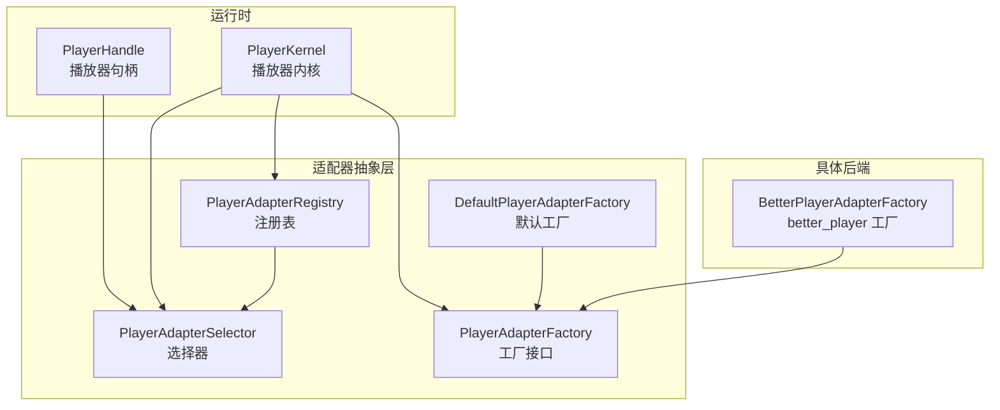
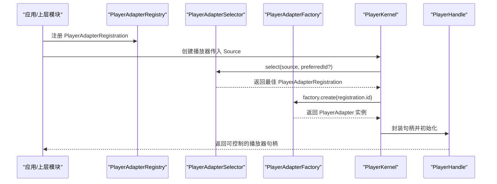
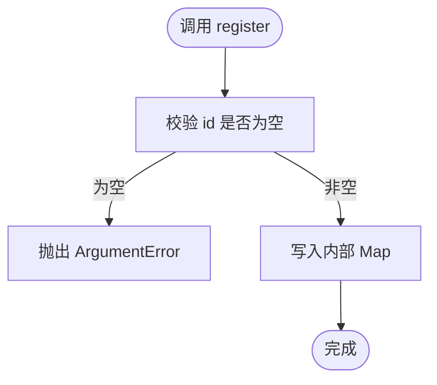
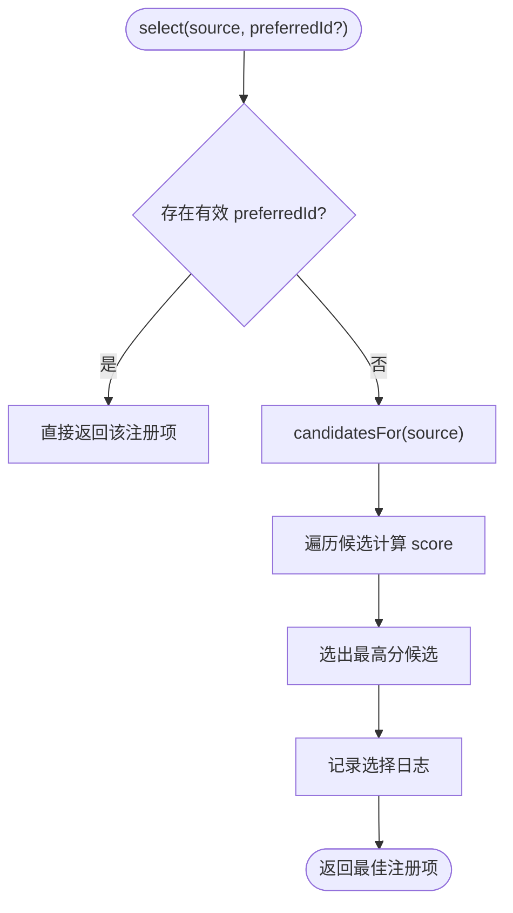
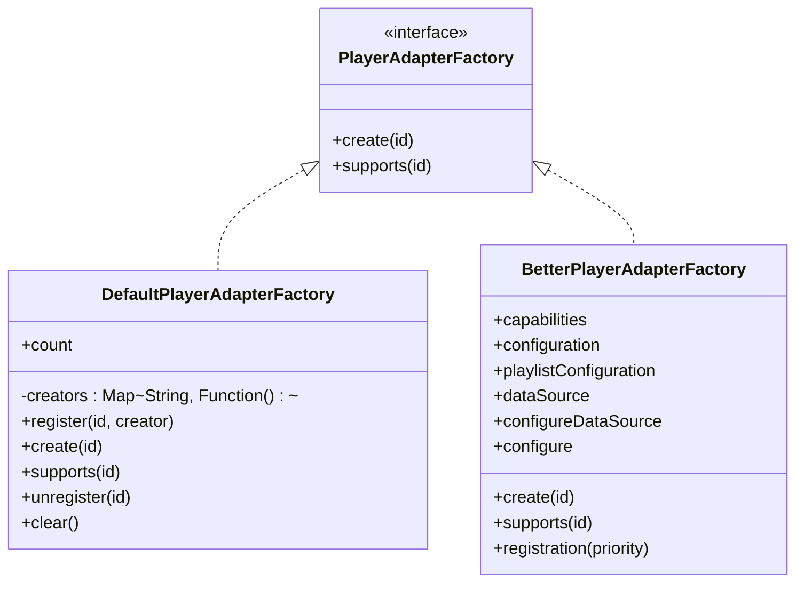
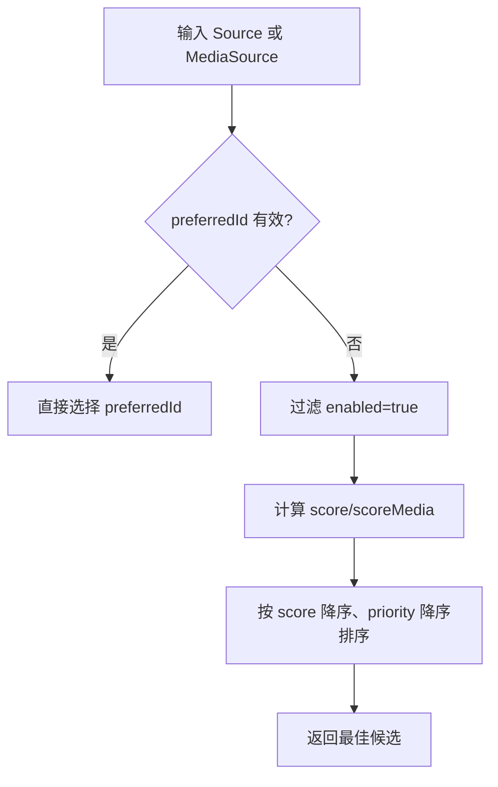
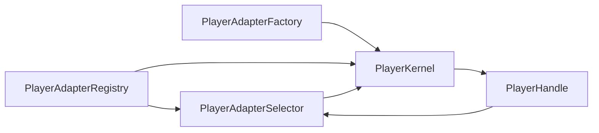

# 注册表与选择器

<cite>
**本文引用的文件**   
- [player_adapter_registry.dart](file://packages/media_core/lib/adapter/player_adapter_registry.dart)
- [player_adapter_selector.dart](file://packages/media_core/lib/adapter/player_adapter_selector.dart)
- [player_adapter_factory.dart](file://packages/media_core/lib/adapter/player_adapter_factory.dart)
- [better_player_adapter_factory.dart](file://packages/media_core_better_player/lib/src/better_player_adapter_factory.dart)
- [player_kernel.dart](file://packages/media_core/lib/kernel/player_kernel.dart)
- [player_handle.dart](file://packages/media_core/lib/kernel/player_handle.dart)
- [composite_capability_test.dart](file://packages/media_core_better_player/test/composite_capability_test.dart)
- [planner_open_media_test.dart](file://packages/media_core/test/kernel/planner_open_media_test.dart)
- [adapter.md](file://doc/en/adapter.md)
</cite>

## 目录
1. [引言](#引言)
2. [项目结构定位](#项目结构定位)
3. [核心组件总览](#核心组件总览)
4. [架构总览](#架构总览)
5. [PlayerAdapterRegistry：适配器注册表](#playeradapterregistry适配器注册表)
6. [PlayerAdapterSelector：智能选择器](#playeradapterselector智能选择器)
7. [PlayerAdapterFactory：工厂模式实现](#playeradapterfactory工厂模式实现)
8. [适配器发现机制](#适配器发现机制)
9. [选择策略配置：硬约束、软偏好与自定义规则](#选择策略配置硬约束软偏好与自定义规则)
10. [依赖关系分析](#依赖关系分析)
11. [性能与复杂度特征](#性能与复杂度特征)
12. [使用场景与配置示例](#使用场景与配置示例)
13. [故障排查指南](#故障排查指南)
14. [结论](#结论)

## 引言
本文围绕媒体播放适配层的“注册—选择—创建”主线，系统化说明以下三类核心对象的行为与协作方式：
- PlayerAdapterRegistry：负责注册、查询、枚举适配器元数据。
- PlayerAdapterSelector：基于协议、格式、直播能力、组合源支持等维度对候选适配器打分并排序。
- PlayerAdapterFactory：隐藏具体后端实现细节，按标识符创建播放器适配器实例。

文档同时解释动态注册、优先级排序、冲突处理、组合媒体源选择、回退路径中的候选生成，以及实际集成中如何正确配置和使用这套系统。

## 项目结构定位
本主题涉及的代码主要位于 media_core 的 adapter 层，并由 better_player 插件提供具体后端的工厂和注册辅助方法；运行时由 player_kernel 和 player_handle 驱动选择与创建流程。

图表来源
- [player_adapter_registry.dart:4-26](file://packages/media_core/lib/adapter/player_adapter_registry.dart#L4-L26)
- [player_adapter_selector.dart:12-38](file://packages/media_core/lib/adapter/player_adapter_selector.dart#L12-L38)
- [player_adapter_factory.dart:3-30](file://packages/media_core/lib/adapter/player_adapter_factory.dart#L3-L30)
- [better_player_adapter_factory.dart:7-21](file://packages/media_core_better_player/lib/src/better_player_adapter_factory.dart#L7-L21)
- [player_kernel.dart:329-370](file://packages/media_core/lib/kernel/player_kernel.dart#L329-L370)
- [player_handle.dart:782-803](file://packages/media_core/lib/kernel/player_handle.dart#L782-L803)

章节来源
- [adapter.md:1-21](file://doc/en/adapter.md#L1-L21)

## 核心组件总览
- PlayerAdapterRegistry
  - 维护 id 到 PlayerAdapterRegistration 的映射。
  - 提供注册、注销、查询、枚举、清空等能力。
  - 不创建实例、不选择最佳适配器、不控制播放。
- PlayerAdapterRegistration
  - 描述一个可被选择的适配器条目：id、factory、capabilities、priority、enabled。
  - 提供 copyWith 以调整部分字段。
- PlayerAdapterSelector
  - 基于 PlayerSource 或 MediaSource 计算候选分数并排序。
  - 支持 preferredId 强制偏好。
  - 暴露 candidatesFor、scoreTable、mediaScoreTable 等诊断信息。
- PlayerAdapterFactory / DefaultPlayerAdapterFactory
  - 定义 create(id)、supports(id)。
  - 默认实现通过闭包注册表创建实例。
- BetterPlayerAdapterFactory
  - 具体后端工厂，提供 registration(priority) 便捷构造注册项。
  - 提供 registerBetterPlayerFactory 与 registerBetterPlayerRegistry 两个注册入口。

章节来源
- [player_adapter_registry.dart:4-148](file://packages/media_core/lib/adapter/player_adapter_registry.dart#L4-L148)
- [player_adapter_selector.dart:12-513](file://packages/media_core/lib/adapter/player_adapter_selector.dart#L12-L513)
- [player_adapter_factory.dart:3-94](file://packages/media_core/lib/adapter/player_adapter_factory.dart#L3-L94)
- [better_player_adapter_factory.dart:7-105](file://packages/media_core_better_player/lib/src/better_player_adapter_factory.dart#L7-L105)

## 架构总览
下图展示从“注册”到“选择”再到“创建”的端到端流程。

图表来源
- [player_kernel.dart:329-370](file://packages/media_core/lib/kernel/player_kernel.dart#L329-L370)
- [player_adapter_selector.dart:48-114](file://packages/media_core/lib/adapter/player_adapter_selector.dart#L48-L114)
- [player_adapter_factory.dart:52-77](file://packages/media_core/lib/adapter/player_adapter_factory.dart#L52-L77)

## PlayerAdapterRegistry：适配器注册表
### 职责边界
- 只负责存储与查找注册信息。
- 不负责实例化、选择、生命周期管理。
- 对外暴露 ids、registrations、length 等只读视图。

### 注册机制
- register(registration)
  - 校验 id 非空，否则抛出参数错误。
  - 将 registration 写入内部 Map，key 为 id。
  - 若重复注册同一 id，会覆盖旧条目，形成隐式“后注册覆盖前注册”的冲突解决策略。
- unregister(id)
  - 移除指定 id 的注册。
- get(id)/contains(id)
  - 按 id 查询是否存在及获取注册项。
- registrations/ids/length/clear
  - 提供集合式访问与清理能力。

### 版本管理与依赖解析
- 当前实现未内置语义化版本比较或依赖图解析。
- “版本管理”通过 priority 与 enabled 表达：
  - priority 越高越优先。
  - enabled=false 表示禁用，不参与选择。
- “依赖解析”不在 Registry 内完成；如需依赖其他后端，应在更高层（如 Kernel/Planner）根据 capabilities 与 source 类型进行决策。

### 冲突解决策略
- 同 id 覆盖：后注册的条目替换先前的条目。
- 多 id 共存时，由 Selector 依据 score + priority 决定最终选择。
- 可通过设置 enabled=false 显式禁用某个后端，避免被选中。

图表来源
- [player_adapter_registry.dart:32-46](file://packages/media_core/lib/adapter/player_adapter_registry.dart#L32-L46)

章节来源
- [player_adapter_registry.dart:4-82](file://packages/media_core/lib/adapter/player_adapter_registry.dart#L4-L82)

## PlayerAdapterSelector：智能选择器
### 设计目标
- 在“不实例化后端”的前提下，仅凭 capabilities 与 source 元信息进行评分与排序。
- 支持两种输入模型：
  - PlayerSource：扁平协议+格式+直播标记。
  - MediaSource：包含 ProgressiveMediaSource 与 CompositeMediaSource，能表达音视频轨道、组合能力等。

### 选择算法总览
- 首选 preferredId：
  - 如果 preferredId 已注册且 enabled=true，则无条件胜出。
  - 否则记录警告日志并回退到评分选择。
- 候选集：
  - 过滤 enabled=true 的注册项。
  - 按 score 降序，再按 priority 降序排序。
- 评分权重（PlayerSource 路径）：
  - 基础分 = priority。
  - 协议匹配 +40。
  - 格式匹配 +30。
  - 直播源且 supportsLive +10。
- 评分权重（MediaSource 路径）：
  - 基础分 = priority。
  - 主轨道协议匹配 +40。
  - 主轨道格式匹配 +30。
  - 组合源 bonus：
    - compositeSupport.native +60。
    - compositeSupport.externalAudio +40。
    - compositeSupport.none 无加分。
  - 渐进式音频单轨且 supportsAudioOnly +10。
  - 直播源且 supportsLive +10。

### 设备能力评估、网络环境检测、性能特征分析
- 设备能力评估：通过 PlayerAdapterCapabilities 声明协议、格式、直播、组合、音频单轨等能力；Selector 据此打分。
- 网络环境检测：Selector 本身不做实时网络探测；协议匹配基于 SourceProtocol/URI scheme，格式匹配基于 SourceFormat/URI extension。
- 性能特征分析：Selector 不直接读取解码性能指标；性能差异通常通过 capabilities 与 planner 决策间接体现。

### 优先级排序逻辑
- 排序键：score 为主键，priority 为次键。
- score 是 capability 匹配的加权结果，priority 作为“注册侧偏好”的基线。

图表来源
- [player_adapter_selector.dart:48-114](file://packages/media_core/lib/adapter/player_adapter_selector.dart#L48-L114)

章节来源
- [player_adapter_selector.dart:12-513](file://packages/media_core/lib/adapter/player_adapter_selector.dart#L12-L513)

## PlayerAdapterFactory：工厂模式实现
### 接口契约
- create(id)：按 id 创建 PlayerAdapter。
- supports(id)：判断是否支持该 id。

### 默认实现
- DefaultPlayerAdapterFactory
  - 内部维护 Map<String, Creator>。
  - register(id, creator) 注册匿名创建函数。
  - create(id) 找不到 creator 时抛出 StateError。
  - supports(id) 检查是否已注册。
  - 提供 unregister/clear/count 等管理能力。

### 具体后端工厂
- BetterPlayerAdapterFactory
  - 持有 capabilities 与 better_player 相关配置。
  - 提供 registration(priority) 构建 PlayerAdapterRegistration。
  - 提供 registerBetterPlayerFactory(factory, ...) 与 registerBetterPlayerRegistry(registry, ...) 两个便捷注册方法。

图表来源
- [player_adapter_factory.dart:3-94](file://packages/media_core/lib/adapter/player_adapter_factory.dart#L3-L94)
- [better_player_adapter_factory.dart:7-105](file://packages/media_core_better_player/lib/src/better_player_adapter_factory.dart#L7-L105)

章节来源
- [player_adapter_factory.dart:3-94](file://packages/media_core/lib/adapter/player_adapter_factory.dart#L3-L94)
- [better_player_adapter_factory.dart:7-105](file://packages/media_core_better_player/lib/src/better_player_adapter_factory.dart#L7-L105)

## 适配器发现机制
### 静态注册
- 在应用启动阶段，通过以下方式之一注册：
  - 向 DefaultPlayerAdapterFactory.register 注册匿名创建函数。
  - 向 PlayerAdapterRegistry.register 注册 PlayerAdapterRegistration。
- better_player 提供：
  - registerBetterPlayerFactory(DefaultPlayerAdapterFactory, ...)
  - registerBetterPlayerRegistry(PlayerAdapterRegistry, ...)

### 动态加载
- 运行期可通过 registry.unregister(id) 移除注册。
- 通过 registry.clear() 清空全部注册。
- 通过 registry.registrations/ids 枚举当前可用后端。
- 选择器始终基于当前注册状态进行候选筛选。

### 与运行时协作
- PlayerKernel 在创建播放器时：
  - 使用 selector.select(...) 选择最佳注册项。
  - 通过 registration.factory.create(id) 创建实例。
  - 将 adapter、registration、selector、registry 等注入 PlayerHandle。
- PlayerHandle 在回退路径中：
  - 复用 selector.candidatesFor(...) 生成候选列表。
  - 排除当前后端、禁用项、不支持组合源的项。

章节来源
- [better_player_adapter_factory.dart:59-105](file://packages/media_core_better_player/lib/src/better_player_adapter_factory.dart#L59-L105)
- [player_kernel.dart:329-370](file://packages/media_core/lib/kernel/player_kernel.dart#L329-L370)
- [player_handle.dart:782-803](file://packages/media_core/lib/kernel/player_handle.dart#L782-L803)

## 选择策略配置：硬约束、软偏好与自定义规则
### 硬约束
- enabled=false 的注册项不会进入候选集。
- 对于 MediaSource 的组合源，只有 supportsComposite=true 的后端才具备资格（compositeMatches）。
- 对于 progressive 音频单轨，supportsAudioOnly 可作为加分信号。

### 软偏好
- preferredId：若存在且 enabled，则无条件胜出。
- priority：作为评分基线，影响相同 score 时的排序。
- capabilities 声明：协议/格式/直播/组合能力等决定加分项。

### 自定义规则
- 通过调整 priority 提升或降低某后端优先级。
- 通过 capabilities 精确声明支持的协议与格式。
- 通过 MediaSource-aware 的 scoreMedia 路径，利用 compositeSupport 获得更高区分度。
- 在更高层（如 Planner）结合业务需求做额外拒绝或偏好。

图表来源
- [player_adapter_selector.dart:48-149](file://packages/media_core/lib/adapter/player_adapter_selector.dart#L48-L149)
- [player_adapter_selector.dart:276-374](file://packages/media_core/lib/adapter/player_adapter_selector.dart#L276-L374)

章节来源
- [player_adapter_selector.dart:48-513](file://packages/media_core/lib/adapter/player_adapter_selector.dart#L48-L513)

## 依赖关系分析
- Registry 依赖 Factory 与 Registration 元数据。
- Selector 依赖 Registry 与 Source/MediaSource 能力描述。
- Kernel 同时依赖 Registry、Selector、Factory，并在创建句柄时注入这些依赖。
- Handle 在回退路径中复用 Selector 的候选生成逻辑。

图表来源
- [player_kernel.dart:329-370](file://packages/media_core/lib/kernel/player_kernel.dart#L329-L370)
- [player_handle.dart:782-803](file://packages/media_core/lib/kernel/player_handle.dart#L782-L803)

章节来源
- [player_kernel.dart:329-370](file://packages/media_core/lib/kernel/player_kernel.dart#L329-L370)
- [player_handle.dart:782-803](file://packages/media_core/lib/kernel/player_handle.dart#L782-L803)

## 性能与复杂度特征
- 注册/注销/查询：O(1) 平均时间（Map 操作）。
- 候选排序：O(n log n)，n 为启用注册项数量。
- 评分计算：O(n)，每次选择都会遍历候选集。
- 内存占用：与注册项数量线性增长。
- 优化建议：
  - 减少频繁的全量 clear/register 操作。
  - 合理设置 priority，避免过多等价 score 导致排序抖动。
  - 在应用启动阶段完成注册，避免运行期频繁变更注册表。

[本节为通用性能讨论，不直接分析具体文件]

## 使用场景与配置示例
### 场景一：注册 better_player 后端
- 使用 registerBetterPlayerRegistry 将 better_player 注册到 PlayerAdapterRegistry。
- 通过 priority 控制其相对优先级。
- 通过 capabilities 声明协议、格式、直播等能力。

参考路径
- [better_player_adapter_factory.dart:84-105](file://packages/media_core_better_player/lib/src/better_player_adapter_factory.dart#L84-L105)

### 场景二：强制偏好后端
- 在 select/selectMedia 时传入 preferredId。
- 若该 id 已注册且 enabled，则直接胜出。

参考路径
- [player_adapter_selector.dart:48-73](file://packages/media_core/lib/adapter/player_adapter_selector.dart#L48-L73)
- [player_adapter_selector.dart:276-301](file://packages/media_core/lib/adapter/player_adapter_selector.dart#L276-L301)

### 场景三：组合媒体源选择
- 当 MediaSource 为 CompositeMediaSource 时，compositeSupport.native 与 externalAudio 会显著加分。
- 测试用例验证了外部音频能力更强的后端会被优先选择。

参考路径
- [composite_capability_test.dart:44-71](file://packages/media_core_better_player/test/composite_capability_test.dart#L44-L71)
- [player_adapter_selector.dart:405-464](file://packages/media_core/lib/adapter/player_adapter_selector.dart#L405-L464)

### 场景四：回退路径候选生成
- PlayerHandle 在回退时复用 selector.candidatesFor(...)。
- 排除当前后端、禁用项、不支持组合源的项。

参考路径
- [player_handle.dart:782-803](file://packages/media_core/lib/kernel/player_handle.dart#L782-L803)

### 场景五：测试中构造注册项
- 测试中使用 PlayerAdapterRegistration 构造不同 capabilities 与 priority 的注册项，用于验证选择行为。

参考路径
- [planner_open_media_test.dart:18-24](file://packages/media_core/test/kernel/planner_open_media_test.dart#L18-L24)

章节来源
- [better_player_adapter_factory.dart:84-105](file://packages/media_core_better_player/lib/src/better_player_adapter_factory.dart#L84-L105)
- [player_adapter_selector.dart:48-73](file://packages/media_core/lib/adapter/player_adapter_selector.dart#L48-L73)
- [player_adapter_selector.dart:276-301](file://packages/media_core/lib/adapter/player_adapter_selector.dart#L276-L301)
- [composite_capability_test.dart:44-71](file://packages/media_core_better_player/test/composite_capability_test.dart#L44-L71)
- [player_handle.dart:782-803](file://packages/media_core/lib/kernel/player_handle.dart#L782-L803)
- [planner_open_media_test.dart:18-24](file://packages/media_core/test/kernel/planner_open_media_test.dart#L18-L24)

## 故障排查指南
### 常见问题
- 没有可用后端
  - 现象：select/selectMedia 返回 null 或 require 抛出 StateError。
  - 原因：没有 enabled=true 的注册项，或 capabilities 无法匹配 source。
  - 排查：检查 registry.ids 与 scoreTable/mediaScoreTable 输出。
- preferredId 无效
  - 现象：传入 preferredId 但未被选中。
  - 原因：id 未注册或 enabled=false。
  - 排查：查看警告日志，确认注册状态。
- 同 id 覆盖
  - 现象：预期后端未生效。
  - 原因：后注册的同 id 条目覆盖了先前条目。
  - 排查：检查注册顺序与唯一性。
- 组合源不被选择
  - 现象：DASH 或复合媒体源未选择期望后端。
  - 原因：compositeSupport 不足。
  - 排查：检查 capabilities.compositeSupport 与 scoreTable。

### 日志与诊断
- 选择过程会记录：
  - preferred backend selected。
  - preferred backend not registered/disabled。
  - no enabled backend can handle the source。
  - backend candidates 与 scores。
- 建议开启 fallback 分类日志以便定位选择路径。

章节来源
- [player_adapter_selector.dart:48-114](file://packages/media_core/lib/adapter/player_adapter_selector.dart#L48-L114)
- [player_adapter_selector.dart:276-339](file://packages/media_core/lib/adapter/player_adapter_selector.dart#L276-L339)

## 结论
- PlayerAdapterRegistry 提供稳定、轻量的注册与查询能力，适合集中管理后端元数据。
- PlayerAdapterSelector 在不实例化后端的前提下，通过协议、格式、直播、组合能力等维度进行客观评分，并结合 preferredId 与 priority 满足业务偏好。
- PlayerAdapterFactory 与 DefaultPlayerAdapterFactory/BetterPlayerAdapterFactory 共同构成可扩展的工厂体系，便于接入多种后端。
- 推荐实践：
  - 在应用启动阶段完成静态注册。
  - 明确声明 capabilities，避免过度乐观的能力声明。
  - 使用 preferredId 进行关键路径的确定性选择。
  - 使用 priority 微调后端优先级。
  - 针对组合媒体源，确保至少一个后端声明 compositeSupport.native 或 externalAudio。
  - 借助 scoreTable/mediaScoreTable 与日志进行可观测性与排障。

[本节为总结性内容，不直接分析具体文件]