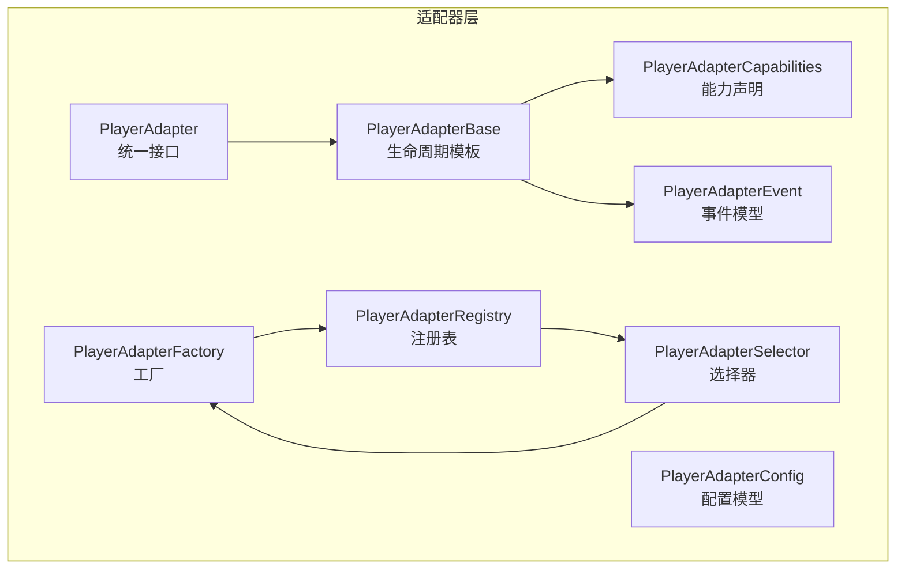
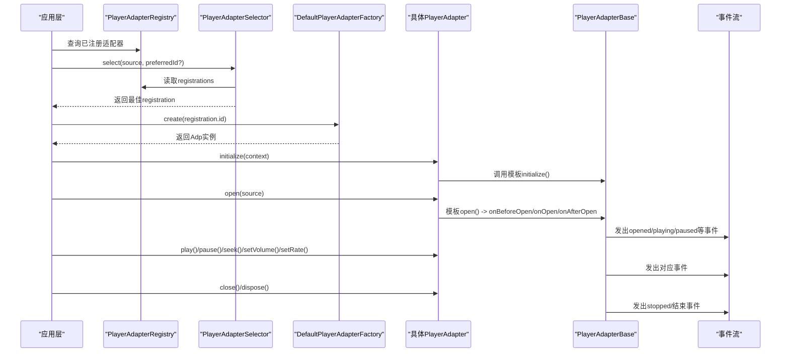
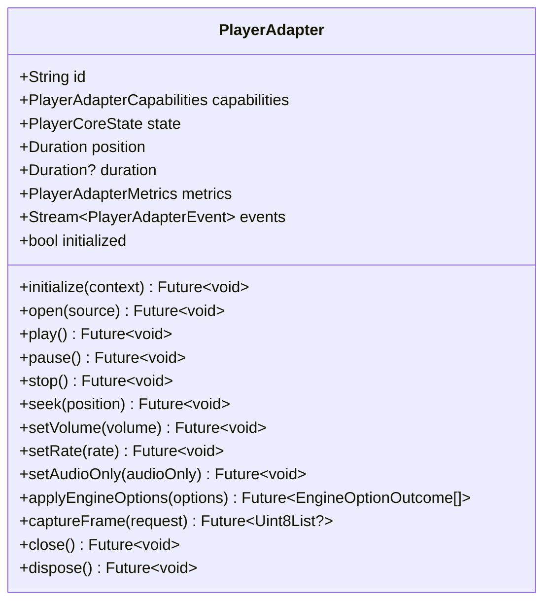
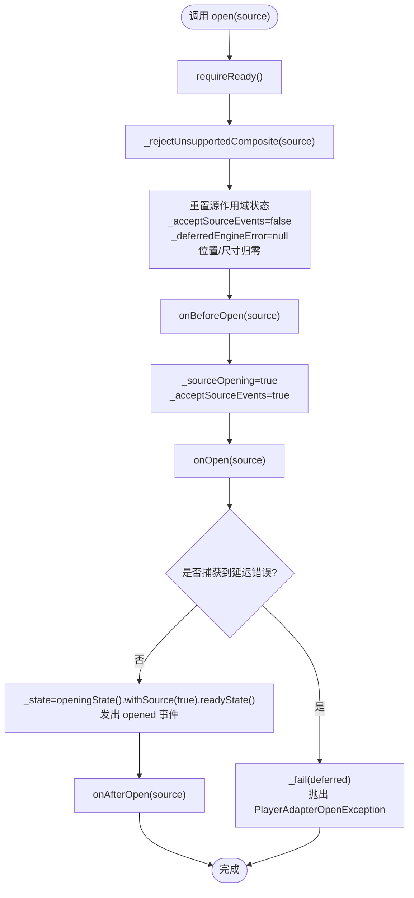
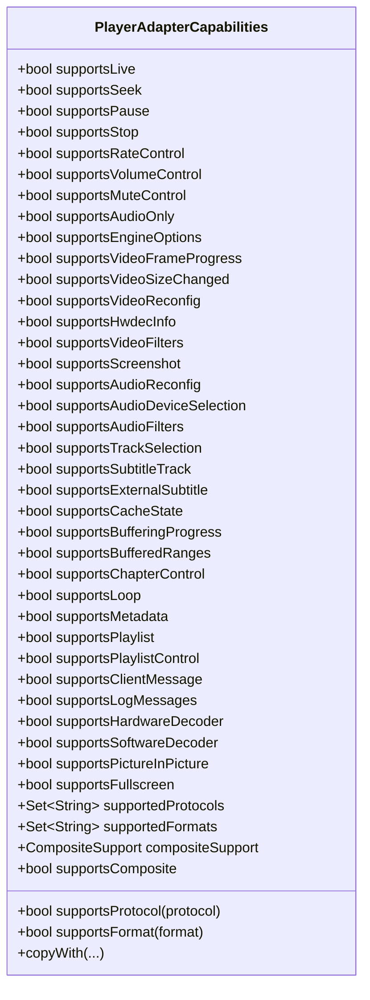
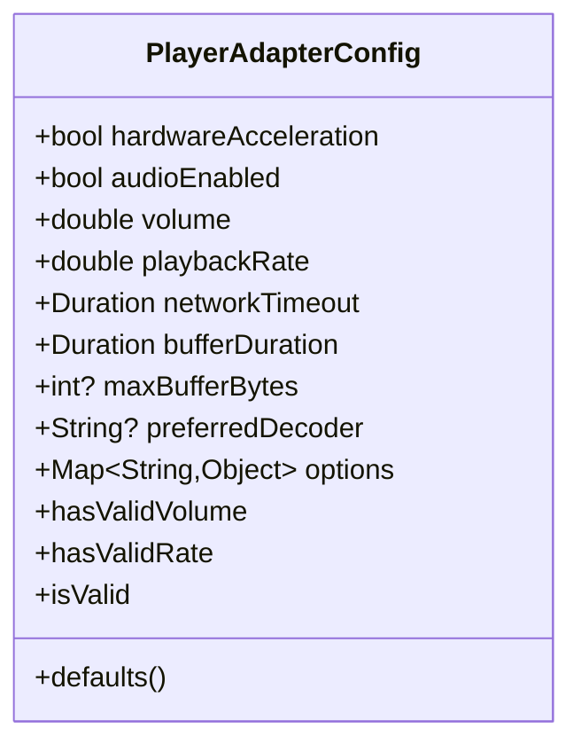
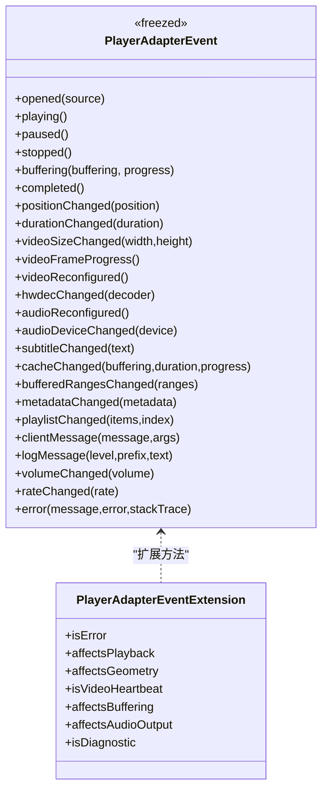
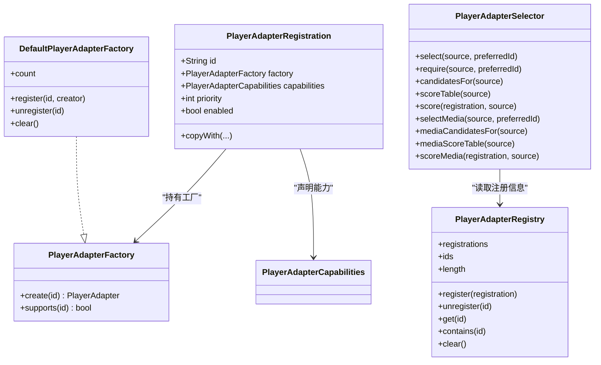
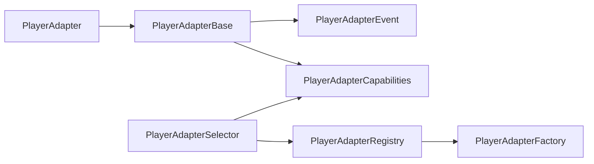

# 适配器核心概念

<cite>
**本文引用的文件**   
- [packages/media_core/lib/adapter/player_adapter.dart](file://packages/media_core/lib/adapter/player_adapter.dart)
- [packages/media_core/lib/adapter/player_adapter_base.dart](file://packages/media_core/lib/adapter/player_adapter_base.dart)
- [packages/media_core/lib/adapter/player_adapter_capabilities.dart](file://packages/media_core/lib/adapter/player_adapter_capabilities.dart)
- [packages/media_core/lib/adapter/player_adapter_config.dart](file://packages/media_core/lib/adapter/player_adapter_config.dart)
- [packages/media_core/lib/adapter/player_adapter_factory.dart](file://packages/media_core/lib/adapter/player_adapter_factory.dart)
- [packages/media_core/lib/adapter/player_adapter_registry.dart](file://packages/media_core/lib/adapter/player_adapter_registry.dart)
- [packages/media_core/lib/adapter/player_adapter_selector.dart](file://packages/media_core/lib/adapter/player_adapter_selector.dart)
- [packages/media_core/lib/adapter/player_adapter_event.dart](file://packages/media_core/lib/adapter/player_adapter_event.dart)
- [doc/zh-Hans/adapter.md](file://doc/zh-Hans/adapter.md)
</cite>

## 目录
1. [引言](#引言)
2. [项目结构](#项目结构)
3. [核心组件](#核心组件)
4. [架构总览](#架构总览)
5. [详细组件分析](#详细组件分析)
6. [依赖关系分析](#依赖关系分析)
7. [性能与资源管理](#性能与资源管理)
8. [故障排查指南](#故障排查指南)
9. [结论](#结论)
10. [附录：完整适配器实现流程示例](#附录完整适配器实现流程示例)

## 引言
本文件聚焦 Media Core 的“适配器核心概念”，围绕统一播放器后端抽象、生命周期模板、能力声明、配置模型、状态与事件流、错误处理策略，以及开发最佳实践展开。目标是帮助读者理解 PlayerAdapter 统一接口的设计理念与扩展方式，掌握 PlayerAdapterBase 的实现模式与钩子点，学会通过 PlayerAdapterCapabilities 声明协议、格式、硬件加速等能力，并通过 PlayerAdapterConfig 封装引擎特定参数；同时提供从注册到选择、打开、播放、关闭、释放的端到端流程图和排障建议。

## 项目结构
Media Core 在 packages/media_core 下以 adapter 为核心模块，负责定义统一的播放器后端契约、工厂、注册表、选择器、能力描述、事件与配置等。文档 zh-Hans/adapter.md 对该模块的职责、API 与设计原则做了概述。

图示来源
- [packages/media_core/lib/adapter/player_adapter.dart:41-133](file://packages/media_core/lib/adapter/player_adapter.dart#L41-L133)
- [packages/media_core/lib/adapter/player_adapter_base.dart:22-83](file://packages/media_core/lib/adapter/player_adapter_base.dart#L22-L83)
- [packages/media_core/lib/adapter/player_adapter_capabilities.dart:6-40](file://packages/media_core/lib/adapter/player_adapter_capabilities.dart#L6-L40)
- [packages/media_core/lib/adapter/player_adapter_config.dart:5-29](file://packages/media_core/lib/adapter/player_adapter_config.dart#L5-L29)
- [packages/media_core/lib/adapter/player_adapter_event.dart:7-29](file://packages/media_core/lib/adapter/player_adapter_event.dart#L7-L29)
- [packages/media_core/lib/adapter/player_adapter_factory.dart:3-30](file://packages/media_core/lib/adapter/player_adapter_factory.dart#L3-L30)
- [packages/media_core/lib/adapter/player_adapter_registry.dart:4-26](file://packages/media_core/lib/adapter/player_adapter_registry.dart#L4-L26)
- [packages/media_core/lib/adapter/player_adapter_selector.dart:12-36](file://packages/media_core/lib/adapter/player_adapter_selector.dart#L12-L36)

章节来源
- [doc/zh-Hans/adapter.md:1-33](file://doc/zh-Hans/adapter.md#L1-L33)

## 核心组件
- PlayerAdapter：统一的后端抽象接口，定义 open/play/pause/stop/seek/setVolume/setRate/captureFrame/close/dispose 等控制方法，并暴露 state/events/metrics/capabilities。
- PlayerAdapterBase：模板方法基类，封装事件流、状态机、生命周期守卫、源作用域事件门控、错误归一化与能力门控，具体适配器只需实现 onInitialize/onOpen/onPlay 等钩子。
- PlayerAdapterCapabilities：静态能力描述对象，声明直播、seek、PiP、硬解、支持的协议与格式、缓冲范围、截图、音视频重配等能力，是能力选择的唯一事实来源。
- PlayerAdapterConfig：后端无关的配置模型，包含硬件加速、音量、速率、网络超时、缓冲时长、最大缓冲字节、首选解码器及引擎选项等。
- PlayerAdapterEvent：后端事件的闭集（freezed），包括 opened/playing/paused/buffering/completed/position/duration/videoSize/hwdec/audio/reconfig/subtitle/cache/ranges/metadata/playlist/clientMessage/logMessage/volume/rate/error 等。
- PlayerAdapterFactory / DefaultPlayerAdapterFactory：按 id 创建适配器实例，隐藏具体实现细节。
- PlayerAdapterRegistry / PlayerAdapterRegistration：存储适配器元数据（id、factory、capabilities、priority、enabled），只负责查找。
- PlayerAdapterSelector：依据能力（live/seek/协议/格式）与优先级为 SourceDescriptor/MediaSource 选出最佳适配器，并提供候选顺序与评分明细。

章节来源
- [packages/media_core/lib/adapter/player_adapter.dart:12-40](file://packages/media_core/lib/adapter/player_adapter.dart#L12-L40)
- [packages/media_core/lib/adapter/player_adapter_base.dart:22-83](file://packages/media_core/lib/adapter/player_adapter_base.dart#L22-L83)
- [packages/media_core/lib/adapter/player_adapter_capabilities.dart:6-40](file://packages/media_core/lib/adapter/player_adapter_capabilities.dart#L6-L40)
- [packages/media_core/lib/adapter/player_adapter_config.dart:5-29](file://packages/media_core/lib/adapter/player_adapter_config.dart#L5-L29)
- [packages/media_core/lib/adapter/player_adapter_event.dart:7-29](file://packages/media_core/lib/adapter/player_adapter_event.dart#L7-L29)
- [packages/media_core/lib/adapter/player_adapter_factory.dart:3-30](file://packages/media_core/lib/adapter/player_adapter_factory.dart#L3-L30)
- [packages/media_core/lib/adapter/player_adapter_registry.dart:4-26](file://packages/media_core/lib/adapter/player_adapter_registry.dart#L4-L26)
- [packages/media_core/lib/adapter/player_adapter_selector.dart:12-36](file://packages/media_core/lib/adapter/player_adapter_selector.dart#L12-L36)

## 架构总览
下图展示从“注册与选择”到“生命周期与事件”的整体协作关系。

图示来源
- [packages/media_core/lib/adapter/player_adapter_registry.dart:26-82](file://packages/media_core/lib/adapter/player_adapter_registry.dart#L26-L82)
- [packages/media_core/lib/adapter/player_adapter_selector.dart:48-114](file://packages/media_core/lib/adapter/player_adapter_selector.dart#L48-L114)
- [packages/media_core/lib/adapter/player_adapter_factory.dart:52-93](file://packages/media_core/lib/adapter/player_adapter_factory.dart#L52-L93)
- [packages/media_core/lib/adapter/player_adapter_base.dart:183-261](file://packages/media_core/lib/adapter/player_adapter_base.dart#L183-L261)
- [packages/media_core/lib/adapter/player_adapter_event.dart:31-184](file://packages/media_core/lib/adapter/player_adapter_event.dart#L31-L184)

## 详细组件分析

### PlayerAdapter 统一接口
- 设计目标：屏蔽 media_kit、native、ffmpeg、platform 等不同后端的差异，向上暴露一致的播放控制 API 与状态/事件/指标/能力视图。
- 关键职责：控制后端、暴露后端事件、提供后端状态；不负责选择后端、创建实例或降级处理。
- 典型方法：initialize/open/play/pause/stop/seek/setVolume/setRate/setAudioOnly/applyEngineOptions/captureFrame/close/dispose。

图示来源
- [packages/media_core/lib/adapter/player_adapter.dart:41-133](file://packages/media_core/lib/adapter/player_adapter.dart#L41-L133)

章节来源
- [packages/media_core/lib/adapter/player_adapter.dart:12-40](file://packages/media_core/lib/adapter/player_adapter.dart#L12-L40)
- [packages/media_core/lib/adapter/player_adapter.dart:41-133](file://packages/media_core/lib/adapter/player_adapter.dart#L41-L133)

### PlayerAdapterBase 抽象基类与生命周期模板
- 模板方法：onInitialize/onBeforeOpen/onOpen/onAfterOpen/onPlay/onPause/onStop/onSeek/onSetVolume/onSetRate/onSetAudioOnly/onCaptureFrame/onClose/onDispose。
- 生命周期守卫：requireReady 确保命令仅在初始化且未释放时执行；gatesSourceEvents 控制源作用域事件门控；engineReportsOpenFailure 决定打开窗口内延迟错误的处理策略。
- 事件门控与能力门控：emit* 系列方法区分“信号发射”（如 videoFrameProgress、videoSizeChanged、buffering progress）与“事实发射”（如 playing、paused、completed、positionChanged）。信号发射受 capabilities 字段门控，事实发射不受门控。
- 错误处理：reportEngineError/fail 将引擎错误归一化为 PlayerError，并在打开窗口期间延迟上报，避免早期异步回调污染 open 结果。
- 指标更新：updateMetrics 允许替换指标快照；emitEvent 提供直接发布自定义事件的出口。

图示来源
- [packages/media_core/lib/adapter/player_adapter_base.dart:193-261](file://packages/media_core/lib/adapter/player_adapter_base.dart#L193-L261)
- [packages/media_core/lib/adapter/player_adapter_base.dart:536-550](file://packages/media_core/lib/adapter/player_adapter_base.dart#L536-L550)
- [packages/media_core/lib/adapter/player_adapter_base.dart:801-814](file://packages/media_core/lib/adapter/player_adapter_base.dart#L801-L814)

章节来源
- [packages/media_core/lib/adapter/player_adapter_base.dart:22-83](file://packages/media_core/lib/adapter/player_adapter_base.dart#L22-L83)
- [packages/media_core/lib/adapter/player_adapter_base.dart:183-261](file://packages/media_core/lib/adapter/player_adapter_base.dart#L183-L261)
- [packages/media_core/lib/adapter/player_adapter_base.dart:552-558](file://packages/media_core/lib/adapter/player_adapter_base.dart#L552-L558)
- [packages/media_core/lib/adapter/player_adapter_base.dart:560-639](file://packages/media_core/lib/adapter/player_adapter_base.dart#L560-L639)
- [packages/media_core/lib/adapter/player_adapter_base.dart:654-754](file://packages/media_core/lib/adapter/player_adapter_base.dart#L654-L754)
- [packages/media_core/lib/adapter/player_adapter_base.dart:756-851](file://packages/media_core/lib/adapter/player_adapter_base.dart#L756-L851)

### PlayerAdapterCapabilities 能力声明机制
- 单一事实来源：所有 supportsXxx 标志仅存在于该对象中，其他层不得重复声明。
- 保守默认值：除 supportsSoftwareDecoder 默认为 true 外，其余能力默认 false，必须显式 opt-in。
- 能力分类：
  - 核心播放：supportsLive/supportsSeek/supportsPause/supportsStop/supportsRateControl/supportsVolumeControl/supportsMuteControl/supportsAudioOnly/supportsEngineOptions
  - 视频与渲染：supportsVideoFrameProgress/supportsVideoSizeChanged/supportsVideoReconfig/supportsHwdecInfo/supportsVideoFilters/supportsScreenshot
  - 音频：supportsAudioReconfig/supportsAudioDeviceSelection/supportsAudioFilters
  - 轨道与字幕：supportsTrackSelection/supportsSubtitleTrack/supportsExternalSubtitle
  - 缓冲与状态：supportsCacheState/supportsBufferingProgress/supportsBufferedRanges/supportsChapterControl/supportsLoop
  - 元数据与播放列表：supportsMetadata/supportsPlaylist/supportsPlaylistControl
  - 诊断与集成：supportsClientMessage/supportsLogMessages
  - 解码器：supportsHardwareDecoder/supportsSoftwareDecoder
  - 呈现：supportsPictureInPicture/supportsFullscreen
  - 源匹配：supportedProtocols/supportedFormats/compositeSupport
- 协议与格式匹配：supportsProtocol/supportedFormat 支持大小写不敏感匹配，结合 SourceProtocol/SourceFormat 与 URI scheme/extension 进行多路径匹配。
- 复合源支持：compositeSupport 枚举 native/external-audio/none，影响选择器对 CompositeMediaSource 的加分策略。

图示来源
- [packages/media_core/lib/adapter/player_adapter_capabilities.dart:40-103](file://packages/media_core/lib/adapter/player_adapter_capabilities.dart#L40-L103)
- [packages/media_core/lib/adapter/player_adapter_capabilities.dart:349-403](file://packages/media_core/lib/adapter/player_adapter_capabilities.dart#L349-L403)
- [packages/media_core/lib/adapter/player_adapter_capabilities.dart:405-486](file://packages/media_core/lib/adapter/player_adapter_capabilities.dart#L405-L486)

章节来源
- [packages/media_core/lib/adapter/player_adapter_capabilities.dart:6-40](file://packages/media_core/lib/adapter/player_adapter_capabilities.dart#L6-L40)
- [packages/media_core/lib/adapter/player_adapter_capabilities.dart:40-103](file://packages/media_core/lib/adapter/player_adapter_capabilities.dart#L40-L103)
- [packages/media_core/lib/adapter/player_adapter_capabilities.dart:349-403](file://packages/media_core/lib/adapter/player_adapter_capabilities.dart#L349-L403)
- [packages/media_core/lib/adapter/player_adapter_capabilities.dart:405-486](file://packages/media_core/lib/adapter/player_adapter_capabilities.dart#L405-L486)

### PlayerAdapterConfig 配置模型
- 后端无关的初始化选项：hardwareAcceleration、audioEnabled、volume、playbackRate、networkTimeout、bufferDuration、maxBufferBytes、preferredDecoder、options。
- 校验扩展：hasValidVolume/hasValidRate/isValid 保证音量、速率、超时与缓冲时长合法。
- 使用建议：由上层根据业务需求构造，再由具体适配器映射到底层引擎参数。

图示来源
- [packages/media_core/lib/adapter/player_adapter_config.dart:30-65](file://packages/media_core/lib/adapter/player_adapter_config.dart#L30-L65)
- [packages/media_core/lib/adapter/player_adapter_config.dart:73-89](file://packages/media_core/lib/adapter/player_adapter_config.dart#L73-L89)

章节来源
- [packages/media_core/lib/adapter/player_adapter_config.dart:5-29](file://packages/media_core/lib/adapter/player_adapter_config.dart#L5-L29)
- [packages/media_core/lib/adapter/player_adapter_config.dart:30-65](file://packages/media_core/lib/adapter/player_adapter_config.dart#L30-L65)
- [packages/media_core/lib/adapter/player_adapter_config.dart:73-89](file://packages/media_core/lib/adapter/player_adapter_config.dart#L73-L89)

### 事件模型与扩展
- 事件类型：opened/playing/paused/stopped/buffering/completed/positionChanged/durationChanged/videoSizeChanged/videoFrameProgress/videoReconfigured/hwdecChanged/audioReconfigured/audioDeviceChanged/subtitleChanged/cacheChanged/bufferedRangesChanged/metadataChanged/playlistChanged/clientMessage/logMessage/volumeChanged/rateChanged/error。
- 扩展判定：isError/affectsPlayback/affectsGeometry/isVideoHeartbeat/affectsBuffering/affectsAudioOutput/isDiagnostic 便于上层快速分类处理。

图示来源
- [packages/media_core/lib/adapter/player_adapter_event.dart:29-184](file://packages/media_core/lib/adapter/player_adapter_event.dart#L29-L184)
- [packages/media_core/lib/adapter/player_adapter_event.dart:186-227](file://packages/media_core/lib/adapter/player_adapter_event.dart#L186-L227)

章节来源
- [packages/media_core/lib/adapter/player_adapter_event.dart:7-29](file://packages/media_core/lib/adapter/player_adapter_event.dart#L7-L29)
- [packages/media_core/lib/adapter/player_adapter_event.dart:29-184](file://packages/media_core/lib/adapter/player_adapter_event.dart#L29-L184)
- [packages/media_core/lib/adapter/player_adapter_event.dart:186-227](file://packages/media_core/lib/adapter/player_adapter_event.dart#L186-L227)

### 工厂、注册表与选择器
- 工厂：PlayerAdapterFactory 抽象出 create/supprts，DefaultPlayerAdapterFactory 维护 creators 映射，支持 register/unregister/clear/count。
- 注册表：PlayerAdapterRegistry 维护 registration 映射，禁止空 id，提供 get/contains/registrations/ids/length/clear。
- 选择器：PlayerAdapterSelector 基于 registration.capabilities 与 source 特征（protocol/format/live/composite）打分，支持 preferredId 强制偏好，输出候选排序与评分明细。

图示来源
- [packages/media_core/lib/adapter/player_adapter_factory.dart:30-93](file://packages/media_core/lib/adapter/player_adapter_factory.dart#L30-L93)
- [packages/media_core/lib/adapter/player_adapter_registry.dart:26-148](file://packages/media_core/lib/adapter/player_adapter_registry.dart#L26-L148)
- [packages/media_core/lib/adapter/player_adapter_selector.dart:36-114](file://packages/media_core/lib/adapter/player_adapter_selector.dart#L36-L114)
- [packages/media_core/lib/adapter/player_adapter_selector.dart:192-254](file://packages/media_core/lib/adapter/player_adapter_selector.dart#L192-L254)
- [packages/media_core/lib/adapter/player_adapter_selector.dart:276-464](file://packages/media_core/lib/adapter/player_adapter_selector.dart#L276-L464)

章节来源
- [packages/media_core/lib/adapter/player_adapter_factory.dart:3-30](file://packages/media_core/lib/adapter/player_adapter_factory.dart#L3-L30)
- [packages/media_core/lib/adapter/player_adapter_factory.dart:52-93](file://packages/media_core/lib/adapter/player_adapter_factory.dart#L52-L93)
- [packages/media_core/lib/adapter/player_adapter_registry.dart:4-26](file://packages/media_core/lib/adapter/player_adapter_registry.dart#L4-L26)
- [packages/media_core/lib/adapter/player_adapter_registry.dart:26-148](file://packages/media_core/lib/adapter/player_adapter_registry.dart#L26-L148)
- [packages/media_core/lib/adapter/player_adapter_selector.dart:12-36](file://packages/media_core/lib/adapter/player_adapter_selector.dart#L12-L36)
- [packages/media_core/lib/adapter/player_adapter_selector.dart:48-114](file://packages/media_core/lib/adapter/player_adapter_selector.dart#L48-L114)
- [packages/media_core/lib/adapter/player_adapter_selector.dart:192-254](file://packages/media_core/lib/adapter/player_adapter_selector.dart#L192-L254)
- [packages/media_core/lib/adapter/player_adapter_selector.dart:276-464](file://packages/media_core/lib/adapter/player_adapter_selector.dart#L276-L464)

## 依赖关系分析
- 耦合与内聚：
  - PlayerAdapter 与 PlayerAdapterBase 高内聚，后者承担生命周期与事件门控，前者保持薄接口。
  - PlayerAdapterCapabilities 作为能力声明的唯一事实来源，被 Base、Selector、Registry 共同消费，降低重复声明风险。
  - Factory/Registry/Selector 三者职责清晰：Factory 创建、Registry 存储、Selector 决策。
- 外部依赖：
  - freezed/equatable 用于不可变值对象与事件模型。
  - core/source 提供 PlayerCoreState、PlayerSource、MediaSource 等上游模型。
- 循环依赖：未发现明显循环依赖；Selector 依赖 Registry/Capabilities，Base 依赖 Event/Metrics/State，均单向。

图示来源
- [packages/media_core/lib/adapter/player_adapter_base.dart:22-83](file://packages/media_core/lib/adapter/player_adapter_base.dart#L22-L83)
- [packages/media_core/lib/adapter/player_adapter_selector.dart:36-114](file://packages/media_core/lib/adapter/player_adapter_selector.dart#L36-L114)
- [packages/media_core/lib/adapter/player_adapter_registry.dart:26-82](file://packages/media_core/lib/adapter/player_adapter_registry.dart#L26-L82)
- [packages/media_core/lib/adapter/player_adapter_factory.dart:30-93](file://packages/media_core/lib/adapter/player_adapter_factory.dart#L30-L93)

## 性能与资源管理
- 事件去重与门控：
  - emitVideoSizeChangedIfChanged 对几何变化做去重，减少 UI 抖动。
  - gatesSourceEvents 防止上一个源的晚期事件泄漏到下一个源。
- 能力门控：
  - 信号发射（如 buffering progress、videoFrameProgress、videoSizeChanged）受 capabilities 门控，避免无能力的后端误报。
- 指标更新：
  - updateMetrics 允许原子替换指标快照，避免中间态。
- 资源清理：
  - dispose 设置 disposed 标记，关闭事件流，确保后续命令被拒绝。
- 性能优化建议：
  - 仅在声明 supportsVideoFrameProgress 时高频触发心跳，避免不必要的帧级事件。
  - 合理设置 bufferDuration/maxBufferBytes，平衡首开时间与内存占用。
  - 使用 applyEngineOptions 在引擎存在时批量下发底层参数，减少多次切换开销。

章节来源
- [packages/media_core/lib/adapter/player_adapter_base.dart:709-727](file://packages/media_core/lib/adapter/player_adapter_base.dart#L709-L727)
- [packages/media_core/lib/adapter/player_adapter_base.dart:154-169](file://packages/media_core/lib/adapter/player_adapter_base.dart#L154-L169)
- [packages/media_core/lib/adapter/player_adapter_base.dart:617-639](file://packages/media_core/lib/adapter/player_adapter_base.dart#L617-L639)
- [packages/media_core/lib/adapter/player_adapter_base.dart:820-824](file://packages/media_core/lib/adapter/player_adapter_base.dart#L820-L824)
- [packages/media_core/lib/adapter/player_adapter_base.dart:442-457](file://packages/media_core/lib/adapter/player_adapter_base.dart#L442-L457)

## 故障排查指南
- 打开失败：
  - open 内部会捕获异常并归一化为 PlayerError，若发生在打开窗口期间则延迟上报，最终通过 PlayerAdapterOpenException 暴露给调用方。
  - 检查 engineReportsOpenFailure 与 _deferredEngineError 的处理逻辑，确认引擎是否在打开阶段报告了健康状态。
- 命令非法状态：
  - requireReady 在未初始化或已释放时抛出 StateError，确保命令安全。
- 能力不一致：
  - 若调用了 setAudioOnly/applyEngineOptions/captureFrame 但未声明对应 capability，调试构建会断言失败，发布构建会静默忽略。
- 事件丢失：
  - 检查 gatesSourceEvents 与 _acceptSourceEvents 的状态，确认事件是否被源作用域门控丢弃。
- 复合源不支持：
  - _rejectUnsupportedComposite 会在适配器声明 compositeSupport:none 却收到 CompositeMediaSource 时抛出 UnsupportedError。

章节来源
- [packages/media_core/lib/adapter/player_adapter_base.dart:193-261](file://packages/media_core/lib/adapter/player_adapter_base.dart#L193-L261)
- [packages/media_core/lib/adapter/player_adapter_base.dart:536-550](file://packages/media_core/lib/adapter/player_adapter_base.dart#L536-L550)
- [packages/media_core/lib/adapter/player_adapter_base.dart:552-558](file://packages/media_core/lib/adapter/player_adapter_base.dart#L552-L558)
- [packages/media_core/lib/adapter/player_adapter_base.dart:321-346](file://packages/media_core/lib/adapter/player_adapter_base.dart#L321-L346)
- [packages/media_core/lib/adapter/player_adapter_base.dart:362-381](file://packages/media_core/lib/adapter/player_adapter_base.dart#L362-L381)
- [packages/media_core/lib/adapter/player_adapter_base.dart:417-424](file://packages/media_core/lib/adapter/player_adapter_base.dart#L417-L424)
- [packages/media_core/lib/adapter/player_adapter_base.dart:801-814](file://packages/media_core/lib/adapter/player_adapter_base.dart#L801-L814)

## 结论
Media Core 的适配器体系通过 PlayerAdapter 统一接口、PlayerAdapterBase 生命周期模板、PlayerAdapterCapabilities 能力声明、PlayerAdapterConfig 配置模型，以及 Factory/Registry/Selector 的组合，实现了后端无关、可扩展、可观测、可选择的播放器适配框架。开发者只需关注引擎钩子与能力声明，即可接入任意后端并获得一致的生命周期、事件与错误语义。

## 附录：完整适配器实现流程示例
以下流程展示从零开始实现一个完整适配器的步骤（不含代码内容，仅提供路径指引）：

1. 定义适配器能力
   - 参考 PlayerAdapterCapabilities 的字段，构造一个最小但准确的 capabilities 实例。
   - 参考路径：[player_adapter_capabilities.dart:40-103](file://packages/media_core/lib/adapter/player_adapter_capabilities.dart#L40-L103)

2. 继承 PlayerAdapterBase
   - 实现 onInitialize/onOpen/onPlay/onPause/onStop/onSeek/onSetVolume/onSetRate/onClose/onDispose 等钩子。
   - 在 onAfterOpen 中按需应用 audioOnly 等运行时设置。
   - 参考路径：[player_adapter_base.dart:463-525](file://packages/media_core/lib/adapter/player_adapter_base.dart#L463-L525)

3. 使用 emit* 报告引擎事件
   - 使用 emitPlaying/emitPaused/emitCompleted/emitBuffering/emitPositionChanged/emitDurationChanged/emitVideoSizeChanged 等。
   - 仅在声明相应 capability 时发送信号型事件（如 buffering progress、videoFrameProgress）。
   - 参考路径：[player_adapter_base.dart:574-754](file://packages/media_core/lib/adapter/player_adapter_base.dart#L574-L754)

4. 处理错误
   - 通过 reportEngineError/fail 上报 PlayerError，避免直接抛异常破坏 open 语义。
   - 参考路径：[player_adapter_base.dart:790-814](file://packages/media_core/lib/adapter/player_adapter_base.dart#L790-L814)

5. 注册适配器
   - 使用 DefaultPlayerAdapterFactory.register 注册工厂函数。
   - 使用 PlayerAdapterRegistry.register 注册 registration（含 id/factory/capabilities/priority/enabled）。
   - 参考路径：[player_adapter_factory.dart:58-61](file://packages/media_core/lib/adapter/player_adapter_factory.dart#L58-L61)、[player_adapter_registry.dart:38-46](file://packages/media_core/lib/adapter/player_adapter_registry.dart#L38-L46)

6. 选择与创建
   - 使用 PlayerAdapterSelector.select/require 选择最佳适配器。
   - 通过工厂 create 获取实例，然后调用 initialize/open/play 等。
   - 参考路径：[player_adapter_selector.dart:48-114](file://packages/media_core/lib/adapter/player_adapter_selector.dart#L48-L114)、[player_adapter_factory.dart:63-72](file://packages/media_core/lib/adapter/player_adapter_factory.dart#L63-L72)

7. 配置与验证
   - 使用 PlayerAdapterConfig.defaults() 或自定义配置，调用 isValid 校验。
   - 参考路径：[player_adapter_config.dart:67-89](file://packages/media_core/lib/adapter/player_adapter_config.dart#L67-L89)

8. 关闭与释放
   - 调用 close 停止当前源，调用 dispose 释放资源并关闭事件流。
   - 参考路径：[player_adapter_base.dart:426-457](file://packages/media_core/lib/adapter/player_adapter_base.dart#L426-L457)