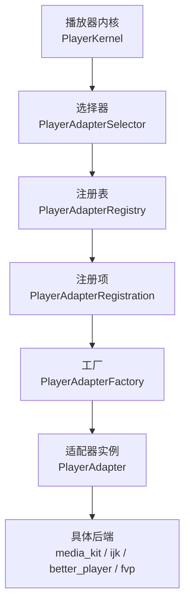
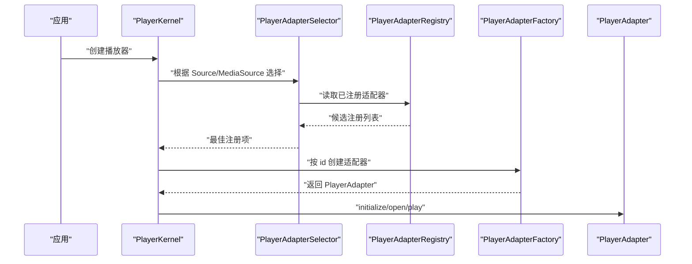
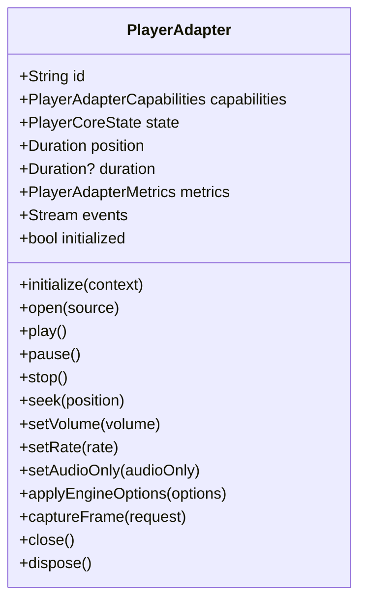
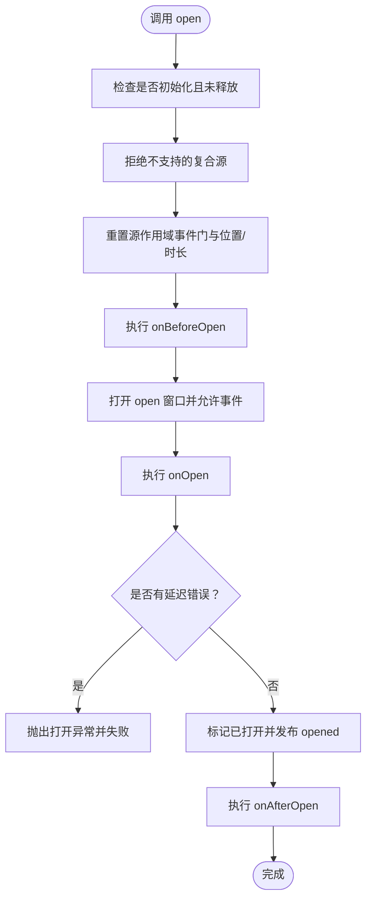
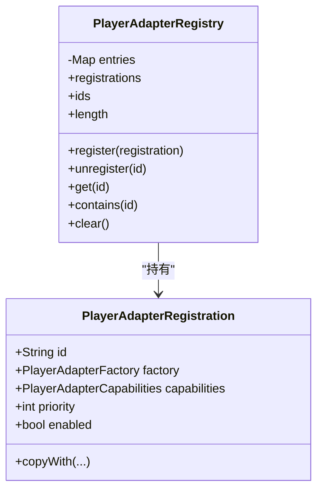
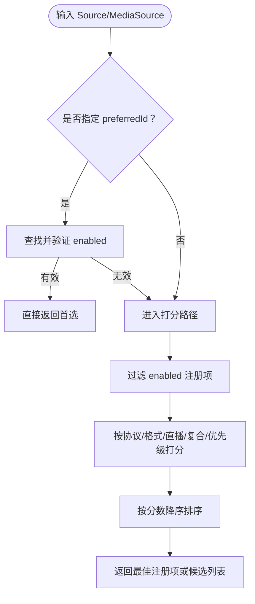
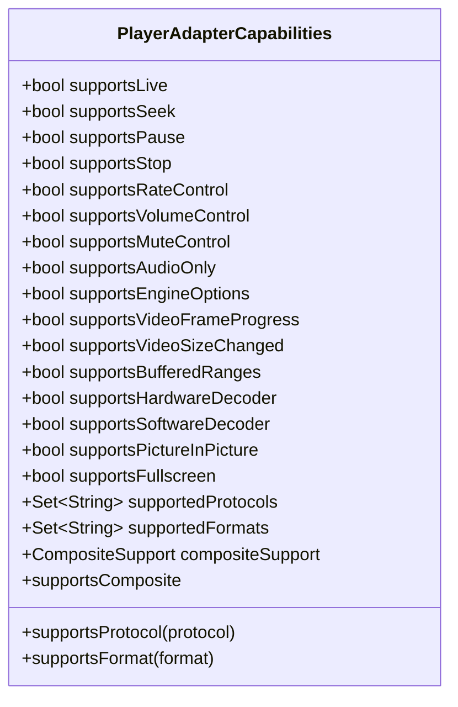
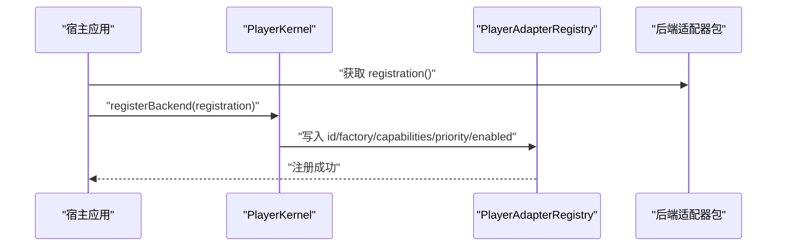
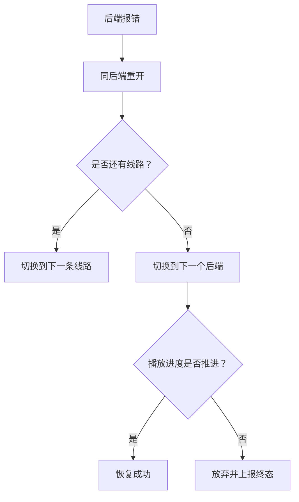
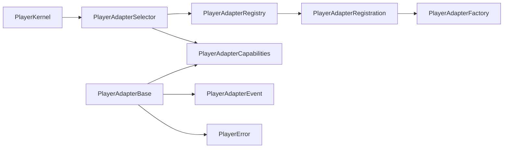

# 适配器系统

<cite>
**本文引用的文件**   
- [README.md](file://README.md)
- [adapter.md（简体中文）](file://doc/zh-Hans/adapter.md)
- [player_adapter.dart](file://packages/media_core/lib/adapter/player_adapter.dart)
- [player_adapter_base.dart](file://packages/media_core/lib/adapter/player_adapter_base.dart)
- [player_adapter_factory.dart](file://packages/media_core/lib/adapter/player_adapter_factory.dart)
- [player_adapter_registry.dart](file://packages/media_core/lib/adapter/player_adapter_registry.dart)
- [player_adapter_selector.dart](file://packages/media_core/lib/adapter/player_adapter_selector.dart)
- [player_adapter_capabilities.dart](file://packages/media_core/lib/adapter/player_adapter_capabilities.dart)
- [player_handle.dart](file://packages/media_core/lib/kernel/player_handle.dart)
- [composite_capability_test.dart](file://packages/media_core_better_player/test/composite_capability_test.dart)
- [better_player README.md](file://packages/media_core_better_player/README.md)
</cite>

## 目录
1. [引言](#引言)
2. [项目结构](#项目结构)
3. [核心组件](#核心组件)
4. [架构总览](#架构总览)
5. [详细组件分析](#详细组件分析)
6. [依赖关系分析](#依赖关系分析)
7. [性能与兼容性](#性能与兼容性)
8. [错误处理、日志与调试](#错误处理日志与调试)
9. [自定义适配器开发指南](#自定义适配器开发指南)
10. [结论](#结论)

## 引言
Media Core 的适配器系统把“播放引擎实现”和“上层编排逻辑”解耦：上层只面向统一的 `PlayerAdapter` 接口，具体后端通过工厂注册到注册表，再由选择器按协议、格式、直播能力与优先级打分选出最佳引擎。仓库明确支持 media_kit、ijk_player、better_player、fvp 四种后端，并通过 `PlayerAdapterCapabilities` 声明能力，避免“靠猜”。

本文件聚焦适配器抽象、注册表、选择策略、能力模型、四后端适配差异、错误恢复链路、日志与调试方法，以及从零实现自定义适配器的完整流程。

**章节来源**
- [README.md:55-157](file://README.md#L55-L157)
- [adapter.md（简体中文）:1-33](file://doc/zh-Hans/adapter.md#L1-L33)

## 项目结构
适配器系统位于 `packages/media_core/lib/adapter`，围绕五个关键文件组织：
- 接口层：`PlayerAdapter`
- 模板基类：`PlayerAdapterBase`
- 工厂层：`PlayerAdapterFactory` / `DefaultPlayerAdapterFactory`
- 注册表：`PlayerAdapterRegistry` / `PlayerAdapterRegistration`
- 选择器：`PlayerAdapterSelector`
- 能力模型：`PlayerAdapterCapabilities`

**图示来源**
- [player_adapter_selector.dart:12-41](file://packages/media_core/lib/adapter/player_adapter_selector.dart#L12-L41)
- [player_adapter_registry.dart:4-26](file://packages/media_core/lib/adapter/player_adapter_registry.dart#L4-L26)
- [player_adapter_factory.dart:3-30](file://packages/media_core/lib/adapter/player_adapter_factory.dart#L3-L30)
- [player_adapter.dart:12-41](file://packages/media_core/lib/adapter/player_adapter.dart#L12-L41)

**章节来源**
- [README.md:148-157](file://README.md#L148-L157)
- [adapter.md（简体中文）:5-21](file://doc/zh-Hans/adapter.md#L5-L21)

## 核心组件
- `PlayerAdapter`：统一播放引擎契约，定义生命周期、控制命令、状态、指标、事件、截图与能力暴露。
- `PlayerAdapterBase`：模板方法基类，封装事件流、状态机、源作用域事件门控、错误归一化、能力门控的 `emit*` 辅助方法。
- `PlayerAdapterFactory`：创建适配器实例；`DefaultPlayerAdapterFactory` 维护 id 到构造函数的映射。
- `PlayerAdapterRegistry`：存储注册元数据，提供增删查与全部注册列表。
- `PlayerAdapterRegistration`：包含 id、工厂、能力、优先级、启用状态。
- `PlayerAdapterSelector`：对 `PlayerSource` 或 `MediaSource` 打分，返回最佳候选或候选排序。
- `PlayerAdapterCapabilities`：静态能力描述，是后端能力的唯一来源。

**章节来源**
- [player_adapter.dart:12-133](file://packages/media_core/lib/adapter/player_adapter.dart#L12-L133)
- [player_adapter_base.dart:22-91](file://packages/media_core/lib/adapter/player_adapter_base.dart#L22-L91)
- [player_adapter_factory.dart:3-94](file://packages/media_core/lib/adapter/player_adapter_factory.dart#L3-L94)
- [player_adapter_registry.dart:4-149](file://packages/media_core/lib/adapter/player_adapter_registry.dart#L4-L149)
- [player_adapter_selector.dart:12-513](file://packages/media_core/lib/adapter/player_adapter_selector.dart#L12-L513)
- [player_adapter_capabilities.dart:6-103](file://packages/media_core/lib/adapter/player_adapter_capabilities.dart#L6-L103)

## 架构总览
Media Core 在创建播放器时，先由 `PlayerKernel` 驱动 `PlayerAdapterSelector` 从 `PlayerAdapterRegistry` 中选出最佳后端；运行时若失败，则进入恢复梯级：同后端重开 → 换线路 → 换后端 → 放弃。

**图示来源**
- [README.md:55-74](file://README.md#L55-L74)
- [player_handle.dart:782-803](file://packages/media_core/lib/kernel/player_handle.dart#L782-L803)
- [player_adapter_selector.dart:48-114](file://packages/media_core/lib/adapter/player_adapter_selector.dart#L48-L114)
- [player_adapter_registry.dart:32-66](file://packages/media_core/lib/adapter/player_adapter_registry.dart#L32-L66)
- [player_adapter_factory.dart:63-77](file://packages/media_core/lib/adapter/player_adapter_factory.dart#L63-L77)

**章节来源**
- [README.md:55-103](file://README.md#L55-L103)
- [player_handle.dart:782-803](file://packages/media_core/lib/kernel/player_handle.dart#L782-L803)

## 详细组件分析

### PlayerAdapter 接口规范
`PlayerAdapter` 是 Media Core 与具体播放引擎之间的唯一契约。它负责：
- 生命周期：`initialize`、`open`、`close`、`dispose`
- 播放控制：`play`、`pause`、`stop`、`seek`、`setVolume`、`setRate`
- 能力相关：`setAudioOnly`、`applyEngineOptions`、`captureFrame`
- 可观测性：`state`、`position`、`duration`、`metrics`、`events`、`capabilities`

该接口不处理后端选择、实例创建与降级，这些职责分别交给工厂、注册表与选择器。

**图示来源**
- [player_adapter.dart:41-133](file://packages/media_core/lib/adapter/player_adapter.dart#L41-L133)

**章节来源**
- [player_adapter.dart:12-133](file://packages/media_core/lib/adapter/player_adapter.dart#L12-L133)

### PlayerAdapterBase 模板基类
`PlayerAdapterBase` 为所有后端实现提供统一骨架：
- 生命周期钩子：`onInitialize`、`onBeforeOpen`、`onOpen`、`onAfterOpen`、`onPlay`、`onPause`、`onStop`、`onSeek`、`onSetVolume`、`onSetRate`、`onSetAudioOnly`、`onCaptureFrame`、`onClose`、`onDispose`
- 事件门控：区分“信号发射”与“事实发射”，前者受能力字段门控，后者直接发布
- 错误归一化：将引擎异常转换为 `PlayerError`，并在 open 窗口内延迟上报
- 复合源保护：拒绝 `CompositeSupport.none` 的后端接收复合媒体源

**图示来源**
- [player_adapter_base.dart:194-260](file://packages/media_core/lib/adapter/player_adapter_base.dart#L194-L260)
- [player_adapter_base.dart:536-550](file://packages/media_core/lib/adapter/player_adapter_base.dart#L536-L550)

**章节来源**
- [player_adapter_base.dart:22-91](file://packages/media_core/lib/adapter/player_adapter_base.dart#L22-L91)
- [player_adapter_base.dart:194-260](file://packages/media_core/lib/adapter/player_adapter_base.dart#L194-L260)
- [player_adapter_base.dart:536-550](file://packages/media_core/lib/adapter/player_adapter_base.dart#L536-L550)

### PlayerAdapterRegistry 注册表机制
注册表负责保存适配器元数据，不负责创建实例或选择最佳后端。关键行为：
- `register`：校验 id 非空后写入内部映射
- `unregister`、`get`、`contains`、`registrations`、`ids`、`clear`
- `PlayerAdapterRegistration`：保存 id、factory、capabilities、priority、enabled

注册表的“只存不选”设计让选择逻辑集中在 `PlayerAdapterSelector`。

**图示来源**
- [player_adapter_registry.dart:26-82](file://packages/media_core/lib/adapter/player_adapter_registry.dart#L26-L82)
- [player_adapter_registry.dart:90-149](file://packages/media_core/lib/adapter/player_adapter_registry.dart#L90-L149)

**章节来源**
- [player_adapter_registry.dart:4-149](file://packages/media_core/lib/adapter/player_adapter_registry.dart#L4-L149)

### PlayerAdapterSelector 智能选择策略
选择器根据 `PlayerSource` 或 `MediaSource` 计算候选分数，返回最佳注册项或候选排序。评分权重：
- 注册优先级：作为基础分
- 协议匹配：+40
- 格式匹配：+30
- 直播源且支持直播：+10
- 复合媒体源：native +60、externalAudio +40、none 不加
- 渐进式纯音频且支持 audioOnly：+10

选择器还支持显式 `preferredId`：只要对应注册存在且启用，就无条件优先。

**图示来源**
- [player_adapter_selector.dart:48-114](file://packages/media_core/lib/adapter/player_adapter_selector.dart#L48-L114)
- [player_adapter_selector.dart:192-209](file://packages/media_core/lib/adapter/player_adapter_selector.dart#L192-L209)
- [player_adapter_selector.dart:421-464](file://packages/media_core/lib/adapter/player_adapter_selector.dart#L421-L464)

**章节来源**
- [player_adapter_selector.dart:12-513](file://packages/media_core/lib/adapter/player_adapter_selector.dart#L12-L513)

### PlayerAdapterCapabilities 能力探测与协议格式判断
`PlayerAdapterCapabilities` 是后端能力的唯一来源，默认保守：除软件解码外，其他能力默认关闭。关键维度包括：
- 播放控制：直播、seek、暂停、停止、变速、音量、静音、audioOnly、引擎选项
- 视频与渲染：帧进度、尺寸变化、重配置、硬解信息、滤镜、截图
- 音频：输出重配置、设备选择、滤镜
- 轨道与字幕：轨道选择、字幕轨道、外部字幕
- 缓冲与状态：缓存状态、缓冲进度、缓冲区间、章节、循环
- 元数据与播放列表：元数据、播放列表、播放列表控制
- 诊断：客户端消息、后端日志
- 解码器：硬件解码、软件解码
- 呈现：画中画、全屏
- 源匹配：协议集合、格式集合、复合支持模式

协议与格式匹配同时考虑枚举名称与 URI scheme/扩展名，以兼容未知协议或未建模容器。

**图示来源**
- [player_adapter_capabilities.dart:40-103](file://packages/media_core/lib/adapter/player_adapter_capabilities.dart#L40-L103)
- [player_adapter_capabilities.dart:349-403](file://packages/media_core/lib/adapter/player_adapter_capabilities.dart#L349-L403)

**章节来源**
- [player_adapter_capabilities.dart:6-103](file://packages/media_core/lib/adapter/player_adapter_capabilities.dart#L6-L103)
- [player_adapter_capabilities.dart:349-403](file://packages/media_core/lib/adapter/player_adapter_capabilities.dart#L349-L403)

### 四种后端引擎特点、适用场景与配置
仓库文档给出四个后端包及其工厂：
- `media_core_media_kit`：`MediaKitAdapterFactory`，协议/格式覆盖最广，默认首选，自带解码策略
- `media_core_ijk_player`：`IjkPlayerAdapterFactory`，FLV/H.265，移动端
- `media_core_better_player`：`BetterPlayerAdapterFactory`，轻量、纯 Flutter 生态
- `media_core_fvp`：`FvpAdapterFactory`，另一条桌面/移动解码路径

注册方式统一：`kernel.registerBackend(const XxxAdapterFactory().registration())`。

**章节来源**
- [README.md:148-157](file://README.md#L148-L157)

### 适配器注册流程
典型注册流程：
1. 宿主引入后端包
2. 获取后端工厂的 `registration()`
3. 调用 `PlayerKernel.registerBackend(...)`
4. 选择器从注册表中读取能力、优先级与启用状态进行打分
5. 内核通过工厂创建适配器实例并进入生命周期

**图示来源**
- [README.md:148-157](file://README.md#L148-L157)
- [player_adapter_registry.dart:32-46](file://packages/media_core/lib/adapter/player_adapter_registry.dart#L32-L46)

**章节来源**
- [README.md:148-157](file://README.md#L148-L157)
- [player_adapter_registry.dart:32-46](file://packages/media_core/lib/adapter/player_adapter_registry.dart#L32-L46)

### 能力探测机制与复合源选择
选择器不仅看协议和格式，还会根据 `CompositeSupport` 决定复合媒体源的适配倾向：
- `native`：原生合并，适合能内部合成多轨的后端
- `externalAudio`：主视频走主 URL，额外音频走侧通道
- `none`：单 URL 引擎，不能消费复合源

测试用例表明，当存在 externalAudio 能力时，选择器会偏好具备该能力的后端，而不是仅凭数字优先级误判。

**章节来源**
- [player_adapter_selector.dart:421-464](file://packages/media_core/lib/adapter/player_adapter_selector.dart#L421-L464)
- [composite_capability_test.dart:44-71](file://packages/media_core_better_player/test/composite_capability_test.dart#L44-L71)

### 恢复链路与换后端
恢复决策点不在适配器层，而在内核的恢复梯级。换后端前会刷新签名 URL，并确保播放进度真正推进才算成功。

**图示来源**
- [README.md:92-103](file://README.md#L92-L103)
- [player_handle.dart:782-803](file://packages/media_core/lib/kernel/player_handle.dart#L782-L803)

**章节来源**
- [README.md:92-103](file://README.md#L92-L103)
- [player_handle.dart:782-803](file://packages/media_core/lib/kernel/player_handle.dart#L782-L803)

## 依赖关系分析
适配器系统的依赖方向清晰：
- 选择器依赖注册表与能力模型
- 注册表依赖工厂接口
- 基类依赖能力模型、事件、错误模型、截图请求
- 内核通过选择器和注册表间接依赖具体后端

**图示来源**
- [player_adapter_selector.dart:1-10](file://packages/media_core/lib/adapter/player_adapter_selector.dart#L1-L10)
- [player_adapter_registry.dart:1-3](file://packages/media_core/lib/adapter/player_adapter_registry.dart#L1-L3)
- [player_adapter_base.dart:1-20](file://packages/media_core/lib/adapter/player_adapter_base.dart#L1-L20)

**章节来源**
- [player_adapter_selector.dart:1-10](file://packages/media_core/lib/adapter/player_adapter_selector.dart#L1-L10)
- [player_adapter_registry.dart:1-3](file://packages/media_core/lib/adapter/player_adapter_registry.dart#L1-L3)
- [player_adapter_base.dart:1-20](file://packages/media_core/lib/adapter/player_adapter_base.dart#L1-L20)

## 性能与兼容性

### 后端对比与适用场景
- media_kit：协议/格式覆盖最广，默认首选，适合需要广泛协议与解码策略的场景
- ijk_player：FLV/H.265，适合移动端 FLV 场景
- better_player：轻量、纯 Flutter 生态，适合简单播放需求
- fvp：另一条解码路径，适合桌面/移动多后端组合

**章节来源**
- [README.md:148-157](file://README.md#L148-L157)

### 平台支持与限制
- 播放：四个后端均可用
- 系统媒体面：通知/锁屏/SMTC/MPRIS
- 能力探针：硬解/设备/系统特性
- PiP：Android/iOS/macOS/Linux 有不同支持程度

**章节来源**
- [README.md:159-168](file://README.md#L159-L168)

### better_player 注意事项
- 缓冲抖动不出门：避免频繁 pause/play 导致下游重建
- 释放要强制：确保原生资源释放，避免引擎切换冲突
- 去重：同一原生失败可能以多种消息出现，适配器需去重

**章节来源**
- [better_player README.md:50-56](file://packages/media_core_better_player/README.md#L50-L56)

## 错误处理、日志与调试

### 错误归一化
`PlayerAdapterBase` 将引擎异常转换为 `PlayerError`，并在 open 窗口内延迟上报；如果引擎在 open 期间报告失败但随后认为源健康，则不会误报。

**章节来源**
- [player_adapter_base.dart:218-260](file://packages/media_core/lib/adapter/player_adapter_base.dart#L218-L260)
- [player_adapter_base.dart:790-800](file://packages/media_core/lib/adapter/player_adapter_base.dart#L790-L800)

### 日志记录
选择器在选择后端时会记录：
- 首选后端是否被选中
- 首选后端未注册或被禁用时的回退
- 无可用后端时的错误
- 最终选择的后端与分数明细

**章节来源**
- [player_adapter_selector.dart:48-114](file://packages/media_core/lib/adapter/player_adapter_selector.dart#L48-L114)
- [player_adapter_selector.dart:276-339](file://packages/media_core/lib/adapter/player_adapter_selector.dart#L276-L339)

### 调试建议
- 开启 fallback 分类日志，观察“为什么选了某个后端”
- 使用 `scoreTable` / `mediaScoreTable` 查看每个候选的协议/格式/直播/复合匹配情况
- 检查 `PlayerAdapterCapabilities` 是否正确声明协议、格式与复合支持
- 对于复合源，确认后端 `compositeSupport` 是否为 native 或 externalAudio

**章节来源**
- [player_adapter_selector.dart:151-182](file://packages/media_core/lib/adapter/player_adapter_selector.dart#L151-L182)
- [player_adapter_selector.dart:380-403](file://packages/media_core/lib/adapter/player_adapter_selector.dart#L380-L403)

## 自定义适配器开发指南

### 第一步：实现 PlayerAdapter
至少实现：
- `id`、`capabilities`、`state`、`position`、`duration`、`metrics`、`events`、`initialized`
- `initialize`、`open`、`play`、`pause`、`stop`、`seek`、`setVolume`、`setRate`、`close`、`dispose`
- 可选：`setAudioOnly`、`applyEngineOptions`、`captureFrame`

**章节来源**
- [player_adapter.dart:41-133](file://packages/media_core/lib/adapter/player_adapter.dart#L41-L133)

### 第二步：继承 PlayerAdapterBase
推荐继承 `PlayerAdapterBase`，只需重写引擎钩子：
- `onInitialize`：创建引擎并绑定监听
- `onBeforeOpen` / `onOpen` / `onAfterOpen`：打开源前后准备
- `onPlay` / `onPause` / `onStop` / `onSeek` / `onSetVolume` / `onSetRate`
- `onSetAudioOnly` / `onApplyEngineOptions` / `onCaptureFrame`
- `onClose` / `onDispose`

使用基类的 `emit*` 方法发布事件，注意信号发射受能力门控。

**章节来源**
- [player_adapter_base.dart:22-91](file://packages/media_core/lib/adapter/player_adapter_base.dart#L22-L91)
- [player_adapter_base.dart:463-525](file://packages/media_core/lib/adapter/player_adapter_base.dart#L463-L525)

### 第三步：声明 PlayerAdapterCapabilities
保守声明能力，不要夸大：
- 协议与格式：填写 `supportedProtocols`、`supportedFormats`
- 直播：`supportsLive`
- seek/暂停/停止/变速/音量：按需开启
- audioOnly：只有真正禁用视频轨道才开启
- 截图：只有引擎原生截图才开启
- 复合支持：native 或 externalAudio 或 none

**章节来源**
- [player_adapter_capabilities.dart:40-103](file://packages/media_core/lib/adapter/player_adapter_capabilities.dart#L40-L103)
- [player_adapter_capabilities.dart:349-403](file://packages/media_core/lib/adapter/player_adapter_capabilities.dart#L349-L403)

### 第四步：实现工厂与注册
实现 `PlayerAdapterFactory`，提供 `create` 与 `supports`；或通过默认工厂注册匿名构造函数。然后生成 `PlayerAdapterRegistration` 并注册到内核。

**章节来源**
- [player_adapter_factory.dart:30-94](file://packages/media_core/lib/adapter/player_adapter_factory.dart#L30-L94)
- [player_adapter_registry.dart:90-149](file://packages/media_core/lib/adapter/player_adapter_registry.dart#L90-L149)

### 第五步：测试能力选择
使用选择器的 `candidatesFor`、`select`、`scoreTable` 验证：
- 协议/格式匹配是否符合预期
- 直播源是否获得 live 加分
- 复合源是否被正确偏好 native/externalAudio
- 显式 `preferredId` 是否生效

**章节来源**
- [player_adapter_selector.dart:132-149](file://packages/media_core/lib/adapter/player_adapter_selector.dart#L132-L149)
- [player_adapter_selector.dart:151-182](file://packages/media_core/lib/adapter/player_adapter_selector.dart#L151-L182)
- [composite_capability_test.dart:44-71](file://packages/media_core_better_player/test/composite_capability_test.dart#L44-L71)

## 结论
Media Core 的适配器系统通过 `PlayerAdapter` 统一引擎契约，通过 `PlayerAdapterBase` 降低实现成本，通过 `PlayerAdapterRegistry` 管理元数据，通过 `PlayerAdapterSelector` 基于协议、格式、直播与复合能力智能选择后端，并通过 `PlayerAdapterCapabilities` 保证能力声明的唯一性与保守性。开发者应：
- 准确声明能力，尤其是协议、格式、直播、audioOnly、截图与复合支持
- 使用选择器调试“为什么选了这个后端”
- 结合恢复链路与日志排查后端失败
- 根据业务场景选择合适的后端：media_kit 通用首选，ijk 移动端 FLV，better_player 轻量生态，fvp 多路径备选