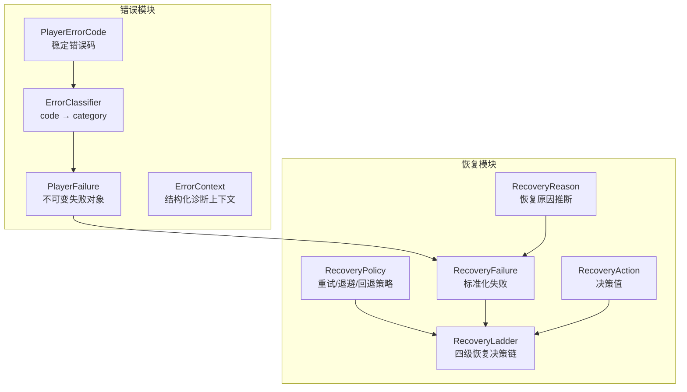
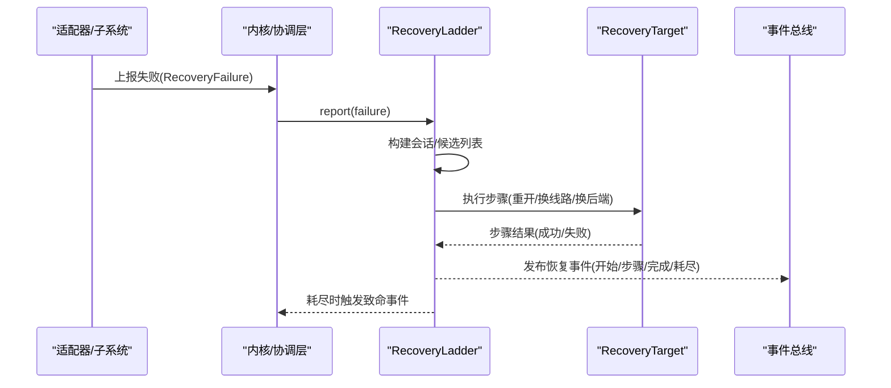
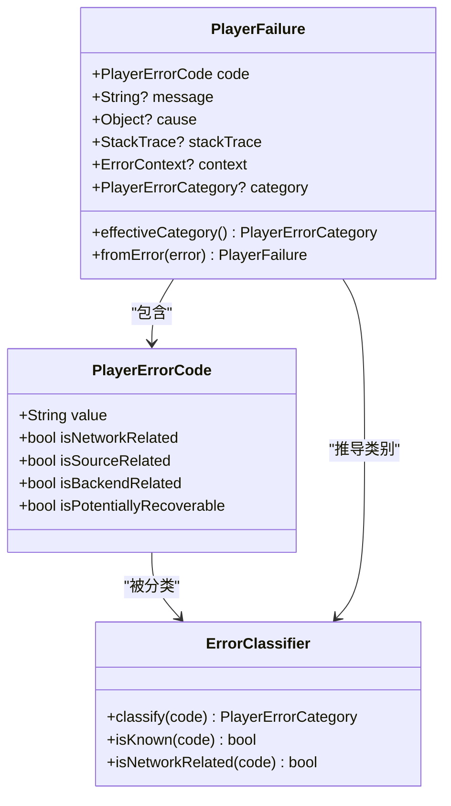
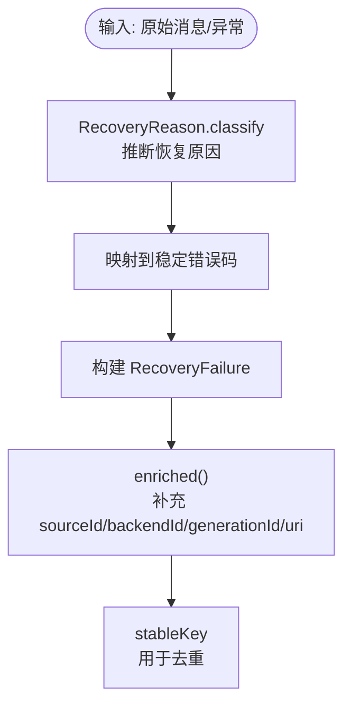
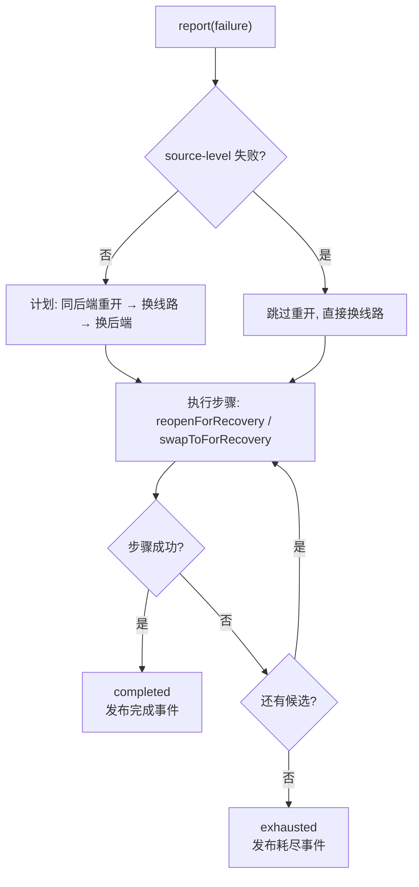
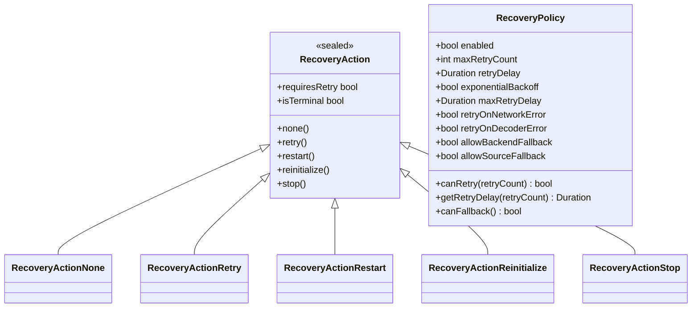
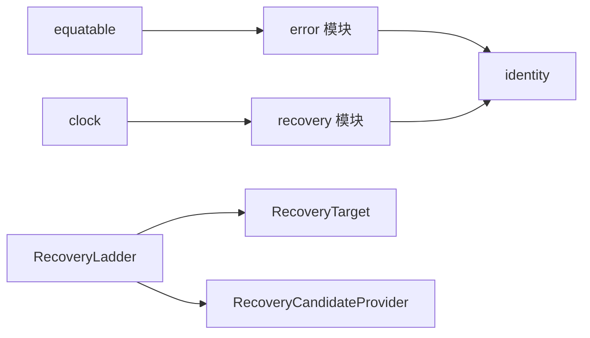

# 错误处理与恢复

<cite>
**本文引用的文件**   
- [packages/media_core/lib/error/player_failure.dart](file://packages/media_core/lib/error/player_failure.dart)
- [packages/media_core/lib/error/error_classifier.dart](file://packages/media_core/lib/error/error_classifier.dart)
- [packages/media_core/lib/error/player_error_code.dart](file://packages/media_core/lib/error/player_error_code.dart)
- [packages/media_core/lib/recovery/recovery_ladder.dart](file://packages/media_core/lib/recovery/recovery_ladder.dart)
- [packages/media_core/lib/recovery/recovery_action.dart](file://packages/media_core/lib/recovery/recovery_action.dart)
- [packages/media_core/lib/recovery/recovery_reason.dart](file://packages/media_core/lib/recovery/recovery_reason.dart)
- [packages/media_core/lib/recovery/recovery_failure.dart](file://packages/media_core/lib/recovery/recovery_failure.dart)
- [packages/media_core/lib/policy/recovery_policy.dart](file://packages/media_core/lib/policy/recovery_policy.dart)
- [doc/zh-Hans/error.md](file://doc/zh-Hans/error.md)
- [doc/zh-Hans/recovery.md](file://doc/zh-Hans/recovery.md)
- [README.md](file://README.md)
</cite>

## 目录
1. [引言](#引言)
2. [项目结构](#项目结构)
3. [核心组件](#核心组件)
4. [架构总览](#架构总览)
5. [详细组件分析](#详细组件分析)
6. [依赖关系分析](#依赖关系分析)
7. [性能与资源影响](#性能与资源影响)
8. [故障排查指南](#故障排查指南)
9. [结论](#结论)
10. [附录：常见错误场景与最佳实践](#附录常见错误场景与最佳实践)

## 引言
本文面向 Media Core 的错误处理与恢复机制，目标是帮助开发者理解并正确使用“错误模型、分类体系、四级恢复策略”。文档围绕以下主题展开：
- PlayerFailure 错误表示与结构化诊断上下文。
- ErrorClassifier 的分类逻辑与稳定错误码体系。
- RecoveryLadder 的四级恢复决策链：同后端重开、换线路、换后端、放弃。
- 重试预算、退避策略与恢复策略的配置方式。
- 直播场景的特殊处理、网络错误的自动恢复、解码失败的降级策略。
- 恢复事件的观测方法、调试技巧与性能影响分析。

## 项目结构
Media Core 将“错误”和“恢复”拆分为两个职责清晰的模块：
- error 模块：定义稳定的错误码、宽泛失败域、分类器、格式化器、不可变失败对象与结构化诊断上下文。它不执行重试或恢复，只产生决策数据。
- recovery 模块：以 sealed 决策值表示恢复动作；RecoveryManager/RecoveryLadder 负责启动恢复、跟踪上下文与尝试次数、调度重试、完成或耗尽；RetryScheduler 仅负责重试时序计算与执行。

图表来源
- [doc/zh-Hans/error.md:1-34](file://doc/zh-Hans/error.md#L1-L34)
- [doc/zh-Hans/recovery.md:1-29](file://doc/zh-Hans/recovery.md#L1-L29)

章节来源
- [doc/zh-Hans/error.md:1-34](file://doc/zh-Hans/error.md#L1-L34)
- [doc/zh-Hans/recovery.md:1-29](file://doc/zh-Hans/recovery.md#L1-L29)

## 核心组件
- PlayerErrorCode：机器可读的稳定错误码，支持自定义码，提供内置集合与分组判断（网络、源、后端、播放、解码、渲染等）。
- ErrorClassifier：静态 code → category 映射，回答“是哪类错？”；未知或自定义码归类为 unknown。
- PlayerFailure：不可变失败对象，携带 code、message、cause、stackTrace、context、category；提供 fromCode/fromError 等构造器与 effectiveCategory。
- RecoveryFailure：标准化失败，统一 adapter/watchdog/playback/user/kernel 上报形状，携带 sourceId/backendId/generationId/uri/metadata 等身份与诊断信息。
- RecoveryReason：从原始消息与异常类型推断恢复原因（网络/超时/解码/渲染/源/初始化/中断/资源）。
- RecoveryAction：sealed 决策值（None/Retry/Restart/Reinitialize/Stop），描述“应该做什么”，不执行副作用。
- RecoveryPolicy：控制重试配置、退避策略、是否允许后端/源回退。
- RecoveryLadder：唯一恢复决策点，按梯级推进：同后端重开 → 换线路 → 换后端 → 耗尽。

章节来源
- [packages/media_core/lib/error/player_error_code.dart:1-800](file://packages/media_core/lib/error/player_error_code.dart#L1-L800)
- [packages/media_core/lib/error/error_classifier.dart:1-370](file://packages/media_core/lib/error/error_classifier.dart#L1-L370)
- [packages/media_core/lib/error/player_failure.dart:1-633](file://packages/media_core/lib/error/player_failure.dart#L1-L633)
- [packages/media_core/lib/recovery/recovery_failure.dart:1-326](file://packages/media_core/lib/recovery/recovery_failure.dart#L1-L326)
- [packages/media_core/lib/recovery/recovery_reason.dart:1-210](file://packages/media_core/lib/recovery/recovery_reason.dart#L1-L210)
- [packages/media_core/lib/recovery/recovery_action.dart:1-87](file://packages/media_core/lib/recovery/recovery_action.dart#L1-L87)
- [packages/media_core/lib/policy/recovery_policy.dart:1-169](file://packages/media_core/lib/policy/recovery_policy.dart#L1-L169)

## 架构总览
Media Core 的错误自愈链路遵循“一个决策点”原则：任何错误来源都通过 reportFailure 上报到 RecoveryLadder，由它决定下一步动作，并通过 RecoveryTarget 执行物理步骤。每一步都必须验证“播放真的在走”（位置前进或直播换源后重新基线）才算成功。

图表来源
- [README.md:83-103](file://README.md#L83-L103)
- [packages/media_core/lib/recovery/recovery_ladder.dart:38-68](file://packages/media_core/lib/recovery/recovery_ladder.dart#L38-L68)

章节来源
- [README.md:83-103](file://README.md#L83-L103)

## 详细组件分析

### 错误模型与分类体系
- 错误码与分类分离：PlayerErrorCode 表达具体失败，PlayerErrorCategory 表达宽泛失败域。
- ErrorClassifier 将 code 映射到 category；未识别码归为 unknown。
- PlayerFailure 是数据/诊断对象，不负责重试/降级/恢复决策与执行。
- effectiveCategory 优先使用显式 category，否则委托 ErrorClassifier.classify。

图表来源
- [packages/media_core/lib/error/player_error_code.dart:1-800](file://packages/media_core/lib/error/player_error_code.dart#L1-L800)
- [packages/media_core/lib/error/error_classifier.dart:1-370](file://packages/media_core/lib/error/error_classifier.dart#L1-L370)
- [packages/media_core/lib/error/player_failure.dart:1-633](file://packages/media_core/lib/error/player_failure.dart#L1-L633)

章节来源
- [packages/media_core/lib/error/error_classifier.dart:1-370](file://packages/media_core/lib/error/error_classifier.dart#L1-L370)
- [packages/media_core/lib/error/player_failure.dart:1-633](file://packages/media_core/lib/error/player_failure.dart#L1-L633)

### 标准化失败与恢复原因
- RecoveryFailure 统一各上报方（adapter/watchdog/playback/user/kernel）的形状，携带 sourceId/backendId/generationId/uri/metadata 等身份字段。
- effectiveReason 通过 RecoveryReason.classify 从消息与异常类型推断恢复原因。
- stableKey 用于去重，避免对同一失败单元重复发起恢复。

图表来源
- [packages/media_core/lib/recovery/recovery_reason.dart:46-134](file://packages/media_core/lib/recovery/recovery_reason.dart#L46-L134)
- [packages/media_core/lib/recovery/recovery_failure.dart:89-122](file://packages/media_core/lib/recovery/recovery_failure.dart#L89-L122)
- [packages/media_core/lib/recovery/recovery_failure.dart:174-184](file://packages/media_core/lib/recovery/recovery_failure.dart#L174-L184)
- [packages/media_core/lib/recovery/recovery_failure.dart:236-257](file://packages/media_core/lib/recovery/recovery_failure.dart#L236-L257)

章节来源
- [packages/media_core/lib/recovery/recovery_failure.dart:1-326](file://packages/media_core/lib/recovery/recovery_failure.dart#L1-L326)
- [packages/media_core/lib/recovery/recovery_reason.dart:1-210](file://packages/media_core/lib/recovery/recovery_reason.dart#L1-L210)

### 四级恢复策略与 RecoveryLadder
RecoveryLadder 是唯一恢复决策点，按如下顺序推进：
1. 同后端重开：在当前引擎上原地重开当前源一次。
2. 换线路：切换到候选源列表中的下一个（直播多线路）。
3. 换后端：切换到注册表中的下一个引擎，切换前刷新签名 URL（单次有效）。
4. 放弃：候选耗尽，发布 exhausted 事件，交由上层决定后续行为。

关键约束：
- 一次只运行一个恢复流程，防止竞争。
- 每个步骤必须通过目标验证（播放位置前进或直播换源后重新基线）。
- 预算与边界由候选列表决定，无额外预算/退避/内存泄漏风险。

图表来源
- [packages/media_core/lib/recovery/recovery_ladder.dart:38-68](file://packages/media_core/lib/recovery/recovery_ladder.dart#L38-L68)
- [packages/media_core/lib/recovery/recovery_ladder.dart:253-365](file://packages/media_core/lib/recovery/recovery_ladder.dart#L253-L365)
- [packages/media_core/lib/recovery/recovery_ladder.dart:414-470](file://packages/media_core/lib/recovery/recovery_ladder.dart#L414-L470)

章节来源
- [packages/media_core/lib/recovery/recovery_ladder.dart:1-585](file://packages/media_core/lib/recovery/recovery_ladder.dart#L1-L585)

### 恢复动作与策略配置
- RecoveryAction：描述“做什么”，不包含副作用；requiresRetry/isTerminal 便于上层编排。
- RecoveryPolicy：控制是否启用恢复、最大重试次数、初始退避延迟、指数退避、最大退避延迟、是否允许网络/解码重试、是否允许后端/源回退。
- getRetryDelay：当开启指数退避时，按 2^retryCount 增长，但不超过 maxRetryDelay；关闭时返回固定 retryDelay（上限 clamp）。

图表来源
- [packages/media_core/lib/recovery/recovery_action.dart:1-87](file://packages/media_core/lib/recovery/recovery_action.dart#L1-L87)
- [packages/media_core/lib/policy/recovery_policy.dart:1-169](file://packages/media_core/lib/policy/recovery_policy.dart#L1-L169)

章节来源
- [packages/media_core/lib/recovery/recovery_action.dart:1-87](file://packages/media_core/lib/recovery/recovery_action.dart#L1-L87)
- [packages/media_core/lib/policy/recovery_policy.dart:1-169](file://packages/media_core/lib/policy/recovery_policy.dart#L1-L169)

### 错误上下文管理与诊断
- ErrorContext：结构化诊断上下文，包含 player/session/source/request/operation id、uri、backend、adapter、state、metadata 等。
- PlayerFailure.context：可携带 ErrorContext；toException 转换为运行时异常。
- RecoveryFailure.toFailure：桥接回 error 模块的 PlayerFailure，保留 category/context。

章节来源
- [packages/media_core/lib/error/player_failure.dart:239-262](file://packages/media_core/lib/error/player_failure.dart#L239-L262)
- [packages/media_core/lib/error/player_failure.dart:553-560](file://packages/media_core/lib/error/player_failure.dart#L553-L560)
- [packages/media_core/lib/recovery/recovery_failure.dart:189-203](file://packages/media_core/lib/recovery/recovery_failure.dart#L189-L203)

## 依赖关系分析
- error 模块依赖 identity（上下文 id）、equatable（值比较）。
- recovery 模块依赖 identity（SourceId、RequestId、OperationId、GenerationId）、clock（时间戳）。
- RecoveryLadder 依赖 RecoveryTarget 执行物理步骤，依赖 RecoveryCandidateProvider 提供候选源与后端。
- README 强调“能力靠声明，不靠猜”，恢复只有 RecoveryLadder 一处做决定，且必须验证播放进度真正推进。

图表来源
- [doc/zh-Hans/error.md:30-34](file://doc/zh-Hans/error.md#L30-L34)
- [doc/zh-Hans/recovery.md:26-29](file://doc/zh-Hans/recovery.md#L26-L29)
- [README.md:83-103](file://README.md#L83-L103)

章节来源
- [doc/zh-Hans/error.md:30-34](file://doc/zh-Hans/error.md#L30-L34)
- [doc/zh-Hans/recovery.md:26-29](file://doc/zh-Hans/recovery.md#L26-L29)
- [README.md:83-103](file://README.md#L83-L103)

## 性能与资源影响
- 恢复决策链无额外预算与退避，边界由候选列表保证，避免无限重试与内存泄漏。
- 每步执行均通过目标验证，确保“open 成功 ≠ 播放成功”，避免误判。
- 指数退避仅在策略层生效，受 maxRetryDelay 限制，防止长时间阻塞。
- 恢复事件通过广播流发出，建议按需订阅，避免不必要的 UI 更新开销。

[本节为通用指导，不直接分析具体文件]

## 故障排查指南
- 观察恢复事件：监听 RecoveryLadder.events，关注 started/stepStarted/stepFailed/completed/exhausted/cancelled 等事件，定位失败阶段与尝试次数。
- 检查稳定键：RecoveryFailure.stableKey 可用于识别重复失败，避免重复恢复。
- 确认目标可用性：若 target.isRecoveryAvailable 为 false，ladder 会拒绝恢复并快速结束。
- 日志与诊断：利用 MediaCoreLog 的 recovery/fallback 日志，结合 failure.code/effectiveReason/message 进行根因定位。
- 直播特殊路径：直播模式禁用 handle 的 ladder，改用自身单槽任务队列执行等价扫描，并在 onError 上报失败。

章节来源
- [packages/media_core/lib/recovery/recovery_ladder.dart:94-113](file://packages/media_core/lib/recovery/recovery_ladder.dart#L94-L113)
- [packages/media_core/lib/recovery/recovery_ladder.dart:140-192](file://packages/media_core/lib/recovery/recovery_ladder.dart#L140-L192)
- [packages/media_core/lib/recovery/recovery_failure.dart:174-184](file://packages/media_core/lib/recovery/recovery_failure.dart#L174-L184)
- [README.md:127-145](file://README.md#L127-L145)

## 结论
Media Core 的错误处理与恢复机制通过“错误模型与分类体系”“标准化失败与原因推断”“四级恢复决策链”“策略与执行分离”四个层次，构建了稳定、可扩展且可观测的自愈链路。开发者应：
- 使用 PlayerErrorCode/PlayerFailure/ErrorClassifier 表达与分类错误。
- 通过 RecoveryFailure/RecoveryReason 规范化失败并推断原因。
- 借助 RecoveryPolicy 配置重试与退避，让 RecoveryLadder 负责恢复决策。
- 在直播场景中采用专用路径，在网络/解码/渲染等错误下充分利用自动恢复与降级策略。

[本节为总结性内容，不直接分析具体文件]

## 附录：常见错误场景与最佳实践

### 网络错误自动恢复
- 现象：DNS/连接/超时/HTTP/TLS 错误。
- 策略：
  - 策略层：开启 retryOnNetworkError，合理设置 maxRetryCount 与指数退避。
  - 恢复层：RecoveryLadder 先尝试同后端重开，再换线路，最后换后端。
- 最佳实践：
  - 为签名 URL 准备刷新逻辑，换后端前刷新签名。
  - 监控 network 相关错误码，必要时提示用户网络状态。

章节来源
- [packages/media_core/lib/error/player_error_code.dart:94-128](file://packages/media_core/lib/error/player_error_code.dart#L94-L128)
- [packages/media_core/lib/recovery/recovery_ladder.dart:299-348](file://packages/media_core/lib/recovery/recovery_ladder.dart#L299-L348)
- [packages/media_core/lib/policy/recovery_policy.dart:37-43](file://packages/media_core/lib/policy/recovery_policy.dart#L37-L43)

### 解码失败降级策略
- 现象：decoder/demuxer/codec 错误。
- 策略：
  - 策略层：开启 retryOnDecoderError，配合指数退避。
  - 恢复层：优先换线路（不同编码/封装可能可用），其次换后端（不同解码实现）。
- 最佳实践：
  - 提供多编码/多封装的候选源，提升容错率。
  - 记录 decoder/demuxer 错误码，辅助后端选择与问题定位。

章节来源
- [packages/media_core/lib/error/player_error_code.dart:187-207](file://packages/media_core/lib/error/player_error_code.dart#L187-L207)
- [packages/media_core/lib/recovery/recovery_ladder.dart:315-348](file://packages/media_core/lib/recovery/recovery_ladder.dart#L315-L348)
- [packages/media_core/lib/policy/recovery_policy.dart:39-43](file://packages/media_core/lib/policy/recovery_policy.dart#L39-L43)

### 渲染/显示异常
- 现象：renderer/surface/texture 初始化或绘制失败。
- 策略：
  - 恢复层：换后端（不同渲染实现），必要时重启操作。
- 最佳实践：
  - 在多后端环境下，优先切换到更稳定的渲染后端。
  - 结合设备能力声明，避免选择不支持的渲染路径。

章节来源
- [packages/media_core/lib/error/player_error_code.dart:233-246](file://packages/media_core/lib/error/player_error_code.dart#L233-L246)
- [packages/media_core/lib/recovery/recovery_ladder.dart:328-348](file://packages/media_core/lib/recovery/recovery_ladder.dart#L328-L348)

### 直播场景特殊处理
- 特点：禁用 handle 的 ladder，使用自身单槽任务队列执行等价扫描，onError 上报失败一次。
- 要点：
  - 直播换源后需重新基线，确保位置推进。
  - 多线路候选优先尝试，避免重复重开已失效 URL。

章节来源
- [README.md:127-145](file://README.md#L127-L145)
- [packages/media_core/lib/recovery/recovery_ladder.dart:265-270](file://packages/media_core/lib/recovery/recovery_ladder.dart#L265-L270)

### 重试预算与退避配置
- 配置项：
  - enabled：是否启用恢复。
  - maxRetryCount：最大自动重试次数。
  - retryDelay：初始退避延迟。
  - exponentialBackoff：是否启用指数退避。
  - maxRetryDelay：最大退避延迟。
  - retryOnNetworkError/retryOnDecoderError：按错误类型决定是否重试。
  - allowBackendFallback/allowSourceFallback：是否允许后端/源回退。
- 建议：
  - 默认开启指数退避，但设置合理的 maxRetryDelay，避免长时间阻塞。
  - 在网络抖动环境中适当提高 maxRetryCount；在解码不稳定设备上谨慎开启解码重试。

章节来源
- [packages/media_core/lib/policy/recovery_policy.dart:24-73](file://packages/media_core/lib/policy/recovery_policy.dart#L24-L73)
- [packages/media_core/lib/policy/recovery_policy.dart:92-112](file://packages/media_core/lib/policy/recovery_policy.dart#L92-L112)