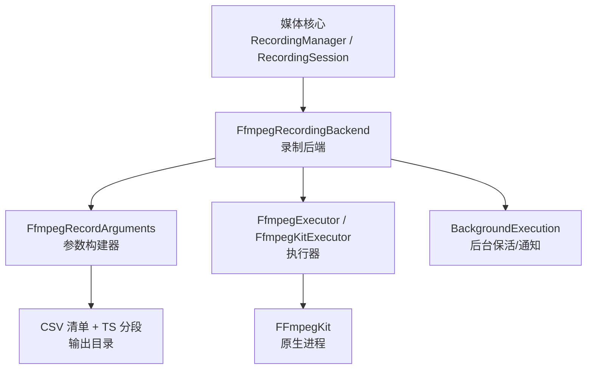
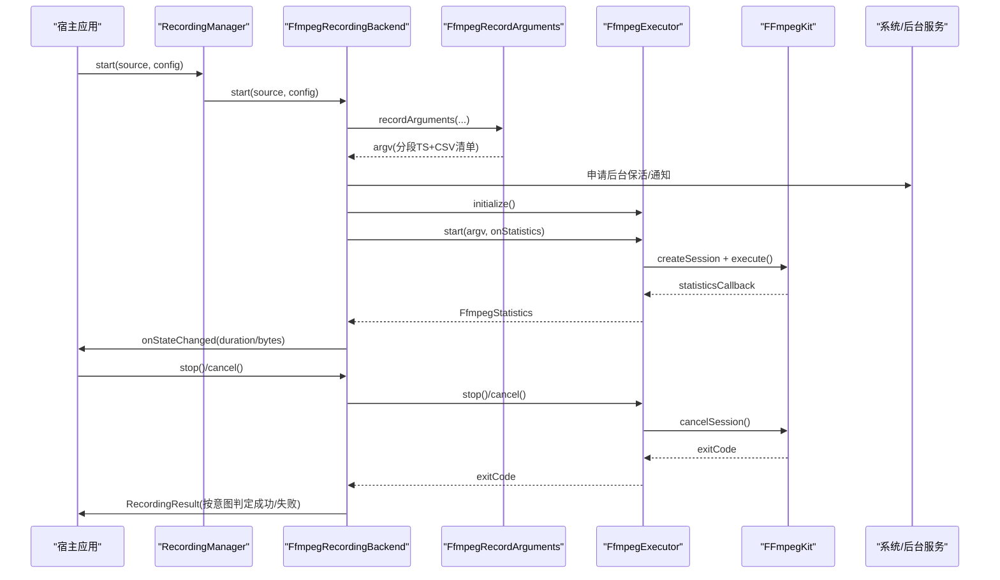
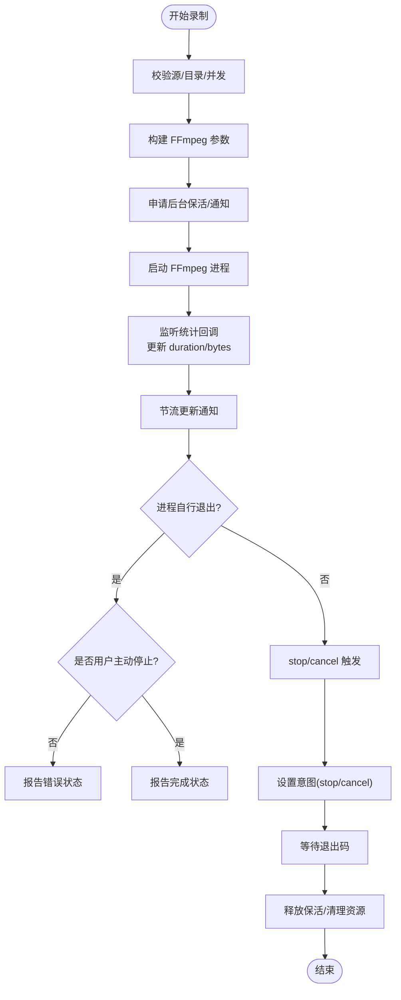
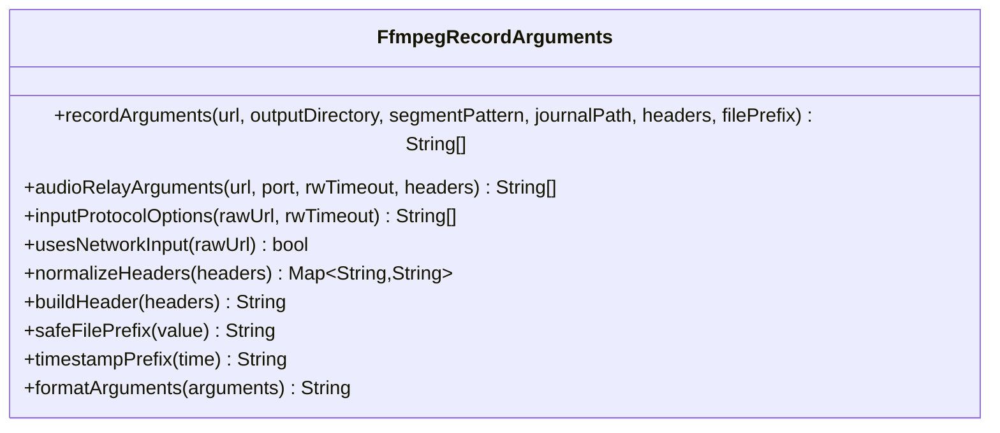
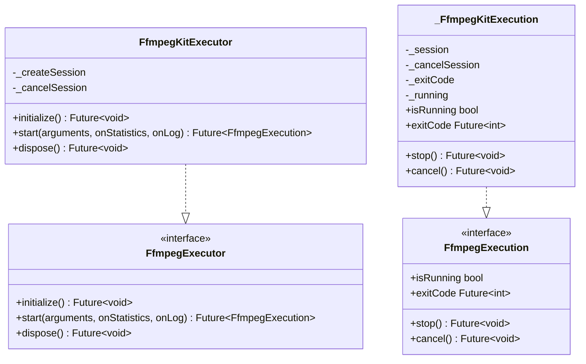
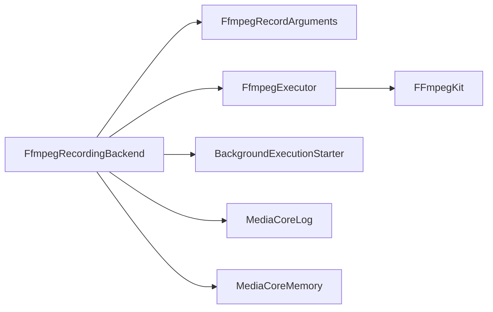

# FFmpeg 录播

<cite>
**本文引用的文件**   
- [README.md](file://packages/media_core_recording_ffmpeg/README.md)
- [media_core_recording_ffmpeg.dart](file://packages/media_core_recording_ffmpeg/lib/media_core_recording_ffmpeg.dart)
- [ffmpeg_recording_backend.dart](file://packages/media_core_recording_ffmpeg/lib/src/ffmpeg_recording_backend.dart)
- [ffmpeg_record_arguments.dart](file://packages/media_core_recording_ffmpeg/lib/src/ffmpeg_record_arguments.dart)
- [ffmpeg_executor.dart](file://packages/media_core_recording_ffmpeg/lib/src/ffmpeg_executor.dart)
- [ffmpeg_record_config.dart](file://packages/media_core_recording_ffmpeg/lib/src/ffmpeg_record_config.dart)
- [recording.md](file://doc/zh-Hans/recording.md)
- [ffmpeg_recording_test.dart](file://packages/media_core_recording_ffmpeg/test/ffmpeg_recording_test.dart)
</cite>

## 目录
1. [简介](#简介)
2. [项目结构](#项目结构)
3. [核心组件](#核心组件)
4. [架构总览](#架构总览)
5. [详细组件分析](#详细组件分析)
6. [依赖关系分析](#依赖关系分析)
7. [性能与参数调优](#性能与参数调优)
8. [故障排查与恢复](#故障排查与恢复)
9. [结论](#结论)
10. [附录：API 参考与示例路径](#附录api-参考与示例路径)

## 简介
本文件系统化梳理基于 FFmpegKit 的录制引擎，覆盖分段录制机制、CSV 日志清单、格式复制策略、后台保活、状态监控与失败恢复。文档同时给出录制参数配置、输出格式选择、存储空间管理建议，以及完整的 API 使用路径与代码片段位置，帮助在不同平台稳定地实现直播流录制。

## 项目结构
该模块以“后端契约 + 参数构建 + 执行器抽象”的方式组织：
- 对外导出统一的库入口，暴露后端、执行器、参数构建器和配置类。
- 后端负责会话生命周期、FFmpeg 进程控制、状态与进度上报、后台保活。
- 参数构建器负责把网络源和配置转换为 FFmpeg 命令行参数，并处理协议白名单、重连、头部等。
- 执行器抽象封装 FFmpegKit，便于测试替换与多实现扩展。
- 配置对象集中管理录制行为的可调项。

图示来源
- [media_core_recording_ffmpeg.dart:1-30](file://packages/media_core_recording_ffmpeg/lib/media_core_recording_ffmpeg.dart#L1-L30)
- [ffmpeg_recording_backend.dart:62-119](file://packages/media_core_recording_ffmpeg/lib/src/ffmpeg_recording_backend.dart#L62-L119)
- [ffmpeg_record_arguments.dart:23-28](file://packages/media_core_recording_ffmpeg/lib/src/ffmpeg_record_arguments.dart#L23-L28)
- [ffmpeg_executor.dart:67-88](file://packages/media_core_recording_ffmpeg/lib/src/ffmpeg_executor.dart#L67-L88)

章节来源
- [media_core_recording_ffmpeg.dart:1-30](file://packages/media_core_recording_ffmpeg/lib/media_core_recording_ffmpeg.dart#L1-L30)
- [recording.md:1-30](file://doc/zh-Hans/recording.md#L1-L30)

## 核心组件
- FfmpegRecordingBackend：实现录制后端契约，负责启动/停止/取消、状态与进度、后台保活、退出码意图判定、内存与日志记录。
- FfmpegRecordArguments：生成 FFmpeg 参数，支持分段录制、音频中继、协议选项、头部规范化与安全文件名。
- FfmpegExecutor / FfmpegKitExecutor：抽象并封装 FFmpegKit 会话创建、统计回调、日志回调与销毁。
- FfmpegRecordConfig：集中管理分段时长、超时、队列大小、流映射偏好、文件名前缀/后缀、保活开关等。
- FfmpegStatistics：仅携带录制有用的统计字段（时间、字节、比特率、速度、丢帧）。

章节来源
- [ffmpeg_recording_backend.dart:62-119](file://packages/media_core_recording_ffmpeg/lib/src/ffmpeg_recording_backend.dart#L62-L119)
- [ffmpeg_record_arguments.dart:23-28](file://packages/media_core_recording_ffmpeg/lib/src/ffmpeg_record_arguments.dart#L23-L28)
- [ffmpeg_executor.dart:5-42](file://packages/media_core_recording_ffmpeg/lib/src/ffmpeg_executor.dart#L5-L42)
- [ffmpeg_record_config.dart:1-22](file://packages/media_core_recording_ffmpeg/lib/src/ffmpeg_record_config.dart#L1-L22)

## 架构总览
录制从上层 RecordingManager/RecordingSession 发起，由后端将源与配置转为 FFmpeg 参数，启动原生进程；过程中通过统计回调更新状态与后台通知；结束时根据“用户意图”而非“退出码”决定成功或失败。

图示来源
- [ffmpeg_recording_backend.dart:141-210](file://packages/media_core_recording_ffmpeg/lib/src/ffmpeg_recording_backend.dart#L141-L210)
- [ffmpeg_record_arguments.dart:47-139](file://packages/media_core_recording_ffmpeg/lib/src/ffmpeg_record_arguments.dart#L47-L139)
- [ffmpeg_executor.dart:131-173](file://packages/media_core_recording_ffmpeg/lib/src/ffmpeg_executor.dart#L131-L173)

## 详细组件分析

### 录制后端 FfmpegRecordingBackend
职责与边界：
- 负责构建 FFmpeg 参数、持有进程、观察进度、结束进程并将结果映射为录制状态与结果。
- 不决定“录什么”，也不编排多个录制；这些由上层 RecordingManager 负责。
- 不合并分段文件；只写 CSV 清单供后续合并。

关键流程要点：
- 启动时校验源类型（不支持本地文件）、输出目录、并发限制。
- 先申请后台保活，再启动 FFmpeg；失败时释放保活。
- 通过统计回调更新媒体时间与写入字节，并节流更新通知。
- 停止/取消会设置“意图”，避免用 255 退出码误判失败。
- dispose 统一走取消路径，确保所有结束分支都释放资源。

图示来源
- [ffmpeg_recording_backend.dart:141-210](file://packages/media_core_recording_ffmpeg/lib/src/ffmpeg_recording_backend.dart#L141-L210)
- [ffmpeg_recording_backend.dart:214-284](file://packages/media_core_recording_ffmpeg/lib/src/ffmpeg_recording_backend.dart#L214-L284)
- [ffmpeg_recording_backend.dart:403-457](file://packages/media_core_recording_ffmpeg/lib/src/ffmpeg_recording_backend.dart#L403-L457)

章节来源
- [ffmpeg_recording_backend.dart:33-61](file://packages/media_core_recording_ffmpeg/lib/src/ffmpeg_recording_backend.dart#L33-L61)
- [ffmpeg_recording_backend.dart:141-210](file://packages/media_core_recording_ffmpeg/lib/src/ffmpeg_recording_backend.dart#L141-L210)
- [ffmpeg_recording_backend.dart:214-284](file://packages/media_core_recording_ffmpeg/lib/src/ffmpeg_recording_backend.dart#L214-L284)
- [ffmpeg_recording_backend.dart:292-401](file://packages/media_core_recording_ffmpeg/lib/src/ffmpeg_recording_backend.dart#L292-L401)
- [ffmpeg_recording_backend.dart:403-457](file://packages/media_core_recording_ffmpeg/lib/src/ffmpeg_recording_backend.dart#L403-L457)

### 参数构建器 FfmpegRecordArguments
能力与约束：
- 生成两段参数：分段录制（MPEG-TS + CSV 清单）与纯音频中继（localhost HTTP）。
- 强制复制编码（-c copy），不进行转码，保证录制性能与质量无损。
- 启用分段与 CSV 清单，使崩溃后仍可获得可播放片段，且能拼接。
- 对网络输入启用重连与超时；对 RTSP/UDP/RTP 做针对性优化。
- 规范化请求头，拒绝非法头名，避免凭据静默丢失。
- 安全化文件名前缀，防止路径穿越与非法字符。

图示来源
- [ffmpeg_record_arguments.dart:23-28](file://packages/media_core_recording_ffmpeg/lib/src/ffmpeg_record_arguments.dart#L23-L28)
- [ffmpeg_record_arguments.dart:47-139](file://packages/media_core_recording_ffmpeg/lib/src/ffmpeg_record_arguments.dart#L47-L139)
- [ffmpeg_record_arguments.dart:141-176](file://packages/media_core_recording_ffmpeg/lib/src/ffmpeg_record_arguments.dart#L141-L176)
- [ffmpeg_record_arguments.dart:178-281](file://packages/media_core_recording_ffmpeg/lib/src/ffmpeg_record_arguments.dart#L178-L281)

章节来源
- [ffmpeg_record_arguments.dart:47-139](file://packages/media_core_recording_ffmpeg/lib/src/ffmpeg_record_arguments.dart#L47-L139)
- [ffmpeg_record_arguments.dart:141-176](file://packages/media_core_recording_ffmpeg/lib/src/ffmpeg_record_arguments.dart#L141-L176)
- [ffmpeg_record_arguments.dart:178-281](file://packages/media_core_recording_ffmpeg/lib/src/ffmpeg_record_arguments.dart#L178-L281)

### 执行器 FfmpegExecutor / FfmpegKitExecutor
设计要点：
- 抽象出初始化、启动、销毁接口，便于测试替换与多实现。
- FfmpegKitExecutor 封装 FFmpegKitExtended，转发统计与日志回调。
- 通过 Completer 跟踪会话完成，统一 isRunning/exitCode 语义。

图示来源
- [ffmpeg_executor.dart:44-88](file://packages/media_core_recording_ffmpeg/lib/src/ffmpeg_executor.dart#L44-L88)
- [ffmpeg_executor.dart:91-179](file://packages/media_core_recording_ffmpeg/lib/src/ffmpeg_executor.dart#L91-L179)
- [ffmpeg_executor.dart:181-215](file://packages/media_core_recording_ffmpeg/lib/src/ffmpeg_executor.dart#L181-L215)

章节来源
- [ffmpeg_executor.dart:44-88](file://packages/media_core_recording_ffmpeg/lib/src/ffmpeg_executor.dart#L44-L88)
- [ffmpeg_executor.dart:91-179](file://packages/media_core_recording_ffmpeg/lib/src/ffmpeg_executor.dart#L91-L179)
- [ffmpeg_executor.dart:181-215](file://packages/media_core_recording_ffmpeg/lib/src/ffmpeg_executor.dart#L181-L215)

### 配置 FfmpegRecordConfig
可调项说明：
- keepAlive：是否保持后台运行（Android 前台服务+唤醒锁，macOS/Windows 睡眠断言，iOS 需声明后台模式）。
- segmentTime：分段时长（10..86400 秒），平衡碎片开销与容错范围。
- rwTimeout：读写超时（秒），避免死等。
- threadQueueSize：输入包队列大小，优先完整性。
- preferBestStream：优先首条音视频轨，避免多码率变体被录成多轨。
- filePrefix/segmentSuffix/journalSuffix：命名规范，便于识别与合并。
- keepAliveTitle/keepAliveIcon：通知标题与图标。

章节来源
- [ffmpeg_record_config.dart:1-22](file://packages/media_core_recording_ffmpeg/lib/src/ffmpeg_record_config.dart#L1-L22)
- [ffmpeg_record_config.dart:24-97](file://packages/media_core_recording_ffmpeg/lib/src/ffmpeg_record_config.dart#L24-L97)
- [ffmpeg_record_config.dart:99-121](file://packages/media_core_recording_ffmpeg/lib/src/ffmpeg_record_config.dart#L99-L121)

## 依赖关系分析
- 后端依赖参数构建器与执行器，解耦了“如何录制”和“用什么引擎录制”。
- 执行器依赖 FFmpegKit，但通过抽象屏蔽具体实现差异。
- 后台保活通过 BackgroundExecutionStarter 注入，便于测试与平台适配。
- 日志与内存统计通过 MediaCoreLog/MediaCoreMemory 上报，便于观测。

图示来源
- [ffmpeg_recording_backend.dart:1-10](file://packages/media_core_recording_ffmpeg/lib/src/ffmpeg_recording_backend.dart#L1-L10)
- [ffmpeg_recording_backend.dart:62-119](file://packages/media_core_recording_ffmpeg/lib/src/ffmpeg_recording_backend.dart#L62-L119)
- [ffmpeg_executor.dart:91-179](file://packages/media_core_recording_ffmpeg/lib/src/ffmpeg_executor.dart#L91-L179)

章节来源
- [ffmpeg_recording_backend.dart:1-10](file://packages/media_core_recording_ffmpeg/lib/src/ffmpeg_recording_backend.dart#L1-L10)
- [ffmpeg_executor.dart:91-179](file://packages/media_core_recording_ffmpeg/lib/src/ffmpeg_executor.dart#L91-L179)

## 性能与参数调优
- 编码策略：始终使用复制（-c copy），避免转码带来的 CPU 与质量损失。
- 分段策略：默认 300 秒分段，兼顾可播放性与碎片开销；短于 10 秒会增加容器开销，长于一天无意义。
- 网络重连：HTTP(S) 开启重连与 5xx 重试，RTSP 使用 TCP，UDP/RTP 增大 fifo 并忽略非致命溢出。
- 队列与吞吐：threadQueueSize 默认较大，优先保证完整写入；可根据设备 I/O 调整。
- 时间戳修正：对网络输入启用 dts 阈值修正，避免 CDN 跳点导致播放异常。
- 输出偏移：保留 MPEG-TS 预卷偏移，避免拼接时丢弃负 DTS。
- 保活与通知：按媒体时间节流更新通知，避免频繁 UI 刷新；直播无总量，使用不确定进度。

章节来源
- [ffmpeg_record_arguments.dart:63-131](file://packages/media_core_recording_ffmpeg/lib/src/ffmpeg_record_arguments.dart#L63-L131)
- [ffmpeg_record_arguments.dart:178-217](file://packages/media_core_recording_ffmpeg/lib/src/ffmpeg_record_arguments.dart#L178-L217)
- [ffmpeg_record_config.dart:55-75](file://packages/media_core_recording_ffmpeg/lib/src/ffmpeg_record_config.dart#L55-L75)
- [ffmpeg_recording_backend.dart:329-392](file://packages/media_core_recording_ffmpeg/lib/src/ffmpeg_recording_backend.dart#L329-L392)

## 故障排查与恢复
常见问题与对策：
- 无法启动录制：检查是否已调用 initialize；确认输出目录存在且可写；避免重复并发录制。
- 本地文件源报错：后端仅支持网络源；本地文件无需录制。
- 明文 HTTP 失败：Android 9+ 默认禁止明文，需在应用侧添加 network_security_config 与 usesCleartextTraffic。
- 后台录制中断：确认 keepAlive 开启；Android 需要前台服务与通知权限；iOS 需声明 audio 后台模式。
- 通知不更新：统计回调按媒体时间节流；若源时间回退会重置窗口，避免永久卡住。
- 退出码 255：可能是用户主动停止，也可能是崩溃；后端通过“意图”区分，不要仅凭退出码判断成败。
- 文件不可播放：确认未发生转码；检查分段与 CSV 清单是否齐全；必要时进行二次合并。

章节来源
- [ffmpeg_recording_backend.dart:141-210](file://packages/media_core_recording_ffmpeg/lib/src/ffmpeg_recording_backend.dart#L141-L210)
- [ffmpeg_recording_backend.dart:214-284](file://packages/media_core_recording_ffmpeg/lib/src/ffmpeg_recording_backend.dart#L214-L284)
- [ffmpeg_recording_backend.dart:417-457](file://packages/media_core_recording_ffmpeg/lib/src/ffmpeg_recording_backend.dart#L417-L457)
- [README.md:18-38](file://packages/media_core_recording_ffmpeg/README.md#L18-L38)
- [README.md:40-51](file://packages/media_core_recording_ffmpeg/README.md#L40-L51)

## 结论
该录制方案以“分段 + CSV 清单 + 复制编码 + 意图驱动”为核心，在直播场景下提供高鲁棒性：即使进程被杀或应用回收，也能最大限度保留可播放片段；通过后台保活与节流通知提升用户体验；通过参数构建器的严格校验与协议优化降低失败概率。上层只需关注源与配置，后端负责工程化细节，便于跨平台复用与维护。

## 附录：API 参考与示例路径

### 快速上手
- 后端初始化与录制：
  - 初始化后端、创建管理器、启动录制、停止并获取结果。
  - 参考路径：[media_core_recording_ffmpeg.dart:6-17](file://packages/media_core_recording_ffmpeg/lib/media_core_recording_ffmpeg.dart#L6-L17)

- 直接调用后端：
  - 构造后端、传入源与配置、调用 start/stop。
  - 参考路径：[README.md:8-16](file://packages/media_core_recording_ffmpeg/README.md#L8-L16)

### 核心 API 速查
- 后端
  - 构造函数：FfmpegRecordingBackend({executor, config, outputDirectory, keepAliveStarter})
  - initialize()
  - start(source, config)
  - stop() → RecordingResult
  - cancel()
  - dispose()
  - state / onStateChanged / isAvailable / activeDirectory / setOutputDirectory()
  - 参考路径：[ffmpeg_recording_backend.dart:62-139](file://packages/media_core_recording_ffmpeg/lib/src/ffmpeg_recording_backend.dart#L62-L139)

- 参数构建器
  - recordArguments(url, outputDirectory, segmentPattern, journalPath, headers?, filePrefix?)
  - audioRelayArguments(url, port, rwTimeout?, headers?)
  - inputProtocolOptions(rawUrl, rwTimeout?)
  - normalizeHeaders(headers)
  - buildHeader(headers)
  - safeFilePrefix(value)
  - timestampPrefix(time)
  - formatArguments(arguments)
  - 参考路径：[ffmpeg_record_arguments.dart:47-281](file://packages/media_core_recording_ffmpeg/lib/src/ffmpeg_record_arguments.dart#L47-L281)

- 执行器
  - FfmpegExecutor.initialize()
  - FfmpegExecutor.start(arguments, onStatistics, onLog)
  - FfmpegExecutor.dispose()
  - FfmpegExecution.isRunning / exitCode / stop() / cancel()
  - 参考路径：[ffmpeg_executor.dart:67-88](file://packages/media_core_recording_ffmpeg/lib/src/ffmpeg_executor.dart#L67-L88), [ffmpeg_executor.dart:181-215](file://packages/media_core_recording_ffmpeg/lib/src/ffmpeg_executor.dart#L181-L215)

- 配置
  - FfmpegRecordConfig.defaults
  - 字段：keepAlive, keepAliveTitle, keepAliveIcon, segmentTime, rwTimeout, threadQueueSize, preferBestStream, filePrefix, includeTimestampPrefix, segmentSuffix, journalSuffix
  - 参考路径：[ffmpeg_record_config.dart:1-22](file://packages/media_core_recording_ffmpeg/lib/src/ffmpeg_record_config.dart#L1-L22), [ffmpeg_record_config.dart:24-97](file://packages/media_core_recording_ffmpeg/lib/src/ffmpeg_record_config.dart#L24-L97)

### 录制状态与结果
- 状态：starting → recording → stopping/completed/error/cancelled
- 结果：RecordingResult(success, outputPath, duration, bytesWritten, error?)
- 参考路径：[ffmpeg_recording_backend.dart:214-245](file://packages/media_core_recording_ffmpeg/lib/src/ffmpeg_recording_backend.dart#L214-L245), [ffmpeg_recording_backend.dart:449-457](file://packages/media_core_recording_ffmpeg/lib/src/ffmpeg_recording_backend.dart#L449-L457)

### 实际示例路径
- 控制台演示（含录制启动与多实例）：
  - [example/lib/demos/console/recording_demo.dart:104-170](file://example/lib/demos/console/recording_demo.dart#L104-L170)
- 单元测试（参数构建、目录创建、并发限制、统计进度、通知更新）：
  - [ffmpeg_recording_test.dart:101-125](file://packages/media_core_recording_ffmpeg/test/ffmpeg_recording_test.dart#L101-L125)
  - [ffmpeg_recording_test.dart:257-319](file://packages/media_core_recording_ffmpeg/test/ffmpeg_recording_test.dart#L257-L319)
  - [ffmpeg_recording_test.dart:321-336](file://packages/media_core_recording_ffmpeg/test/ffmpeg_recording_test.dart#L321-L336)

### 输出结构与元数据
- 输出：分段 TS 文件 + CSV 清单（segment_list_type=csv）
- 命名：由前缀 + 序号 + 后缀组成；前缀安全化处理，后缀用于版本标识
- 清单：CSV 用于后续合并；不在此层合并
- 参考路径：[ffmpeg_record_arguments.dart:105-131](file://packages/media_core_recording_ffmpeg/lib/src/ffmpeg_record_arguments.dart#L105-L131), [ffmpeg_record_config.dart:90-97](file://packages/media_core_recording_ffmpeg/lib/src/ffmpeg_record_config.dart#L90-L97)