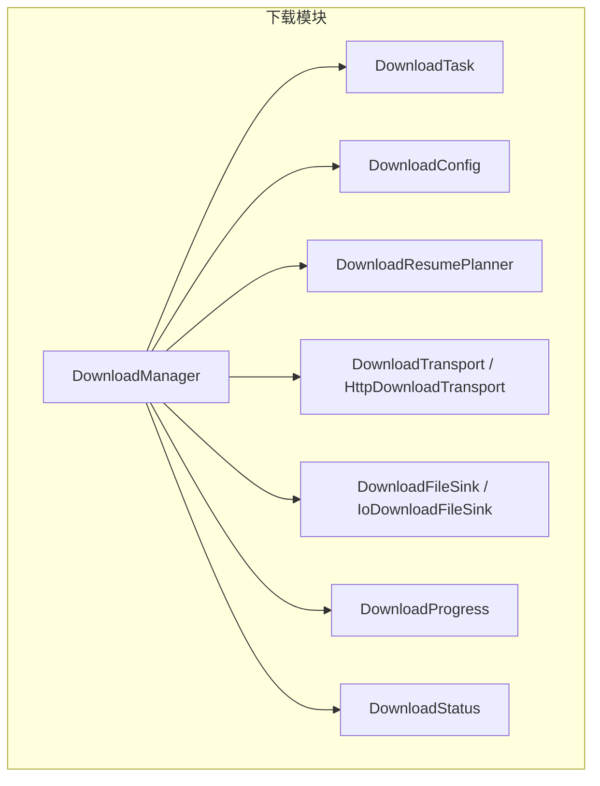
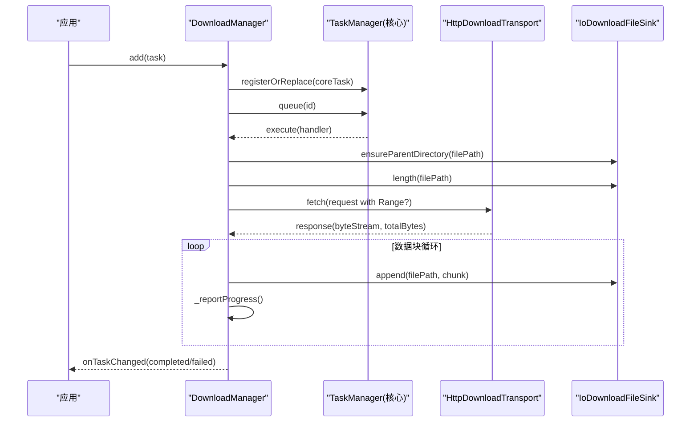
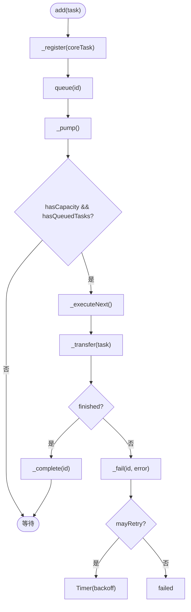
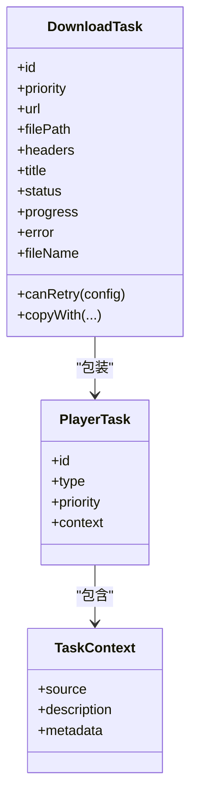
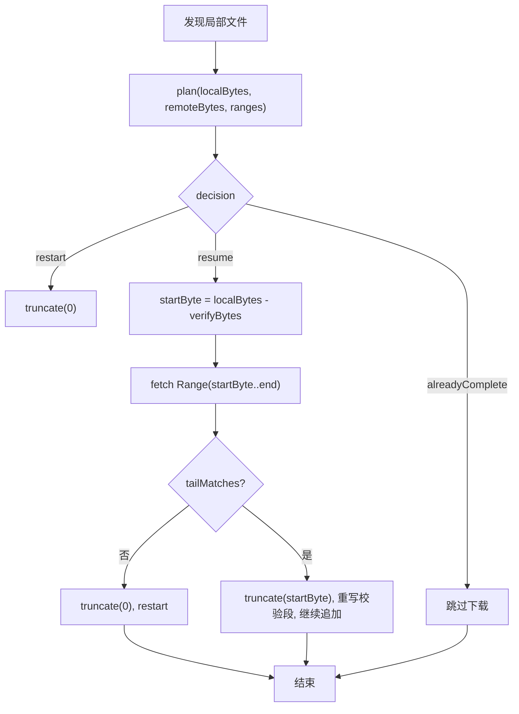
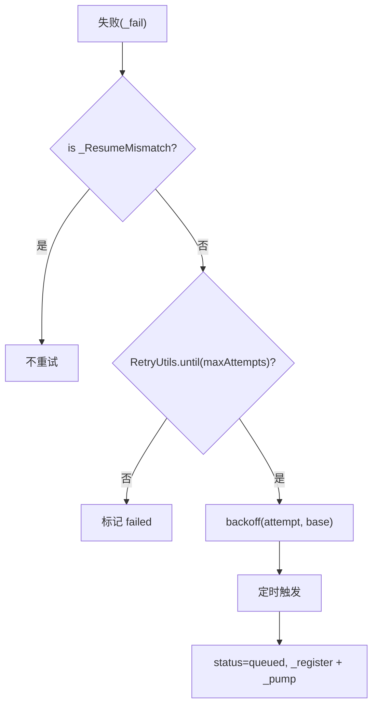
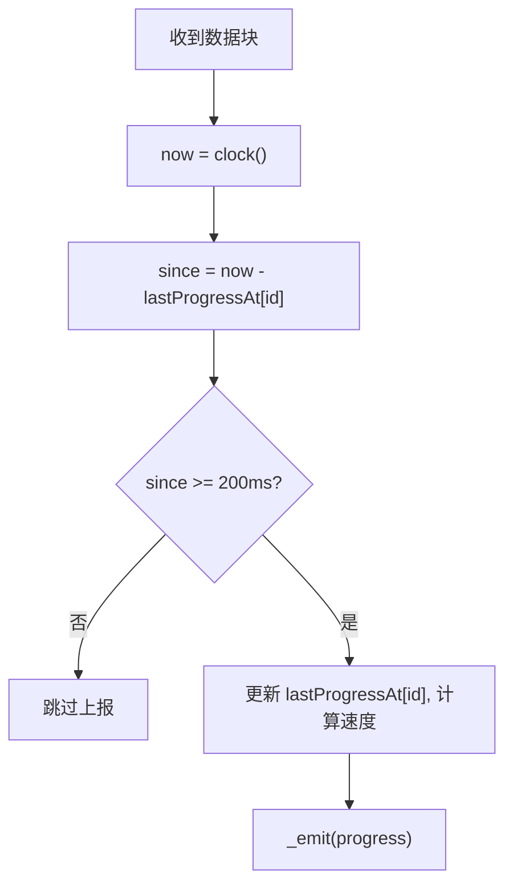
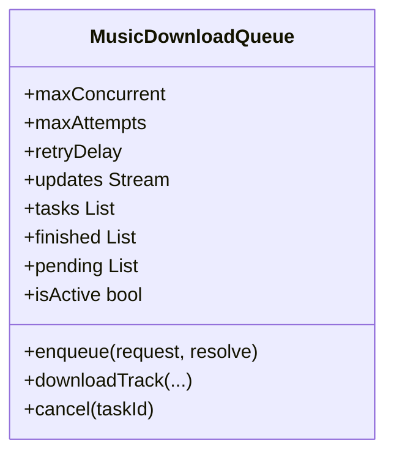
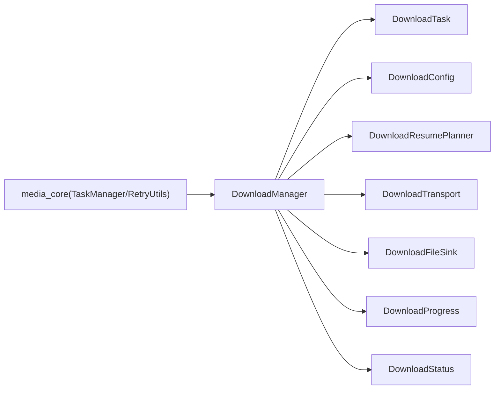

# 下载管理

<cite>
**本文引用的文件**   
- [README.md](file://packages/media_core_download/README.md)
- [download_manager.dart](file://packages/media_core_download/lib/src/download_manager.dart)
- [download_task.dart](file://packages/media_core_download/lib/src/download_task.dart)
- [download_config.dart](file://packages/media_core_download/lib/src/download_config.dart)
- [download_resume.dart](file://packages/media_core_download/lib/src/download_resume.dart)
- [download_transport.dart](file://packages/media_core_download/lib/src/download_transport.dart)
- [download_file_sink.dart](file://packages/media_core_download/lib/src/download_file_sink.dart)
- [download_progress.dart](file://packages/media_core_download/lib/src/download_progress.dart)
- [download_status.dart](file://packages/media_core_download/lib/src/download_status.dart)
- [concurrency.md](file://doc/zh-Hans/concurrency.md)
- [task.md](file://doc/zh-Hans/task.md)
- [music_download_queue.dart](file://packages/media_core_audio/lib/src/download/music_download_queue.dart)
- [task_demo.dart](file://example/lib/demos/console/task_demo.dart)
</cite>

## 目录
1. [简介](#简介)
2. [项目结构](#项目结构)
3. [核心组件](#核心组件)
4. [架构总览](#架构总览)
5. [详细组件分析](#详细组件分析)
6. [依赖关系分析](#依赖关系分析)
7. [性能与并发优化](#性能与并发优化)
8. [故障排查指南](#故障排查指南)
9. [结论](#结论)
10. [附录：API 参考与示例](#附录api-参考与示例)

## 简介
本模块为媒体核心提供离线下载能力，围绕“任务队列 + 有界并发 + 可验证断点续传 + 退避重试”构建。它复用核心框架的 TaskManager 完成调度、优先级排序与取消，同时补充下载领域特有的“暂停语义”和“续传校验”。对外暴露 DownloadManager 作为统一入口，支持添加任务、暂停/恢复、取消、重试、清理已完成任务，并通过 onTaskChanged 流式上报进度与状态变化。

该设计的关键在于：
- 使用核心 TaskManager 做有界并发与优先级调度，避免重复造轮子。
- 通过 DownloadResumePlanner 对本地部分文件进行尾部字节校验，拒绝不可信续传。
- 借助 RetryUtils 实现重试预算与指数退避，保证网络异常时的稳定性。
- 将网络 IO 与文件 IO 抽象为 DownloadTransport 与 DownloadFileSink，便于测试与平台扩展。

**章节来源**
- [README.md:1-73](file://packages/media_core_download/README.md#L1-L73)

## 项目结构
下载模块采用按职责分层的包结构，核心类集中在 lib/src 下：
- 调度与生命周期：DownloadManager、DownloadStatus、DownloadProgress
- 任务模型：DownloadTask
- 配置与策略：DownloadConfig、DownloadResumePlanner
- 网络层：DownloadTransport、HttpDownloadTransport、DownloadRequest、DownloadResponse
- 存储层：DownloadFileSink、IoDownloadFileSink

**图表来源**
- [download_manager.dart:74-149](file://packages/media_core_download/lib/src/download_manager.dart#L74-L149)
- [download_task.dart:7-60](file://packages/media_core_download/lib/src/download_task.dart#L7-L60)
- [download_config.dart:1-58](file://packages/media_core_download/lib/src/download_config.dart#L1-L58)
- [download_resume.dart:34-123](file://packages/media_core_download/lib/src/download_resume.dart#L34-L123)
- [download_transport.dart:8-101](file://packages/media_core_download/lib/src/download_transport.dart#L8-L101)
- [download_file_sink.dart:1-26](file://packages/media_core_download/lib/src/download_file_sink.dart#L1-L26)
- [download_progress.dart:1-44](file://packages/media_core_download/lib/src/download_progress.dart#L1-L44)
- [download_status.dart:1-44](file://packages/media_core_download/lib/src/download_status.dart#L1-L44)

**章节来源**
- [download_manager.dart:74-149](file://packages/media_core_download/lib/src/download_manager.dart#L74-L149)
- [download_task.dart:7-60](file://packages/media_core_download/lib/src/download_task.dart#L7-L60)
- [download_config.dart:1-58](file://packages/media_core_download/lib/src/download_config.dart#L1-L58)
- [download_resume.dart:34-123](file://packages/media_core_download/lib/src/download_resume.dart#L34-L123)
- [download_transport.dart:8-101](file://packages/media_core_download/lib/src/download_transport.dart#L8-L101)
- [download_file_sink.dart:1-26](file://packages/media_core_download/lib/src/download_file_sink.dart#L1-L26)
- [download_progress.dart:1-44](file://packages/media_core_download/lib/src/download_progress.dart#L1-L44)
- [download_status.dart:1-44](file://packages/media_core_download/lib/src/download_status.dart#L1-L44)

## 核心组件
- DownloadManager：下载队列与生命周期中枢，负责注册任务、驱动执行、进度节流、暂停/恢复/取消/重试、失败处理与资源释放。
- DownloadTask：下载任务值对象，携带 URL、目标路径、请求头、优先级与运行时状态（状态、进度、错误）。
- DownloadConfig：可调参数，包括最大并发、重试次数、退避延迟、超时、重定向上限、是否强制续传、尾部校验字节数、User-Agent。
- DownloadResumePlanner：断点续传决策器，根据本地大小、远端大小、服务器 Range 支持与校验窗口决定 restart/resume/alreadyComplete。
- DownloadTransport / HttpDownloadTransport：网络获取抽象，封装 HTTP GET/Range、重定向、超时、头部清洗与响应解析。
- DownloadFileSink / IoDownloadFileSink：本地文件操作抽象，提供 length/readTail/append/truncate/delete/ensureParentDirectory。
- DownloadProgress：进度值对象，包含已接收字节、总字节、速度、尝试次数、待写入计数，并提供百分比与剩余时间估算。
- DownloadStatus：下载任务状态机，涵盖 idle/queued/running/paused/stopped/completed/failed/cancelled。

**章节来源**
- [download_manager.dart:74-149](file://packages/media_core_download/lib/src/download_manager.dart#L74-L149)
- [download_task.dart:7-60](file://packages/media_core_download/lib/src/download_task.dart#L7-L60)
- [download_config.dart:1-58](file://packages/media_core_download/lib/src/download_config.dart#L1-L58)
- [download_resume.dart:34-123](file://packages/media_core_download/lib/src/download_resume.dart#L34-L123)
- [download_transport.dart:8-101](file://packages/media_core_download/lib/src/download_transport.dart#L8-L101)
- [download_file_sink.dart:1-26](file://packages/media_core_download/lib/src/download_file_sink.dart#L1-L26)
- [download_progress.dart:1-44](file://packages/media_core_download/lib/src/download_progress.dart#L1-L44)
- [download_status.dart:1-44](file://packages/media_core_download/lib/src/download_status.dart#L1-L44)

## 架构总览
DownloadManager 不直接拉取字节，而是委托给 HttpDownloadTransport；不直接写盘，而是委托给 IoDownloadFileSink。任务调度交给核心 TaskManager，从而获得优先级排序、有界并发与取消能力。

**图表来源**
- [download_manager.dart:157-185](file://packages/media_core_download/lib/src/download_manager.dart#L157-L185)
- [download_manager.dart:379-419](file://packages/media_core_download/lib/src/download_manager.dart#L379-L419)
- [download_manager.dart:421-483](file://packages/media_core_download/lib/src/download_manager.dart#L421-L483)
- [download_manager.dart:497-628](file://packages/media_core_download/lib/src/download_manager.dart#L497-L628)
- [download_transport.dart:131-179](file://packages/media_core_download/lib/src/download_transport.dart#L131-L179)
- [download_file_sink.dart:29-96](file://packages/media_core_download/lib/src/download_file_sink.dart#L29-L96)

**章节来源**
- [download_manager.dart:157-185](file://packages/media_core_download/lib/src/download_manager.dart#L157-L185)
- [download_manager.dart:379-419](file://packages/media_core_download/lib/src/download_manager.dart#L379-L419)
- [download_manager.dart:421-483](file://packages/media_core_download/lib/src/download_manager.dart#L421-L483)
- [download_manager.dart:497-628](file://packages/media_core_download/lib/src/download_manager.dart#L497-L628)
- [download_transport.dart:131-179](file://packages/media_core_download/lib/src/download_transport.dart#L131-L179)
- [download_file_sink.dart:29-96](file://packages/media_core_download/lib/src/download_file_sink.dart#L29-L96)

## 详细组件分析

### 有界并发队列与任务调度
- 核心机制：DownloadManager 在构造时创建 TaskManager(maxConcurrentTasks: config.maxConcurrent)，将并发上限固定到队列容量。
- 入队流程：add(task) → _register(coreTask) → queue(id) → _pump() 不断尝试取出可执行任务。
- 执行流程：_executeNext() 从核心队列取得一个槽位，标记 inFlight，调用 _transfer(task) 执行一次传输尝试。
- 优先级：DownloadTask.priority 映射到 TaskPriority，由核心队列按优先级排序。
- 取消与暂停：pause 会 cancel 并移除核心任务，使任务离开队列；resume/start 重新注册或重新入队。

**图表来源**
- [download_manager.dart:157-185](file://packages/media_core_download/lib/src/download_manager.dart#L157-L185)
- [download_manager.dart:379-419](file://packages/media_core_download/lib/src/download_manager.dart#L379-L419)
- [download_manager.dart:421-483](file://packages/media_core_download/lib/src/download_manager.dart#L421-L483)
- [download_manager.dart:696-753](file://packages/media_core_download/lib/src/download_manager.dart#L696-L753)

**章节来源**
- [download_manager.dart:157-185](file://packages/media_core_download/lib/src/download_manager.dart#L157-L185)
- [download_manager.dart:379-419](file://packages/media_core_download/lib/src/download_manager.dart#L379-L419)
- [download_manager.dart:421-483](file://packages/media_core_download/lib/src/download_manager.dart#L421-L483)
- [download_manager.dart:696-753](file://packages/media_core_download/lib/src/download_manager.dart#L696-L753)

### 优先级管理与任务模型
- DownloadTask 携带 TaskPriority，用于核心队列排序。
- DownloadManager 将 DownloadTask 包装为 PlayerTask，附带 TaskContext（source、description、metadata），以便核心队列与上层监控理解任务语义。
- 任务 ID 使用 TaskId，避免字符串混用，并与核心队列一致。

**图表来源**
- [download_task.dart:7-102](file://packages/media_core_download/lib/src/download_task.dart#L7-L102)
- [download_manager.dart:379-389](file://packages/media_core_download/lib/src/download_manager.dart#L379-L389)

**章节来源**
- [download_task.dart:7-102](file://packages/media_core_download/lib/src/download_task.dart#L7-L102)
- [download_manager.dart:379-389](file://packages/media_core_download/lib/src/download_manager.dart#L379-L389)

### 断点续传与数据完整性校验
- 续传决策：DownloadResumePlanner.plan(localBytes, remoteBytes, serverAcceptsRanges) 返回 restart/resume/alreadyComplete。
- 校验窗口：当 resume 且 verifyTailBytes > 0 时，先拉取 startByte 之前的 verifyBytes 字节，与本地尾部比对；匹配则 truncate 回 startByte 并重写校验段，再追加后续数据。
- 不匹配处理：抛出内部 _ResumeMismatch，触发从头截断重启，防止“播到某点就断”的隐蔽损坏。
- 服务端不支持 Range：若未声明 accept-ranges 且未开启 forceResume，则直接 restart。

**图表来源**
- [download_resume.dart:56-104](file://packages/media_core_download/lib/src/download_resume.dart#L56-L104)
- [download_manager.dart:527-628](file://packages/media_core_download/lib/src/download_manager.dart#L527-L628)

**章节来源**
- [download_resume.dart:56-104](file://packages/media_core_download/lib/src/download_resume.dart#L56-L104)
- [download_manager.dart:527-628](file://packages/media_core_download/lib/src/download_manager.dart#L527-L628)

### 重试预算控制与智能退避
- 重试预算：RetryUtils.until(maxAttempts) 决定是否可以重试；失败后通过 RetryUtils.backoff(attempt, base: retryDelay) 计算退避延迟。
- 停止条件：非 _ResumeMismatch 的错误才进入重试；达到预算后标记 failed。
- 用户手动重试：retry(id) 清空 attempt 并重新入队。

**图表来源**
- [download_manager.dart:696-753](file://packages/media_core_download/lib/src/download_manager.dart#L696-L753)

**章节来源**
- [download_manager.dart:696-753](file://packages/media_core_download/lib/src/download_manager.dart#L696-L753)

### 进度节流与 UI 友好更新
- 每任务独立的时间窗口：_lastProgressAt 记录上次上报时间，默认 200ms 内抑制中间进度，避免高频事件风暴。
- 首块立即上报：确保 UI 开局不空。
- 终态带精确字节：节流只影响中间过程，不影响最终结果。
- 速度计算：基于最近一次采样间隔计算 speedBytesPerSecond，并在窗口边界刷新。

**图表来源**
- [download_manager.dart:641-676](file://packages/media_core_download/lib/src/download_manager.dart#L641-L676)

**章节来源**
- [download_manager.dart:641-676](file://packages/media_core_download/lib/src/download_manager.dart#L641-L676)

### 网络状态感知与智能退避
- 连接/读取超时：DownloadConfig.timeout 应用于每个 HTTP 请求。
- 重定向限制：maxRedirects 控制重定向次数，超出抛 DownloadHttpException。
- Range 支持检测：acceptsRanges 来自响应头，结合 forceResume 决定是否尝试续传。
- 头部清洗：HttpDownloadTransport.applyHeaders 使用 HttpHeaderSanitizer 清洗请求头，避免凭据丢失导致 403。

**章节来源**
- [download_transport.dart:131-179](file://packages/media_core_download/lib/src/download_transport.dart#L131-L179)
- [download_config.dart:1-58](file://packages/media_core_download/lib/src/download_config.dart#L1-L58)

### 与音频下载队列的对比
音频模块中的 MusicDownloadQueue 展示了另一种有界并发与重试模式：
- 通过 _running 集合限制并发数，按顺序 drain 队列。
- 每次失败按 maxAttempts 重试，并使用 resolve 回调在重试前刷新签名 URL。
- 适合“批量选择歌曲”场景，避免瞬时高并发打爆限频 API。

**图表来源**
- [music_download_queue.dart:21-91](file://packages/media_core_audio/lib/src/download/music_download_queue.dart#L21-L91)

**章节来源**
- [music_download_queue.dart:21-91](file://packages/media_core_audio/lib/src/download/music_download_queue.dart#L21-L91)

## 依赖关系分析
- 外部依赖：media_core 的 TaskManager、PlayerTask、TaskContext、RetryUtils、MemoryAccount 等。
- 内部依赖：DownloadManager 组合 DownloadTask、DownloadConfig、DownloadResumePlanner、DownloadTransport、DownloadFileSink、DownloadProgress、DownloadStatus。
- 解耦点：DownloadTransport 与 DownloadFileSink 是替换点，便于测试与平台适配。

**图表来源**
- [download_manager.dart:1-11](file://packages/media_core_download/lib/src/download_manager.dart#L1-L11)
- [download_manager.dart:74-149](file://packages/media_core_download/lib/src/download_manager.dart#L74-L149)

**章节来源**
- [download_manager.dart:1-11](file://packages/media_core_download/lib/src/download_manager.dart#L1-L11)
- [download_manager.dart:74-149](file://packages/media_core_download/lib/src/download_manager.dart#L74-L149)

## 性能与并发优化
- 固定并发上限：DownloadConfig.maxConcurrent 在构造时固定 TaskManager 容量，避免动态扩容带来的不一致。
- 进度节流：每任务 200ms 窗口抑制中间进度，减少内存记账与监听唤醒开销。
- 内存报告：仅对运行中任务统计 receivedBytes 或固定缓冲估计，避免暂停任务占用内存指标。
- 文件 I/O：IoDownloadFileSink 使用 append 模式与随机定位 readTail，避免全量拷贝。
- 网络 I/O：HttpDownloadTransport 使用 dart:io HttpClient，禁用自动重定向，手动控制重定向次数与超时。

最佳实践建议：
- 合理设置 maxConcurrent：移动端建议 1~3，避免多路切换导致拥塞。
- 合理设置 verifyTailBytes：大文件建议适当增大以增强校验强度。
- 合理设置 timeout 与 maxRedirects：根据后端行为调整，避免长时间挂起。
- 使用 forceResume 需谨慎：仅在已知服务端支持隐式 Range 时使用。

**章节来源**
- [download_manager.dart:74-87](file://packages/media_core_download/lib/src/download_manager.dart#L74-L87)
- [download_manager.dart:117-127](file://packages/media_core_download/lib/src/download_manager.dart#L117-L127)
- [download_manager.dart:326-338](file://packages/media_core_download/lib/src/download_manager.dart#L326-L338)
- [download_file_sink.dart:29-96](file://packages/media_core_download/lib/src/download_file_sink.dart#L29-L96)
- [download_transport.dart:131-179](file://packages/media_core_download/lib/src/download_transport.dart#L131-L179)

## 故障排查指南
常见问题与定位要点：
- 任务无法启动：检查队列容量与优先级；确认 _register 成功且 _pump 被调用。
- 续传无效：查看 DownloadResumePlanner.plan 的 reason；确认服务器是否支持 Range 或未启用 forceResume。
- 文件损坏但显示完成：检查 verifyTailBytes 与 tailMatches；确认 _ResumeMismatch 是否被正确触发。
- 频繁重试：检查 RetryUtils.until/backoff 与 maxAttempts/retryDelay；确认是否为可重试错误。
- 进度不更新：检查 _lastProgressAt 节流逻辑与 onTaskChanged 订阅。
- 内存增长：关注 runningCount 与 _inFlight 中任务的 receivedBytes 统计。

相关代码位置：
- 续传计划与尾部匹配：[download_resume.dart:56-123](file://packages/media_core_download/lib/src/download_resume.dart#L56-L123)
- 失败处理与重试计时器：[download_manager.dart:696-753](file://packages/media_core_download/lib/src/download_manager.dart#L696-L753)
- 进度节流与速度计算：[download_manager.dart:641-676](file://packages/media_core_download/lib/src/download_manager.dart#L641-L676)
- 内存报告：[download_manager.dart:326-338](file://packages/media_core_download/lib/src/download_manager.dart#L326-L338)

**章节来源**
- [download_resume.dart:56-123](file://packages/media_core_download/lib/src/download_resume.dart#L56-L123)
- [download_manager.dart:326-338](file://packages/media_core_download/lib/src/download_manager.dart#L326-L338)
- [download_manager.dart:641-676](file://packages/media_core_download/lib/src/download_manager.dart#L641-L676)
- [download_manager.dart:696-753](file://packages/media_core_download/lib/src/download_manager.dart#L696-L753)

## 结论
下载模块通过复用核心调度能力，聚焦下载领域的关键问题：暂停语义、续传校验、重试预算与进度节流。其分层清晰、接口可替换，既满足通用下载需求，也便于在不同平台与业务场景中扩展。推荐在生产环境中结合业务特征调优并发、超时与校验参数，并配合日志与监控观察任务生命周期与资源占用。

## 附录：API 参考与示例

### API 参考
- DownloadManager
  - 初始化：DownloadManager({transport?, files?, config?, resumePlanner?, queue?, clock?})
  - 任务管理：add(task)、remove(id, deleteFile?)、start(id)、pause(id)、resume(id)、cancel(id)、retry(id)、clearCompleted()
  - 配置更新：updateConfig(config)
  - 查询：tasks、onTaskChanged、config、queue、runningCount、canStartMore、task(id)
  - 资源释放：dispose()
- DownloadTask
  - 字段：id、priority、url、filePath、headers、title、status、progress、error
  - 方法：fileName、canRetry(config)、copyWith(...)
- DownloadConfig
  - 字段：maxConcurrent、maxAttempts、retryDelay、timeout、maxRedirects、forceResume、verifyTailBytes、userAgent
  - 工厂：defaults、copyWith(...)
- DownloadResumePlanner
  - 方法：plan(localBytes, remoteBytes, serverAcceptsRanges) → DownloadResumePlan
  - 方法：tailMatches(localTail, remoteTail) → bool
- DownloadTransport / HttpDownloadTransport
  - 方法：fetch(DownloadRequest) → DownloadResponse
  - 方法：dispose()
  - 静态：applyHeaders(request, headers)、totalFromContentRange(contentRange)
- DownloadFileSink / IoDownloadFileSink
  - 方法：length(path)、readTail(path, count)、append(path, bytes)、truncate(path, length)、delete(path)、ensureParentDirectory(path)
- DownloadProgress
  - 字段：receivedBytes、totalBytes、speedBytesPerSecond、attempt、pendingWrites
  - 属性：hasTotal、fraction、percent、remainingBytes、remaining
  - 方法：copyWith(...)
- DownloadStatus
  - 枚举：idle、queued、running、paused、stopped、completed、failed、cancelled
  - 属性：isRunning、isTerminal、isResumable

**章节来源**
- [download_manager.dart:74-149](file://packages/media_core_download/lib/src/download_manager.dart#L74-L149)
- [download_task.dart:7-102](file://packages/media_core_download/lib/src/download_task.dart#L7-L102)
- [download_config.dart:1-82](file://packages/media_core_download/lib/src/download_config.dart#L1-L82)
- [download_resume.dart:34-123](file://packages/media_core_download/lib/src/download_resume.dart#L34-L123)
- [download_transport.dart:8-101](file://packages/media_core_download/lib/src/download_transport.dart#L8-L101)
- [download_file_sink.dart:1-26](file://packages/media_core_download/lib/src/download_file_sink.dart#L1-L26)
- [download_progress.dart:1-73](file://packages/media_core_download/lib/src/download_progress.dart#L1-L73)
- [download_status.dart:1-45](file://packages/media_core_download/lib/src/download_status.dart#L1-L45)

### 使用示例（步骤说明）
- 创建下载管理器并订阅进度：
  - 实例化 DownloadManager，监听 onTaskChanged，打印任务文件名与百分比或字节数。
- 添加下载任务：
  - 构造 DownloadTask，指定 id、url、filePath、headers，调用 manager.add(task)。
- 暂停与恢复：
  - 调用 manager.pause(id) 暂停；调用 manager.resume(id) 或 manager.start(id) 恢复。
- 重试与清理：
  - 调用 manager.retry(id) 清空尝试次数并重新入队；调用 manager.clearCompleted() 清理已完成任务。

这些步骤对应仓库 README 中的用法示例，强调进度事件按 200ms 窗口发，而非每个数据块都发。

**章节来源**
- [README.md:23-53](file://packages/media_core_download/README.md#L23-L53)

### 与核心任务系统的集成示例
- 使用 TaskManager 演示优先级与并发：
  - 创建 TaskManager(maxConcurrentTasks: 2)，创建多个不同优先级的任务，循环执行直到无排队任务。
  - 使用 SerialExecutor 串行执行，使用 Mutex 保护共享变量。

该示例展示核心任务系统的能力，下载模块复用此能力。

**章节来源**
- [task_demo.dart:53-126](file://example/lib/demos/console/task_demo.dart#L53-L126)
- [task.md:1-26](file://doc/zh-Hans/task.md#L1-L26)
- [concurrency.md:1-31](file://doc/zh-Hans/concurrency.md#L1-L31)