# 多画面监控

<cite>
**本文引用的文件**   
- [README.md](file://packages/media_core_multiview/README.md)
- [multiview_controller.dart](file://packages/media_core_multiview/lib/src/multiview_controller.dart)
- [multiview_controller_cells.dart](file://packages/media_core_multiview/lib/src/multiview_controller_cells.dart)
- [multiview_controller_focus.dart](file://packages/media_core_multiview/lib/src/multiview_controller_focus.dart)
- [multiview_controller_internals.dart](file://packages/media_core_multiview/lib/src/multiview_controller_internals.dart)
- [multiview_cell.dart](file://packages/media_core_multiview/lib/src/multiview_cell.dart)
- [multiview_config.dart](file://packages/media_core_multiview/lib/src/multiview_config.dart)
- [multiview_snapshot.dart](file://packages/media_core_multiview/lib/src/multiview_snapshot.dart)
- [multiview_layout.dart](file://packages/media_core_multiview/lib/src/multiview_layout.dart)
- [multiview_demo_page.dart](file://example/lib/pages/multiview_demo_page.dart)
</cite>

## 目录
1. [简介](#简介)
2. [项目结构](#项目结构)
3. [核心组件](#核心组件)
4. [架构总览](#架构总览)
5. [详细组件分析](#详细组件分析)
6. [依赖关系分析](#依赖关系分析)
7. [性能与内存控制](#性能与内存控制)
8. [API 参考](#api-参考)
9. [故障排查与恢复](#故障排查与恢复)
10. [最佳实践与集成建议](#最佳实践与集成建议)
11. [结论](#结论)

## 简介
本文件面向“监控式视频墙”的多画面监控能力，围绕 `media_core_multiview` 包展开。它不是简单地把 N 个播放器并排摆放，而是为监控场景提供四个关键保障：逐格健康度、唯一音频归属、解码预算控制、以及每格弹幕。该模块通过核心的 `PoolPlayerHost` 复用播放器实例，结合配置策略、健康检测轮询、焦点轮换和压力响应，实现稳定、可观测、可扩展的监控视图编排。

## 项目结构
`media_core_multiview` 采用按职责拆分但共享同一控制器类的组织方式：控制器主体声明公共 API，并通过 `part` 文件将单元格管理、焦点与巡更、内部生命周期与快照等逻辑分离；数据模型（状态、配置、布局、快照）独立成文件，便于宿主渲染与测试。

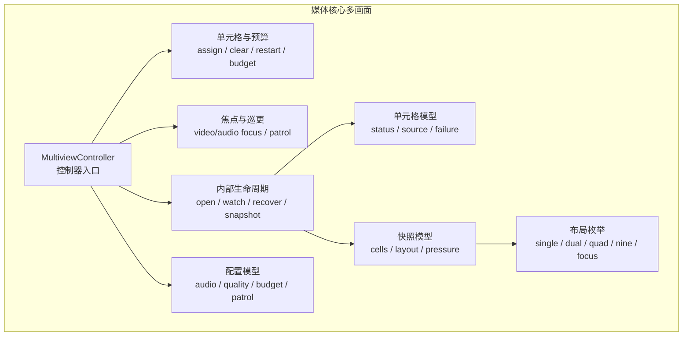

**图示来源**
- [multiview_controller.dart:10-22](file://packages/media_core_multiview/lib/src/multiview_controller.dart#L10-L22)
- [multiview_controller_cells.dart:1-5](file://packages/media_core_multiview/lib/src/multiview_controller_cells.dart#L1-L5)
- [multiview_controller_focus.dart:1-5](file://packages/media_core_multiview/lib/src/multiview_controller_focus.dart#L1-L5)
- [multiview_controller_internals.dart:1-5](file://packages/media_core_multiview/lib/src/multiview_controller_internals.dart#L1-L5)
- [multiview_cell.dart:108-177](file://packages/media_core_multiview/lib/src/multiview_cell.dart#L108-L177)
- [multiview_config.dart:57-154](file://packages/media_core_multiview/lib/src/multiview_config.dart#L57-L154)
- [multiview_snapshot.dart:30-64](file://packages/media_core_multiview/lib/src/multiview_snapshot.dart#L30-L64)
- [multiview_layout.dart:1-59](file://packages/media_core_multiview/lib/src/multiview_layout.dart#L1-L59)

**章节来源**
- [README.md:1-16](file://packages/media_core_multiview/README.md#L1-L16)
- [multiview_controller.dart:10-22](file://packages/media_core_multiview/lib/src/multiview_controller.dart#L10-L22)

## 核心组件
- `MultiviewController`：多画面监控的编排中枢，负责单元格分配、播放资源、音频唯一性、质量策略、健康检测、巡更、弹幕路由与快照发布。
- `MultiviewCell`：单格状态与数据载体，包含状态、失败原因、播放器标识、质量标签、焦点标记、弹幕会话等。
- `MultiviewConfig`：监控墙可调参数，包括布局、最大格子数、音频模式、质量策略、预算策略、弹幕策略、巡更开关与超时、音量与前台自动恢复等。
- `MultiviewSnapshot`：不可变快照，供宿主渲染网格、显示健康度、预算超支和资源压力。
- `MultiviewLayout`：网格形状与容量，决定展示尺寸与列行数。
- `MultiviewCellSource`：单元格播放源，支持房间标识、签名 URL 过期与续期回调。

**章节来源**
- [multiview_controller.dart:74-173](file://packages/media_core_multiview/lib/src/multiview_controller.dart#L74-L173)
- [multiview_cell.dart:5-177](file://packages/media_core_multiview/lib/src/multiview_cell.dart#L5-L177)
- [multiview_config.dart:4-194](file://packages/media_core_multiview/lib/src/multiview_config.dart#L4-L194)
- [multiview_snapshot.dart:6-64](file://packages/media_core_multiview/lib/src/multiview_snapshot.dart#L6-L64)
- [multiview_layout.dart:1-59](file://packages/media_core_multiview/lib/src/multiview_layout.dart#L1-L59)

## 架构总览
多画面监控以控制器为核心，向上暴露快照流与变更事件，向下通过 `PoolPlayerHost` 获取/归还播放器实例。每个格子拥有独立的进度观察、健康检测与恢复预算；音频由控制器统一应用，保证“唯一可听”或“静音/混合”模式；质量策略通过宿主注入的解析器决定实际码率；弹幕会话按格创建，受焦点控制是否喂入。

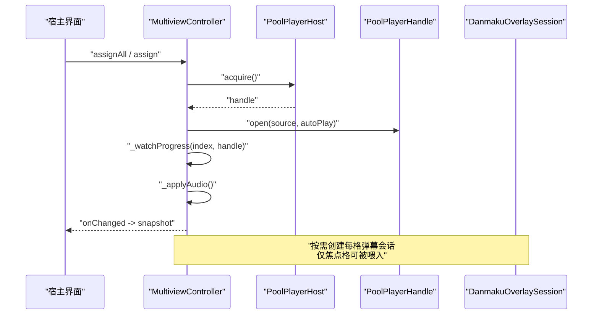

**图示来源**
- [multiview_controller_cells.dart:10-53](file://packages/media_core_multiview/lib/src/multiview_controller_cells.dart#L10-L53)
- [multiview_controller_internals.dart:10-82](file://packages/media_core_multiview/lib/src/multiview_controller_internals.dart#L10-L82)
- [multiview_controller_internals.dart:148-165](file://packages/media_core_multiview/lib/src/multiview_controller_internals.dart#L148-L165)
- [multiview_controller_internals.dart:167-202](file://packages/media_core_multiview/lib/src/multiview_controller_internals.dart#L167-L202)
- [multiview_controller_internals.dart:220-231](file://packages/media_core_multiview/lib/src/multiview_controller_internals.dart#L220-L231)

## 详细组件分析

### 多画面控制器与生命周期
控制器在构造时根据布局初始化固定数量的单元格，并启动健康检测定时器。对外暴露单元格分配、清理、重启、暂停/恢复、音量覆盖、焦点设置、巡更控制、压力上报、弹幕会话获取与销毁等方法。内部维护：
- 单元格列表与索引映射
- 每格的播放器句柄与进度订阅
- 播放位置与时间戳
- 手动音量覆盖
- 焦点与音频索引
- 预算与压力状态
- 快照广播控制器

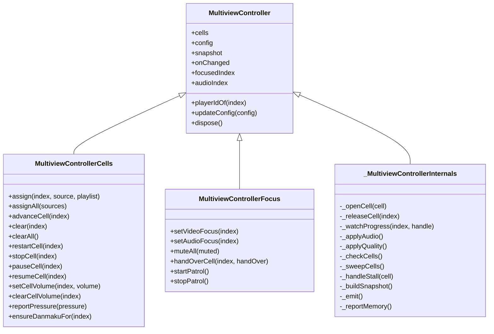

**图示来源**
- [multiview_controller.dart:74-173](file://packages/media_core_multiview/lib/src/multiview_controller.dart#L74-L173)
- [multiview_controller_cells.dart:5-283](file://packages/media_core_multiview/lib/src/multiview_controller_cells.dart#L5-L283)
- [multiview_controller_focus.dart:5-157](file://packages/media_core_multiview/lib/src/multiview_controller_focus.dart#L5-L157)
- [multiview_controller_internals.dart:5-398](file://packages/media_core_multiview/lib/src/multiview_controller_internals.dart#L5-L398)

**章节来源**
- [multiview_controller.dart:74-173](file://packages/media_core_multiview/lib/src/multiview_controller.dart#L74-L173)
- [multiview_controller.dart:183-266](file://packages/media_core_multiview/lib/src/multiview_controller.dart#L183-L266)

### 单元格模型与健康状态
单元格是监控墙的最小单元，承载播放源、状态、失败信息、播放器标识、质量标签、焦点标记与弹幕会话。状态包括空、启动中、播放、暂停、离线、恢复中、失败。失败类型区分解析失败、开流失败与停滞。单元格的生命周期由控制器驱动，打开前会检查是否离线、是否需要续期签名 URL、是否通过质量解析器降级或提升码率。

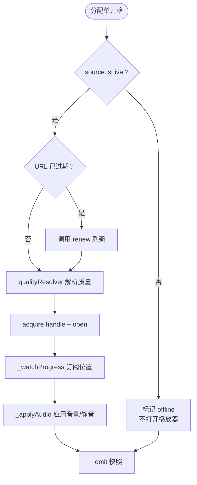

**图示来源**
- [multiview_controller_internals.dart:10-82](file://packages/media_core_multiview/lib/src/multiview_controller_internals.dart#L10-L82)
- [multiview_controller_internals.dart:84-109](file://packages/media_core_multiview/lib/src/multiview_controller_internals.dart#L84-L109)
- [multiview_controller_internals.dart:118-146](file://packages/media_core_multiview/lib/src/multiview_controller_internals.dart#L118-L146)
- [multiview_controller_internals.dart:148-165](file://packages/media_core_multiview/lib/src/multiview_controller_internals.dart#L148-L165)
- [multiview_controller_internals.dart:167-202](file://packages/media_core_multiview/lib/src/multiview_controller_internals.dart#L167-L202)

**章节来源**
- [multiview_cell.dart:5-177](file://packages/media_core_multiview/lib/src/multiview_cell.dart#L5-L177)
- [multiview_controller_internals.dart:10-109](file://packages/media_core_multiview/lib/src/multiview_controller_internals.dart#L10-L109)

### 音频唯一性与音量策略
音频模式有三种：独占（仅一个格子可听）、静音（全部静音）、混合（各格独立音量）。控制器维护“被听的格子”和“被看的格子”，二者可不同。独占模式下，非焦点格默认背景音量（通常静音），即使存在手动音量覆盖也不会让整面墙同时出声。静音操作会记住之前的音频模式，取消静音后恢复原模式而非强制独占。

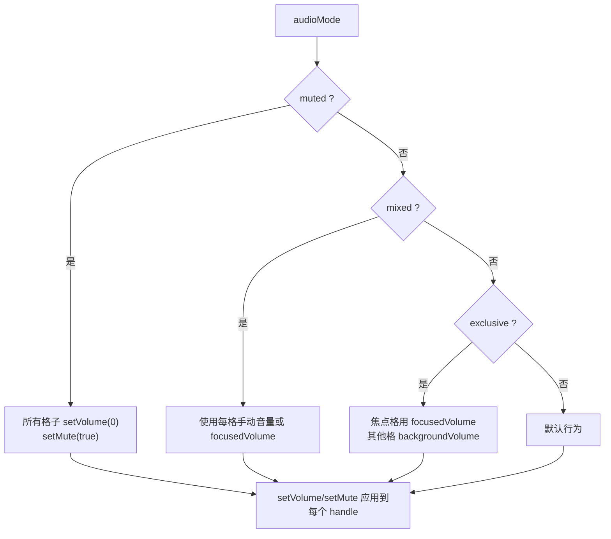

**图示来源**
- [multiview_controller_internals.dart:167-202](file://packages/media_core_multiview/lib/src/multiview_controller_internals.dart#L167-L202)
- [multiview_controller_focus.dart:50-70](file://packages/media_core_multiview/lib/src/multiview_controller_focus.dart#L50-L70)

**章节来源**
- [multiview_config.dart:4-22](file://packages/media_core_multiview/lib/src/multiview_config.dart#L4-L22)
- [multiview_controller_internals.dart:167-202](file://packages/media_core_multiview/lib/src/multiview_controller_internals.dart#L167-L202)
- [multiview_controller_focus.dart:50-70](file://packages/media_core_multiview/lib/src/multiview_controller_focus.dart#L50-L70)

### 健康检测与自动恢复
健康检测每 2 秒扫描一次，检查正在播放的格子是否仍在前进。若超过配置的停滞超时，则记录停滞失败并按重启预算尝试恢复；预算耗尽后，带播放列表的格子会前进到下一个房间，避免“盯着静止帧”。为避免重复风暴，控制器使用 `_sweeping` 标志确保一轮扫描未完成前不再开启下一轮。

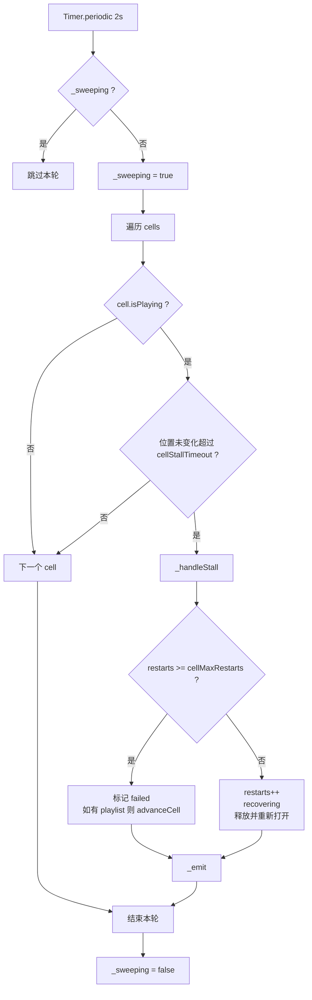

**图示来源**
- [multiview_controller_internals.dart:237-275](file://packages/media_core_multiview/lib/src/multiview_controller_internals.dart#L237-L275)
- [multiview_controller_internals.dart:277-344](file://packages/media_core_multiview/lib/src/multiview_controller_internals.dart#L277-L344)

**章节来源**
- [multiview_controller_internals.dart:237-344](file://packages/media_core_multiview/lib/src/multiview_controller_internals.dart#L237-L344)

### 资源分配与预算策略
预算基于“有效最大格子数”（布局容量与宿主 `maxCells` 取小者）与设备压力。当播放中的格子数超过预算或检测到压力时，控制器按策略处理：
- `keepFocusedOnly`：除焦点格外暂停其他播放格，严重压力时直接停掉非焦点格。
- `letPlatformDrop`：保持所有格子播放，交由平台丢帧。
- `refuseNewCells`：达到预算时拒绝新格子并抛出状态错误。

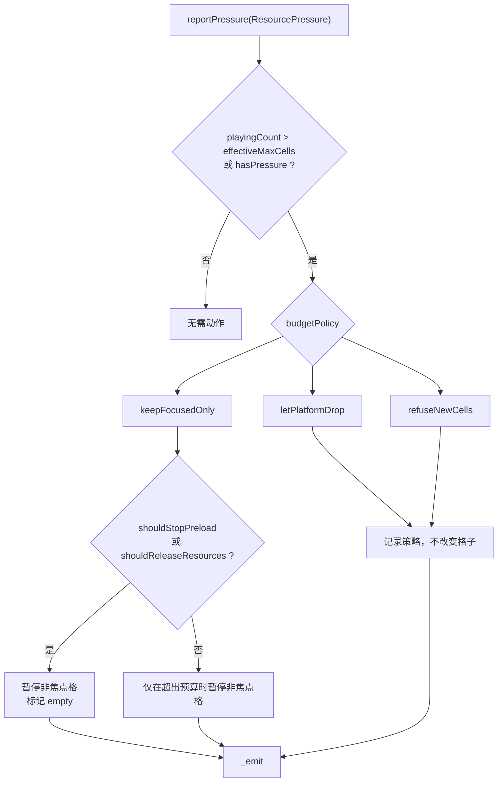

**图示来源**
- [multiview_controller_cells.dart:206-257](file://packages/media_core_multiview/lib/src/multiview_controller_cells.dart#L206-L257)

**章节来源**
- [multiview_controller_cells.dart:206-257](file://packages/media_core_multiview/lib/src/multiview_controller_cells.dart#L206-L257)
- [multiview_config.dart:38-55](file://packages/media_core_multiview/lib/src/multiview_config.dart#L38-L55)

### 逐格监控机制与弹幕路由
每格弹幕会话独立创建，避免 A 格积压出现在 B 格。弹幕是否喂入取决于 `danmakuOnlyOnFocused` 与当前焦点格。宿主从 `focusedDanmaku` 获取焦点格的弹幕会话，并将消息路由到该会话。

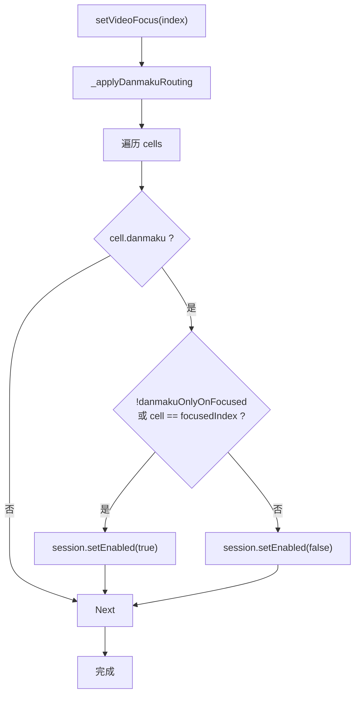

**图示来源**
- [multiview_controller_internals.dart:220-231](file://packages/media_core_multiview/lib/src/multiview_controller_internals.dart#L220-L231)
- [multiview_controller_cells.dart:267-281](file://packages/media_core_multiview/lib/src/multiview_controller_cells.dart#L267-L281)

**章节来源**
- [multiview_controller_internals.dart:220-231](file://packages/media_core_multiview/lib/src/multiview_controller_internals.dart#L220-L231)
- [multiview_controller_cells.dart:267-281](file://packages/media_core_multiview/lib/src/multiview_controller_cells.dart#L267-L281)

### 播放器生命周期管理与资源回收
控制器通过 `PoolPlayerHost.acquire()` 获取播放器句柄，并在释放时先暂停再回收，最后归还给 host，以便内核池复用。每格还维护进度订阅，释放时取消订阅、移除进度记录与手动音量覆盖。

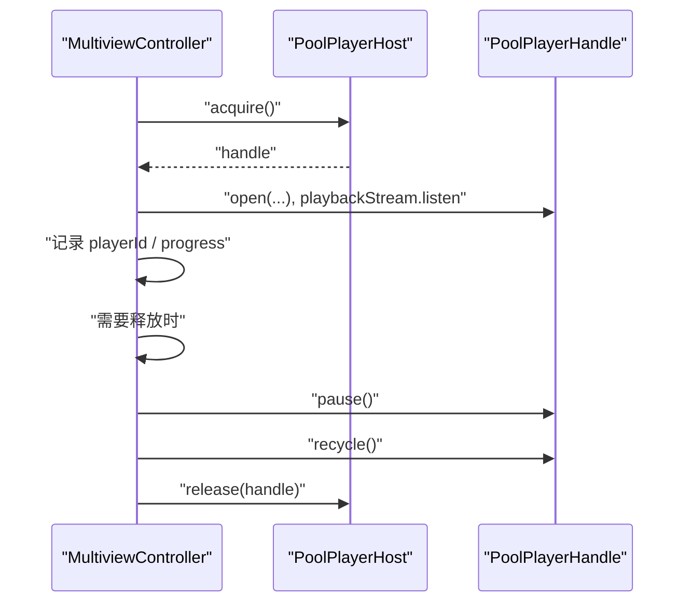

**图示来源**
- [multiview_controller_internals.dart:118-146](file://packages/media_core_multiview/lib/src/multiview_controller_internals.dart#L118-L146)
- [multiview_controller_internals.dart:148-165](file://packages/media_core_multiview/lib/src/multiview_controller_internals.dart#L148-L165)

**章节来源**
- [multiview_controller_internals.dart:118-146](file://packages/media_core_multiview/lib/src/multiview_controller_internals.dart#L118-L146)

### 监控指标收集与异常检测
- 指标收集：控制器通过 `MediaCoreMemory.of(MemoryModule.multiview)` 报告占用，统计已指派格子数、播放中格子数与弹幕队列长度，估算字节数。
- 异常检测：健康检测发现停滞，记录 `stallFailure`；开流失败记录 `startFailure`；解析失败记录 `resolveFailure`。
- 自动恢复：按 `cellMaxRestarts` 预算重启；预算耗尽后，有播放列表的格子前进到下一个房间。

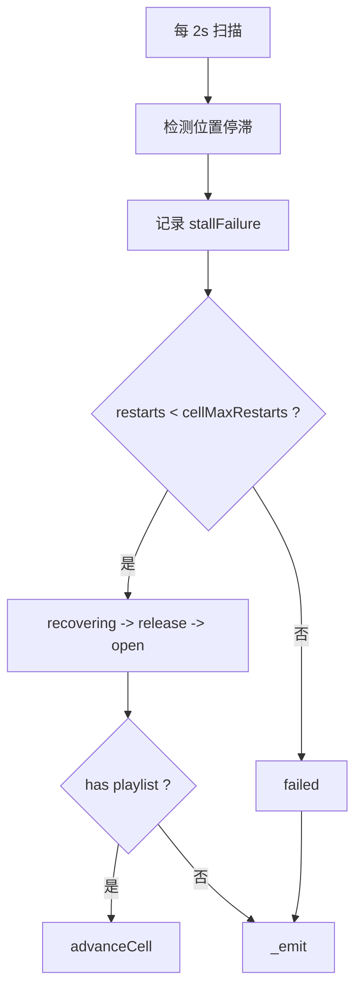

**图示来源**
- [multiview_controller_internals.dart:277-344](file://packages/media_core_multiview/lib/src/multiview_controller_internals.dart#L277-L344)
- [multiview_controller_internals.dart:371-396](file://packages/media_core_multiview/lib/src/multiview_controller_internals.dart#L371-L396)

**章节来源**
- [multiview_controller_internals.dart:277-344](file://packages/media_core_multiview/lib/src/multiview_controller_internals.dart#L277-L344)
- [multiview_controller_internals.dart:371-396](file://packages/media_core_multiview/lib/src/multiview_controller_internals.dart#L371-L396)

## 依赖关系分析
多画面监控依赖以下外部能力：
- 核心播放器池接口 `PoolPlayerHost` 与 `PoolPlayerHandle`
- 弹幕会话 `DanmakuOverlaySession`
- 日志模块 `LogCategory.multiview`
- 内存记账模块 `MemoryModule.multiview`
- 资源压力 `ResourcePressure`

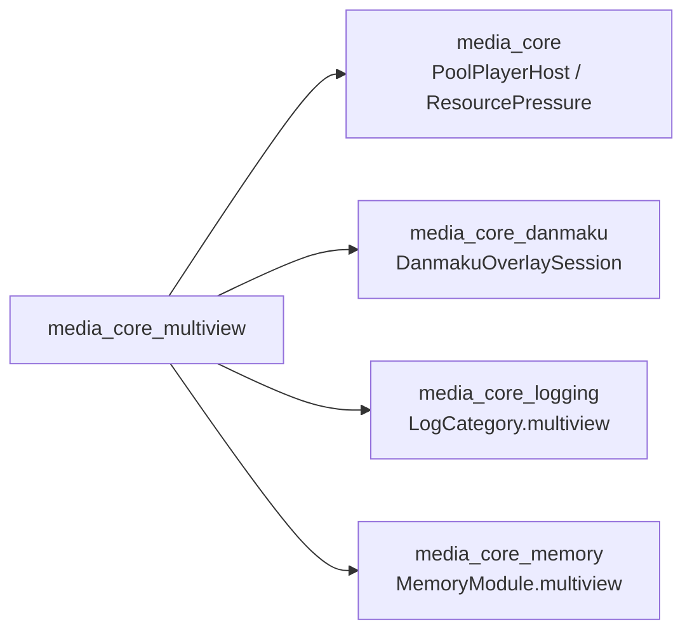

**图示来源**
- [multiview_controller.dart:1-8](file://packages/media_core_multiview/lib/src/multiview_controller.dart#L1-L8)
- [multiview_controller.dart:30-37](file://packages/media_core_multiview/lib/src/multiview_controller.dart#L30-L37)

**章节来源**
- [multiview_controller.dart:1-8](file://packages/media_core_multiview/lib/src/multiview_controller.dart#L1-L8)
- [multiview_controller.dart:30-37](file://packages/media_core_multiview/lib/src/multiview_controller.dart#L30-L37)

## 性能与内存控制
- 解码预算：通过 `effectiveMaxCells` 限制同时解码的格子数量；压力上升时立即应用策略，不等下一次 tick。
- 播放器复用：换房间的格子复用热播放器，避免冷启动成本；释放时先 `recycle` 再归还 host。
- 弹幕队列：每格独立会话，按需创建；只向焦点格喂入可减少文本渲染开销。
- 内存记账：统计已指派格子与弹幕消息，估算占用字节，纳入全局内存压力评估。
- 前台恢复：可通过配置启用回到前台时自动恢复播放。

**章节来源**
- [multiview_controller_cells.dart:206-257](file://packages/media_core_multiview/lib/src/multiview_controller_cells.dart#L206-L257)
- [multiview_controller_internals.dart:118-146](file://packages/media_core_multiview/lib/src/multiview_controller_internals.dart#L118-L146)
- [multiview_controller_internals.dart:220-231](file://packages/media_core_multiview/lib/src/multiview_controller_internals.dart#L220-L231)
- [multiview_controller_internals.dart:371-396](file://packages/media_core_multiview/lib/src/multiview_controller_internals.dart#L371-L396)
- [multiview_config.dart:147-148](file://packages/media_core_multiview/lib/src/multiview_config.dart#L147-L148)

## API 参考

### 初始化与基本用法
- 创建控制器：传入 `PoolPlayerHost`、`MultiviewConfig`、可选质量解析器与时钟函数。
- 监听快照：订阅 `onChanged`，更新 UI。
- 批量分配：`assignAll` 将多个房间分配到格子。
- 单格分配：`assign` 支持附带播放列表，用于轮播。

示例路径
- [multiview_demo_page.dart:51-77](file://example/lib/pages/multiview_demo_page.dart#L51-L77)

**章节来源**
- [multiview_controller.dart:74-85](file://packages/media_core_multiview/lib/src/multiview_controller.dart#L74-L85)
- [multiview_controller_cells.dart:10-63](file://packages/media_core_multiview/lib/src/multiview_controller_cells.dart#L10-L63)
- [multiview_demo_page.dart:51-77](file://example/lib/pages/multiview_demo_page.dart#L51-L77)

### 画面布局与配置
- 布局：`MultiviewLayout.single/dual/quad/nine/focus`，决定容量与行列。
- 最大格子：`maxCells` 与布局容量取小作为有效上限。
- 音频模式：`exclusive/muted/mixed`。
- 质量策略：`focusFirst/uniform`，配合 `degradeQualityWhenCrowded`。
- 预算策略：`keepFocusedOnly/letPlatformDrop/refuseNewCells`。
- 弹幕策略：`danmakuOnlyOnFocused`。
- 巡更：`patrolEnabled/patrolInterval/patrolSkipsOfflineCells`。
- 超时与重试：`cellStartTimeout/cellStallTimeout/cellMaxRestarts`。
- 音量：`focusedVolume/backgroundVolume`。
- 前台恢复：`autoResumeOnForeground`。

示例路径
- [multiview_config.dart:57-154](file://packages/media_core_multiview/lib/src/multiview_config.dart#L57-L154)

**章节来源**
- [multiview_layout.dart:1-59](file://packages/media_core_multiview/lib/src/multiview_layout.dart#L1-L59)
- [multiview_config.dart:57-154](file://packages/media_core_multiview/lib/src/multiview_config.dart#L57-L154)

### 状态监听与事件处理
- 快照：`snapshot.cells/layout/focusedIndex/audioIndex/pressure/budgetExceeded`。
- 变更流：`onChanged` 发射不可变快照。
- 焦点：`focusedIndex`、`audioIndex`。
- 播放器标识：`playerIdOf(index)` 用于宿主渲染或 PiP 接管。

示例路径
- [multiview_controller.dart:146-173](file://packages/media_core_multiview/lib/src/multiview_controller.dart#L146-L173)
- [multiview_snapshot.dart:30-64](file://packages/media_core_multiview/lib/src/multiview_snapshot.dart#L30-L64)

**章节来源**
- [multiview_controller.dart:146-173](file://packages/media_core_multiview/lib/src/multiview_controller.dart#L146-L173)
- [multiview_snapshot.dart:30-64](file://packages/media_core_multiview/lib/src/multiview_snapshot.dart#L30-L64)

### 单元格操作
- 分配：`assign(index, source, playlist?)`
- 批量分配：`assignAll(sources)`
- 前进播放列表：`advanceCell(index)`
- 清理：`clear(index)`、`clearAll()`
- 重启：`restartCell(index)`
- 停止：`stopCell(index)`
- 暂停/恢复：`pauseCell(index)`、`resumeCell(index)`
- 音量覆盖：`setCellVolume(index, volume)`、`clearCellVolume(index)`

示例路径
- [multiview_controller_cells.dart:10-196](file://packages/media_core_multiview/lib/src/multiview_controller_cells.dart#L10-L196)

**章节来源**
- [multiview_controller_cells.dart:10-196](file://packages/media_core_multiview/lib/src/multiview_controller_cells.dart#L10-L196)

### 焦点与巡更
- 视频焦点：`setVideoFocus(index)`
- 音频焦点：`setAudioFocus(index)`
- 静音：`muteAll(muted)`
- 交接格子：`handOverCell(index, handOver)`
- 巡更：`startPatrol()`、`stopPatrol()`

示例路径
- [multiview_controller_focus.dart:10-157](file://packages/media_core_multiview/lib/src/multiview_controller_focus.dart#L10-L157)

**章节来源**
- [multiview_controller_focus.dart:10-157](file://packages/media_core_multiview/lib/src/multiview_controller_focus.dart#L10-L157)

### 资源与弹幕
- 压力上报：`reportPressure(ResourcePressure)`
- 弹幕会话：`ensureDanmakuFor(index)`
- 内存报告：内部 `_reportMemory` 按实例上报

示例路径
- [multiview_controller_cells.dart:206-281](file://packages/media_core_multiview/lib/src/multiview_controller_cells.dart#L206-L281)
- [multiview_controller_internals.dart:371-396](file://packages/media_core_multiview/lib/src/multiview_controller_internals.dart#L371-L396)

**章节来源**
- [multiview_controller_cells.dart:206-281](file://packages/media_core_multiview/lib/src/multiview_controller_cells.dart#L206-L281)
- [multiview_controller_internals.dart:371-396](file://packages/media_core_multiview/lib/src/multiview_controller_internals.dart#L371-L396)

### 销毁与资源释放
- 销毁控制器：`dispose()` 释放所有格子播放器与弹幕会话，关闭快照控制器。

示例路径
- [multiview_controller.dart:236-259](file://packages/media_core_multiview/lib/src/multiview_controller.dart#L236-L259)

**章节来源**
- [multiview_controller.dart:236-259](file://packages/media_core_multiview/lib/src/multiview_controller.dart#L236-L259)

## 故障排查与恢复
- 常见状态
  - `empty`：无房间分配
  - `starting`：正在打开
  - `playing`：正常播放
  - `paused`：被宿主暂停，健康检测跳过
  - `offline`：业务离线，不触发错误
  - `recovering`：因停滞而重启中
  - `failed`：失败且不再自动重试
- 失败原因
  - `resolveFailure`：解析失败
  - `startFailure`：开流失败
  - `stallFailure`：停滞
- 恢复流程
  - 停滞检测 → 记录失败 → 按预算重启 → 预算耗尽 → 若有播放列表则前进到下一个房间
- 预算超支
  - 根据策略暂停非焦点格、交给平台丢帧或拒绝新格子
- 日志与内存
  - 决策写入 `LogCategory.multiview`
  - 占用按实例报进 `MemoryModule.multiview`

示例路径
- [multiview_cell.dart:5-63](file://packages/media_core_multiview/lib/src/multiview_cell.dart#L5-L63)
- [multiview_controller_internals.dart:277-344](file://packages/media_core_multiview/lib/src/multiview_controller_internals.dart#L277-L344)
- [multiview_controller_cells.dart:206-257](file://packages/media_core_multiview/lib/src/multiview_controller_cells.dart#L206-L257)

**章节来源**
- [multiview_cell.dart:5-63](file://packages/media_core_multiview/lib/src/multiview_cell.dart#L5-L63)
- [multiview_controller_internals.dart:277-344](file://packages/media_core_multiview/lib/src/multiview_controller_internals.dart#L277-L344)
- [multiview_controller_cells.dart:206-257](file://packages/media_core_multiview/lib/src/multiview_controller_cells.dart#L206-L257)

## 最佳实践与集成建议
- 合理设置 `maxCells`：屏幕能放下不等于设备能解码；应结合后端能力与设备探针调整。
- 使用 `keepFocusedOnly`：在移动设备上优先保焦点格，避免九路卡顿。
- 提供质量解析器：让宿主根据站点能力选择码率，避免盲目降级导致全墙模糊。
- 使用播放列表：对轮播格子配置 playlist，失败或结束后前进，而不是死循环重试。
- 使用 `handOverCell`：把格子交给 PiP 或浮窗，不重开流，减少缓冲抖动。
- 弹幕只喂焦点格：降低渲染与队列压力。
- 及时上报压力：通过 `reportPressure` 立即生效，不要等 tick。
- 正确销毁：在页面销毁时调用 `wall.dispose()` 并释放 host。

示例路径
- [multiview_demo_page.dart:51-87](file://example/lib/pages/multiview_demo_page.dart#L51-L87)
- [README.md:18-54](file://packages/media_core_multiview/README.md#L18-L54)

**章节来源**
- [multiview_demo_page.dart:51-87](file://example/lib/pages/multiview_demo_page.dart#L51-L87)
- [README.md:18-54](file://packages/media_core_multiview/README.md#L18-L54)

## 结论
多画面监控通过控制器集中编排，将“谁在响、谁在看、谁该清晰、谁该存活”四个问题系统化解决。它以播放器池为基础，结合健康检测、预算策略、焦点与巡更、弹幕路由与内存记账，形成一套适合监控场景的稳定方案。宿主只需负责渲染网格、解析房间与质量、接入系统媒体面与 PiP，即可构建高性能、可观测、可扩展的视频墙。