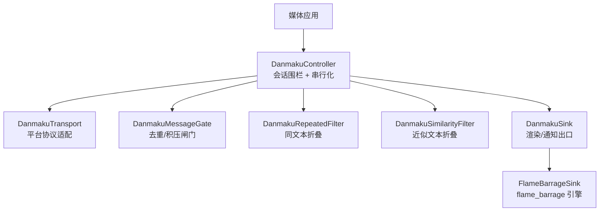
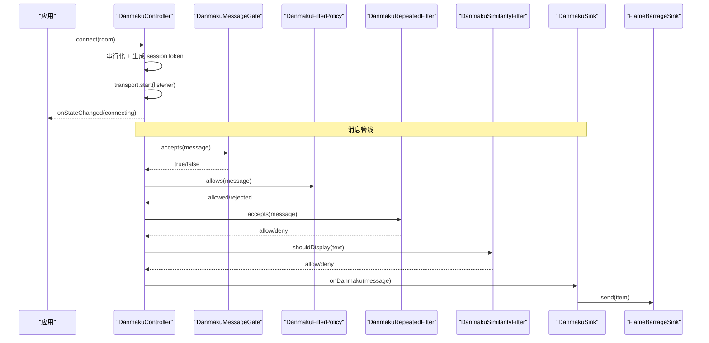
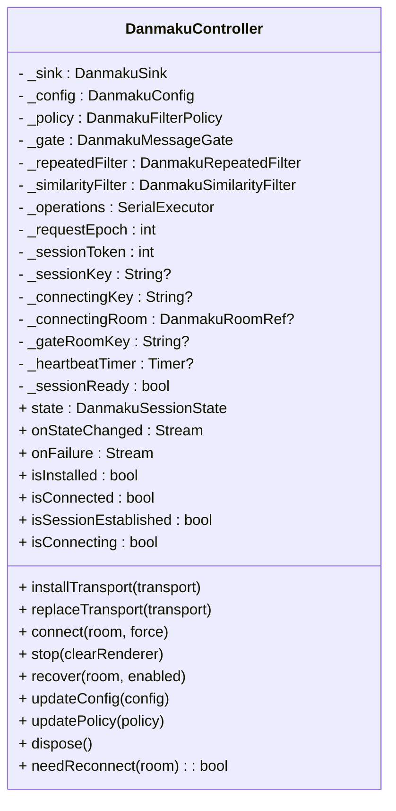
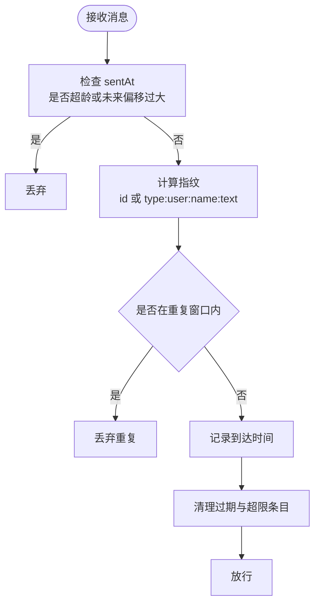
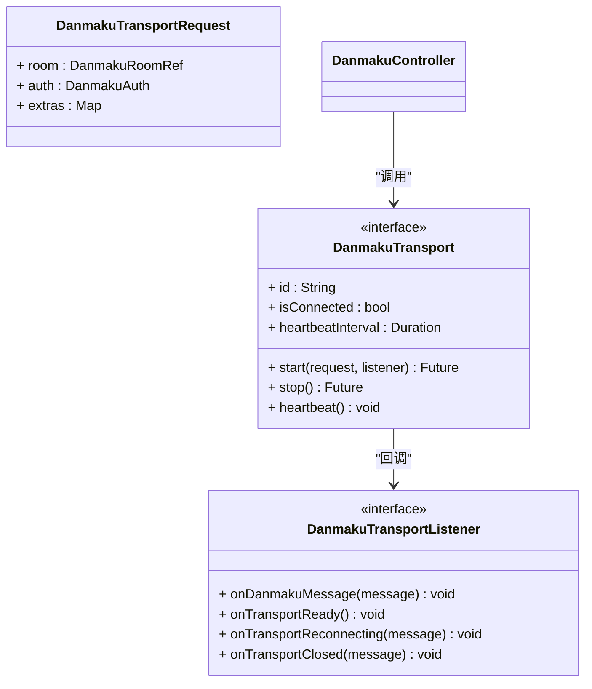
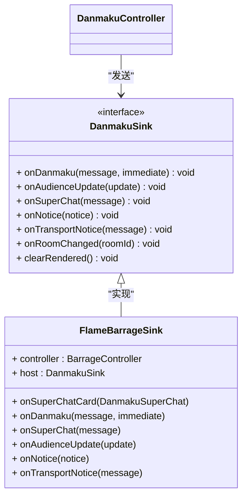
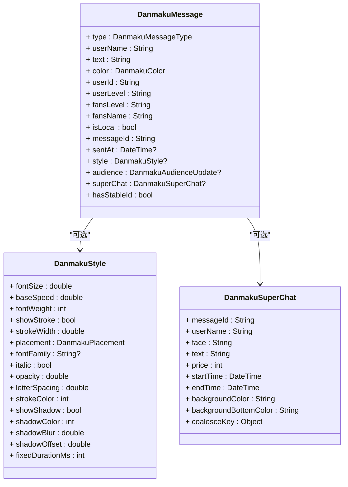
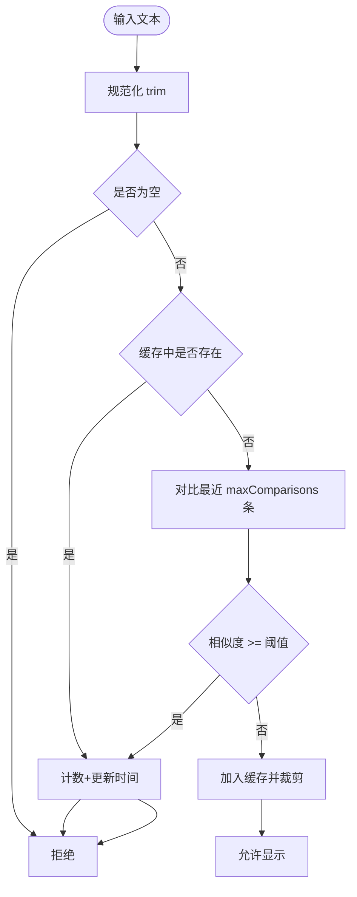
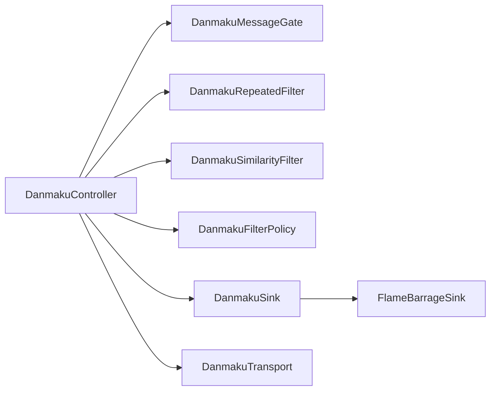

# 弹幕系统

<cite>
**本文引用的文件**   
- [media_core_danmaku.dart](file://packages/media_core_danmaku/lib/media_core_danmaku.dart)
- [danmaku_controller.dart](file://packages/media_core_danmaku/lib/src/danmaku_controller.dart)
- [danmaku_message_gate.dart](file://packages/media_core_danmaku/lib/src/danmaku_message_gate.dart)
- [danmaku_transport.dart](file://packages/media_core_danmaku/lib/src/danmaku_transport.dart)
- [danmaku_sink.dart](file://packages/media_core_danmaku/lib/src/danmaku_sink.dart)
- [danmaku_message.dart](file://packages/media_core_danmaku/lib/src/danmaku_message.dart)
- [danmaku_config.dart](file://packages/media_core_danmaku/lib/src/danmaku_config.dart)
- [danmaku_filter_policy.dart](file://packages/media_core_danmaku/lib/src/danmaku_filter_policy.dart)
- [danmaku_repeated_filter.dart](file://packages/media_core_danmaku/lib/src/danmaku_repeated_filter.dart)
- [danmaku_similarity_filter.dart](file://packages/media_core_danmaku/lib/src/danmaku_similarity_filter.dart)
- [flame_barrage_sink.dart](file://packages/media_core_danmaku/lib/src/flame_barrage_sink.dart)
- [README.md](file://packages/media_core_danmaku/README.md)
</cite>

## 目录
1. [简介](#简介)
2. [项目结构](#项目结构)
3. [核心组件](#核心组件)
4. [架构总览](#架构总览)
5. [详细组件分析](#详细组件分析)
6. [依赖关系分析](#依赖关系分析)
7. [性能与内存优化](#性能与内存优化)
8. [API 参考](#api-参考)
9. [故障排查](#故障排查)
10. [结论](#结论)

## 简介
本模块为 `media_core` 的弹幕会话层，提供平台无关的传输契约、消息归一化、去重与积压闸门、内容过滤，以及“旧 socket 不能写进新房间”的会话围栏。它不负责任何站点私有协议，也不负责渲染：传输由实现 `DanmakuTransport` 的适配器完成，画面通过 `DanmakuSink`（默认使用 `FlameBarrageSink`）交给宿主或引擎。

该包解决的核心问题包括：
- 旧 socket 写入新房间：通过 `SerialExecutor` 串行化连接/断开，并用 `(transport, roomKey, sessionToken)` 三重校验丢弃回调。
- 重放与积压：`DanmakuMessageGate` 区分稳定 id 长窗与无 id 短指纹窗，并拒绝超过 `maxMessageAge` 的后台积压。
- 重复刷屏：`DanmakuRepeatedFilter` 折叠不同账号同一文本；`DanmakuSimilarityFilter` 折叠近似文本，且对本地回显豁免。
- 小画面不是第二个会话：`DanmakuOverlaySession` 绑定可见性流，隐藏即清空，避免返回时回放旧弹幕。

**章节来源**
- [README.md:1-75](file://packages/media_core_danmaku/README.md#L1-L75)

## 项目结构
`media_core_danmaku` 采用按职责拆分的纯 Dart 结构：公共导出集中在库入口，具体实现位于 `src/`。关键文件如下：
- 公共导出：`lib/media_core_danmaku.dart`
- 控制器与会话围栏：`danmaku_controller.dart`
- 消息闸门：`danmaku_message_gate.dart`
- 传输契约：`danmaku_transport.dart`
- 输出端口：`danmaku_sink.dart`
- 消息模型：`danmaku_message.dart`
- 配置与策略：`danmaku_config.dart`、`danmaku_filter_policy.dart`
- 过滤器：`danmaku_repeated_filter.dart`、`danmaku_similarity_filter.dart`
- 渲染桥接：`flame_barrage_sink.dart`

**图表来源**
- [danmaku_controller.dart:16-38](file://packages/media_core_danmaku/lib/src/danmaku_controller.dart#L16-L38)
- [danmaku_transport.dart:101-143](file://packages/media_core_danmaku/lib/src/danmaku_transport.dart#L101-L143)
- [danmaku_message_gate.dart:5-20](file://packages/media_core_danmaku/lib/src/danmaku_message_gate.dart#L5-L20)
- [danmaku_sink.dart:31-82](file://packages/media_core_danmaku/lib/src/danmaku_sink.dart#L31-L82)
- [flame_barrage_sink.dart:8-28](file://packages/media_core_danmaku/lib/src/flame_barrage_sink.dart#L8-L28)

**章节来源**
- [media_core_danmaku.dart:1-30](file://packages/media_core_danmaku/lib/media_core_danmaku.dart#L1-L30)

## 核心组件
- DanmakuController：单房间会话控制器，负责安装/替换传输、串行化连接/停止、回调身份校验、消息管线编排、状态与失败事件。
- DanmakuMessageGate：基于时间窗口和指纹的去重/积压闸门，支持稳定 id 长窗和无 id 短指纹窗。
- DanmakuTransport / DanmakuTransportListener：平台传输契约，定义 start/stop/heartbeat 及就绪、重连、关闭等事件。
- DanmakuSink：会话输出端口，承载弹幕、观众数、付费卡片、通知、房间变更与清理。
- DanmakuMessage / DanmakuStyle / DanmakuSuperChat：跨平台消息与样式归一化模型。
- DanmakuConfig / DanmakuFilterPolicy：会话可调参数与用户屏蔽策略。
- DanmakuRepeatedFilter / DanmakuSimilarityFilter：重复与近似文本过滤。
- FlameBarrageSink：将归一化消息映射到 flame_barrage 引擎项。

**章节来源**
- [danmaku_controller.dart:16-38](file://packages/media_core_danmaku/lib/src/danmaku_controller.dart#L16-L38)
- [danmaku_message_gate.dart:5-20](file://packages/media_core_danmaku/lib/src/danmaku_message_gate.dart#L5-L20)
- [danmaku_transport.dart:101-143](file://packages/media_core_danmaku/lib/src/danmaku_transport.dart#L101-L143)
- [danmaku_sink.dart:31-82](file://packages/media_core_danmaku/lib/src/danmaku_sink.dart#L31-L82)
- [danmaku_message.dart:157-234](file://packages/media_core_danmaku/lib/src/danmaku_message.dart#L157-L234)
- [danmaku_config.dart:14-33](file://packages/media_core_danmaku/lib/src/danmaku_config.dart#L14-L33)
- [danmaku_filter_policy.dart:15-26](file://packages/media_core_danmaku/lib/src/danmaku_filter_policy.dart#L15-L26)
- [danmaku_repeated_filter.dart:5-23](file://packages/media_core_danmaku/lib/src/danmaku_repeated_filter.dart#L5-L23)
- [danmaku_similarity_filter.dart:5-24](file://packages/media_core_danmaku/lib/src/danmaku_similarity_filter.dart#L5-L24)
- [flame_barrage_sink.dart:8-28](file://packages/media_core_danmaku/lib/src/flame_barrage_sink.dart#L8-L28)

## 架构总览
DanmakuController 是会话中枢：它持有 SerialExecutor 保证所有连接/停止/替换操作串行执行；每次请求递增 requestEpoch，并在进入操作体前检查是否仍有效；每次接受会话递增 sessionToken，并把 token、transport 身份与 roomKey 一起传给传输监听器，从而杜绝“旧 socket 写新房间”。

消息到达后按顺序经过：
1. DanmakuMessageGate：拒绝超龄与重复。
2. DanmakuFilterPolicy：根据用户屏蔽名单过滤。
3. DanmakuRepeatedFilter：折叠短时间内的相同文本。
4. DanmakuSimilarityFilter：折叠近似文本（本地消息豁免）。
5. DanmakuSink：渲染或转发给上层 UI。

**图表来源**
- [danmaku_controller.dart:220-310](file://packages/media_core_danmaku/lib/src/danmaku_controller.dart#L220-L310)
- [danmaku_controller.dart:416-459](file://packages/media_core_danmaku/lib/src/danmaku_controller.dart#L416-L459)
- [danmaku_message_gate.dart:84-112](file://packages/media_core_danmaku/lib/src/danmaku_message_gate.dart#L84-L112)
- [danmaku_sink.dart:42-82](file://packages/media_core_danmaku/lib/src/danmaku_sink.dart#L42-L82)
- [flame_barrage_sink.dart:50-53](file://packages/media_core_danmaku/lib/src/flame_barrage_sink.dart#L50-L53)

**章节来源**
- [danmaku_controller.dart:39-56](file://packages/media_core_danmaku/lib/src/danmaku_controller.dart#L39-L56)
- [danmaku_controller.dart:416-459](file://packages/media_core_danmaku/lib/src/danmaku_controller.dart#L416-L459)

## 详细组件分析

### DanmakuController：会话围栏与实时渲染编排
- 串行化：所有连接/停止/替换通过 `_serialize` 进入 `SerialExecutor`，失败不阻塞后续操作。
- 身份令牌：`_sessionToken` 在每次会话建立/销毁时递增；监听器捕获启动时的 token，回调先经 `_accepts(transport, key, token)` 校验。
- 生命周期：`connect` 快速路径跳过已连接或正在连接的相同房间；`stop` 可保留渲染历史用于同房间重连；`recover` 尊重宿主启用策略。
- 心跳：由控制器调度，若传输报告自身心跳则跳过；心跳失败不直接视为会话失败，交由平台关闭事件处理。
- 通知去抖：`_notice` 与 `_reportTransportNotice` 对重复通知进行短时合并。
- 资源清理：dispose 会停止会话、关闭流；disconnectInternal 会递增 token、清空房间键、停止心跳、清理渲染。

**图表来源**
- [danmaku_controller.dart:57-167](file://packages/media_core_danmaku/lib/src/danmaku_controller.dart#L57-L167)
- [danmaku_controller.dart:168-377](file://packages/media_core_danmaku/lib/src/danmaku_controller.dart#L168-L377)

**章节来源**
- [danmaku_controller.dart:39-56](file://packages/media_core_danmaku/lib/src/danmaku_controller.dart#L39-L56)
- [danmaku_controller.dart:168-377](file://packages/media_core_danmaku/lib/src/danmaku_controller.dart#L168-L377)
- [danmaku_controller.dart:500-567](file://packages/media_core_danmaku/lib/src/danmaku_controller.dart#L500-L567)

### DanmakuMessageGate：消息生命周期与时序控制
- 双机制：
  - 年龄门限：`sentAt` 超出 `maxMessageAge` 或未来偏移超过 `maxFutureSkew` 直接丢弃。
  - 身份去重：有稳定 id 走长窗 `stableIdWindow`；无 id 走短指纹窗 `fallbackDuplicateWindow`，指纹包含类型、发送者、用户名与文本。
- 内存上限：`LinkedHashMap` 保持插入顺序，过期扫描 O(1) 截断，同时受 `maxEntries` 限制。
- 窗口更新：`applyWindows` 重建窗口并清空指纹缓存，避免用新规则判断旧条目。

**图表来源**
- [danmaku_message_gate.dart:84-112](file://packages/media_core_danmaku/lib/src/danmaku_message_gate.dart#L84-L112)
- [danmaku_message_gate.dart:135-145](file://packages/media_core_danmaku/lib/src/danmaku_message_gate.dart#L135-L145)

**章节来源**
- [danmaku_message_gate.dart:5-20](file://packages/media_core_danmaku/lib/src/danmaku_message_gate.dart#L5-L20)
- [danmaku_message_gate.dart:65-82](file://packages/media_core_danmaku/lib/src/danmaku_message_gate.dart#L65-L82)
- [danmaku_message_gate.dart:84-112](file://packages/media_core_danmaku/lib/src/danmaku_message_gate.dart#L84-L112)

### DanmakuTransport：协议适配与连接管理
- 单房间单次使用：一个实例只为一次 `start` 创建，由 `stop` 释放；复用会导致迟到包被错误归属。
- 事件语义：`onTransportReady` 表示就绪；`onTransportReconnecting` 表示非终态中断；`onTransportClosed` 表示终止。
- 心跳：`heartbeatInterval` 为零表示传输自管心跳；否则由控制器周期性调用 `heartbeat()`。
- 健壮性：`stop` 必须对未启动、已停止、start 飞行中均安全。

**图表来源**
- [danmaku_transport.dart:101-143](file://packages/media_core_danmaku/lib/src/danmaku_transport.dart#L101-L143)
- [danmaku_transport.dart:74-99](file://packages/media_core_danmaku/lib/src/danmaku_transport.dart#L74-L99)
- [danmaku_transport.dart:51-72](file://packages/media_core_danmaku/lib/src/danmaku_transport.dart#L51-L72)

**章节来源**
- [danmaku_transport.dart:101-143](file://packages/media_core_danmaku/lib/src/danmaku_transport.dart#L101-L143)

### DanmakuSink 与 FlameBarrageSink：渲染与事件分发
- DanmakuSink：抽象输出端口，承载弹幕、观众数、付费卡片、通知、房间变更与清理；实现需轻量且不抛异常。
- FlameBarrageSink：将归一化消息映射为引擎项；superchat 走独立回调；`immediate` 仅建议，真正即时渲染应开启引擎实时模式。

**图表来源**
- [danmaku_sink.dart:31-82](file://packages/media_core_danmaku/lib/src/danmaku_sink.dart#L31-L82)
- [flame_barrage_sink.dart:28-80](file://packages/media_core_danmaku/lib/src/flame_barrage_sink.dart#L28-L80)

**章节来源**
- [danmaku_sink.dart:31-82](file://packages/media_core_danmaku/lib/src/danmaku_sink.dart#L31-L82)
- [flame_barrage_sink.dart:8-28](file://packages/media_core_danmaku/lib/src/flame_barrage_sink.dart#L8-L28)
- [flame_barrage_sink.dart:50-80](file://packages/media_core_danmaku/lib/src/flame_barrage_sink.dart#L50-L80)

### 消息模型与样式：DanmakuMessage / DanmakuStyle / DanmakuSuperChat
- DanmakuMessage：统一的消息载体，包含类型、用户名、文本、颜色、用户标识、等级标签、本地标记、稳定 id、发送时间、样式、观众数据与付费卡片。
- DanmakuStyle：每条消息可覆盖字体大小、速度、字重、描边、阴影、位置、透明度、字距与固定停留时长。
- DanmakuSuperChat：付费卡片拥有独立生命周期、价格、起止时间与去重键。

**图表来源**
- [danmaku_message.dart:157-234](file://packages/media_core_danmaku/lib/src/danmaku_message.dart#L157-L234)
- [danmaku_message.dart:86-129](file://packages/media_core_danmaku/lib/src/danmaku_message.dart#L86-L129)
- [danmaku_message.dart:236-289](file://packages/media_core_danmaku/lib/src/danmaku_message.dart#L236-L289)

**章节来源**
- [danmaku_message.dart:157-234](file://packages/media_core_danmaku/lib/src/danmaku_message.dart#L157-L234)
- [danmaku_message.dart:86-129](file://packages/media_core_danmaku/lib/src/danmaku_message.dart#L86-L129)
- [danmaku_message.dart:236-289](file://packages/media_core_danmaku/lib/src/danmaku_message.dart#L236-L289)

### 过滤器：重复与相似度
- DanmakuRepeatedFilter：在窗口内折叠相同文本，忽略本地消息；禁用时清空窗口。
- DanmakuSimilarityFilter：对最近缓存文本做模糊匹配，限制比较预算与缓存大小；精确命中直接短路；支持运行时更新配置。

**图表来源**
- [danmaku_similarity_filter.dart:81-120](file://packages/media_core_danmaku/lib/src/danmaku_similarity_filter.dart#L81-L120)
- [danmaku_repeated_filter.dart:35-54](file://packages/media_core_danmaku/lib/src/danmaku_repeated_filter.dart#L35-L54)

**章节来源**
- [danmaku_repeated_filter.dart:5-23](file://packages/media_core_danmaku/lib/src/danmaku_repeated_filter.dart#L5-L23)
- [danmaku_repeated_filter.dart:35-70](file://packages/media_core_danmaku/lib/src/danmaku_repeated_filter.dart#L35-L70)
- [danmaku_similarity_filter.dart:5-24](file://packages/media_core_danmaku/lib/src/danmaku_similarity_filter.dart#L5-L24)
- [danmaku_similarity_filter.dart:81-120](file://packages/media_core_danmaku/lib/src/danmaku_similarity_filter.dart#L81-L120)

## 依赖关系分析
- DanmakuController 依赖：
  - SerialExecutor（核心）：串行化连接/停止。
  - DanmakuMessageGate：去重与积压。
  - DanmakuRepeatedFilter / DanmakuSimilarityFilter：内容过滤。
  - DanmakuFilterPolicy：用户屏蔽策略。
  - DanmakuSink：渲染与通知出口。
  - DanmakuTransport：平台协议。
- 外部依赖：
  - rxdart：状态与失败事件流。
  - flame_barrage：默认渲染引擎。
  - fuzzywuzzy：相似度评分。
  - media_core_logging / media_core_memory：日志与内存记账。

**图表来源**
- [danmaku_controller.dart:57-89](file://packages/media_core_danmaku/lib/src/danmaku_controller.dart#L57-L89)
- [danmaku_sink.dart:31-82](file://packages/media_core_danmaku/lib/src/danmaku_sink.dart#L31-L82)
- [flame_barrage_sink.dart:28-80](file://packages/media_core_danmaku/lib/src/flame_barrage_sink.dart#L28-L80)

**章节来源**
- [danmaku_controller.dart:57-89](file://packages/media_core_danmaku/lib/src/danmaku_controller.dart#L57-L89)

## 性能与内存优化
- 去重与积压：
  - 稳定 id 使用长窗，无 id 使用短指纹窗，避免误杀真实刷屏。
  - `maxMessageAge` 防止后台积压被当作现场聊天。
  - `maxEntries` 限制指纹表大小，配合插入顺序 O(1) 淘汰。
- 重复与相似度：
  - 重复折叠与相似度折叠分离，前者针对“同文本”，后者针对“近似文本”。
  - 相似度比较只对新近切片进行，`maxComparisons` 限制每包比较次数。
  - 精确命中短路，避免昂贵编辑距离计算。
- 渲染：
  - `FlameBarrageSink` 仅做映射，布局与节奏由引擎负责。
  - 本地回显绕过相似度过滤，确保用户看到自己的发送。
- 并发与资源：
  - 所有连接/停止串行化，避免多握手竞争。
  - 心跳由控制器调度，避免应用在挂起/后台时积累并行保活。
  - 清理时递增 sessionToken，立即失效所有待处理回调。

**章节来源**
- [danmaku_message_gate.dart:84-112](file://packages/media_core_danmaku/lib/src/danmaku_message_gate.dart#L84-L112)
- [danmaku_similarity_filter.dart:12-23](file://packages/media_core_danmaku/lib/src/danmaku_similarity_filter.dart#L12-L23)
- [danmaku_similarity_filter.dart:81-120](file://packages/media_core_danmaku/lib/src/danmaku_similarity_filter.dart#L81-L120)
- [danmaku_controller.dart:500-567](file://packages/media_core_danmaku/lib/src/danmaku_controller.dart#L500-L567)

## API 参考

### 控制器初始化与生命周期
- 构造参数：
  - sink：渲染出口，默认丢弃。
  - config：会话可调参数。
  - policy：用户屏蔽策略。
  - authProvider：按需获取鉴权信息。
- 主要方法：
  - installTransport：首次同步安装，替换异步。
  - replaceTransport：替换传输并清理过滤器。
  - connect：连接房间，支持强制重建。
  - stop：断开会话，可选择清理渲染历史。
  - recover：恢复会话，尊重宿主启用策略。
  - updateConfig：更新窗口与过滤器参数。
  - updatePolicy：更新屏蔽策略。
  - dispose：释放资源并关闭流。
- 状态与事件：
  - state / onStateChanged：会话快照流。
  - onFailure：失败事件流。
  - isInstalled / isConnected / isSessionEstablished / isConnecting：连接与就绪状态。
  - needReconnect：是否需要重连。

**章节来源**
- [danmaku_controller.dart:57-167](file://packages/media_core_danmaku/lib/src/danmaku_controller.dart#L57-L167)
- [danmaku_controller.dart:168-377](file://packages/media_core_danmaku/lib/src/danmaku_controller.dart#L168-L377)

### 传输协议接入
- 实现 DanmakuTransport：
  - id：诊断标识。
  - isConnected：当前连接状态。
  - heartbeatInterval：心跳间隔，零表示自管。
  - start：建立连接并注册监听器。
  - stop：释放连接，需幂等。
  - heartbeat：保活。
- 实现 DanmakuTransportListener：
  - onDanmakuMessage：解码后的消息。
  - onTransportReady：就绪。
  - onTransportReconnecting：临时中断。
  - onTransportClosed：终止。

**章节来源**
- [danmaku_transport.dart:101-143](file://packages/media_core_danmaku/lib/src/danmaku_transport.dart#L101-L143)
- [danmaku_transport.dart:74-99](file://packages/media_core_danmaku/lib/src/danmaku_transport.dart#L74-L99)

### 消息发送与样式配置
- 发送：
  - 通过 DanmakuSink.onDanmaku 投递；本地回显使用 system 类型并 bypass 过滤。
- 样式：
  - DanmakuStyle 可覆盖字体大小、速度、字重、描边、阴影、位置、透明度、字距与固定停留时长。
  - 付费卡片与本地消息可使用独立样式以区别于普通弹幕。

**章节来源**
- [danmaku_controller.dart:416-459](file://packages/media_core_danmaku/lib/src/danmaku_controller.dart#L416-L459)
- [danmaku_message.dart:86-129](file://packages/media_core_danmaku/lib/src/danmaku_message.dart#L86-L129)

### 事件回调与通知
- 状态变化：onStateChanged 暴露 connecting/connected/reconnecting/closed/failed。
- 失败事件：onFailure 携带失败类型、房间键、传输标识与原因。
- 通知：
  - DanmakuNotice：connecting/connected/connectionTimeout/unsupportedPlatform/recordingMode/maskedUserName。
  - 传输文本：onTransportNotice 透传平台消息。

**章节来源**
- [danmaku_controller.dart:259-300](file://packages/media_core_danmaku/lib/src/danmaku_controller.dart#L259-L300)
- [danmaku_controller.dart:593-616](file://packages/media_core_danmaku/lib/src/danmaku_controller.dart#L593-L616)
- [danmaku_sink.dart:3-29](file://packages/media_core_danmaku/lib/src/danmaku_sink.dart#L3-L29)

### 多种弹幕协议接入示例
- 步骤：
  1. 实现 DanmakuTransport，解析站点协议，解码为 DanmakuMessage。
  2. 在 start 中建立连接并注册 DanmakuTransportListener。
  3. 在 onTransportReady 上报就绪；在 onTransportClosed 上报终止。
  4. 通过 DanmakuController.installTransport 安装，再 connect 指定房间。
- 鉴权：
  - 通过 authProvider 返回 DanmakuAuth，包含 userId、token、cookies。
- 心跳：
  - 若平台需要心跳，设置 heartbeatInterval 并由控制器调度。

**章节来源**
- [danmaku_transport.dart:51-72](file://packages/media_core_danmaku/lib/src/danmaku_transport.dart#L51-L72)
- [danmaku_controller.dart:272-278](file://packages/media_core_danmaku/lib/src/danmaku_controller.dart#L272-L278)
- [danmaku_controller.dart:538-562](file://packages/media_core_danmaku/lib/src/danmaku_controller.dart#L538-L562)

### 自定义样式设置
- 全局样式：通过 DanmakuConfig 调整去重窗口、最大条目、重复与相似度过滤开关与阈值。
- 单条样式：在 DanmakuMessage.style 中设置 DanmakuStyle，覆盖字体、速度、描边、阴影、位置与停留时长。
- 付费卡片：DanmakuSuperChat 自带背景色与起止时间，由宿主单独渲染。

**章节来源**
- [danmaku_config.dart:14-33](file://packages/media_core_danmaku/lib/src/danmaku_config.dart#L14-L33)
- [danmaku_message.dart:86-129](file://packages/media_core_danmaku/lib/src/danmaku_message.dart#L86-L129)
- [danmaku_message.dart:236-289](file://packages/media_core_danmaku/lib/src/danmaku_message.dart#L236-L289)

## 故障排查
- 连接超时：
  - 现象：onFailure 报 startTimeout。
  - 排查：检查 transport.start 是否及时上报 onTransportReady；确认 startTimeout 配置合理。
- 连接被拒：
  - 现象：onFailure 报 startRejected。
  - 排查：检查鉴权信息与 extras；确认平台握手逻辑。
- 传输关闭：
  - 现象：onFailure 报 transportClosed。
  - 排查：查看 onTransportClosed 消息；确认心跳与网络健康。
- 名称被掩码：
  - 现象：收到 maskedUserName 通知。
  - 排查：平台匿名展示；宿主可提示用户。
- 渲染缺失：
  - 现象：superchat 未显示。
  - 排查：为 FlameBarrageSink 提供 onSuperChatCard 处理器。

**章节来源**
- [danmaku_controller.dart:279-300](file://packages/media_core_danmaku/lib/src/danmaku_controller.dart#L279-L300)
- [danmaku_controller.dart:468-481](file://packages/media_core_danmaku/lib/src/danmaku_controller.dart#L468-L481)
- [danmaku_controller.dart:581-586](file://packages/media_core_danmaku/lib/src/danmaku_controller.dart#L581-L586)
- [flame_barrage_sink.dart:55-71](file://packages/media_core_danmaku/lib/src/flame_barrage_sink.dart#L55-L71)

## 结论
DanmakuController 通过串行化与会话令牌围栏，确保弹幕连接与回调的正确性；DanmakuMessageGate 通过年龄与身份双机制，兼顾重连重放与后台积压；两个过滤器分别处理重复与近似文本，并对本地回显豁免；DanmakuSink 与 FlameBarrageSink 将归一化消息交给渲染引擎。整体设计把平台协议与渲染解耦，使直播应用能专注于站点适配与界面呈现，同时获得稳定的会话管理与高性能的弹幕体验。