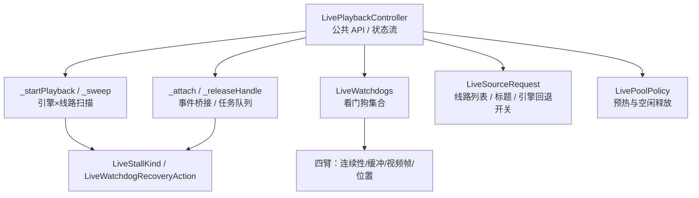
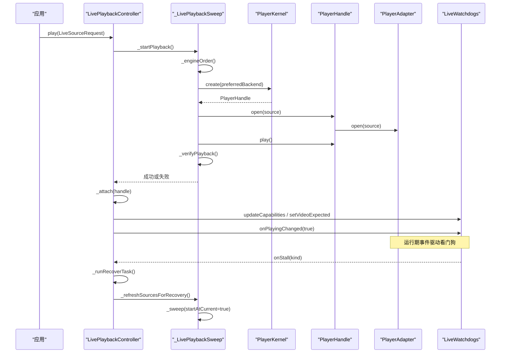
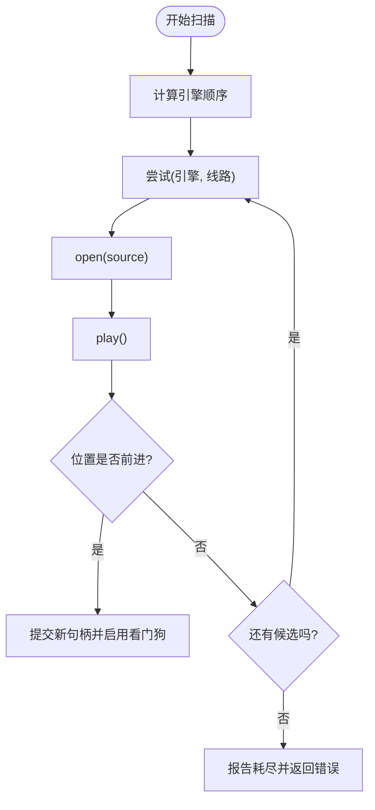
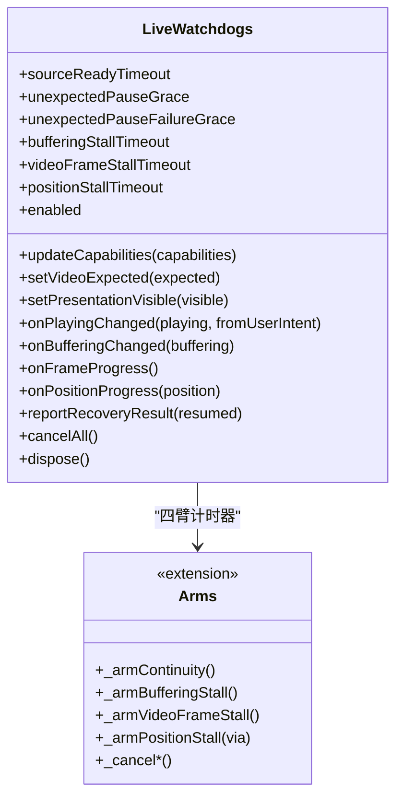
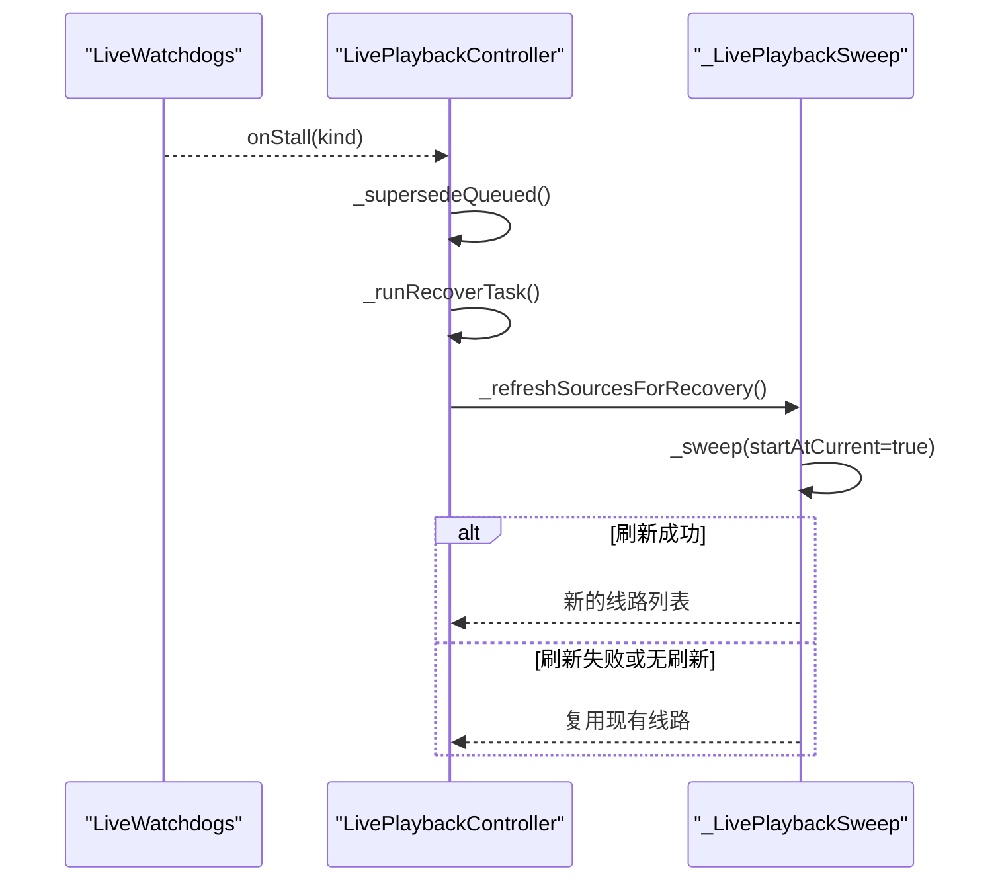
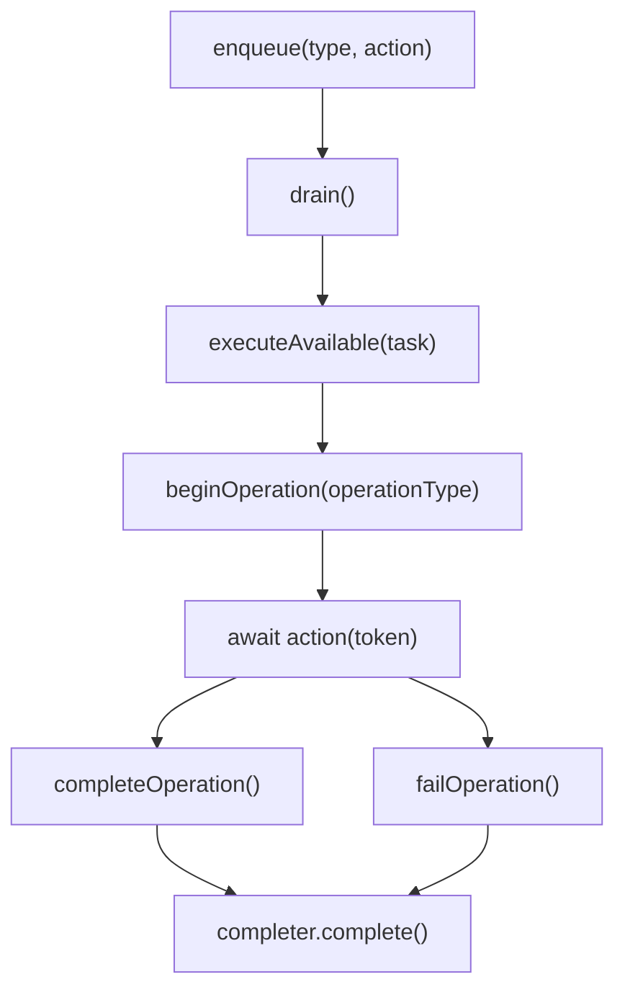
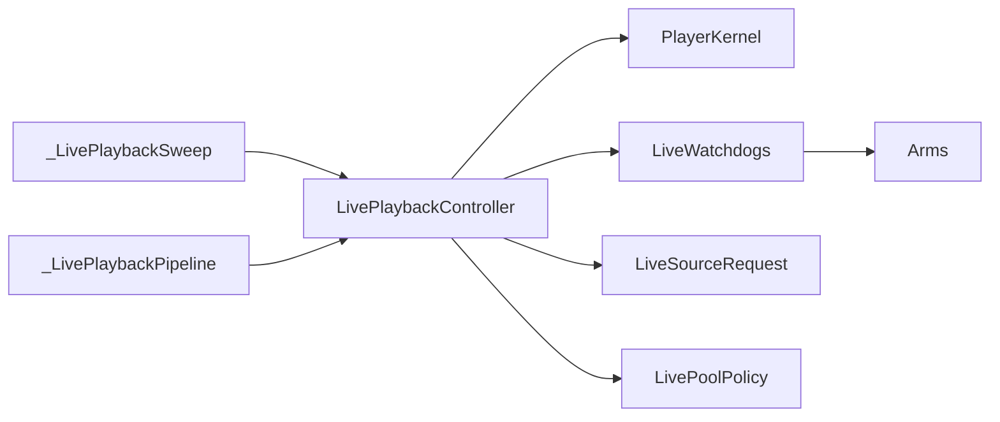

# 直播播放

<cite>
**本文引用的文件**   
- [live_playback_controller.dart](file://packages/media_core_live/lib/src/live_playback_controller.dart)
- [live_playback_sweep.dart](file://packages/media_core_live/lib/src/live_playback_sweep.dart)
- [live_playback_pipeline.dart](file://packages/media_core_live/lib/src/live_playback_pipeline.dart)
- [live_watchdogs.dart](file://packages/media_core_live/lib/src/live_watchdogs.dart)
- [live_watchdog_arms.dart](file://packages/media_core_live/lib/src/live_watchdog_arms.dart)
- [live_playback_models.dart](file://packages/media_core_live/lib/src/live_playback_models.dart)
- [live_source_request.dart](file://packages/media_core_live/lib/src/live_source_request.dart)
- [live_pool_policy.dart](file://packages/media_core_live/lib/src/live_pool_policy.dart)
- [playback.md](file://doc/zh-Hans/playback.md)
- [architecture.md](file://doc/en/architecture.md)
- [README.md](file://README.md)
</cite>

## 目录
1. [简介](#简介)
2. [项目结构](#项目结构)
3. [核心组件](#核心组件)
4. [架构总览](#架构总览)
5. [详细组件分析](#详细组件分析)
6. [依赖关系分析](#依赖关系分析)
7. [性能与资源优化](#性能与资源优化)
8. [故障排查指南](#故障排查指南)
9. [结论](#结论)
10. [附录：API 参考](#附录api-参考)

## 简介
本文件面向“直播播放”能力，围绕 `LivePlaybackController` 的架构、线路扫描、卡顿检测、自动切换与故障恢复进行系统化说明。该模块在 `PlayerKernel` 之上提供直播专属编排：以单任务队列串行化所有用户操作与恢复流程，避免竞态；通过“引擎 × 线路”的扫描策略完成多后端、多线路容错；借助 `LiveWatchdogs` 实现源就绪、缓冲、视频帧与位置等多维卡顿检测，并在需要时触发恢复流程。文档同时覆盖直播源管理、多线路配置、网络状态监控、延迟优化、看门狗阈值与告警机制，以及完整的 API 参考和集成建议。

## 项目结构
直播播放相关代码集中在 `media_core_live` 包中，采用按职责拆分的多文件组织方式：
- 控制器入口与公共 API：`live_playback_controller.dart`
- 扫描与验证逻辑：`live_playback_sweep.dart`
- 管线、事件桥接与任务队列：`live_playback_pipeline.dart`
- 看门狗主类与能力绑定：`live_watchdogs.dart`
- 看门狗四臂（连续性、缓冲、视频帧、位置）：`live_watchdog_arms.dart`
- 数据模型与枚举：`live_playback_models.dart`
- 直播请求封装：`live_source_request.dart`
- 池策略（预热备用播放器）：`live_pool_policy.dart`

**图表来源**
- [live_playback_controller.dart:84-459](file://packages/media_core_live/lib/src/live_playback_controller.dart#L84-L459)
- [live_playback_sweep.dart:10-517](file://packages/media_core_live/lib/src/live_playback_sweep.dart#L10-L517)
- [live_playback_pipeline.dart:1-424](file://packages/media_core_live/lib/src/live_playback_pipeline.dart#L1-L424)
- [live_watchdogs.dart:95-776](file://packages/media_core_live/lib/src/live_watchdogs.dart#L95-L776)
- [live_watchdog_arms.dart:1-295](file://packages/media_core_live/lib/src/live_watchdog_arms.dart#L1-L295)
- [live_playback_models.dart:1-55](file://packages/media_core_live/lib/src/live_playback_models.dart#L1-L55)
- [live_source_request.dart:1-86](file://packages/media_core_live/lib/src/live_source_request.dart#L1-L86)
- [live_pool_policy.dart:1-60](file://packages/media_core_live/lib/src/live_pool_policy.dart#L1-L60)

**章节来源**
- [live_playback_controller.dart:84-459](file://packages/media_core_live/lib/src/live_playback_controller.dart#L84-L459)
- [README.md:55-81](file://README.md#L55-L81)

## 核心组件
- `LivePlaybackController`：直播播放编排器，负责启动播放、线路切换、重试、暂停/恢复、关闭、内存报告、状态流与失败流。所有外部动作都进入单槽任务队列，保证顺序执行与可取消。
- `_LivePlaybackSweep`：扫描与验证扩展，遍历“引擎 × 线路”，对每个候选打开、播放并验证是否真正前进；支持“分阶段提交”的引擎切换以减少黑屏。
- `_LivePlaybackPipeline`：引擎选择、句柄生命周期、适配器事件到恢复任务的桥接、回放状态镜像对齐、任务队列调度。
- `LiveWatchdogs`：看门狗集合，监听播放状态、缓冲、视频帧进度与位置变化，推断卡顿并请求恢复。
- `LiveStallKind` / `LiveWatchdogRecoveryAction`：卡顿类型与恢复动作枚举。
- `LiveSourceRequest`：直播请求封装，包含候选线路、标题、是否允许引擎回退等。
- `LivePoolPolicy`：直播场景下的播放器池策略，控制预热数量与空闲释放时间。

**章节来源**
- [live_playback_controller.dart:84-459](file://packages/media_core_live/lib/src/live_playback_controller.dart#L84-L459)
- [live_playback_sweep.dart:10-517](file://packages/media_core_live/lib/src/live_playback_sweep.dart#L10-L517)
- [live_playback_pipeline.dart:1-424](file://packages/media_core_live/lib/src/live_playback_pipeline.dart#L1-L424)
- [live_watchdogs.dart:95-776](file://packages/media_core_live/lib/src/live_watchdogs.dart#L95-L776)
- [live_playback_models.dart:1-55](file://packages/media_core_live/lib/src/live_playback_models.dart#L1-L55)
- [live_source_request.dart:1-86](file://packages/media_core_live/lib/src/live_source_request.dart#L1-L86)
- [live_pool_policy.dart:1-60](file://packages/media_core_live/lib/src/live_pool_policy.dart#L1-L60)

## 架构总览
直播播放的整体流程如下：
- 应用调用 `play(request)`，控制器构建引擎顺序与线路列表，进入单任务队列。
- 扫描器依次尝试“引擎 × 线路”，对每个候选执行 open → play → verify。
- 若当前引擎的所有线路失败且允许引擎回退，则刷新线路（可选）并切换到下一个引擎继续扫描。
- 扫描成功后，控制器附着句柄、订阅适配器事件、启用看门狗，并对外暴露状态流。
- 运行期间，看门狗根据播放状态、缓冲、视频帧与位置推断卡顿，触发恢复任务；恢复任务优先刷新过期签名 URL，再重新扫描。
- 内核侧恢复梯子在直播模式下被禁用，确保只有一个恢复路径由直播控制器掌控。

**图表来源**
- [live_playback_controller.dart:227-246](file://packages/media_core_live/lib/src/live_playback_controller.dart#L227-L246)
- [live_playback_sweep.dart:10-517](file://packages/media_core_live/lib/src/live_playback_sweep.dart#L10-L517)
- [live_playback_pipeline.dart:65-129](file://packages/media_core_live/lib/src/live_playback_pipeline.dart#L65-L129)
- [live_watchdogs.dart:355-435](file://packages/media_core_live/lib/src/live_watchdogs.dart#L355-L435)

**章节来源**
- [architecture.md:82-125](file://doc/en/architecture.md#L82-L125)
- [README.md:55-81](file://README.md#L55-L81)

## 详细组件分析

### 扫描与验证：引擎 × 线路
- 引擎顺序：优先使用首选后端（如果声明支持），否则按选择器的评分顺序；若首选后端不支持格式，会降级为评分顺序并记录警告。
- 线路顺序：按请求中的候选顺序尝试；当同一引擎的所有线路失败且允许引擎回退时，可调用 `onEngineFallbackSources` 刷新线路（例如重新获取签名 URL）。
- 分阶段提交：新引擎在后台创建、打开、播放并验证，只有验证通过后才提交替换旧句柄，从而缩短切换时的黑屏时间。
- 验证逻辑：等待位置前进，容忍重开导致的时钟重置；超时则判定为“打开成功但未播放”。

**图表来源**
- [live_playback_sweep.dart:10-517](file://packages/media_core_live/lib/src/live_playback_sweep.dart#L10-L517)
- [live_playback_pipeline.dart:14-63](file://packages/media_core_live/lib/src/live_playback_pipeline.dart#L14-L63)

**章节来源**
- [live_playback_sweep.dart:10-517](file://packages/media_core_live/lib/src/live_playback_sweep.dart#L10-L517)
- [live_playback_pipeline.dart:14-63](file://packages/media_core_live/lib/src/live_playback_pipeline.dart#L14-L63)

### 看门狗：卡顿检测算法与阈值
看门狗不直接操作播放器，只观察状态并推断卡顿：
- 源就绪超时：打开后未在时限内进入可播放状态。
- 意外暂停连续性：非用户意图的暂停，先请求恢复播放；若恢复失败或超时，上报相应卡顿。
- 缓冲超时：长时间处于缓冲未结束。
- 视频帧超时：播放中但无解码帧心跳（需适配器声明支持）。
- 位置超时：播放中且不在缓冲，但位置不再前进（兜底检测，适用于所有引擎）。

**图表来源**
- [live_watchdogs.dart:95-776](file://packages/media_core_live/lib/src/live_watchdogs.dart#L95-L776)
- [live_watchdog_arms.dart:1-295](file://packages/media_core_live/lib/src/live_watchdog_arms.dart#L1-L295)

**章节来源**
- [live_watchdogs.dart:95-776](file://packages/media_core_live/lib/src/live_watchdogs.dart#L95-L776)
- [live_watchdog_arms.dart:1-295](file://packages/media_core_live/lib/src/live_watchdog_arms.dart#L1-L295)

### 自动切换与故障恢复
- 恢复触发点：适配器错误、看门狗卡顿、扫描验证失败。
- 恢复流程：先调用 `onRecoverySources` 刷新线路（处理签名 URL 过期），再重新扫描；若无可刷新线路，则从当前线路继续。
- 引擎回退：当当前引擎的所有线路失败且允许回退时，刷新线路并切换到下一个引擎；若不允许回退，直接报告失败。
- 内核恢复禁用：直播模式禁用内核侧恢复梯，确保单一恢复路径由直播控制器掌控。

**图表来源**
- [live_playback_pipeline.dart:135-193](file://packages/media_core_live/lib/src/live_playback_pipeline.dart#L135-L193)
- [live_playback_sweep.dart:175-217](file://packages/media_core_live/lib/src/live_playback_sweep.dart#L175-L217)

**章节来源**
- [live_playback_pipeline.dart:135-193](file://packages/media_core_live/lib/src/live_playback_pipeline.dart#L135-L193)
- [live_playback_sweep.dart:175-217](file://packages/media_core_live/lib/src/live_playback_sweep.dart#L175-L217)

### 任务队列与并发安全
- 单槽任务队列：所有用户操作（play、switchLine、retry、pause、resume、close）与恢复任务统一排队，容量为 1，保证顺序执行。
- 任务取消：新任务会取消之前排队但未执行的任务，避免重复打开或陈旧请求覆盖新请求。
- 操作记录：任务执行前后通过 `beginOperation` / `completeOperation` / `failOperation` 记录操作，便于诊断。

**图表来源**
- [live_playback_pipeline.dart:317-410](file://packages/media_core_live/lib/src/live_playback_pipeline.dart#L317-L410)

**章节来源**
- [live_playback_pipeline.dart:317-410](file://packages/media_core_live/lib/src/live_playback_pipeline.dart#L317-L410)

### 直播源管理与多线路配置
- `LiveSourceRequest`：封装候选线路、标题、是否允许引擎回退；可从 URL 列表快速构造，但更推荐显式构造 `PlayerSource` 以准确声明协议与格式。
- 线路优先级：`sources.first` 作为主线路；切换线路时更新 `_sourceIndex` 与 `_sweepStart`，使下一次扫描从目标线路开始。
- 引擎回退：可通过 `allowEngineFallback` 控制是否允许在全部线路失败后切换到其他引擎。

**章节来源**
- [live_source_request.dart:1-86](file://packages/media_core_live/lib/src/live_source_request.dart#L1-L86)
- [live_playback_controller.dart:248-276](file://packages/media_core_live/lib/src/live_playback_controller.dart#L248-L276)

### 网络状态监控与延迟优化
- 网络异常：适配器错误事件会被捕获并触发恢复任务；扫描期间记录的适配器错误会立即中断验证循环，避免误判为位置冻结。
- 延迟优化：
  - 分阶段提交引擎切换，减少黑屏时间。
  - 使用池策略预热备用播放器，降低线路切换冷启动开销。
  - 合理设置看门狗阈值，避免过早恢复导致频繁重连。

**章节来源**
- [live_playback_pipeline.dart:238-306](file://packages/media_core_live/lib/src/live_playback_pipeline.dart#L238-L306)
- [live_pool_policy.dart:1-60](file://packages/media_core_live/lib/src/live_pool_policy.dart#L1-L60)

## 依赖关系分析
- `LivePlaybackController` 依赖 `PlayerKernel` 创建与释放播放器句柄，并通过 `selector` 与 `registry` 决定引擎顺序。
- `LiveWatchdogs` 依赖 `PlayerAdapterCapabilities` 快照，仅读取所需字段，不持有 `PlayerHandle`。
- 扫描与管线通过 `part of` 共享控制器内部状态，保持低耦合高内聚。
- 模型与请求类型独立于具体引擎，便于扩展与测试。

**图表来源**
- [live_playback_controller.dart:84-459](file://packages/media_core_live/lib/src/live_playback_controller.dart#L84-L459)
- [live_playback_sweep.dart:10-517](file://packages/media_core_live/lib/src/live_playback_sweep.dart#L10-L517)
- [live_playback_pipeline.dart:1-424](file://packages/media_core_live/lib/src/live_playback_pipeline.dart#L1-L424)
- [live_watchdogs.dart:95-776](file://packages/media_core_live/lib/src/live_watchdogs.dart#L95-L776)

**章节来源**
- [live_playback_controller.dart:84-459](file://packages/media_core_live/lib/src/live_playback_controller.dart#L84-L459)
- [live_playback_sweep.dart:10-517](file://packages/media_core_live/lib/src/live_playback_sweep.dart#L10-L517)
- [live_playback_pipeline.dart:1-424](file://packages/media_core_live/lib/src/live_playback_pipeline.dart#L1-L424)
- [live_watchdogs.dart:95-776](file://packages/media_core_live/lib/src/live_watchdogs.dart#L95-L776)

## 性能与资源优化
- 内存管理：控制器在扫描期间报告候选线路与引擎数量，供内存账户统计；销毁时释放句柄、取消订阅、回收看门狗与任务队列。
- 电池优化：
  - 音频-only 模式禁用视频帧看门狗，避免无意义的心跳检测。
  - 隐藏视频展示面时禁用视频帧看门狗，减少后台耗电。
  - 池策略将空闲备用播放器快速释放，避免长期占用带宽与 CPU。
- 延迟优化：
  - 合理设置 `sourceReadyTimeout`、`bufferingStallTimeout`、`videoFrameStallTimeout`、`positionStallTimeout`，平衡灵敏度与稳定性。
  - 使用 `LivePoolPolicy` 预热少量备用播放器，缩短线路切换冷启动时间。

**章节来源**
- [live_playback_controller.dart:146-155](file://packages/media_core_live/lib/src/live_playback_controller.dart#L146-L155)
- [live_watchdogs.dart:537-585](file://packages/media_core_live/lib/src/live_watchdogs.dart#L537-L585)
- [live_pool_policy.dart:15-50](file://packages/media_core_live/lib/src/live_pool_policy.dart#L15-L50)

## 故障排查指南
- 常见卡顿类型与含义：
  - `sourceReadyTimeout`：打开成功但未在时限内进入可播放状态。
  - `bufferingStallTimeout`：长时间缓冲未结束。
  - `videoFrameStallTimeout`：播放中但无解码帧心跳（需适配器支持）。
  - `positionStallTimeout`：播放中且不在缓冲，但位置不再前进（兜底检测）。
  - `unexpectedPauseResumeFailed` / `unexpectedPauseTimeout`：意外暂停恢复失败或超时。
- 排查步骤：
  1. 检查适配器错误日志，确认是否为网络或解码问题。
  2. 查看看门狗日志，确认哪一臂触发恢复。
  3. 检查 `onRecoverySources` 是否返回了新的签名 URL。
  4. 调整看门狗阈值，避免过于敏感导致频繁恢复。
  5. 确认池策略是否启用了预热，减少切换冷启动。

**章节来源**
- [live_playback_models.dart:16-46](file://packages/media_core_live/lib/src/live_playback_models.dart#L16-L46)
- [live_watchdogs.dart:355-435](file://packages/media_core_live/lib/src/live_watchdogs.dart#L355-L435)
- [live_playback_pipeline.dart:238-306](file://packages/media_core_live/lib/src/live_playback_pipeline.dart#L238-L306)

## 结论
`LivePlaybackController` 通过单任务队列、引擎×线路扫描、分阶段提交与多维看门狗检测，构建了稳定、可恢复的直播播放体验。其设计强调“恢复即函数”：恢复行为由调用方声明，控制器仅编排与执行，确保单一恢复路径与可观测性。结合池策略与内存报告，可在复杂网络环境下提供低延迟、高可用的直播播放能力。

## 附录：API 参考

### 初始化与配置
- `LivePlaybackController(kernel, watchdogs?, onEngineFallbackSources?, onRecoverySources?)`
  - `kernel`：播放器内核。
  - `watchdogs`：自定义看门狗实例，可配置阈值。
  - `onEngineFallbackSources`：引擎回退前刷新线路。
  - `onRecoverySources`：恢复前刷新线路（处理签名 URL 过期）。

**章节来源**
- [live_playback_controller.dart:84-107](file://packages/media_core_live/lib/src/live_playback_controller.dart#L84-L107)

### 播放控制
- `play(request, preferredBackend?)`：开始播放，可选择首选引擎。
- `switchLine(index)`：切换到指定线路。
- `retry()`：从头重试当前线路。
- `pause()` / `resume()` / `togglePlayPause()`：暂停、恢复、切换。
- `setVolume(volume)` / `setMute(muted)`：音量与静音。
- `setLoop(loop)`：循环播放。
- `setAudioOnly(audioOnly)`：仅音频模式。
- `setPresentationVisible(visible)`：标记视频展示面可见性。
- `noteBackgrounded()`：标记应用后台，避免看门狗误判。
- `close()` / `dispose()`：停止播放与释放资源。

**章节来源**
- [live_playback_controller.dart:227-419](file://packages/media_core_live/lib/src/live_playback_controller.dart#L227-L419)

### 状态与事件
- `onStateChanged`：播放状态流。
- `onHandleChanged`：句柄变更流（引擎切换时通知 UI 重建）。
- `onError`：终端失败流（扫描耗尽后触发）。
- `handle` / `backendId` / `playerId` / `sessionSnapshot`：当前句柄与元信息。
- `sources` / `sourceIndex` / `audioOnly`：线路与模式信息。

**章节来源**
- [live_playback_controller.dart:180-218](file://packages/media_core_live/lib/src/live_playback_controller.dart#L180-L218)

### 直播请求
- `LiveSourceRequest(sources, title?, allowEngineFallback?)`
- `LiveSourceRequest.fromUrls(urls, headers?, title?, allowEngineFallback?)`

**章节来源**
- [live_source_request.dart:26-86](file://packages/media_core_live/lib/src/live_source_request.dart#L26-L86)

### 看门狗配置
- `sourceReadyTimeout`：源就绪超时。
- `unexpectedPauseGrace`：意外暂停宽限。
- `unexpectedPauseFailureGrace`：恢复失败宽限。
- `bufferingStallTimeout`：缓冲超时。
- `videoFrameStallTimeout`：视频帧超时。
- `positionStallTimeout`：位置超时。
- `enabled`：总开关。

**章节来源**
- [live_watchdogs.dart:95-155](file://packages/media_core_live/lib/src/live_watchdogs.dart#L95-L155)

### 池策略
- `LivePoolPolicy(warmStandbyEnabled, warmStandbyCount, releaseIdleAfter)`
- `toPoolConfig()`：映射到 `PlayerPoolConfig`。

**章节来源**
- [live_pool_policy.dart:15-50](file://packages/media_core_live/lib/src/live_pool_policy.dart#L15-L50)