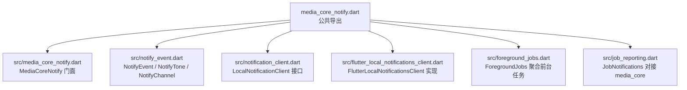
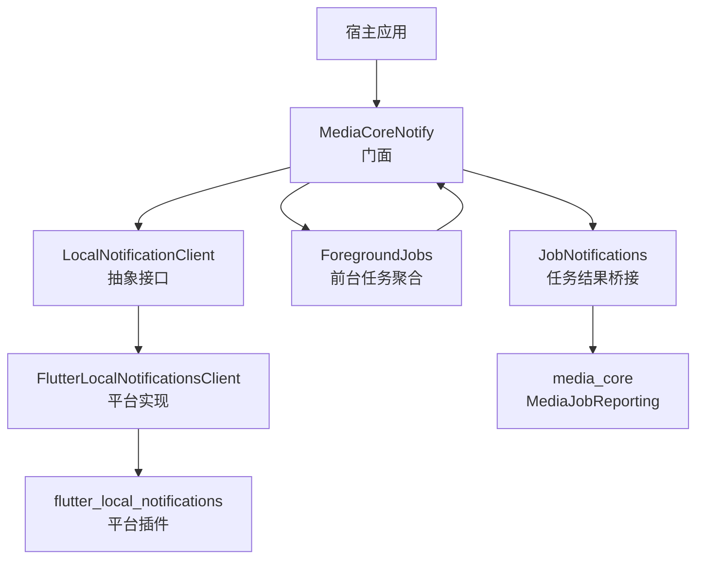
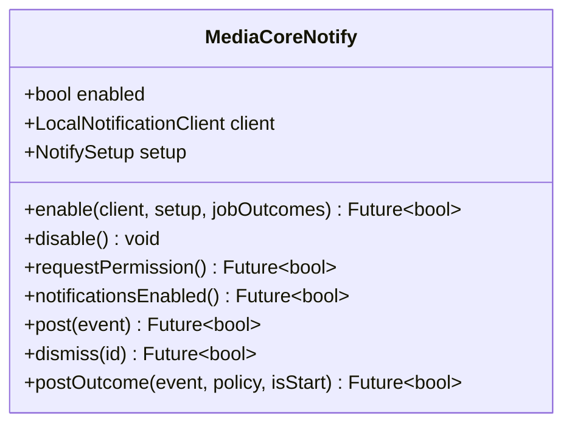
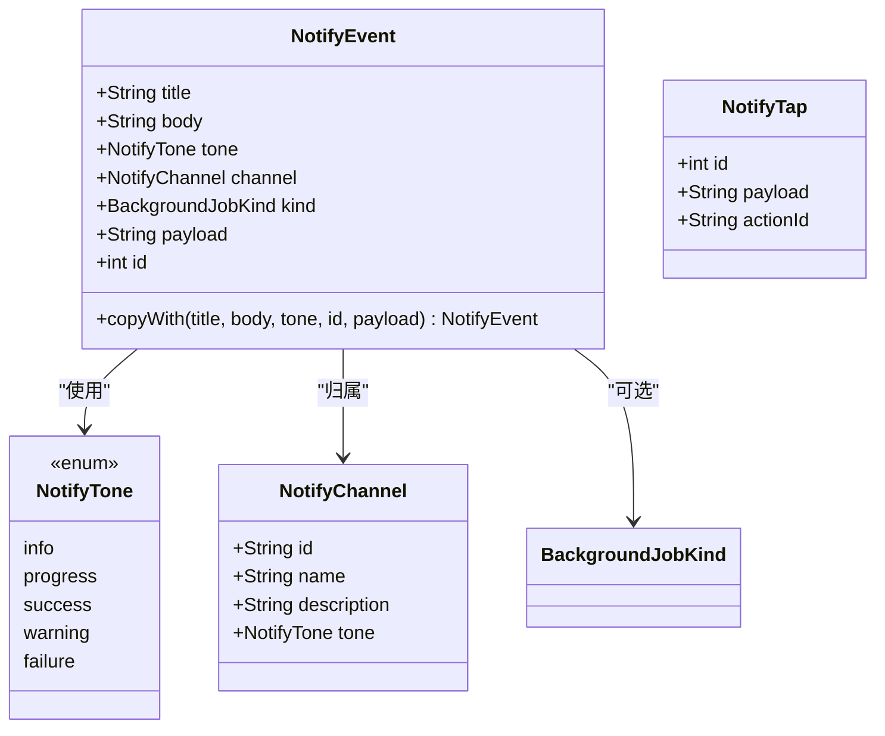
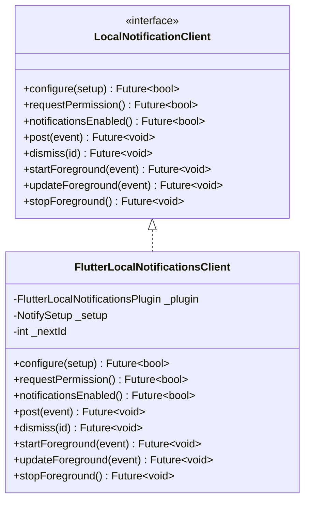
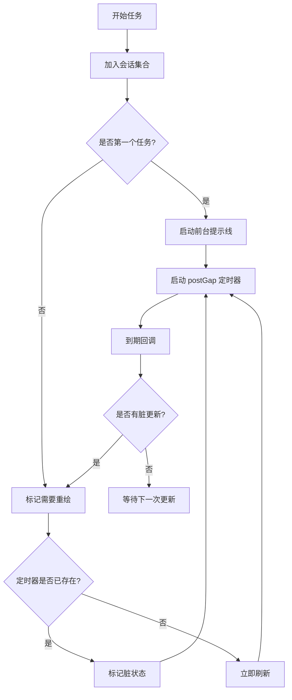
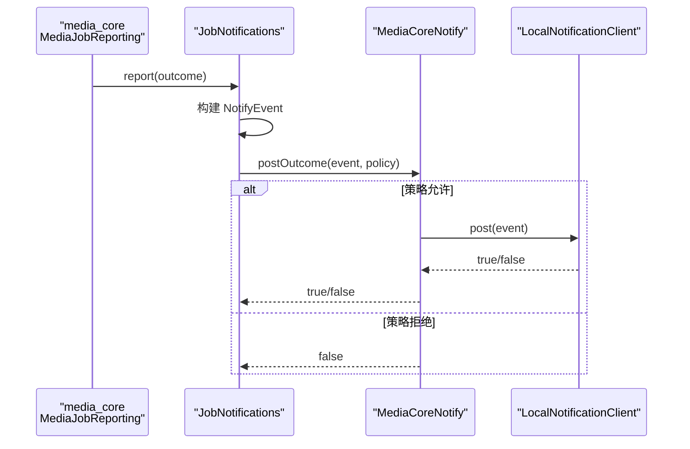
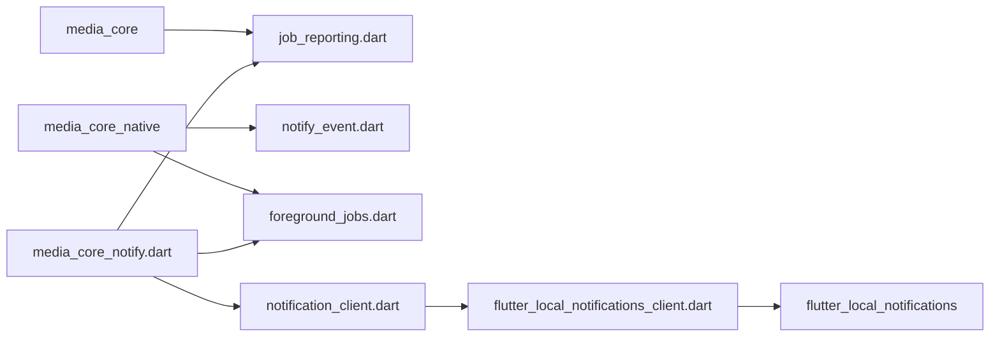

# 通知系统

<cite>
**本文引用的文件**   
- [packages/media_core_notify/lib/media_core_notify.dart](file://packages/media_core_notify/lib/media_core_notify.dart)
- [packages/media_core_notify/lib/src/media_core_notify.dart](file://packages/media_core_notify/lib/src/media_core_notify.dart)
- [packages/media_core_notify/lib/src/notify_event.dart](file://packages/media_core_notify/lib/src/notify_event.dart)
- [packages/media_core_notify/lib/src/notification_client.dart](file://packages/media_core_notify/lib/src/notification_client.dart)
- [packages/media_core_notify/lib/src/flutter_local_notifications_client.dart](file://packages/media_core_notify/lib/src/flutter_local_notifications_client.dart)
- [packages/media_core_notify/lib/src/foreground_jobs.dart](file://packages/media_core_notify/lib/src/foreground_jobs.dart)
- [packages/media_core_notify/lib/src/job_reporting.dart](file://packages/media_core_notify/lib/src/job_reporting.dart)
- [packages/media_core_notify/README.md](file://packages/media_core_notify/README.md)
- [packages/media_core_notify/pubspec.yaml](file://packages/media_core_notify/pubspec.yaml)
- [README.md](file://README.md)
</cite>

## 目录
1. [简介](#简介)
2. [项目结构](#项目结构)
3. [核心组件](#核心组件)
4. [架构总览](#架构总览)
5. [详细组件分析](#详细组件分析)
6. [依赖关系分析](#依赖关系分析)
7. [性能与行为特性](#性能与行为特性)
8. [故障排查指南](#故障排查指南)
9. [结论](#结论)

## 简介
`media_core_notify` 是 `media_core` 生态中的“用户可见通知”能力包。它负责两件事：
- 把下载、录制等后台任务的结果以通知形式呈现给用户；
- 为多个同时运行的任务维护一条共享的“进行中”提示线，避免多条重复通知刷屏。

该包明确不拥有媒体播放控制面（由 `media_core_mediasession` 负责），也不拥有进程保活能力（由 `media_core_native` 负责）。它的职责边界是“信息展示”，因此所有对外调用都设计为“不会让通知失败影响业务任务”。

**章节来源**
- [packages/media_core_notify/README.md:1-36](file://packages/media_core_notify/README.md#L1-L36)
- [packages/media_core_notify/lib/media_core_notify.dart:1-36](file://packages/media_core_notify/lib/media_core_notify.dart#L1-L36)

## 项目结构
该包采用“入口导出 + 内部模块”的组织方式：顶层 `media_core_notify.dart` 只负责暴露公共 API，具体实现放在 `lib/src` 下。

**图表来源**
- [packages/media_core_notify/lib/media_core_notify.dart:65-72](file://packages/media_core_notify/lib/media_core_notify.dart#L65-L72)
- [packages/media_core_notify/lib/src/media_core_notify.dart:31-77](file://packages/media_core_notify/lib/src/media_core_notify.dart#L31-L77)
- [packages/media_core_notify/lib/src/notify_event.dart:13-80](file://packages/media_core_notify/lib/src/notify_event.dart#L13-L80)
- [packages/media_core_notify/lib/src/notification_client.dart:59-93](file://packages/media_core_notify/lib/src/notification_client.dart#L59-L93)
- [packages/media_core_notify/lib/src/flutter_local_notifications_client.dart:17-25](file://packages/media_core_notify/lib/src/flutter_local_notifications_client.dart#L17-L25)
- [packages/media_core_notify/lib/src/foreground_jobs.dart:70-126](file://packages/media_core_notify/lib/src/foreground_jobs.dart#L70-L126)
- [packages/media_core_notify/lib/src/job_reporting.dart:15-25](file://packages/media_core_notify/lib/src/job_reporting.dart#L15-L25)

**章节来源**
- [packages/media_core_notify/lib/media_core_notify.dart:1-73](file://packages/media_core_notify/lib/media_core_notify.dart#L1-L73)
- [packages/media_core_notify/README.md:79-83](file://packages/media_core_notify/README.md#L79-L83)

## 核心组件
| 组件 | 职责 | 关键行为 |
|---|---|---|
| `MediaCoreNotify` | 宿主入口，负责启用通知、权限询问、发送事件、策略过滤 | 未启用时调用不抛错；返回布尔表示是否到达客户端 |
| `NotifyEvent` | 通知数据模型 | 包含标题、正文、语气、渠道、任务类型、点击载荷和 ID |
| `NotifyTone` | 通知语气枚举 | info / progress / success / warning / failure |
| `NotifyChannel` | Android 渠道或跨平台分组语义 | 默认提供“进行中”和“结果”两个渠道 |
| `NotifySetup` | 初始化配置 | 渠道列表、Android 小图标、前台服务类型、点击回调 |
| `LocalNotificationClient` | 通知机制抽象接口 | 定义 configure / post / startForeground / stopForeground 等契约 |
| `FlutterLocalNotificationsClient` | 基于 `flutter_local_notifications` 的实现 | 处理平台差异、语气映射、Android 前台服务、iOS/macOS 横幅控制 |
| `ForegroundJobs` | 多任务聚合的前台提示线 | 合并多条任务，最多每秒重发一次，最后释放才停止 |
| `JobNotifications` | 将 `media_core` 的任务结果转为通知 | 通过 `MediaJobReporting` 插槽接入，无需下载/录制包直接依赖通知插件 |

**章节来源**
- [packages/media_core_notify/lib/src/media_core_notify.dart:15-177](file://packages/media_core_notify/lib/src/media_core_notify.dart#L15-L177)
- [packages/media_core_notify/lib/src/notify_event.dart:13-162](file://packages/media_core_notify/lib/src/notify_event.dart#L13-L162)
- [packages/media_core_notify/lib/src/notification_client.dart:24-93](file://packages/media_core_notify/lib/src/notification_client.dart#L24-L93)
- [packages/media_core_notify/lib/src/flutter_local_notifications_client.dart:17-285](file://packages/media_core_notify/lib/src/flutter_local_notifications_client.dart#L17-L285)
- [packages/media_core_notify/lib/src/foreground_jobs.dart:24-152](file://packages/media_core_notify/lib/src/foreground_jobs.dart#L24-L152)
- [packages/media_core_notify/lib/src/job_reporting.dart:15-90](file://packages/media_core_notify/lib/src/job_reporting.dart#L15-L90)

## 架构总览
通知系统围绕“门面 + 抽象客户端 + 平台实现 + 前台任务聚合 + 任务结果桥接”展开。

**图表来源**
- [packages/media_core_notify/lib/src/media_core_notify.dart:31-77](file://packages/media_core_notify/lib/src/media_core_notify.dart#L31-L77)
- [packages/media_core_notify/lib/src/notification_client.dart:59-93](file://packages/media_core_notify/lib/src/notification_client.dart#L59-L93)
- [packages/media_core_notify/lib/src/flutter_local_notifications_client.dart:17-25](file://packages/media_core_notify/lib/src/flutter_local_notifications_client.dart#L17-L25)
- [packages/media_core_notify/lib/src/foreground_jobs.dart:70-126](file://packages/media_core_notify/lib/src/foreground_jobs.dart#L70-L126)
- [packages/media_core_notify/lib/src/job_reporting.dart:1-7](file://packages/media_core_notify/lib/src/job_reporting.dart#L1-L7)

## 详细组件分析

### 门面：`MediaCoreNotify`
`MediaCoreNotify` 是宿主唯一需要调用的静态入口。它封装了：
- 启用通知并安装任务结果报告器；
- 请求通知权限；
- 查询当前是否允许通知；
- 发布单个通知；
- 按 `NotifyOn` 策略决定是否发布任务开始或结束事件；
- 对底层异常做吞掉式包装，保证“通知失败不影响业务”。

**图表来源**
- [packages/media_core_notify/lib/src/media_core_notify.dart:31-177](file://packages/media_core_notify/lib/src/media_core_notify.dart#L31-L177)

关键行为说明：
- `enable` 会设置 `NotifySetup`、选择或替换 `LocalNotificationClient`，并安装 `JobNotifications`。
- `postOutcome` 根据 `NotifyOn.nothing` / `results` / `startsAndResults` 决定是否投递。
- `_run` 和 `_ask` 捕获异常并返回 `false`，体现“通知不可失败”的设计原则。

**章节来源**
- [packages/media_core_notify/lib/src/media_core_notify.dart:31-177](file://packages/media_core_notify/lib/src/media_core_notify.dart#L31-L177)

### 通知词汇与渠道：`NotifyEvent`、`NotifyTone`、`NotifyChannel`
这一层保持平台无关，使测试可以断言“失败比成功更响”，也让宿主能替换通知后端。

**图表来源**
- [packages/media_core_notify/lib/src/notify_event.dart:13-162](file://packages/media_core_notify/lib/src/notify_event.dart#L13-L162)

要点：
- 默认提供两个渠道：`kNotifyChannelJobs`（进行中）和 `kNotifyChannelResults`（结果）。
- `NotifyEvent.id` 用于“同 ID 替换通知”，从而进度条可原地变为完成结果。
- `NotifyTap` 承载点击回调中的通知身份与载荷。

**章节来源**
- [packages/media_core_notify/lib/src/notify_event.dart:13-162](file://packages/media_core_notify/lib/src/notify_event.dart#L13-L162)

### 通知客户端抽象与默认实现
`LocalNotificationClient` 是通知机制的抽象边界。上层逻辑不直接依赖 `flutter_local_notifications`，而是依赖这个接口。

**图表来源**
- [packages/media_core_notify/lib/src/notification_client.dart:59-93](file://packages/media_core_notify/lib/src/notification_client.dart#L59-L93)
- [packages/media_core_notify/lib/src/flutter_local_notifications_client.dart:17-285](file://packages/media_core_notify/lib/src/flutter_local_notifications_client.dart#L17-L285)

平台差异处理集中在 `FlutterLocalNotificationsClient`：
- Android：创建通知渠道、前台服务、小图标、声音与静默控制。
- iOS/macOS：控制横幅、声音、徽章、列表显示与中断级别。
- Web：直接返回不支持。
- Linux/Windows：无显式权限问题时，退化为能力探测。

**章节来源**
- [packages/media_core_notify/lib/src/notification_client.dart:59-93](file://packages/media_core_notify/lib/src/notification_client.dart#L59-L93)
- [packages/media_core_notify/lib/src/flutter_local_notifications_client.dart:31-191](file://packages/media_core_notify/lib/src/flutter_local_notifications_client.dart#L31-L191)

### 前台任务聚合：`ForegroundJobs`
`ForegroundJobs` 的核心目标是：**多个后台任务共享一条通知线**。

**图表来源**
- [packages/media_core_notify/lib/src/foreground_jobs.dart:107-257](file://packages/media_core_notify/lib/src/foreground_jobs.dart#L107-L257)

关键规则：
- 第一条任务启动平台级前台提示；后续任务只更新文本。
- 最多每 `postGap`（1 秒）重发一次，避免频繁刷新导致状态栏动画抖动。
- 最后一个任务释放后，才真正停止前台提示线。
- 提供 `resetForTest` 供测试重置内部状态。

**章节来源**
- [packages/media_core_notify/lib/src/foreground_jobs.dart:24-290](file://packages/media_core_notify/lib/src/foreground_jobs.dart#L24-L290)

### 任务结果桥接：`JobNotifications`
`JobNotifications` 把 `media_core` 的 `MediaJobOutcome` 转换为 `NotifyEvent`，并通过 `MediaJobReporting` 插槽接入。

**图表来源**
- [packages/media_core_notify/lib/src/job_reporting.dart:40-65](file://packages/media_core_notify/lib/src/job_reporting.dart#L40-L65)
- [packages/media_core_notify/lib/src/media_core_notify.dart:139-156](file://packages/media_core_notify/lib/src/media_core_notify.dart#L139-L156)

行为要点：
- 下载成功 → “下载完成”，失败 → “下载失败”。
- 录制成功 → “录制完成”，失败 → “录制中断”。
- 自动拼接耗时、大小和错误信息。
- 通过 `unawaited` 确保结果上报不会阻塞任务完成流程。

**章节来源**
- [packages/media_core_notify/lib/src/job_reporting.dart:1-90](file://packages/media_core_notify/lib/src/job_reporting.dart#L1-L90)

## 依赖关系分析
该包的依赖方向清晰：业务模块通过策略值 `NotifyOn` 和回调间接依赖通知能力，而不是直接耦合通知插件。

**图表来源**
- [packages/media_core_notify/lib/src/job_reporting.dart:1-7](file://packages/media_core_notify/lib/src/job_reporting.dart#L1-L7)
- [packages/media_core_notify/lib/src/notify_event.dart:10-11](file://packages/media_core_notify/lib/src/notify_event.dart#L10-L11)
- [packages/media_core_notify/lib/src/foreground_jobs.dart:18-22](file://packages/media_core_notify/lib/src/foreground_jobs.dart#L18-L22)
- [packages/media_core_notify/lib/src/flutter_local_notifications_client.dart:9-14](file://packages/media_core_notify/lib/src/flutter_local_notifications_client.dart#L9-L14)

外部依赖约束来自 `pubspec.yaml`：
- `flutter_local_notifications ^22.3.2`，要求 Dart `>=3.10.0`、Flutter `>=3.38.1`。
- `media_core ^0.1.0`，用于任务结果槽位。
- `media_core_native ^0.2.0`，用于任务词汇和 Android 小图标资源名。

**章节来源**
- [packages/media_core_notify/pubspec.yaml:1-46](file://packages/media_core_notify/pubspec.yaml#L1-L46)

## 性能与行为特性
- **通知不可失败**：门面层捕获异常并返回 `false`，避免通知问题污染业务结果。
- **前台任务节流**：`ForegroundJobs.postGap = Duration(seconds: 1)`，同一窗口内多次更新合并为一次重发。
- **ID 复用替代堆叠**：进度和结果使用相同通知 ID，避免产生多条重复通知。
- **平台差异化最小化**：平台差异集中在 `FlutterLocalNotificationsClient`，其他模块只关心 `NotifyEvent` 和 `LocalNotificationClient`。
- **Web 降级**：Web 平台返回不支持，但不抛出异常。

这些特性在 README 中也有明确说明：测试覆盖前台规则，包括“一个开始对应多个任务、最新文本加计数、每秒最多重发一次、最后一个释放才停止、已释放任务不能复活提示线”。

**章节来源**
- [packages/media_core_notify/lib/src/media_core_notify.dart:158-176](file://packages/media_core_notify/lib/src/media_core_notify.dart#L158-L176)
- [packages/media_core_notify/lib/src/foreground_jobs.dart:71-80](file://packages/media_core_notify/lib/src/foreground_jobs.dart#L71-L80)
- [packages/media_core_notify/lib/src/foreground_jobs.dart:190-257](file://packages/media_core_notify/lib/src/foreground_jobs.dart#L190-L257)
- [packages/media_core_notify/README.md:108-130](file://packages/media_core_notify/README.md#L108-L130)

## 故障排查指南
| 现象 | 可能原因 | 排查建议 |
|---|---|---|
| 通知完全不出现 | 未调用 `MediaCoreNotify.enable()` | 检查应用启动流程是否启用通知 |
| Android 13+ 无通知 | 未请求 `POST_NOTIFICATIONS` 权限 | 调用 `MediaCoreNotify.requestPermission()` |
| 前台提示线不消失 | 任务未调用 `release()` 或 `stopAll()` | 检查任务生命周期，必要时在页面销毁时清理 |
| 通知重复堆叠 | 使用了不同 ID 或未按 ID 替换 | 确认进度与结果使用相同 `NotifyEvent.id` |
| 下载/录制结果未通知 | `NotifyOn.nothing` 或 `MediaJobReporting.reporter` 未安装 | 检查 `enable(jobOutcomes:)` 参数和 `JobNotifications.installed` |
| 点击通知无响应 | 未设置 `onTap` 或未正确传递 `payload` | 检查 `NotifySetup.onTap` 和 `NotifyTap.payload` |
| Android 前台服务崩溃或无法启动 | 未声明插件前台服务或权限不足 | 按 README 添加 `ForegroundService` 声明，并核对 `foregroundServiceTypes` |

**章节来源**
- [packages/media_core_notify/lib/src/media_core_notify.dart:65-96](file://packages/media_core_notify/lib/src/media_core_notify.dart#L65-L96)
- [packages/media_core_notify/lib/src/foreground_jobs.dart:102-141](file://packages/media_core_notify/lib/src/foreground_jobs.dart#L102-L141)
- [packages/media_core_notify/lib/src/flutter_local_notifications_client.dart:80-121](file://packages/media_core_notify/lib/src/flutter_local_notifications_client.dart#L80-L121)
- [packages/media_core_notify/README.md:62-77](file://packages/media_core_notify/README.md#L62-L77)

## 结论
`media_core_notify` 是一个边界清晰的通知能力包：它不替业务完成任务，也不替系统保活，只做“让用户知道发生了什么”这件事。其设计亮点包括：
- 门面层保证通知调用永不破坏业务；
- 抽象客户端隔离平台差异；
- 前台任务聚合减少通知噪音；
- 通过 `MediaJobReporting` 与 `media_core` 解耦集成；
- 用 `NotifyOn` 策略控制通知音量，而非散落的布尔开关。

对于宿主应用来说，最关键的接入点是：
1. 启动时调用 `MediaCoreNotify.enable()`；
2. 需要时调用 `MediaCoreNotify.requestPermission()`；
3. 通过 `ForegroundJobs.start/update/release` 管理运行中的任务；
4. 通过 `MediaCoreNotify.postOutcome` 或 `JobNotifications` 报告任务结果。

**章节来源**
- [packages/media_core_notify/README.md:1-36](file://packages/media_core_notify/README.md#L1-L36)
- [packages/media_core_notify/lib/media_core_notify.dart:1-73](file://packages/media_core_notify/lib/media_core_notify.dart#L1-L73)
- [README.md:105-124](file://README.md#L105-L124)