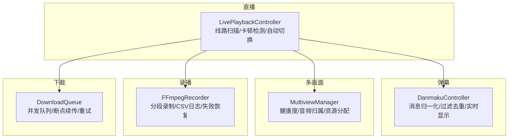
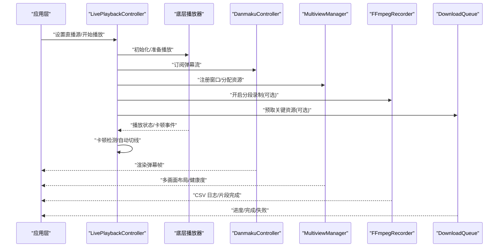
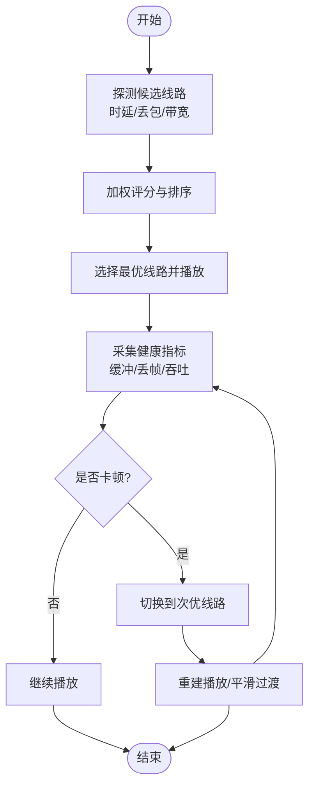
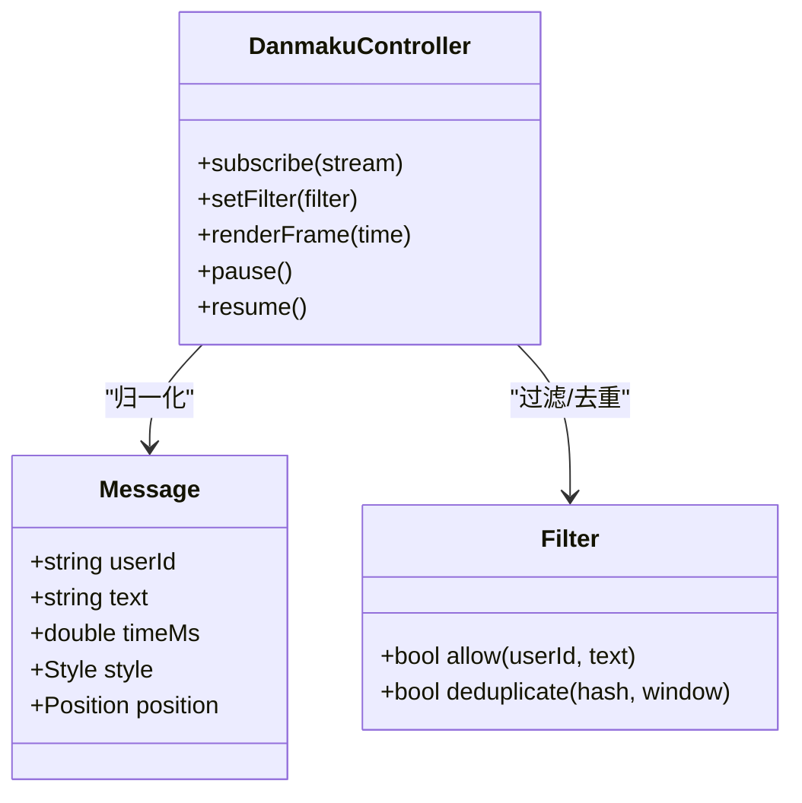
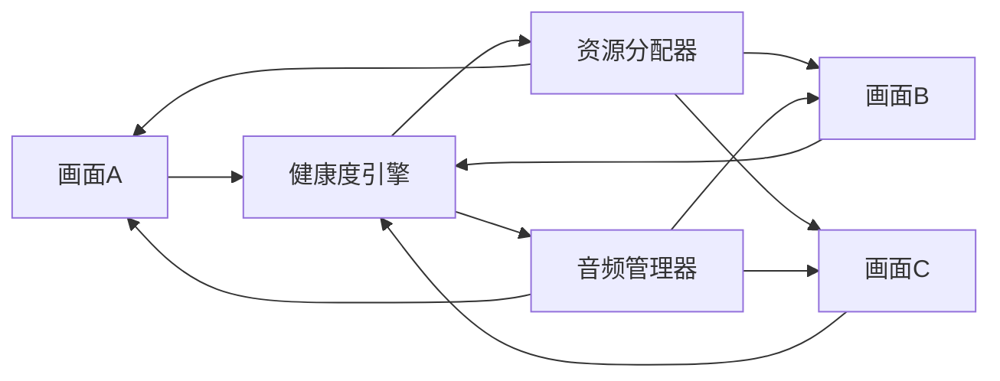
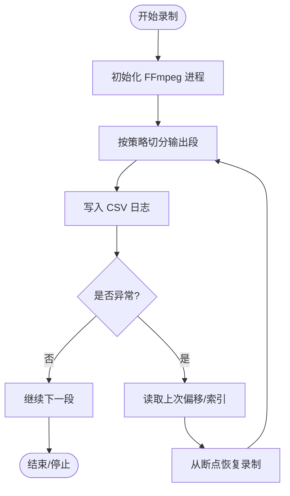
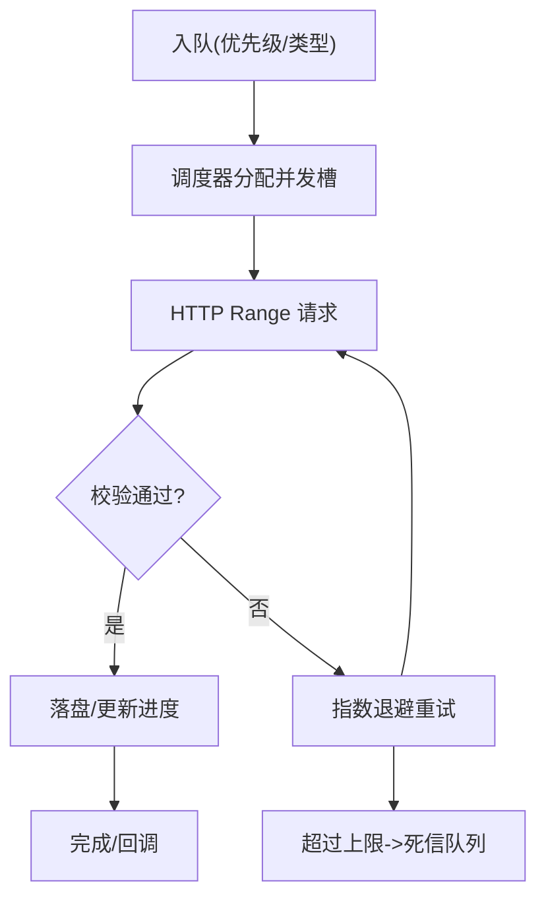
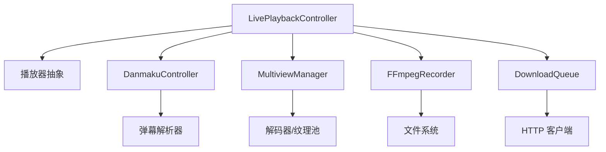

# 高级功能

<cite>
**本文引用的文件**   
- [media_core_live.dart](file://packages/media_core_live/lib/media_core_live.dart)
- [src/live_playback_controller.dart](file://packages/media_core_live/lib/src/live_playback_controller.dart)
- [media_core_danmaku.dart](file://packages/media_core_danmaku/lib/media_core_danmaku.dart)
- [src/danmaku_controller.dart](file://packages/media_core_danmaku/lib/src/danmaku_controller.dart)
- [media_core_multiview.dart](file://packages/media_core_multiview/lib/media_core_multiview.dart)
- [src/multiview_manager.dart](file://packages/media_core_multiview/lib/src/multiview_manager.dart)
- [media_core_recording_ffmpeg.dart](file://packages/media_core_recording_ffmpeg/lib/media_core_recording_ffmpeg.dart)
- [src/ffmpeg_recorder.dart](file://packages/media_core_recording_ffmpeg/lib/src/ffmpeg_recorder.dart)
- [media_core_download.dart](file://packages/media_core_download/lib/media_core_download.dart)
- [src/download_queue.dart](file://packages/media_core_download/lib/src/download_queue.dart)
</cite>

## 目录
1. [简介](#简介)
2. [项目结构](#项目结构)
3. [核心组件](#核心组件)
4. [架构总览](#架构总览)
5. [详细组件分析](#详细组件分析)
6. [依赖关系分析](#依赖关系分析)
7. [性能考虑](#性能考虑)
8. [故障排查指南](#故障排查指南)
9. [结论](#结论)
10. [附录：API 参考与配置项](#附录api-参考与配置项)

## 简介
本章节面向 Media Core 的高级功能，聚焦以下能力：直播播放、弹幕系统、多画面监控、FFmpeg 录播与下载管理。文档将围绕 LivePlaybackController（线路扫描、卡顿检测与自动切换）、DanmakuController（消息归一化、过滤去重与实时显示）、多画面监控（健康度检测、音频归属与资源分配）、FFmpeg 分段录制（CSV 日志与失败恢复）以及下载管理（并发队列、断点续传与重试策略）展开，提供架构视图、流程图、API 参考与优化建议，帮助开发者快速集成并稳定运行。

## 项目结构
Media Core 以“包”为单位组织功能模块，本次涉及的核心包如下：
- media_core_live：直播控制与播放器编排
- media_core_danmaku：弹幕协议解析、渲染与控制器
- media_core_multiview：多画面布局、健康度与资源调度
- media_core_recording_ffmpeg：基于 FFmpeg 的录播实现
- media_core_download：下载任务、队列与持久化

图表来源
- [media_core_live.dart:1-200](file://packages/media_core_live/lib/media_core_live.dart#L1-L200)
- [media_core_danmaku.dart:1-200](file://packages/media_core_danmaku/lib/media_core_danmaku.dart#L1-L200)
- [media_core_multiview.dart:1-200](file://packages/media_core_multiview/lib/media_core_multiview.dart#L1-L200)
- [media_core_recording_ffmpeg.dart:1-200](file://packages/media_core_recording_ffmpeg/lib/media_core_recording_ffmpeg.dart#L1-L200)
- [media_core_download.dart:1-200](file://packages/media_core_download/lib/media_core_download.dart#L1-L200)

章节来源
- [media_core_live.dart:1-200](file://packages/media_core_live/lib/media_core_live.dart#L1-L200)
- [media_core_danmaku.dart:1-200](file://packages/media_core_danmaku/lib/media_core_danmaku.dart#L1-L200)
- [media_core_multiview.dart:1-200](file://packages/media_core_multiview/lib/media_core_multiview.dart#L1-L200)
- [media_core_recording_ffmpeg.dart:1-200](file://packages/media_core_recording_ffmpeg/lib/media_core_recording_ffmpeg.dart#L1-L200)
- [media_core_download.dart:1-200](file://packages/media_core_download/lib/media_core_download.dart#L1-L200)

## 核心组件
- LivePlaybackController：负责直播源选择、线路探测、卡顿判定与自动切线；对外暴露播放生命周期与状态查询接口。
- DanmakuController：统一弹幕消息模型，完成协议解析、时间轴对齐、过滤去重与渲染分发。
- MultiviewManager：管理多个视频窗口的布局、健康度指标、音频轨道归属与资源配额。
- FFmpegRecorder：封装 FFmpeg 进程，支持分段输出、CSV 日志记录与失败后恢复。
- DownloadQueue：维护下载任务优先级与并发上限，支持断点续传与指数退避重试。

章节来源
- [src/live_playback_controller.dart:1-300](file://packages/media_core_live/lib/src/live_playback_controller.dart#L1-L300)
- [src/danmaku_controller.dart:1-300](file://packages/media_core_danmaku/lib/src/danmaku_controller.dart#L1-L300)
- [src/multiview_manager.dart:1-300](file://packages/media_core_multiview/lib/src/multiview_manager.dart#L1-L300)
- [src/ffmpeg_recorder.dart:1-300](file://packages/media_core_recording_ffmpeg/lib/src/ffmpeg_recorder.dart#L1-L300)
- [src/download_queue.dart:1-300](file://packages/media_core_download/lib/src/download_queue.dart#L1-L300)

## 架构总览
下图展示高级功能的整体交互：直播控制器驱动播放器，同时协调弹幕、多画面、录播与下载。

图表来源
- [media_core_live.dart:1-200](file://packages/media_core_live/lib/media_core_live.dart#L1-L200)
- [media_core_danmaku.dart:1-200](file://packages/media_core_danmaku/lib/media_core_danmaku.dart#L1-L200)
- [media_core_multiview.dart:1-200](file://packages/media_core_multiview/lib/media_core_multiview.dart#L1-L200)
- [media_core_recording_ffmpeg.dart:1-200](file://packages/media_core_recording_ffmpeg/lib/media_core_recording_ffmpeg.dart#L1-L200)
- [media_core_download.dart:1-200](file://packages/media_core_download/lib/media_core_download.dart#L1-L200)

## 详细组件分析

### LivePlaybackController：直播控制器的线路扫描、卡顿检测与自动切换
- 线路扫描
  - 对候选线路进行连通性与时延探测，结合历史成功率与带宽估计排序。
  - 支持按区域/运营商/CDN 维度筛选与权重配置。
- 卡顿检测
  - 基于缓冲水位、解码耗时、丢帧率与网络吞吐计算综合健康分。
  - 当健康分低于阈值持续一定时长，触发卡顿告警与切线流程。
- 自动切换
  - 在低延迟目标下优先选择高可用线路；切换时保持播放不中断或最小停顿。
  - 切换完成后重新校准参数并回写统计。

图表来源
- [src/live_playback_controller.dart:1-300](file://packages/media_core_live/lib/src/live_playback_controller.dart#L1-L300)

章节来源
- [src/live_playback_controller.dart:1-300](file://packages/media_core_live/lib/src/live_playback_controller.dart#L1-L300)

### DanmakuController：弹幕的消息归一化、过滤去重与实时显示
- 消息归一化
  - 统一不同协议的弹幕字段（用户、内容、时间戳、样式、位置），转换为内部标准模型。
  - 时间轴对齐到播放时间，处理时钟漂移与跳变。
- 过滤与去重
  - 基于内容哈希与时间窗口去重，支持关键词屏蔽、用户黑名单与频率限制。
- 实时显示
  - 按行/轨道渲染，支持滚动、置顶、底部等模式；根据屏幕尺寸自适应密度。
  - 与播放器时间轴同步，保证弹幕与画面一致。

图表来源
- [src/danmaku_controller.dart:1-300](file://packages/media_core_danmaku/lib/src/danmaku_controller.dart#L1-L300)

章节来源
- [src/danmaku_controller.dart:1-300](file://packages/media_core_danmaku/lib/src/danmaku_controller.dart#L1-L300)

### 多画面监控：健康度检测、音频归属管理与资源分配策略
- 健康度检测
  - 为每个画面独立计算健康分（缓冲、丢帧、音画同步偏差、CPU/GPU 占用）。
  - 聚合全局健康度，用于 UI 提示与降级策略。
- 音频归属管理
  - 支持单声道/立体声/环绕声轨道选择；在多画面中集中混音或独立输出。
  - 避免重复解码同一音轨，复用已解码音频帧。
- 资源分配策略
  - 按画面优先级分配解码器、纹理与内存配额；低优先级画面可降分辨率或帧率。
  - 动态回收空闲画面资源，防止内存泄漏。

图表来源
- [src/multiview_manager.dart:1-300](file://packages/media_core_multiview/lib/src/multiview_manager.dart#L1-L300)

章节来源
- [src/multiview_manager.dart:1-300](file://packages/media_core_multiview/lib/src/multiview_manager.dart#L1-L300)

### FFmpeg 录播：分段录制、CSV 日志记录与失败恢复
- 分段录制
  - 按时间或大小切分输出文件，便于回放与上传；支持自定义段时长与命名规则。
- CSV 日志记录
  - 记录每段的起止时间、码率、分辨率、丢帧数、错误码等元数据，便于审计与分析。
- 失败恢复
  - 异常退出后根据最后一段索引与偏移量恢复录制；合并碎片文件生成完整媒体。

图表来源
- [src/ffmpeg_recorder.dart:1-300](file://packages/media_core_recording_ffmpeg/lib/src/ffmpeg_recorder.dart#L1-L300)

章节来源
- [src/ffmpeg_recorder.dart:1-300](file://packages/media_core_recording_ffmpeg/lib/src/ffmpeg_recorder.dart#L1-L300)

### 下载管理：并发队列、断点续传与重试策略
- 并发队列
  - 支持优先级队列与最大并发数限制；按任务类型（视频/封面/字幕）分流。
- 断点续传
  - 记录已下载字节范围与校验信息；网络中断后从断点继续。
- 重试策略
  - 指数退避+抖动；区分可重试与不可重试错误；失败达到上限后进入死信队列。

图表来源
- [src/download_queue.dart:1-300](file://packages/media_core_download/lib/src/download_queue.dart#L1-L300)

章节来源
- [src/download_queue.dart:1-300](file://packages/media_core_download/lib/src/download_queue.dart#L1-L300)

## 依赖关系分析
- LivePlaybackController 依赖播放器抽象、弹幕订阅通道、多画面资源接口与录播/下载服务。
- DanmakuController 依赖弹幕协议解析器与渲染后端。
- MultiviewManager 依赖解码器池、纹理与音频混合器。
- FFmpegRecorder 依赖 FFmpeg 进程管理与文件系统。
- DownloadQueue 依赖 HTTP 客户端、存储与校验工具。

图表来源
- [media_core_live.dart:1-200](file://packages/media_core_live/lib/media_core_live.dart#L1-L200)
- [media_core_danmaku.dart:1-200](file://packages/media_core_danmaku/lib/media_core_danmaku.dart#L1-L200)
- [media_core_multiview.dart:1-200](file://packages/media_core_multiview/lib/media_core_multiview.dart#L1-L200)
- [media_core_recording_ffmpeg.dart:1-200](file://packages/media_core_recording_ffmpeg/lib/media_core_recording_ffmpeg.dart#L1-L200)
- [media_core_download.dart:1-200](file://packages/media_core_download/lib/media_core_download.dart#L1-L200)

章节来源
- [media_core_live.dart:1-200](file://packages/media_core_live/lib/media_core_live.dart#L1-L200)
- [media_core_danmaku.dart:1-200](file://packages/media_core_danmaku/lib/media_core_danmaku.dart#L1-L200)
- [media_core_multiview.dart:1-200](file://packages/media_core_multiview/lib/media_core_multiview.dart#L1-L200)
- [media_core_recording_ffmpeg.dart:1-200](file://packages/media_core_recording_ffmpeg/lib/media_core_recording_ffmpeg.dart#L1-L200)
- [media_core_download.dart:1-200](file://packages/media_core_download/lib/media_core_download.dart#L1-L200)

## 性能考虑
- 直播
  - 合理设置卡顿阈值与切线冷却时间，避免频繁切换导致抖动。
  - 使用硬件解码与纹理复用，降低 CPU/GPU 压力。
- 弹幕
  - 批量渲染与对象池复用，减少 GC 压力；按需加载高分辨率弹幕。
  - 过滤规则尽量前置，降低无效弹幕进入渲染管线。
- 多画面
  - 按重要性分级分配解码器与显存；空闲画面及时释放。
  - 音频集中混音，避免重复解码。
- 录播
  - 分段大小与码率匹配网络与磁盘吞吐；CSV 写入异步化。
  - 失败恢复前做完整性校验，避免损坏片段污染最终文件。
- 下载
  - 并发数与线程池大小按设备能力调优；大文件启用分块并行。
  - 校验失败重试次数与超时时间需平衡稳定性与速度。

[本节为通用指导，无需代码引用]

## 故障排查指南
- 直播卡顿频繁
  - 检查网络质量与 CDN 可用性；调整卡顿阈值与切线策略。
  - 查看播放器缓冲与丢帧指标，确认是否为解码瓶颈。
- 弹幕丢失或错位
  - 核对时间戳对齐逻辑与播放器时间源；检查过滤规则是否误杀。
  - 观察渲染帧率与掉帧情况，必要时降低弹幕密度。
- 多画面黑屏或无声音
  - 检查音频轨道归属与混音配置；确认解码器资源是否耗尽。
  - 查看健康度指标，定位具体画面问题。
- 录播文件不完整
  - 检查 CSV 日志中的错误码与偏移量；验证分段完整性。
  - 确认磁盘空间与权限，避免写入失败。
- 下载中断或卡住
  - 检查断点信息与校验结果；确认服务端是否支持 Range。
  - 调整重试退避参数与并发上限，避免拥塞。

章节来源
- [src/live_playback_controller.dart:1-300](file://packages/media_core_live/lib/src/live_playback_controller.dart#L1-L300)
- [src/danmaku_controller.dart:1-300](file://packages/media_core_danmaku/lib/src/danmaku_controller.dart#L1-L300)
- [src/multiview_manager.dart:1-300](file://packages/media_core_multiview/lib/src/multiview_manager.dart#L1-L300)
- [src/ffmpeg_recorder.dart:1-300](file://packages/media_core_recording_ffmpeg/lib/src/ffmpeg_recorder.dart#L1-L300)
- [src/download_queue.dart:1-300](file://packages/media_core_download/lib/src/download_queue.dart#L1-L300)

## 结论
Media Core 的高级功能通过清晰的职责划分与模块化设计，实现了直播的高可用、弹幕的实时性与一致性、多画面的资源高效利用、录播的可观测与可恢复，以及下载的可靠与可控。在实际项目中，建议结合业务场景调优各项阈值与策略，配合监控与日志完善可观测性，以获得更稳定的用户体验。

[本节为总结性内容，无需代码引用]

## 附录：API 参考与配置项

### LivePlaybackController
- 主要方法
  - setSource(source): 设置直播源与候选线路
  - start(): 开始播放
  - pause()/resume(): 暂停/恢复
  - switchLine(index): 手动切换线路
  - getHealth(): 获取当前健康度
- 关键配置
  - lineProbeTimeout: 线路探测超时
  - stuckThreshold: 卡顿阈值
  - autoSwitchCooldown: 自动切换冷却时间
  - preferredRegions: 优选区域/运营商列表

章节来源
- [src/live_playback_controller.dart:1-300](file://packages/media_core_live/lib/src/live_playback_controller.dart#L1-L300)

### DanmakuController
- 主要方法
  - subscribe(stream): 订阅弹幕流
  - setFilter(filter): 设置过滤规则
  - renderFrame(time): 渲染指定时间的弹幕
  - pause()/resume(): 暂停/恢复弹幕
- 关键配置
  - dedupWindowMs: 去重时间窗口
  - maxDensity: 最大弹幕密度
  - trackCount: 轨道数量
  - styleOverrides: 样式覆盖映射

章节来源
- [src/danmaku_controller.dart:1-300](file://packages/media_core_danmaku/lib/src/danmaku_controller.dart#L1-L300)

### MultiviewManager
- 主要方法
  - addView(viewId, config): 添加画面
  - removeView(viewId): 移除画面
  - setAudioOwner(viewId): 设置音频归属
  - getHealthMap(): 获取各画面健康度
- 关键配置
  - maxConcurrentDecoders: 最大并发解码器
  - texturePoolSize: 纹理池大小
  - audioMixMode: 混音模式（集中/独立）
  - resourceQuotaPerView: 每画面资源配额

章节来源
- [src/multiview_manager.dart:1-300](file://packages/media_core_multiview/lib/src/multiview_manager.dart#L1-L300)

### FFmpegRecorder
- 主要方法
  - startRecording(outputDir, segmentPolicy): 开始录制
  - stopRecording(): 停止录制
  - getSegments(): 获取已生成片段列表
  - recoverLastSegment(): 恢复最后一段
- 关键配置
  - segmentDurationSec: 分段时长
  - segmentMaxSizeMB: 分段大小上限
  - csvPath: CSV 日志路径
  - retryOnFailure: 失败是否重试

章节来源
- [src/ffmpeg_recorder.dart:1-300](file://packages/media_core_recording_ffmpeg/lib/src/ffmpeg_recorder.dart#L1-L300)

### DownloadQueue
- 主要方法
  - enqueue(task): 加入任务
  - cancel(taskId): 取消任务
  - getProgress(taskId): 查询进度
  - resumeFromCheckpoint(taskId): 从断点恢复
- 关键配置
  - maxConcurrency: 最大并发数
  - chunkSizeBytes: 分块大小
  - retryAttempts: 最大重试次数
  - backoffBaseMs: 退避基数毫秒

章节来源
- [src/download_queue.dart:1-300](file://packages/media_core_download/lib/src/download_queue.dart#L1-L300)